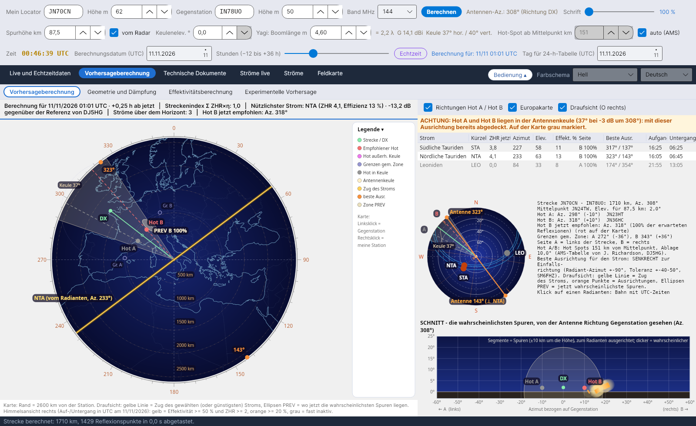
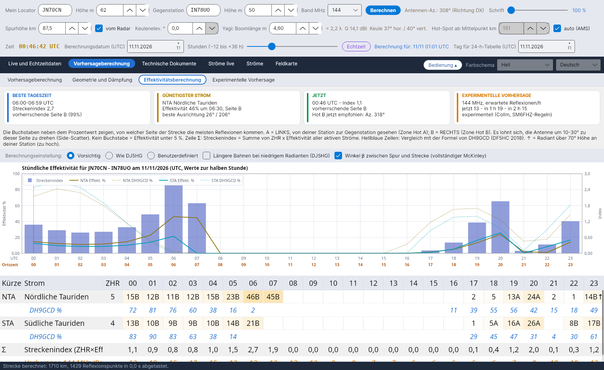
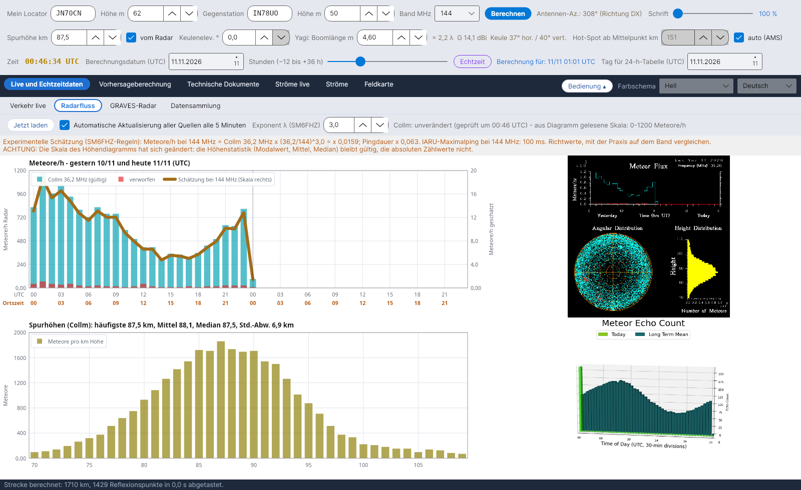

# YA-MS

[Italiano](README.md) · [English](README.en.md) · **Deutsch** · [Français](README.fr.md) · [Español](README.es.md) · [Português](README.pt.md)

**YA-MS** berechnet live und als Vorhersage die Effektivität der Meteorströme für **Meteorscatter**-Verbindungen im Amateurfunk (50–432 MHz): wo die Radianten stehen, welche Hot Spots zu nutzen sind, wann die Strecke am besten geht und wie viel Signal ankommt.
Von Costantino Cerrotta IC8TEM. Kostenlos, für Windows, Linux, Raspberry Pi und Mac. Oberfläche, Wiki und Handbücher in 36 Sprachen.

## Was es kann
- **Vorhersageberechnung**: Himmelsansicht mit den Radianten, Streckenplan mit Hot A / Hot B, Antennenkeule, PREV-Zonen und besten Richtungen; eine Übersichtsleiste mit der Effektivität zum gewählten Zeitpunkt (Datum und Stunden von −12 bis +36 h).
- **Effektivitätsberechnung** Stunde für Stunde für jeden Strom, mit dem Vergleich zur Formel von DH9GCD und den fertigen Einstellungen *Vorsichtig* (Standard) und *Wie DJ5HG*.
- **Geometrie und Streckendämpfung**: Streckendämpfung (McKinley, ITU-R P.843) und Streckenbilanz mit vorsichtigen Werten.
- **Live-Daten**: Fluss der SKiYMET-Meteorradare (Collm, Sodankylä) mit einer Schätzung für 50/144/432 MHz, das GRAVES-Radar, Sammlung der MS-Spots aus DX-Cluster, Reverse Beacon Network und PSKReporter (auch MQTT), Live-Verkehr auf der Karte.
- **Technische Dokumente**: Quellen mit Vergleichen, Rechenhandbuch und Erklärung der Effektivität mit allen Gleichungen.

## Installation
Von der Seite **[Releases](https://github.com/ic8tem/YA-MS/releases/latest)**:
- **Windows**: `...-windows-x64-setup.exe` (32 Bit: `...-windows-x86-setup.exe`, ARM/Snapdragon: `...-windows-arm64-setup.exe`) oder das portable Zip;
- **Linux**: `ya-ms_..._amd64.deb` oder `...-linux-x64.tar.gz`;
- **Fedora, openSUSE**: `ya-ms-....x86_64.rpm` oder `.aarch64.rpm` / `.armv7hl.rpm` (`sudo dnf install` / `sudo zypper install`);
- **Arch, Manjaro, Arch Linux ARM**: `ya-ms-...-x86_64.pkg.tar.zst` / `-aarch64.pkg.tar.zst` (`sudo pacman -U`);
- **Slackware64, Slackware ARM64**: `ya-ms-...-x86_64-1_ic8tem.txz` / `-aarch64-1_ic8tem.txz` (`installpkg`);
- **AppImage**: `YA-MS-...-x86_64.AppImage` / `-aarch64.AppImage`;
- **Alpine Linux** (musl): `YA-MS-...-alpine-x64.tar.gz` / `-alpine-arm64.tar.gz`;
- **Raspberry Pi**: `ya-ms_..._arm64.deb` / `_armhf.deb` oder die tar.gz für 64 und 32 Bit;
- **Linux ARM** (z. B. Slackware ARM64, armv7l-Boards): `...-linux-arm64.tar.gz` oder `...-linux-armv7l.tar.gz`;
- **Mac**: `...-mac-apple-silicon.dmg` oder `...-mac-intel.dmg` (oder das app.zip).

Die Daten bleiben im Ordner `data` neben dem Programm. Vollständige Anleitung im **[Wiki](https://github.com/ic8tem/YA-MS/wiki/Home-de)** und in `LEGGIMI.txt`.

Ab 1.8.0 prüft YA-MS selbst auf GitHub, ob es eine neue Version gibt, und aktualisiert sich mit einem Klick (Schaltfläche **Aktualisierungen** unten), wobei der Ordner `data` erhalten bleibt; fehlen Programmdateien, bietet es an, sie erneut herunterzuladen.

## Hauptquelle
C. Cerrotta IC8TEM, G. Sartori IV3GTH, «METEOR-SCATTER. Ovvero come collegare l'Europa in VHF tutto l'anno senza tante pretese» (Meteorscatter: ganz Europa auf UKW das ganze Jahr ohne großen Aufwand). Die weiteren Quellen stehen im Programm und im Wiki.

## Kompilieren
Die Installationsprogramme erstellt GitHub Actions (`.github/workflows/build.yml`) bei jeder Aktualisierung des Zweigs `release` (Version aus der Datei `VERSION`). Lokal: `dotnet publish YA-MS.csproj -c Release -r <rid> --self-contained true`. Die Dokumente in allen Sprachen werden mit `tools/build_documenti.sh` neu erzeugt.

Die Radardaten gehören ihren Betreibern (Universität Leipzig / IAP Kühlungsborn, Sodankylä Geophysical Observatory).

## Projekt unterstützen
YA-MS ist kostenlos. Wenn es dir nützt, kannst du mir auf **[Ko-fi](https://ko-fi.com/ic8tem)** einen Kaffee spendieren.
