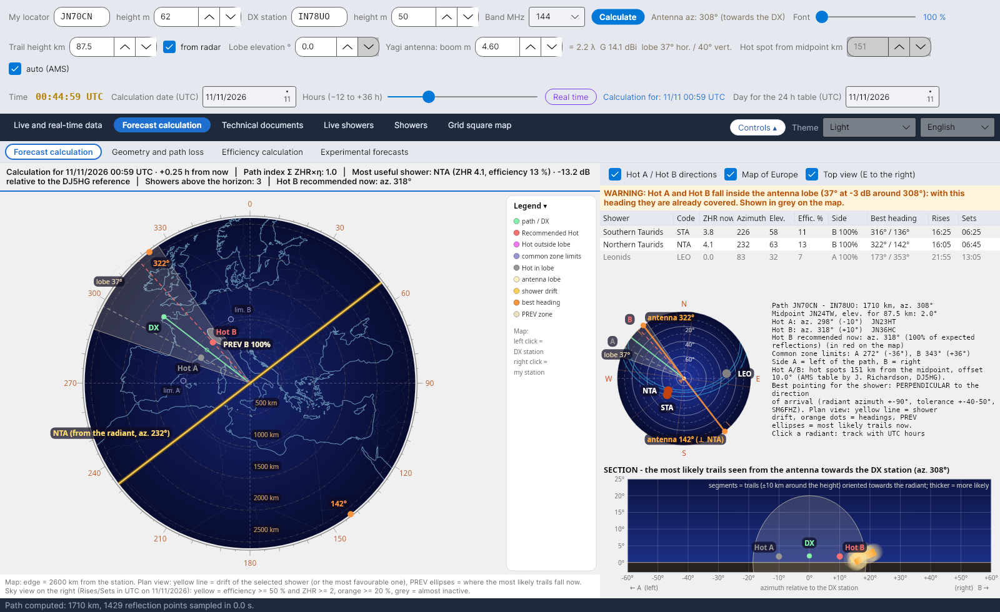
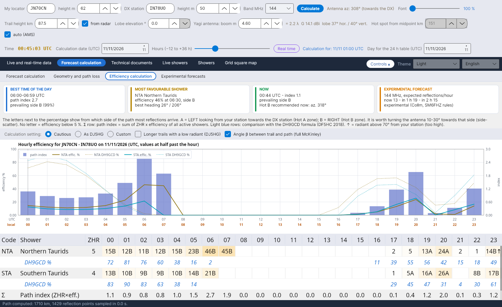
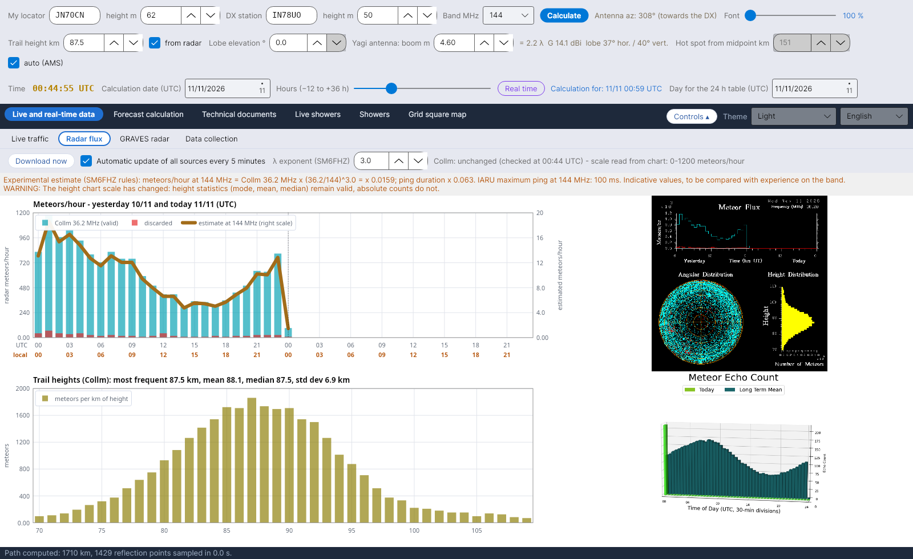

# YA-MS

[Italiano](README.md) · **English** · [Deutsch](README.de.md) · [Français](README.fr.md) · [Español](README.es.md) · [Português](README.pt.md)

**YA-MS** computes, live and as a forecast, the efficiency of meteor showers for amateur-radio **meteor scatter** contacts (50–432 MHz): where the radiants are, which hot spots to use, when the path works best and how much signal arrives.
By Costantino Cerrotta IC8TEM. Free, for Windows, Linux, Raspberry Pi and Mac. Interface, wiki and manuals in 36 languages.

## What it does
- **Forecast calculation**: sky view with the radiants, path map with Hot A / Hot B, antenna lobe, PREV zones and best headings; a summary strip with the efficiency at the chosen moment (date and hours from −12 to +36 h).
- **Efficiency calculation** hour by hour for every shower, compared with the DH9GCD formula, with the ready-made settings *Cautious* (default) and *As DJ5HG*.
- **Geometry and path loss**: path loss (McKinley, ITU-R P.843) and link budget with cautious values.
- **Live data**: flux of the SKiYMET meteor radars (Collm, Sodankylä) with an estimate at 50/144/432 MHz, the GRAVES radar, collection of MS spots from DX cluster, Reverse Beacon Network and PSKReporter (also MQTT), live traffic on a map.
- **Technical documents**: sources with comparisons, calculation manual and efficiency explanation with all the equations.

## Installation
From the **[Releases](https://github.com/ic8tem/YA-MS/releases/latest)** page:
- **Windows**: `...-windows-x64-setup.exe` (32-bit: `...-windows-x86-setup.exe`) or the portable zip;
- **Linux**: `ya-ms_..._amd64.deb` or `...-linux-x64.tar.gz`;
- **Raspberry Pi**: `ya-ms_..._arm64.deb` / `_armhf.deb` or the 64- and 32-bit tar.gz;
- **Mac**: `...-mac-apple-silicon.dmg` or `...-mac-intel.dmg` (or the app.zip).

Data stay in the `data` folder next to the program. Full instructions in the **[wiki](https://github.com/ic8tem/YA-MS/wiki)** and in `LEGGIMI.txt`.

## Main source
C. Cerrotta IC8TEM, G. Sartori IV3GTH, «METEOR-SCATTER. Ovvero come collegare l'Europa in VHF tutto l'anno senza tante pretese» (Meteor scatter: how to reach all of Europe on VHF all year round without great means). The other sources are listed in the program and in the wiki.

## Building
The installers are produced by GitHub Actions (`.github/workflows/build.yml`) whenever the `release` branch is updated (version from the `VERSION` file). Locally: `dotnet publish YA-MS.csproj -c Release -r <rid> --self-contained true`. The documents in all languages are rebuilt with `tools/build_documenti.sh`.

Radar data belong to their owners (University of Leipzig / IAP Kühlungsborn, Sodankylä Geophysical Observatory).
