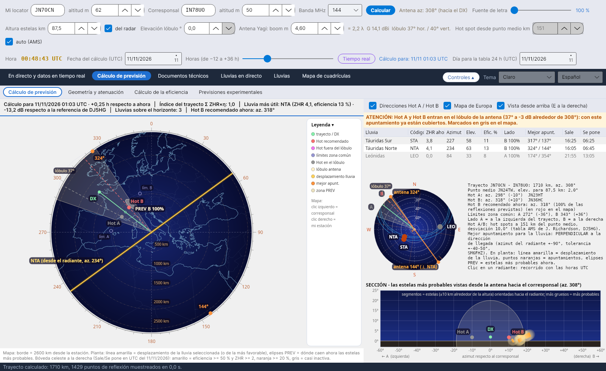
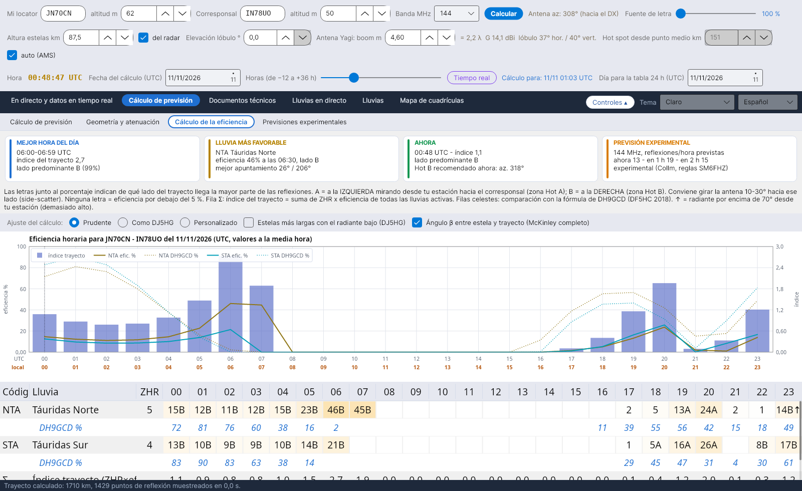
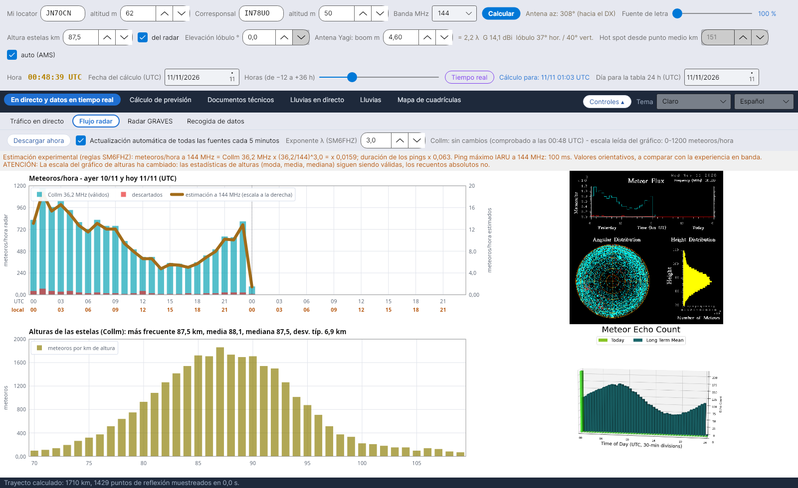

# YA-MS

[Italiano](README.md) · [English](README.en.md) · [Deutsch](README.de.md) · [Français](README.fr.md) · **Español** · [Português](README.pt.md)

**YA-MS** calcula, en directo y como previsión, la eficiencia de las lluvias de meteoros para los enlaces de radioaficionado por **meteor scatter** (50–432 MHz): dónde están los radiantes, qué hot spots usar, cuándo rinde más el trayecto y cuánta señal llega.
Por Costantino Cerrotta IC8TEM. Gratuito, para Windows, Linux, Raspberry Pi y Mac. Interfaz, wiki y manuales en 36 idiomas.

## Qué hace
- **Cálculo de previsión**: bóveda celeste con los radiantes, plano del trayecto con Hot A / Hot B, lóbulo de antena, zonas PREV y mejores rumbos; una franja resumen con la eficiencia en el momento elegido (fecha y horas de −12 a +36 h).
- **Cálculo de la eficiencia** hora por hora para cada lluvia, comparado con la fórmula de DH9GCD, con los ajustes listos *Prudente* (por defecto) y *Como DJ5HG*.
- **Geometría y atenuación**: atenuación del trayecto (McKinley, ITU-R P.843) y balance del enlace con valores prudentes.
- **Datos en directo**: flujo de los radares de meteoros SKiYMET (Collm, Sodankylä) con una estimación a 50/144/432 MHz, el radar GRAVES, recogida de los spots MS del DX cluster, Reverse Beacon Network y PSKReporter (también MQTT), tráfico en directo en el mapa.
- **Documentos técnicos**: fuentes con comparaciones, manual de cálculos y explicación de la eficiencia con todas las ecuaciones.

## Instalación
Desde la página **[Releases](https://github.com/ic8tem/YA-MS/releases/latest)**:
- **Windows**: `...-windows-x64-setup.exe` (32 bits: `...-windows-x86-setup.exe`, ARM/Snapdragon: `...-windows-arm64-setup.exe`) o el zip portátil;
- **Linux**: `ya-ms_..._amd64.deb` o `...-linux-x64.tar.gz`;
- **Fedora, openSUSE**: `ya-ms-....x86_64.rpm` o `.aarch64.rpm` / `.armv7hl.rpm` (`sudo dnf install` / `sudo zypper install`);
- **Arch, Manjaro, Arch Linux ARM**: `ya-ms-...-x86_64.pkg.tar.zst` / `-aarch64.pkg.tar.zst` (`sudo pacman -U`);
- **Slackware64, Slackware ARM64**: `ya-ms-...-x86_64-1_ic8tem.txz` / `-aarch64-1_ic8tem.txz` (`installpkg`);
- **AppImage**: `YA-MS-...-x86_64.AppImage` / `-aarch64.AppImage`;
- **Alpine Linux** (musl): `YA-MS-...-alpine-x64.tar.gz` / `-alpine-arm64.tar.gz`;
- **Raspberry Pi**: `ya-ms_..._arm64.deb` / `_armhf.deb` o los tar.gz de 64 y 32 bits;
- **Linux ARM** (p. ej. Slackware ARM64, placas armv7l): `...-linux-arm64.tar.gz` o `...-linux-armv7l.tar.gz`;
- **Mac**: `...-mac-apple-silicon.dmg` o `...-mac-intel.dmg` (o el app.zip).

Los datos se quedan en la carpeta `data` junto al programa. Instrucciones completas en el **[wiki](https://github.com/ic8tem/YA-MS/wiki/Home-es)** y en `LEGGIMI.txt`.

Desde la 1.8.0, YA-MS comprueba por sí mismo en GitHub si hay una versión nueva y se actualiza con un clic (botón **Actualizaciones** abajo), conservando la carpeta `data`; si faltan archivos del programa, propone descargarlos de nuevo.

## Fuente principal
C. Cerrotta IC8TEM, G. Sartori IV3GTH, «METEOR-SCATTER. Ovvero come collegare l'Europa in VHF tutto l'anno senza tante pretese» (Meteor scatter: cómo comunicar con toda Europa en VHF todo el año sin grandes medios). Las demás fuentes se enumeran en el programa y en el wiki.

## Compilación
Los instaladores los genera GitHub Actions (`.github/workflows/build.yml`) en cada actualización de la rama `release` (versión tomada del archivo `VERSION`). En local: `dotnet publish YA-MS.csproj -c Release -r <rid> --self-contained true`. Los documentos en todos los idiomas se regeneran con `tools/build_documenti.sh`.

Los datos de radar pertenecen a sus propietarios (Universidad de Leipzig / IAP Kühlungsborn, Sodankylä Geophysical Observatory).

## Apoya el proyecto
YA-MS es gratuito. Si te resulta útil, puedes invitarme a un café en **[Ko-fi](https://ko-fi.com/ic8tem)**.
