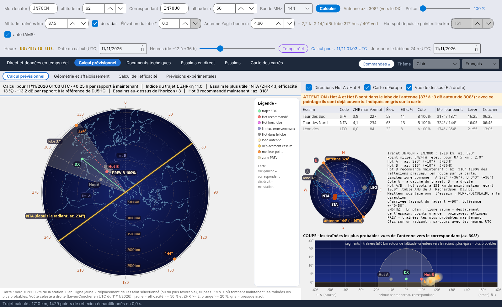
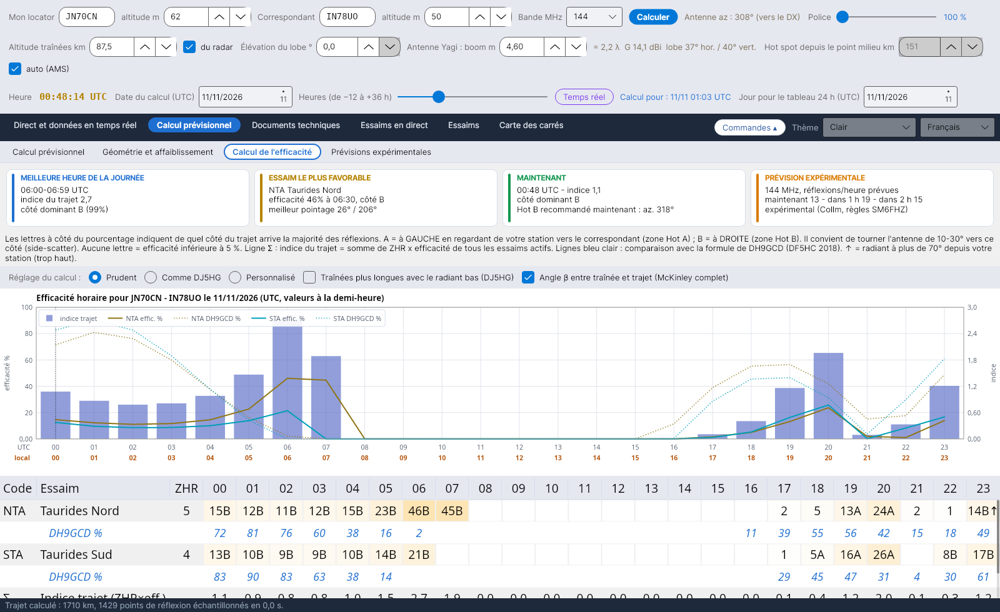
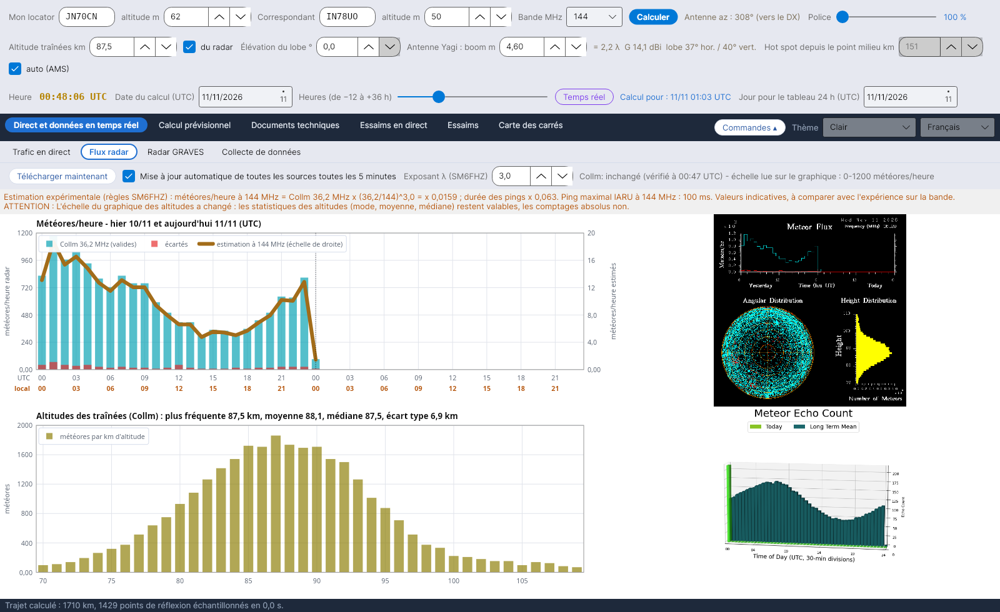

# YA-MS

[Italiano](README.md) · [English](README.en.md) · [Deutsch](README.de.md) · **Français** · [Español](README.es.md) · [Português](README.pt.md)

**YA-MS** calcule, en direct et en prévision, l'efficacité des essaims météoritiques pour les liaisons radioamateurs en **meteor scatter** (50–432 MHz) : où se trouvent les radiants, quels hot spots utiliser, quand le trajet fonctionne le mieux et quel signal arrive.
Par Costantino Cerrotta IC8TEM. Gratuit, pour Windows, Linux, Raspberry Pi et Mac. Interface, wiki et manuels en 36 langues.

## Ce qu'il fait
- **Calcul de prévision** : voûte céleste avec les radiants, plan du trajet avec Hot A / Hot B, lobe d'antenne, zones PREV et meilleures directions ; un bandeau de synthèse avec l'efficacité au moment choisi (date et heures de −12 à +36 h).
- **Calcul de l'efficacité** heure par heure pour chaque essaim, comparé à la formule de DH9GCD, avec les réglages prêts *Prudent* (par défaut) et *Comme DJ5HG*.
- **Géométrie et affaiblissement** : affaiblissement du trajet (McKinley, ITU-R P.843) et bilan de liaison avec des valeurs prudentes.
- **Données en direct** : flux des radars météoriques SKiYMET (Collm, Sodankylä) avec une estimation à 50/144/432 MHz, le radar GRAVES, collecte des spots MS depuis le DX cluster, le Reverse Beacon Network et PSKReporter (aussi MQTT), trafic en direct sur carte.
- **Documents techniques** : sources avec comparaisons, manuel des calculs et explication de l'efficacité avec toutes les équations.

## Installation
Depuis la page **[Releases](https://github.com/ic8tem/YA-MS/releases/latest)** :
- **Windows** : `...-windows-x64-setup.exe` (32 bits : `...-windows-x86-setup.exe`) ou le zip portable ;
- **Linux** : `ya-ms_..._amd64.deb` ou `...-linux-x64.tar.gz` ;
- **Raspberry Pi** : `ya-ms_..._arm64.deb` / `_armhf.deb` ou les tar.gz 64 et 32 bits ;
- **Mac** : `...-mac-apple-silicon.dmg` ou `...-mac-intel.dmg` (ou l'app.zip).

Les données restent dans le dossier `data` à côté du programme. Instructions complètes dans le **[wiki](https://github.com/ic8tem/YA-MS/wiki/Home-fr)** et dans `LEGGIMI.txt`.

Depuis la 1.8.0, YA-MS vérifie lui-même sur GitHub s'il existe une nouvelle version et se met à jour en un clic (bouton **Mises à jour** en bas), en conservant le dossier `data` ; s'il manque des fichiers du programme, il propose de les télécharger à nouveau.

## Source principale
C. Cerrotta IC8TEM, G. Sartori IV3GTH, « METEOR-SCATTER. Ovvero come collegare l'Europa in VHF tutto l'anno senza tante pretese » (Meteor scatter : relier toute l'Europe en VHF toute l'année sans grands moyens). Les autres sources sont listées dans le programme et dans le wiki.

## Compilation
Les installateurs sont produits par GitHub Actions (`.github/workflows/build.yml`) à chaque mise à jour de la branche `release` (version tirée du fichier `VERSION`). En local : `dotnet publish YA-MS.csproj -c Release -r <rid> --self-contained true`. Les documents dans toutes les langues se régénèrent avec `tools/build_documenti.sh`.

Les données radar appartiennent à leurs propriétaires (Université de Leipzig / IAP Kühlungsborn, Sodankylä Geophysical Observatory).

## Soutenir le projet
YA-MS est gratuit. S'il vous est utile, vous pouvez m'offrir un café sur **[Ko-fi](https://ko-fi.com/ic8tem)**.
