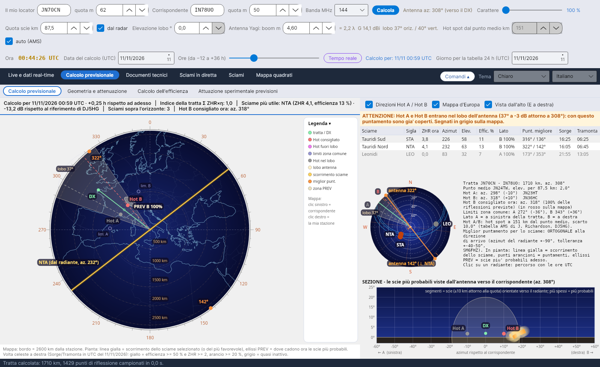
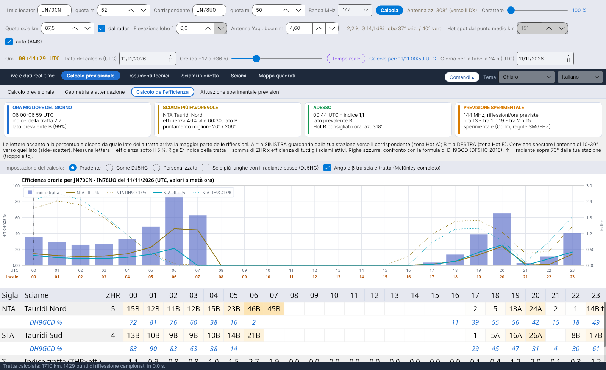
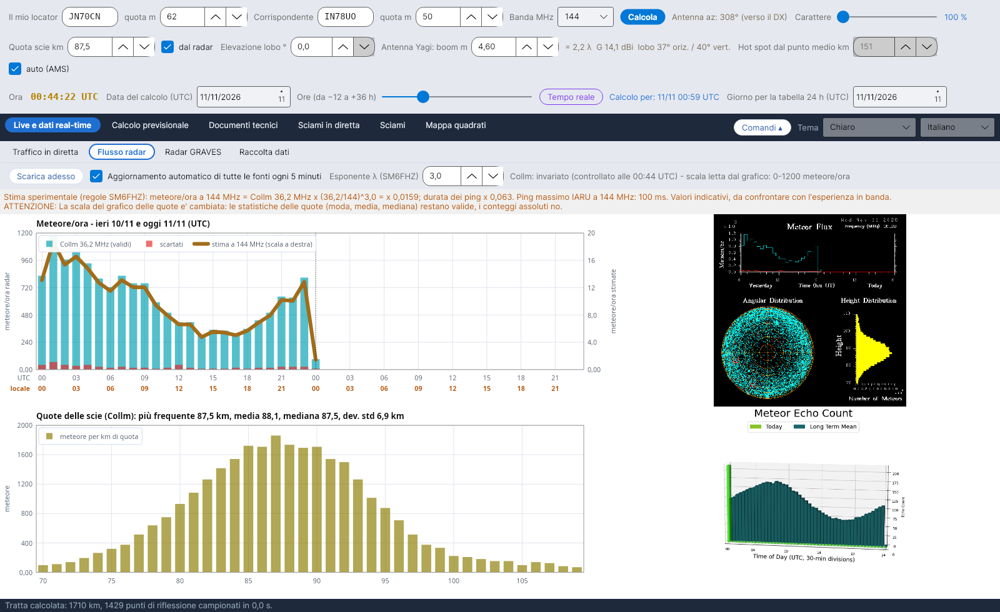

# YA-MS

**Italiano** · [English](README.en.md) · [Deutsch](README.de.md) · [Français](README.fr.md) · [Español](README.es.md) · [Português](README.pt.md)

**YA-MS** calcola, in diretta e in previsione, l'efficienza degli sciami meteorici per i collegamenti radioamatoriali in **meteor scatter** (50–432 MHz): dove guardano i radianti, quali hot spot usare, quando la tratta rende di più e quanto segnale arriva.
A cura di Costantino Cerrotta IC8TEM. Gratuito, per Windows, Linux, Raspberry Pi e Mac. Interfaccia, wiki e manuali in 36 lingue.

## Cosa fa
- **Calcolo previsionale**: volta celeste con i radianti, pianta della tratta con Hot A / Hot B, lobo d'antenna, zone PREV e direzioni migliori; fascia riassuntiva con l'efficienza del momento scelto (data e ore da −12 a +36 h).
- **Calcolo dell'efficienza** ora per ora per ogni sciame, con il confronto con la formula di DH9GCD e le impostazioni pronte *Prudente* (di partenza) e *Come DJ5HG*.
- **Geometria e attenuazione**: perdita di tratta (McKinley, ITU-R P.843) e bilancio con i valori prudenti.
- **Dati in diretta**: flusso dei radar meteorici SKiYMET (Collm, Sodankylä) con la stima a 50/144/432 MHz, radar GRAVES, raccolta degli spot MS da DX cluster, Reverse Beacon Network e PSKReporter (anche MQTT), traffico in diretta su mappa.
- **Documenti tecnici**: fonti con i confronti, manuale dei calcoli e spiegazione dell'efficienza con tutte le equazioni.

## Installazione
Dalla pagina **[Releases](https://github.com/ic8tem/YA-MS/releases/latest)**:
- **Windows**: `...-windows-x64-setup.exe` (a 32 bit `...-windows-x86-setup.exe`) o lo zip portatile;
- **Linux**: `ya-ms_..._amd64.deb` oppure `...-linux-x64.tar.gz`;
- **Raspberry Pi**: `ya-ms_..._arm64.deb` / `_armhf.deb` oppure i tar.gz a 64 e 32 bit;
- **Mac**: `...-mac-apple-silicon.dmg` o `...-mac-intel.dmg` (oppure l'app.zip).

I dati restano nella cartella `data` accanto al programma. Istruzioni complete nel **[wiki](https://github.com/ic8tem/YA-MS/wiki/Home-it)** e nel file `LEGGIMI.txt`.

## Fonte principale
C. Cerrotta IC8TEM, G. Sartori IV3GTH, «METEOR-SCATTER. Ovvero come collegare l'Europa in VHF tutto l'anno senza tante pretese». Le altre fonti sono elencate nel programma e nel wiki.

## Compilazione
Gli installatori li produce GitHub Actions (`.github/workflows/build.yml`) a ogni aggiornamento del ramo `release` (versione dal file `VERSION`). In locale: `dotnet publish YA-MS.csproj -c Release -r <rid> --self-contained true`. I documenti in tutte le lingue si rigenerano con `tools/build_documenti.sh`.

I dati dei radar appartengono ai rispettivi enti (Università di Lipsia / IAP Kühlungsborn, Sodankylä Geophysical Observatory).
