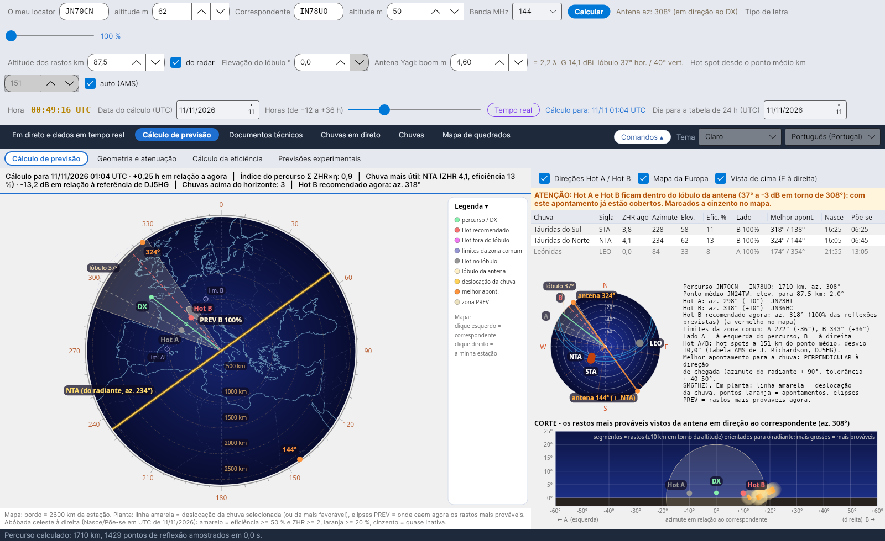
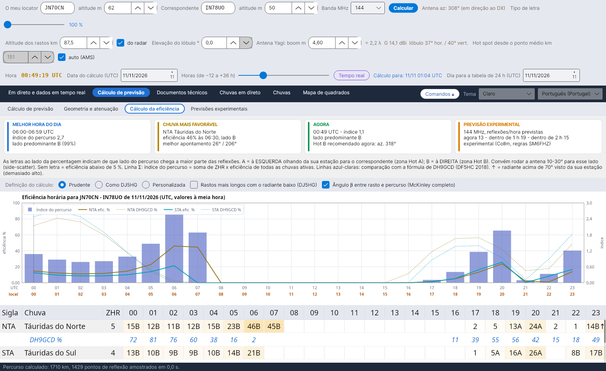
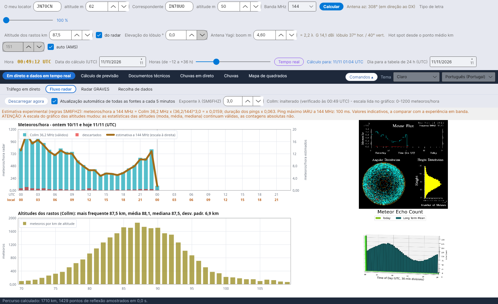

# YA-MS

[Italiano](README.md) · [English](README.en.md) · [Deutsch](README.de.md) · [Français](README.fr.md) · [Español](README.es.md) · **Português**

O **YA-MS** calcula, em direto e em previsão, a eficiência das chuvas de meteoros para as ligações de radioamador por **meteor scatter** (50–432 MHz): onde estão os radiantes, que hot spots usar, quando o percurso rende mais e quanto sinal chega.
Por Costantino Cerrotta IC8TEM. Gratuito, para Windows, Linux, Raspberry Pi e Mac. Interface, wiki e manuais em 36 línguas.

## O que faz
- **Cálculo de previsão**: abóbada celeste com os radiantes, planta do percurso com Hot A / Hot B, lóbulo da antena, zonas PREV e melhores rumos; uma faixa de resumo com a eficiência no momento escolhido (data e horas de −12 a +36 h).
- **Cálculo da eficiência** hora a hora para cada chuva, comparado com a fórmula de DH9GCD, com as definições prontas *Prudente* (por omissão) e *Como DJ5HG*.
- **Geometria e atenuação**: atenuação do percurso (McKinley, ITU-R P.843) e balanço da ligação com valores prudentes.
- **Dados em direto**: fluxo dos radares de meteoros SKiYMET (Collm, Sodankylä) com uma estimativa a 50/144/432 MHz, o radar GRAVES, recolha dos spots MS do DX cluster, Reverse Beacon Network e PSKReporter (também MQTT), tráfego em direto no mapa.
- **Documentos técnicos**: fontes com comparações, manual de cálculos e explicação da eficiência com todas as equações.

## Instalação
Na página **[Releases](https://github.com/ic8tem/YA-MS/releases/latest)**:
- **Windows**: `...-windows-x64-setup.exe` (32 bits: `...-windows-x86-setup.exe`, ARM/Snapdragon: `...-windows-arm64-setup.exe`) ou o zip portátil;
- **Linux**: `ya-ms_..._amd64.deb` ou `...-linux-x64.tar.gz`;
- **Fedora, openSUSE**: `ya-ms-....x86_64.rpm` ou `.aarch64.rpm` / `.armv7hl.rpm` (`sudo dnf install` / `sudo zypper install`);
- **Arch, Manjaro, Arch Linux ARM**: `ya-ms-...-x86_64.pkg.tar.zst` / `-aarch64.pkg.tar.zst` (`sudo pacman -U`);
- **Slackware64, Slackware ARM64**: `ya-ms-...-x86_64-1_ic8tem.txz` / `-aarch64-1_ic8tem.txz` (`installpkg`);
- **AppImage**: `YA-MS-...-x86_64.AppImage` / `-aarch64.AppImage`;
- **Alpine Linux** (musl): `YA-MS-...-alpine-x64.tar.gz` / `-alpine-arm64.tar.gz`;
- **Raspberry Pi**: `ya-ms_..._arm64.deb` / `_armhf.deb` ou os tar.gz de 64 e 32 bits;
- **Linux ARM** (p. ex. Slackware ARM64, placas armv7l): `...-linux-arm64.tar.gz` ou `...-linux-armv7l.tar.gz`;
- **Mac**: `...-mac-apple-silicon.dmg` ou `...-mac-intel.dmg` (ou o app.zip).

Os dados ficam na pasta `data` ao lado do programa. Instruções completas no **[wiki](https://github.com/ic8tem/YA-MS/wiki/Home-pt)** e em `LEGGIMI.txt`.

A partir da 1.8.0, o YA-MS verifica sozinho no GitHub se há uma versão nova e atualiza-se com um clique (botão **Atualizações** em baixo), mantendo a pasta `data`; se faltarem ficheiros do programa, propõe descarregá-los de novo.

## Fonte principal
C. Cerrotta IC8TEM, G. Sartori IV3GTH, «METEOR-SCATTER. Ovvero come collegare l'Europa in VHF tutto l'anno senza tante pretese» (Meteor scatter: como ligar toda a Europa em VHF durante todo o ano sem grandes meios). As outras fontes estão listadas no programa e no wiki.

## Compilação
Os instaladores são produzidos pelo GitHub Actions (`.github/workflows/build.yml`) a cada atualização do ramo `release` (versão do ficheiro `VERSION`). Localmente: `dotnet publish YA-MS.csproj -c Release -r <rid> --self-contained true`. Os documentos em todas as línguas regeneram-se com `tools/build_documenti.sh`.

Os dados dos radares pertencem aos respetivos proprietários (Universidade de Leipzig / IAP Kühlungsborn, Sodankylä Geophysical Observatory).

## Apoie o projeto
O YA-MS é gratuito. Se lhe for útil, pode oferecer-me um café no **[Ko-fi](https://ko-fi.com/ic8tem)**.
