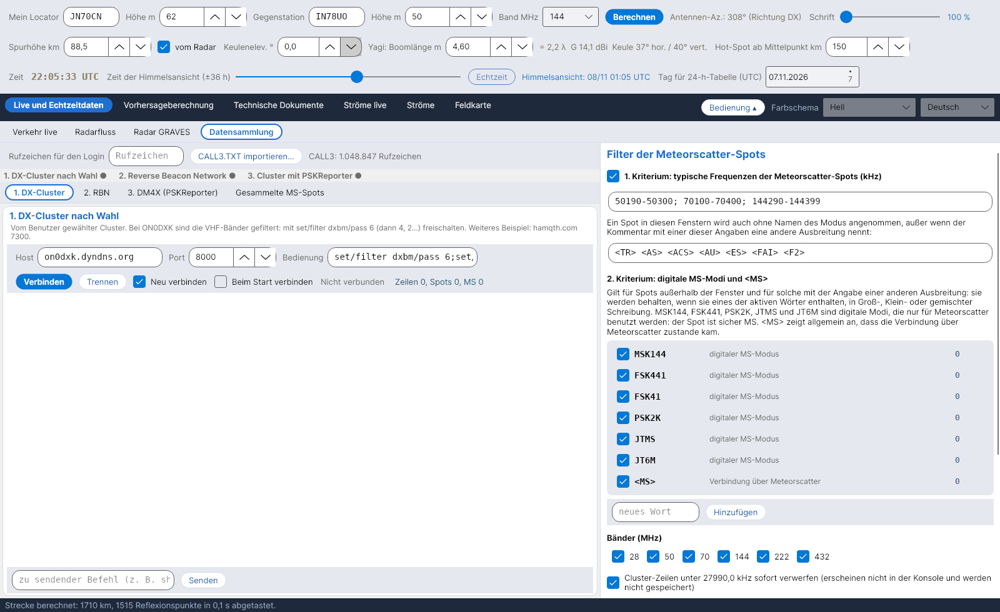

[English](Data-Collection) · [Italiano](Data-Collection-it) · **Deutsch** · [Nederlands](Data-Collection-nl) · [Français](Data-Collection-fr) · [Español](Data-Collection-es) · [Português](Data-Collection-pt) · [Dansk](Data-Collection-da) · [Norsk](Data-Collection-nb) · [Svenska](Data-Collection-sv) · [Íslenska](Data-Collection-is) · [Eesti](Data-Collection-et) · [Lietuvių](Data-Collection-lt) · [Latviešu](Data-Collection-lv) · [Русский](Data-Collection-ru) · [Українська](Data-Collection-uk) · [Türkçe](Data-Collection-tr) · [Afrikaans](Data-Collection-af) · [العربية](Data-Collection-ar) · [עברית](Data-Collection-he) · [اردو](Data-Collection-ur) · [हिन्दी](Data-Collection-hi) · [বাংলা](Data-Collection-bn) · [Bahasa Indonesia](Data-Collection-id) · [Tagalog](Data-Collection-tl) · [日本語](Data-Collection-ja) · [한국어](Data-Collection-ko) · [中文](Data-Collection-zh)

# Datensammlung

*Reiter: Live und Echtzeitdaten › Datensammlung.*

## Vier Quellen

Der Reiter sammelt **Meteorscatter-Spots** aus drei Telnet-Verbindungen und aus dem MQTT-Feed von PSKReporter, jede in ihrem eigenen Unterreiter:

| Unterreiter | Standard | Hinweise |
|---|---|---|
| **1. DX-Cluster** | on0dxk.dyndns.org : 8000 | Ein Cluster deiner Wahl. Bei ON0DXK sind die VHF-Bänder gefiltert: Schalte sie mit `set/filter dxbm/pass 6` frei (dann 4, 2…). |
| **2. RBN** | telnet.reversebeacon.net : 7001 | Reverse Beacon Network (7000 = CW/RTTY, 7001 = FT8). Skimmer dekodieren MS-Modi nur selten. |
| **3. DM4X (PSKReporter)** | dm4x.ddns.net : 8500 | Cluster von DM4X mit den **PSKReporter**-Spots: Hier kommen die MSK144-Dekodierungen von WSJT-X und MSHV an. |
| **4. PSKReporter MQTT** | mqtt.pskreporter.info : 1883 | PSKReporter-Spots live über **MQTT** (Dienst von M0LTE): ohne Login, jeder Spot enthält bereits die Locatoren der sendenden und der empfangenden Station. Standard-Themen: MSK144 auf 6 m, 4 m, 2 m, 1,25 m, 70 cm und FSK441 auf 2 m (`pskr/filter/v2/band/mode/#`); *Standard-Themen* stellt sie wieder her. |
| **Gesammelte MS-Spots** | – | Tabelle der angenommenen Spots, neueste oben. |

Jede Verbindung hat Host, Port, nach dem Login gesendete Befehle, *Neu verbinden*, *Beim Start verbinden*, eine Konsole und eine Zeile zum Senden von Befehlen. Trage oben dein **Rufzeichen für den Login** ein. Die MQTT-Quelle hat Host, Port, Themen (eines pro Zeile oder durch `;` getrennt), *Neu verbinden* und *Beim Start verbinden* (standardmäßig aus) sowie eine Konsole mit den empfangenen Spots; ihre Spots durchlaufen denselben Filter. Eine Leiste zeigt den Zustand der vier Quellen (grüner Punkt = verbunden). Die Sitzungen bleiben offen, wenn du Sprache oder Farbschema wechselst.

## Der Filter (40 % des Fensters)

- **Optionaler lokaler Filter:** Cluster-Zeilen unter **27990,0 kHz** werden sofort verworfen (weder angezeigt noch gespeichert).
- **1. Kriterium – typische MS-Frequenzen:** 50190–50300, 70100–70400, 144290–144399 kHz. Ein Spot in diesen Fenstern wird auch ohne Namen des Modus angenommen, es sei denn, der Kommentar nennt eine andere Ausbreitung: `<TR> <AS> <ACS> <AU> <ES> <FAI> <F2>`. Fenster und Kennungen sind bearbeitbar.
- **2. Kriterium – MS-Modi:** Außerhalb der Fenster oder mit einer dieser Kennungen wird ein Spot nur behalten, wenn er **MSK144, FSK441, FSK41, PSK2K, JTMS, JT6M** (nur für MS genutzte digitale Modi) oder **\<MS\>** enthält, in Groß-, Klein- oder gemischter Schreibweise. Wörter lassen sich abschalten, hinzufügen und entfernen; jedes hat seinen eigenen Zähler.
- **Bänder** 28, 50, 70, 144, 222, 432 MHz; **Filtertest** an einer eingefügten Zeile; **Zähler**.

## Locatoren und Speicherung

Fehlende Locatoren oder solche mit nur 4 Zeichen werden aus dem Archiv **CALL3** (`data/call3.txt`, Datei von JTDX, über eine Million Rufzeichen) übernommen, das immer Vorrang vor einem 4-stelligen Locator hat. Angenommene Spots werden in `data/spot_ms` gespeichert, eine CSV-Datei pro Tag, und speisen die Karte [Verkehr live](Live-Traffic-de).
