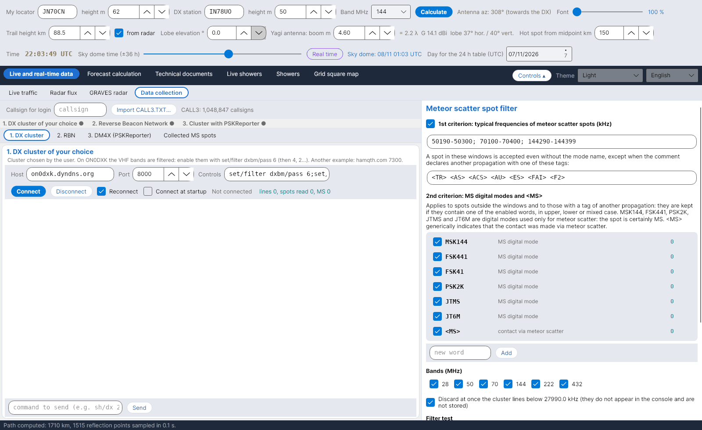

[English](Data-Collection) · [Italiano](Data-Collection-it) · [Deutsch](Data-Collection-de) · [Nederlands](Data-Collection-nl) · [Français](Data-Collection-fr) · [Español](Data-Collection-es) · [Português](Data-Collection-pt) · [Português (Brasil)](Data-Collection-pt-br) · [Dansk](Data-Collection-da) · [Norsk](Data-Collection-nb) · [Svenska](Data-Collection-sv) · **Íslenska** · [Eesti](Data-Collection-et) · [Lietuvių](Data-Collection-lt) · [Latviešu](Data-Collection-lv) · [Polski](Data-Collection-pl) · [Čeština](Data-Collection-cs) · [Magyar](Data-Collection-hu) · [Română](Data-Collection-ro) · [Ελληνικά](Data-Collection-el) · [Русский](Data-Collection-ru) · [Українська](Data-Collection-uk) · [Türkçe](Data-Collection-tr) · [Afrikaans](Data-Collection-af) · [العربية](Data-Collection-ar) · [עברית](Data-Collection-he) · [اردو](Data-Collection-ur) · [हिन्दी](Data-Collection-hi) · [বাংলা](Data-Collection-bn) · [ไทย](Data-Collection-th) · [Bahasa Indonesia](Data-Collection-id) · [Tagalog](Data-Collection-tl) · [日本語](Data-Collection-ja) · [한국어](Data-Collection-ko) · [中文](Data-Collection-zh) · [中文 (繁體)](Data-Collection-zh-tw)

# Gagnasöfnun

*Flipi: Beint og rauntímagögn › Gagnasöfnun.*

## Fjórar uppsprettur

Flipinn safnar **meteor scatter-spotum** úr þremur telnet-straumum og úr PSKReporter MQTT-straumnum, hverjum á sínum undirflipa:

| Undirflipi | Sjálfgefið | Athugasemdir |
|---|---|---|
| **1. DX cluster** | on0dxk.dyndns.org : 8000 | Klasi að eigin vali. Á ON0DXK eru VHF-tíðnisviðin síuð: virkjaðu þau með `set/filter dxbm/pass 6` (síðan 4, 2…). |
| **2. RBN** | telnet.reversebeacon.net : 7001 | Reverse Beacon Network (7000 = CW/RTTY, 7001 = FT8). Skimmers afkóða sjaldan MS-hætti. |
| **3. DM4X (PSKReporter)** | dm4x.ddns.net : 8500 | Klasi DM4X sem flytur spot frá **PSKReporter**: hingað berast MSK144-afkóðanir WSJT-X og MSHV. |
| **4. PSKReporter MQTT** | mqtt.pskreporter.info : 1883 | PSKReporter-spot í beinni um **MQTT** (þjónusta frá M0LTE): engin innskráning, hvert spot ber þegar locatora sendistöðvar og móttökustöðvar. Sjálfgefin efni: MSK144 á 6 m, 4 m, 2 m, 1,25 m, 70 cm og FSK441 á 2 m (`pskr/filter/v2/band/mode/#`); *Sjálfgefin efni* endurheimtir þau. |
| **5. WSJT-X / JTDX / MSHV um UDP** | 127.0.0.1 : 2237 → 2238 | Eins og í LIVETROPOVHF: forritið hlustar á UDP-skilaboð stafræna forritsins (í WSJT-X: Stillingar, Reporting, UDP Server 127.0.0.1 gátt 2237) og endurtekur þau óbreytt á framsendingargáttinni fyrir hin forritin (GridTracker, JTAlert, dagbók). Hver afkóðuð stöð verður spott sem þín stöð heyrir; lokaskilaboð (RR73, 73, RRR) milli tveggja annarra stöðva verða leið QSO-sins þeirra. Spottin fara í gegnum sömu síur og hin. |
| **Söfnuð MS-spot** | – | Tafla yfir samþykkt spot, nýjustu fyrst. |

Hver straumur hefur hýsil, gátt, skipanir sem sendar eru eftir innskráningu, *Tengja aftur*, *Tengja við ræsingu*, skjáborð (console) og línu til að senda skipanir. Skrifaðu **kallmerki fyrir innskráningu** efst. MQTT-uppsprettan hefur hýsil, gátt, efni (eitt í línu eða aðskilin með `;`), *Tengja aftur* og *Tengja við ræsingu* (sjálfgefið óvirkt) og skjáborð með mótteknum spotum; spotin hennar fara í gegnum sömu síu. Rönd sýnir stöðu uppsprettnanna fjögurra (grænn punktur = tengt). Loturnar haldast opnar þegar þú skiptir um tungumál eða litaþema.

## Sían (40 % af glugganum)

- **Valfrjáls staðbundin sía:** línum frá klösum undir **27990,0 kHz** er hent strax (ekki sýndar, ekki geymdar).
- CW-spotum er hent strax (CW eða WPM í athugasemd, eða 28000-28070 kHz): þau birtast ekki í skjáborðinu og eru ekki vistuð, nema þau séu merkt <MS>. Hægt er að slökkva á reitnum.

CALL3-gagnagrunnur með reglum LIVETROPOVHF. „Uppfæra núna" sækir CALL3.TXT frá MMMonVHF (a.m.k. 100.000 gildar línur, sú fyrri verður eftir í data/call3.bak); með „Uppfæra sjálft á 7 daga fresti" gerist það við ræsingu. Ofan á skránni gilda í röð: handskráningar (data/CALL3-MANUALE.TXT), leiðréttingar úr klasa (6 stafa reiturinn sem sá sem spottar gefur upp fyrir sig), viðbættar skrár (data/CALL3-AGGIUNTE), síðan CALL3.TXT og 6 stafa reitir lærðir í beinni (data/LOC6.TXT). Móttekinn 4 stafa reitur, eða sem endar á LL eða MM, er leystur af hólmi með 6 stafa reitnum úr gagnagrunninum; færanlegar stöðvar (með skástriki) aðeins með nákvæmri færslu.

Síðasta heimild, eins og í LIVETROPOVHF: fyrir kallmerki sem hvergi annars staðar hafa 6 stafa reit spyr forritið sjálfkrafa á 6 klukkustunda fresti opið API G7VRD (api.g7vrd.co.uk), í hópum 40 kallmerkja; hvert kallmerki mest einu sinni á dag. Aðeins 6 stafa reitur er samþykktur, ekki miðja reitsins (LL eða MM), í sama reit og sá sem barst. Niðurstöður eru í data/CALL3-G7VRD.TXT og eru, eins og allar leiðréttingar, einnig skrifaðar í data/call3.txt.
- Spottum milli stöðva sem eru nær en 500 km er hent strax, því á þeirri fjarlægð er sambandið beint eða um veðrahvolf en ekki meteor scatter: þau birtast ekki í stjórnborðinu og eru ekki vistuð. Ef staðsetningarreit vantar heldur spottið sér. Fjarlægðinni er breytt undir reitnum.
- **1. viðmið – dæmigerðar MS-tíðnir:** 50190–50300, 70100–70400, 144290–144399 kHz. Spot í þessum gluggum er samþykkt jafnvel án heitis háttarins, nema athugasemdin tilgreini annars konar útbreiðslu: `<TR> <AS> <ACS> <AU> <ES> <FAI> <F2>`. Hægt er að breyta gluggum og merkjum.
- **2. viðmið – MS-hættir:** utan glugganna, eða með einu af þessum merkjum, er spot aðeins haldið ef það inniheldur **MSK144, FSK441, FSK41, PSK2K, JTMS, JT6M** (stafrænir hættir sem aðeins eru notaðir fyrir MS) eða **\<MS\>**, með hástöfum, lágstöfum eða blandað. Hægt er að slökkva á orðum, bæta þeim við og fjarlægja þau; hvert hefur sinn teljara.
- **Tíðnisvið** 28, 50, 70, 144, 222, 432 MHz; **prófun síunnar** á línu sem límd er inn; **teljarar**.

## Locatorar og geymsla

Locatorar sem vantar, eða locatorar með aðeins 4 stöfum, eru sóttir í safnið **CALL3** (`data/call3.txt`, JTDX-skrá, yfir milljón kallmerki), sem hefur alltaf forgang fram yfir 4 stafa locator. Samþykkt spot eru vistuð í `data/spot_ms`, ein CSV-skrá á dag, og fæða kortið [Umferð í beinni](Live-Traffic-is).
