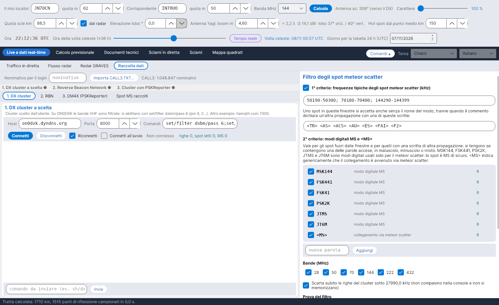

[English](Data-Collection) · **Italiano** · [Deutsch](Data-Collection-de) · [Nederlands](Data-Collection-nl) · [Français](Data-Collection-fr) · [Español](Data-Collection-es) · [Português](Data-Collection-pt) · [Português (Brasil)](Data-Collection-pt-br) · [Dansk](Data-Collection-da) · [Norsk](Data-Collection-nb) · [Svenska](Data-Collection-sv) · [Íslenska](Data-Collection-is) · [Eesti](Data-Collection-et) · [Lietuvių](Data-Collection-lt) · [Latviešu](Data-Collection-lv) · [Polski](Data-Collection-pl) · [Čeština](Data-Collection-cs) · [Magyar](Data-Collection-hu) · [Română](Data-Collection-ro) · [Ελληνικά](Data-Collection-el) · [Русский](Data-Collection-ru) · [Українська](Data-Collection-uk) · [Türkçe](Data-Collection-tr) · [Afrikaans](Data-Collection-af) · [العربية](Data-Collection-ar) · [עברית](Data-Collection-he) · [اردو](Data-Collection-ur) · [हिन्दी](Data-Collection-hi) · [বাংলা](Data-Collection-bn) · [ไทย](Data-Collection-th) · [Bahasa Indonesia](Data-Collection-id) · [Tagalog](Data-Collection-tl) · [日本語](Data-Collection-ja) · [한국어](Data-Collection-ko) · [中文](Data-Collection-zh) · [中文 (繁體)](Data-Collection-zh-tw)

# Raccolta dati

*Linguetta: Live e dati real-time › Raccolta dati.*

## Quattro sorgenti

La linguetta raccoglie gli **spot meteor scatter** da tre flussi telnet e dal flusso MQTT di PSKReporter, ognuno nella sua sotto-linguetta:

| Sotto-linguetta | Predefinito | Note |
|---|---|---|
| **1. DX cluster** | on0dxk.dyndns.org : 8000 | Un cluster a scelta. Su ON0DXK le bande VHF sono filtrate: abilitale con `set/filter dxbm/pass 6` (poi 4, 2…). |
| **2. RBN** | telnet.reversebeacon.net : 7001 | Reverse Beacon Network (7000 = CW/RTTY, 7001 = FT8). Gli skimmer decodificano raramente i modi MS. |
| **3. DM4X (PSKReporter)** | dm4x.ddns.net : 8500 | Cluster DM4X che porta gli spot di **PSKReporter**: qui arrivano le decodifiche MSK144 di WSJT-X e MSHV. |
| **4. PSKReporter MQTT** | mqtt.pskreporter.info : 1883 | Spot di PSKReporter in diretta via **MQTT** (servizio di M0LTE): nessun login, ogni spot porta già i locator della stazione che trasmette e di quella che riceve. Argomenti predefiniti: MSK144 su 6 m, 4 m, 2 m, 1,25 m, 70 cm e FSK441 su 2 m (`pskr/filter/v2/band/mode/#`); *Argomenti di partenza* li ripristina. |
| **Spot MS raccolti** | – | Tabella degli spot accettati, i più recenti in alto. |

Ogni flusso ha host, porta, comandi inviati dopo il login, *Riconnetti*, *Connetti all'avvio*, una console e una riga per inviare comandi. Scrivi in alto il tuo **nominativo per il login**. La sorgente MQTT ha host, porta, argomenti (uno per riga o separati da `;`), *Riconnetti* e *Connetti all'avvio* (disattivato per impostazione predefinita) e una console con gli spot ricevuti; i suoi spot passano per lo stesso filtro. Una striscia mostra lo stato delle quattro sorgenti (pallino verde = connesso). Le sessioni restano aperte quando cambi lingua o schema di colori.

## Il filtro (40 % della finestra)

- **Filtro locale facoltativo:** le righe del cluster sotto **27990,0 kHz** vengono scartate subito (non mostrate, non memorizzate).
- Gli spot CW si scartano subito (CW o WPM nel commento, oppure 28000-28070 kHz): non compaiono nella console e non si memorizzano, salvo quelli segnati <MS>. La casella si può spegnere.

Archivio CALL3 con le regole di LIVETROPOVHF. «Aggiorna adesso» scarica il CALL3.TXT da MMMonVHF (almeno 100.000 righe valide, il precedente resta in data/call3.bak); con «Aggiorna da solo ogni 7 giorni» lo fa all'avvio. Sopra il file valgono, in ordine: voci a mano (data/CALL3-MANUALE.TXT), correzioni dal cluster (il locatore a 6 caratteri che chi spotta dichiara di sé), file aggiunti (data/CALL3-AGGIUNTE), poi CALL3.TXT e i locatori a 6 caratteri imparati dal vivo (data/LOC6.TXT). Un locatore ricevuto di 4 caratteri, o che finisce con LL o MM, si sostituisce con quello a 6 caratteri del database; i portatili (con la barra) solo con la voce esatta.

Ultima fonte, come in LIVETROPOVHF: per i nominativi che in nessun'altra fonte hanno un locatore a 6 caratteri il programma lo chiede in automatico ogni 6 ore all'API pubblica di G7VRD (api.g7vrd.co.uk), in gruppi di 40 nominativi; ogni nominativo al massimo una volta al giorno. Si accetta solo un locatore a 6 caratteri, non il centro del quadrato (LL o MM), nello stesso quadrato di quello ricevuto. I risultati stanno in data/CALL3-G7VRD.TXT e, come tutte le correzioni, vengono scritti anche dentro data/call3.txt.
- Gli spot tra stazioni più vicine di 500 km si scartano subito, perché a quella distanza il collegamento è diretto o troposferico e non meteor scatter: non compaiono nella console e non si memorizzano. Se manca un locator lo spot resta. La distanza si cambia sotto la casella.
- **1° criterio – frequenze tipiche MS:** 50190–50300, 70100–70400, 144290–144399 kHz. Uno spot in queste finestre si accetta anche senza il nome del modo, tranne quando il commento dichiara un'altra propagazione: `<TR> <AS> <ACS> <AU> <ES> <FAI> <F2>`. Finestre e scritte si possono modificare.
- **2° criterio – modi MS:** fuori dalle finestre, o con una di quelle scritte, uno spot si tiene solo se contiene **MSK144, FSK441, FSK41, PSK2K, JTMS, JT6M** (modi digitali usati solo per l'MS) oppure **\<MS\>**, in maiuscolo, minuscolo o misto. Le parole si possono spegnere, aggiungere e togliere; ognuna ha il suo contatore.
- **Bande** 28, 50, 70, 144, 222, 432 MHz; **prova del filtro** su una riga incollata; **contatori**.

## Locator e memorizzazione

I locator mancanti, o con solo 4 caratteri, vengono presi dall'archivio **CALL3** (`data/call3.txt`, file di JTDX, oltre un milione di nominativi), che prevale sempre su un locator a 4 caratteri. Gli spot accettati vengono salvati in `data/spot_ms`, un file CSV al giorno, e alimentano la mappa del [Traffico in diretta](Live-Traffic-it).
