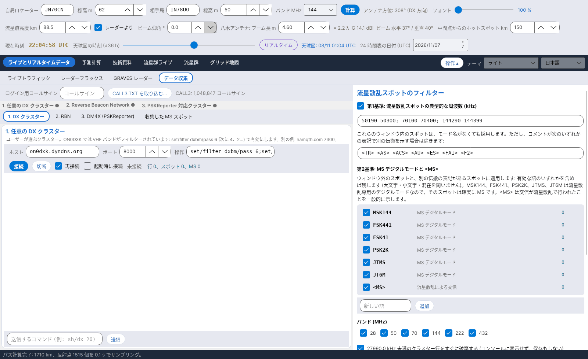

[English](Data-Collection) · [Italiano](Data-Collection-it) · [Deutsch](Data-Collection-de) · [Nederlands](Data-Collection-nl) · [Français](Data-Collection-fr) · [Español](Data-Collection-es) · [Português](Data-Collection-pt) · [Português (Brasil)](Data-Collection-pt-BR) · [Dansk](Data-Collection-da) · [Norsk](Data-Collection-nb) · [Svenska](Data-Collection-sv) · [Íslenska](Data-Collection-is) · [Eesti](Data-Collection-et) · [Lietuvių](Data-Collection-lt) · [Latviešu](Data-Collection-lv) · [Polski](Data-Collection-pl) · [Čeština](Data-Collection-cs) · [Magyar](Data-Collection-hu) · [Română](Data-Collection-ro) · [Ελληνικά](Data-Collection-el) · [Русский](Data-Collection-ru) · [Українська](Data-Collection-uk) · [Türkçe](Data-Collection-tr) · [Afrikaans](Data-Collection-af) · [العربية](Data-Collection-ar) · [עברית](Data-Collection-he) · [اردو](Data-Collection-ur) · [हिन्दी](Data-Collection-hi) · [বাংলা](Data-Collection-bn) · [ไทย](Data-Collection-th) · [Bahasa Indonesia](Data-Collection-id) · [Tagalog](Data-Collection-tl) · **日本語** · [한국어](Data-Collection-ko) · [中文](Data-Collection-zh) · [中文 (繁體)](Data-Collection-zh-TW)

# データ収集

*タブ: ライブとリアルタイムデータ › データ収集。*

## 4 つのソース

このタブは 3 つの telnet 接続と PSKReporter の MQTT フィードから**流星散乱スポット**を集めます。ソースごとに専用のサブタブがあります:

| サブタブ | 既定値 | 備考 |
|---|---|---|
| **1. DX クラスター** | on0dxk.dyndns.org : 8000 | 任意のクラスター。ON0DXK では VHF バンドがフィルターされています: `set/filter dxbm/pass 6` (次に 4、2…) で有効にします。 |
| **2. RBN** | telnet.reversebeacon.net : 7001 | Reverse Beacon Network (7000 = CW/RTTY、7001 = FT8)。スキマーが MS モードをデコードすることはまれです。 |
| **3. DM4X (PSKReporter)** | dm4x.ddns.net : 8500 | **PSKReporter** のスポットを配信する DM4X のクラスター: WSJT-X と MSHV の MSK144 デコードがここに届きます。 |
| **4. PSKReporter MQTT** | mqtt.pskreporter.info : 1883 | **MQTT** による PSKReporter のリアルタイムスポット (M0LTE のサービス): ログイン不要で、各スポットには送信局と受信局のロケーターが最初から含まれています。既定のトピック: 6 m、4 m、2 m、1.25 m、70 cm の MSK144 と 2 m の FSK441 (`pskr/filter/v2/band/mode/#`)。*既定のトピック* で元に戻せます。 |
| **収集した MS スポット** | – | 採用したスポットの表 (新しいものが上)。 |

各接続には、ホスト、ポート、ログイン後に送るコマンド、*再接続*、*起動時に接続*、コンソール、コマンド送信用の行があります。上部に**ログイン用コールサイン**を入力してください。MQTT ソースには、ホスト、ポート、トピック (1 行に 1 つ、または `;` で区切る)、*再接続*、*起動時に接続* (既定はオフ)、受信したスポットを表示するコンソールがあります。そのスポットも同じフィルターを通ります。帯状の表示が 4 つのソースの状態を示します (緑の点 = 接続中)。言語や配色を変えてもセッションは開いたままです。

## フィルター (ウィンドウの 40 %)

- **任意のローカルフィルター:** **27990.0 kHz** 未満のクラスター行はすぐに破棄します (表示も保存もしません)。
- **第1基準 – 流星散乱の典型的な周波数:** 50190–50300、70100–70400、144290–144399 kHz。これらのウィンドウ内のスポットは、モード名がなくても採用します。ただし、コメントが別の伝搬を示す場合は除きます: `<TR> <AS> <ACS> <AU> <ES> <FAI> <F2>`。ウィンドウと表記は編集できます。
- **第2基準 – MS モード:** ウィンドウ外のスポット、またはこれらの表記があるスポットは、**MSK144、FSK441、FSK41、PSK2K、JTMS、JT6M** (MS 専用のデジタルモード) または **\<MS\>** を含む場合だけ残します (大文字・小文字・混在を問いません)。語は無効化・追加・削除でき、それぞれにカウンターがあります。
- **バンド** 28、50、70、144、222、432 MHz; 貼り付けた行での**フィルターのテスト**; **カウンター**。

## ロケーターと保存

ロケーターがない場合や 4 文字しかない場合は、**CALL3** アーカイブ (`data/call3.txt`、JTDX のファイル、100 万以上のコールサイン) から取得します。CALL3 は 4 文字のロケーターより常に優先されます。採用したスポットは `data/spot_ms` に 1 日 1 つの CSV ファイルとして保存され、[ライブトラフィック](Live-Traffic-ja) の地図に使われます。
