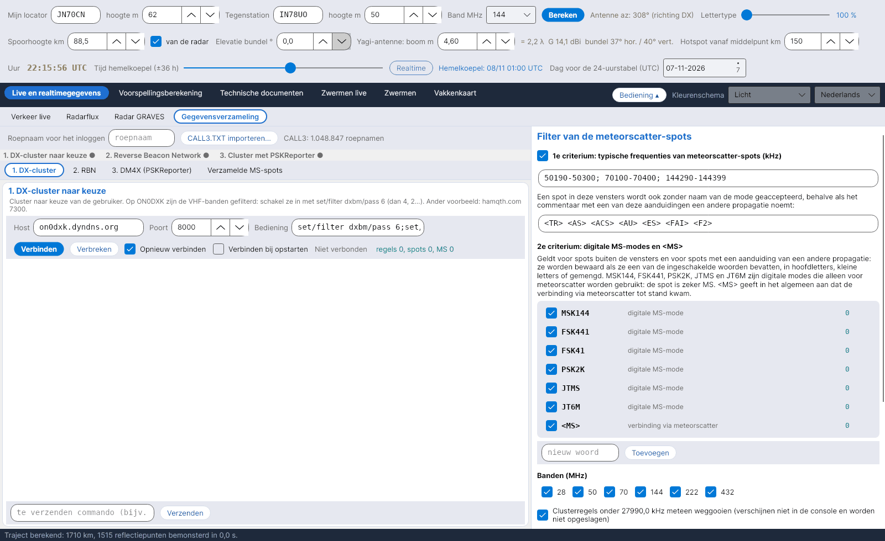

[English](Data-Collection) · [Italiano](Data-Collection-it) · [Deutsch](Data-Collection-de) · **Nederlands** · [Français](Data-Collection-fr) · [Español](Data-Collection-es) · [Português](Data-Collection-pt) · [Português (Brasil)](Data-Collection-pt-br) · [Dansk](Data-Collection-da) · [Norsk](Data-Collection-nb) · [Svenska](Data-Collection-sv) · [Íslenska](Data-Collection-is) · [Eesti](Data-Collection-et) · [Lietuvių](Data-Collection-lt) · [Latviešu](Data-Collection-lv) · [Polski](Data-Collection-pl) · [Čeština](Data-Collection-cs) · [Русский](Data-Collection-ru) · [Українська](Data-Collection-uk) · [Türkçe](Data-Collection-tr) · [Afrikaans](Data-Collection-af) · [العربية](Data-Collection-ar) · [עברית](Data-Collection-he) · [اردو](Data-Collection-ur) · [हिन्दी](Data-Collection-hi) · [বাংলা](Data-Collection-bn) · [Bahasa Indonesia](Data-Collection-id) · [Tagalog](Data-Collection-tl) · [日本語](Data-Collection-ja) · [한국어](Data-Collection-ko) · [中文](Data-Collection-zh)

# Gegevensverzameling

*Tabblad: Live en realtimegegevens › Gegevensverzameling.*

## Drie clusterstromen

Het tabblad verzamelt **meteorscatter-spots** uit drie telnet-stromen, elk in een eigen subtabblad:

| Subtabblad | Standaard | Opmerkingen |
|---|---|---|
| **1. DX-cluster** | on0dxk.dyndns.org : 8000 | Een cluster naar keuze. Op ON0DXK zijn de VHF-banden gefilterd: schakel ze in met `set/filter dxbm/pass 6` (daarna 4, 2…). |
| **2. RBN** | telnet.reversebeacon.net : 7001 | Reverse Beacon Network (7000 = CW/RTTY, 7001 = FT8). Skimmers decoderen zelden MS-modes. |
| **3. DM4X (PSKReporter)** | dm4x.ddns.net : 8500 | DM4X-cluster met de **PSKReporter**-spots: hier komen de MSK144-decodes van WSJT-X en MSHV binnen. |
| **Verzamelde MS-spots** | – | Tabel van de geaccepteerde spots, nieuwste bovenaan. |

Elke stroom heeft host, poort, commando's die na het inloggen worden verzonden, *Opnieuw verbinden*, *Verbinden bij opstarten*, een console en een regel om commando's te verzenden. Vul bovenaan je **roepnaam voor het inloggen** in. Een strook toont de status van de drie sessies (groene stip = verbonden). De sessies blijven open als je van taal of kleurenschema wisselt.

## Het filter (40 % van het venster)

- **Optioneel lokaal filter:** clusterregels onder **27990,0 kHz** worden meteen weggegooid (niet getoond, niet opgeslagen).
- **1e criterium – typische MS-frequenties:** 50190–50300, 70100–70400, 144290–144399 kHz. Een spot in deze vensters wordt ook zonder naam van de mode geaccepteerd, behalve als het commentaar een andere propagatie noemt: `<TR> <AS> <ACS> <AU> <ES> <FAI> <F2>`. Vensters en aanduidingen zijn aan te passen.
- **2e criterium – MS-modes:** buiten de vensters, of met een van die aanduidingen, wordt een spot alleen bewaard als hij **MSK144, FSK441, FSK41, PSK2K, JTMS, JT6M** (digitale modes die alleen voor MS worden gebruikt) of **\<MS\>** bevat, in hoofdletters, kleine letters of gemengd. Woorden kun je uitschakelen, toevoegen en verwijderen; elk heeft zijn eigen teller.
- **Banden** 28, 50, 70, 144, 222, 432 MHz; **filtertest** op een geplakte regel; **tellers**.

## Locators en opslag

Ontbrekende locators, of locators met maar 4 tekens, worden uit het **CALL3**-archief gehaald (`data/call3.txt`, JTDX-bestand, ruim een miljoen roepnamen), dat altijd voorgaat op een locator van 4 tekens. Geaccepteerde spots worden opgeslagen in `data/spot_ms`, één CSV-bestand per dag, en voeden de kaart van [Verkeer live](Live-Traffic-nl).
