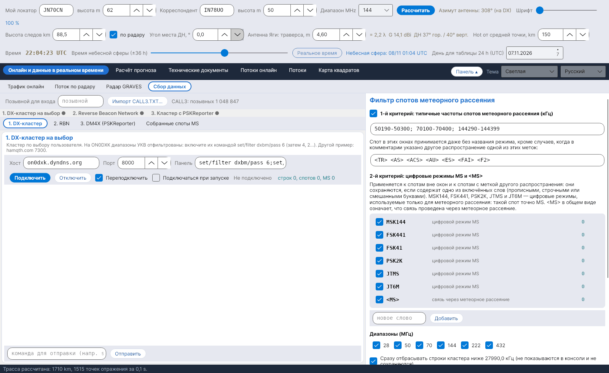

[English](Data-Collection) · [Italiano](Data-Collection-it) · [Deutsch](Data-Collection-de) · [Nederlands](Data-Collection-nl) · [Français](Data-Collection-fr) · [Español](Data-Collection-es) · [Português](Data-Collection-pt) · [Português (Brasil)](Data-Collection-pt-br) · [Dansk](Data-Collection-da) · [Norsk](Data-Collection-nb) · [Svenska](Data-Collection-sv) · [Íslenska](Data-Collection-is) · [Eesti](Data-Collection-et) · [Lietuvių](Data-Collection-lt) · [Latviešu](Data-Collection-lv) · [Polski](Data-Collection-pl) · [Čeština](Data-Collection-cs) · [Magyar](Data-Collection-hu) · [Română](Data-Collection-ro) · [Ελληνικά](Data-Collection-el) · **Русский** · [Українська](Data-Collection-uk) · [Türkçe](Data-Collection-tr) · [Afrikaans](Data-Collection-af) · [العربية](Data-Collection-ar) · [עברית](Data-Collection-he) · [اردو](Data-Collection-ur) · [हिन्दी](Data-Collection-hi) · [বাংলা](Data-Collection-bn) · [Bahasa Indonesia](Data-Collection-id) · [Tagalog](Data-Collection-tl) · [ไทย](Data-Collection-th) · [日本語](Data-Collection-ja) · [한국어](Data-Collection-ko) · [中文](Data-Collection-zh) · [中文 (繁體)](Data-Collection-zh-tw)

# Сбор данных

*Вкладка: Онлайн и данные в реальном времени › Сбор данных.*

## Три подключения к кластерам

Вкладка собирает **споты метеорного рассеяния** из трёх telnet-подключений, каждое на своей подвкладке:

| Подвкладка | По умолчанию | Примечания |
|---|---|---|
| **1. DX-кластер** | on0dxk.dyndns.org : 8000 | Кластер по вашему выбору. На ON0DXK диапазоны УКВ отфильтрованы: включите их командой `set/filter dxbm/pass 6` (затем 4, 2…). |
| **2. RBN** | telnet.reversebeacon.net : 7001 | Reverse Beacon Network (7000 = CW/RTTY, 7001 = FT8). Скиммеры редко декодируют режимы MS. |
| **3. DM4X (PSKReporter)** | dm4x.ddns.net : 8500 | Кластер DM4X, передающий споты **PSKReporter**: сюда приходят декодирования MSK144 из WSJT-X и MSHV. |
| **Собранные споты MS** | – | Таблица принятых спотов, новые вверху. |

Для каждого подключения есть хост, порт, команды, отправляемые после входа, *Переподключить*, *Подключаться при запуске*, консоль и строка для отправки команд. Вверху укажите **позывной для входа**. Полоса состояния показывает состояние трёх сессий (зелёная точка = подключено). Сессии остаются открытыми при смене языка или цветовой схемы.

## Фильтр (40 % окна)

- **Необязательный локальный фильтр:** строки кластера ниже **27990,0 kHz** сразу отбрасываются (не показываются и не сохраняются).
- **1-й критерий – типичные частоты MS:** 50190–50300, 70100–70400, 144290–144399 kHz. Спот в этих окнах принимается даже без названия режима, если только в комментарии не указано другое распространение: `<TR> <AS> <ACS> <AU> <ES> <FAI> <F2>`. Окна и метки можно редактировать.
- **2-й критерий – режимы MS:** вне окон или с одной из этих меток спот сохраняется, только если в нём есть **MSK144, FSK441, FSK41, PSK2K, JTMS, JT6M** (цифровые режимы, используемые только для MS) или **\<MS\>**, прописными, строчными или смешанными буквами. Слова можно отключать, добавлять и удалять; у каждого свой счётчик.
- **Диапазоны** 28, 50, 70, 144, 222, 432 MHz; **проверка фильтра** на вставленной строке; **счётчики**.

## Локаторы и хранение

Отсутствующие локаторы, а также локаторы всего из 4 символов берутся из архива **CALL3** (`data/call3.txt`, файл JTDX, более миллиона позывных), который всегда имеет приоритет над 4-символьным локатором. Принятые споты сохраняются в `data/spot_ms`, по одному CSV-файлу на день, и используются картой [Трафик онлайн](Live-Traffic-ru).
