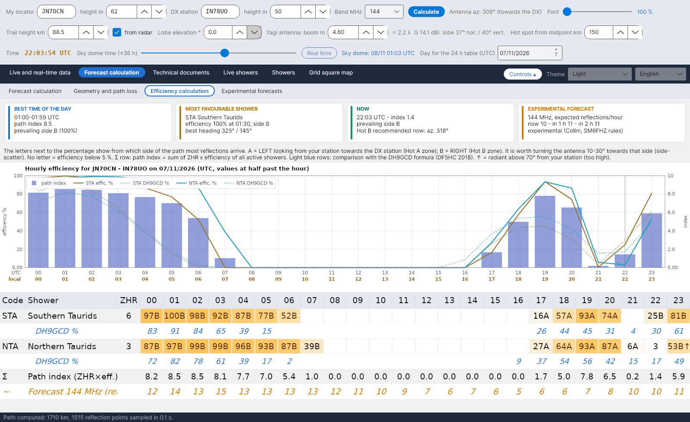

[English](Efficiency-Calculation) · [Italiano](Efficiency-Calculation-it) · [Deutsch](Efficiency-Calculation-de) · [Nederlands](Efficiency-Calculation-nl) · [Français](Efficiency-Calculation-fr) · [Español](Efficiency-Calculation-es) · [Português](Efficiency-Calculation-pt) · [Português (Brasil)](Efficiency-Calculation-pt-br) · [Dansk](Efficiency-Calculation-da) · [Norsk](Efficiency-Calculation-nb) · [Svenska](Efficiency-Calculation-sv) · [Íslenska](Efficiency-Calculation-is) · [Eesti](Efficiency-Calculation-et) · [Lietuvių](Efficiency-Calculation-lt) · [Latviešu](Efficiency-Calculation-lv) · [Polski](Efficiency-Calculation-pl) · [Čeština](Efficiency-Calculation-cs) · [Magyar](Efficiency-Calculation-hu) · [Română](Efficiency-Calculation-ro) · [Ελληνικά](Efficiency-Calculation-el) · [Русский](Efficiency-Calculation-ru) · [Українська](Efficiency-Calculation-uk) · [Türkçe](Efficiency-Calculation-tr) · [Afrikaans](Efficiency-Calculation-af) · [العربية](Efficiency-Calculation-ar) · [עברית](Efficiency-Calculation-he) · [اردو](Efficiency-Calculation-ur) · [हिन्दी](Efficiency-Calculation-hi) · **বাংলা** · [ไทย](Efficiency-Calculation-th) · [Bahasa Indonesia](Efficiency-Calculation-id) · [Tagalog](Efficiency-Calculation-tl) · [日本語](Efficiency-Calculation-ja) · [한국어](Efficiency-Calculation-ko) · [中文](Efficiency-Calculation-zh) · [中文 (繁體)](Efficiency-Calculation-zh-tw)

# দক্ষতার হিসাব

*ট্যাব: পূর্বাভাস গণনা › দক্ষতার হিসাব।*

[](https://raw.githubusercontent.com/ic8tem/YA-MS/main/docs/screenshots/en-2_3.png)

একটি উল্কাবৃষ্টির **দক্ষতা** শতাংশে জানায় তার বিকিরণ বিন্দুর অবস্থান **আপনার** পথে প্রতিফলন কতটা সম্ভব করে। ধারণাটি Ilkka **OH5IY**-এর (MS-Soft) এবং Cerrotta–Sartori প্রবন্ধে গৃহীত হয়েছে: দক্ষতার সর্বোচ্চ চাক্ষুষ সর্বোচ্চের (ZHR) সাথে মেলে না, কারণ এটি নির্ভর করে দুই স্টেশনের সাপেক্ষে বিকিরণ বিন্দু কোথায় তার ওপর। DL5MCG-এর MCG_MS একই ধারণা চারটি স্থির দিকে প্রয়োগ করে; YA-MS এটি হিসাব করে দুই লোকেটরের মধ্যকার **প্রকৃত পথের** জন্য।

এই ট্যাবটি *গণনার তারিখ (UTC)*-এ নির্বাচিত দিনের জন্য ঘণ্টায় ঘণ্টায় এটি দেখায় (প্রতি ঘণ্টার সাড়ে-তে মান)।

## এক নজরের কার্ড

| কার্ড | বিষয়বস্তু |
|---|---|
| **দিনের সেরা সময়** | সর্বোচ্চ পথ সূচকের ঘণ্টা, সূচকটি এবং প্রধান পার্শ্ব (A/B, তার %-সহ) |
| **সবচেয়ে অনুকূল উল্কাবৃষ্টি** | দিনের সর্বোচ্চ ZHR × দক্ষতার উল্কাবৃষ্টি, তার দক্ষতা, ঘণ্টা ও পার্শ্ব, এবং **সেরা দিক** (বিকিরণ বিন্দুর অ্যাজিমুথ +90° / −90°) |
| **এখন · ১, ৩, ৬, ১২ ও ২৪ ঘণ্টা পরে** | প্রতিটি দিগন্তে সেখান থেকে শুরু হওয়া ঘণ্টার গড় (চারটি নমুনা): পথ সূচক, প্রধান দিক, সবচেয়ে বেশি অবদান রাখা বর্ষণ, আর রাডারের তথ্য থাকলে পরীক্ষামূলক পূর্বাভাসের ঘণ্টাপ্রতি প্রতিফলন। এখন-এ রাডারের তথ্য না থাকলে প্রস্তাবিত Hot দেখায়। প্রতি মিনিটে হালনাগাদ হয়। |

এই বাক্সগুলো সময়ের সারির নিচে, ট্যাবের ওপরে একটি পট্টিতে থাকে, কমান্ডের সারি গুটিয়ে রাখলেও সবসময় দেখা যায়: বাঁদিকে বাছাই করা দিনের দুটি বাক্স, তারপর এখন থেকে শুরু হওয়া ছয়টি পূর্বাভাস দিগন্ত।

কার্ডগুলোর নিচে একটি পট্টি A ও B অক্ষরের ব্যাখ্যা দেয় (নিচে দেখুন)।

## চার্ট

*… তারিখে …-এর ঘণ্টাভিত্তিক দক্ষতা (UTC, ঘণ্টার মাঝামাঝি সময়ের মান)।* সর্বোচ্চ পাঁচটি উল্কাবৃষ্টির জন্য: দক্ষতা % নিরবচ্ছিন্ন রেখায় এবং DH9GCD সূত্র একই রঙের বিন্দুরেখায়; **পথ সূচক** ডান স্কেলে নীল বার হিসেবে।

## ঘণ্টাভিত্তিক টেবিল

সেই দিনে সক্রিয় প্রতিটি উল্কাবৃষ্টির জন্য একটি সারি (ZHR অনুযায়ী সাজানো), ঘণ্টার জন্য 24টি কলাম (UTC):

| ঘর | অর্থ |
|---|---|
| `63A` | দক্ষতা 63 %, বেশিরভাগ প্রতিফলন পার্শ্ব **A** থেকে |
| `41B` | দক্ষতা 41 %, পার্শ্ব **B** |
| খালি | দক্ষতা 1 %-এর নিচে |
| `…↑` | সেই ঘণ্টায় বিকিরণ বিন্দু আপনার স্টেশন থেকে **70°-এর ওপরে** (খুব উঁচু) |
| হলুদ লেখা | দক্ষতা ≥ 50 % |

- **A** = আপনার স্টেশন থেকে DX স্টেশনের দিকে তাকালে **বাঁদিকে** (Hot A অঞ্চল); **B** = **ডানদিকে** (Hot B অঞ্চল)। অ্যান্টেনা **সেই পাশে 10–30°** ঘোরানো ভালো (সাইড-স্ক্যাটার, Cerrotta–Sartori প্রবন্ধ)।
- **হালকা নীল সারি** (*DH9GCD %*, প্রতিটি উল্কাবৃষ্টির নিচে): তুলনার জন্য DH9GCD সূত্র।
- **Σ সারি**: *পথ সূচক (ZHR×দক্ষতা)*।
- **কমলা সারি** (*পূর্বাভাস … MHz (প্রতিফলন/ঘণ্টা)*): যে ঘণ্টাগুলোর জন্য পরীক্ষামূলক পূর্বাভাস আছে (আজ ও আগামীকালের কিছু অংশ)।

## মডেল

সব ধাপ আছে [হিসাবের ম্যানুয়াল](Efficiency-Explanation-bn)-এ (`doc/YA-MS_manuale_calcoli.docx`, অধ্যায় 5)। সংক্ষেপে:

**1. দর্পণ প্রতিফলন।** একটি উল্কা-রেখা A থেকে B-তে সংকেত পাঠায় কেবল তখনই, যদি এটি A ও B-কে নাভি করে গঠিত একটি উপবৃত্তাকার গোলকের (ellipsoid) স্পর্শক হয় (McKinley 1961)। একটি উল্কাবৃষ্টির উল্কা-রেখাগুলো বিকিরণ বিন্দুর দিক ŝ-এর সমান্তরাল (প্রবন্ধ; McKinley)। E স্তরের প্রতিটি বিন্দু P-এর জন্য, স্টেশনগুলোর দিকে একক ভেক্টরসহ:

```math
\hat{e}_A = \frac{A-P}{|A-P|},\qquad \hat{e}_B = \frac{B-P}{|B-P|},\qquad \hat{n} = \frac{\hat{e}_A+\hat{e}_B}{|\hat{e}_A+\hat{e}_B|},\qquad \hat{s}\cdot\hat{n} = 0
```

DJ5HG-এর QTFGUI এবং তাঁর লেখা *"Die Geometrie von Meteorscatterverbindungen"* (2004)-এর ভিত্তিতেও একই নিয়ম: উল্কা-রেখা এমন একটি শঙ্কুর ওপর বিক্ষিপ্ত করে যার অক্ষ রেখাটি নিজেই, এবং কেবল শঙ্কুর ওপর থাকা রিসিভারই তা শুনতে পায়। আদর্শ উল্কা-রেখার ক্ষেত্রে শঙ্কুর দেয়াল খুব পাতলা (হাজার হাজার তরঙ্গদৈর্ঘ্য লম্বা বিকিরক); প্রোগ্রামটি শর্তটি গাউসীয় সহনসীমা σ = 0.05 rad (প্রায় 3°) দিয়ে গ্রহণ করে, যা আদর্শ শঙ্কু যা দেখে না তার প্রতিনিধিত্ব করে: উল্কাবৃষ্টির বিকিরণ বিন্দুগুলোর বিস্তার (GMN-এর মাপে 0.3–1.4°), বাতাসে বাঁকা উল্কা-রেখা এবং সেগুলোর সসীম দৈর্ঘ্য – *প্রোগ্রামের নির্বাচন*:

```math
S_P = \exp\left(-\frac{(\hat{s}\cdot\hat{n})^2}{2\sigma^2}\right)
```

**2. প্রতিটি বিন্দুর ভার।** একটি আন্ডারডেন্স উল্কা-রেখার ক্ষমতা (McKinley; ITU-R P.843, সমীকরণ 3), φ = বিচ্ছুরণ কোণের অর্ধেক (85°-এ সীমাবদ্ধ, *নির্বাচন*), β = উল্কা-রেখা ও প্রসারণ তল A-P-B-এর মধ্যকার কোণ, p̂ = সেই তলের একক লম্ব:

```math
\varphi = \tfrac{1}{2}\arccos(\hat{e}_A\cdot\hat{e}_B),\qquad \hat{p} = \frac{\hat{e}_A\times\hat{e}_B}{|\hat{e}_A\times\hat{e}_B|},\qquad \sin\beta = |\hat{s}\cdot\hat{p}|,\qquad w_P(\hat{s}) = \frac{1}{R_1 R_2 (R_1+R_2)\,(1-\cos^2\beta\,\sin^2\varphi)}
```

**বিকল্প "উল্কা-রেখা ও পথের মধ্যে β কোণ (সম্পূর্ণ McKinley)"** (ডিফল্টে চালু, সতর্ক সেটিং)। চালু: যে উল্কা-রেখাগুলো প্রসারণ তল অতিক্রম করে সেগুলো তলে থাকা উল্কা-রেখার চেয়ে 10–15 dB কম মূল্যবান, ফলে কোনো উল্কা-রেখাকে বাড়িয়ে ধরা হয় না। বন্ধ: প্রতিটি উল্কা-রেখাকে এমনভাবে ভার দেওয়া হয় যেন সেটি তলে আছে (β = 0, cos²φ সহ ভার), সংস্করণ 1.6 পর্যন্ত যেমন ছিল। *যাচাই:* 1000 km পথে β ছাড়া বিকিরণ বিন্দুর সেরা আজিমাথ পথ থেকে 15°–90° দূরে, বিকিরণ বিন্দুর এলিভেশনের ওপর নির্ভর করে (বিকিরণ বিন্দু 30°-এ থাকলে 30°, 60°-এ থাকলে পথের লম্বভাবে), এবং 30° এলিভেশনে লম্ব বিকিরণ বিন্দুর মান 67 %; β সহ সেরা বিকিরণ বিন্দু সবসময় পথ বরাবর এবং লম্বটি নেমে আসে 15 %-এ। β সহ SM6FHZ / DH9GCD-এর সেরা দিকের নিয়ম হারিয়ে যায়; β একটি বিকল্পই থাকে, ডিফল্টে চালু কারণ এটি সবচেয়ে সতর্ক মান দেয়, এবং বন্ধ করলে নিয়মটি ফিরে আসে।

একটি বিন্দুতে পৌঁছানো উল্কার সংখ্যা সেখানে বিকিরণ বিন্দুর এলিভেশনের সাইনের সমানুপাতিক (ŝ·û_P), ZHR-এর জন্য IMO যে সংশোধন ব্যবহার করে সেটিই।

**বিকল্প "নিচু বিকিরণ বিন্দুতে লম্বা উল্কা-রেখা (DJ5HG)"** (চার্টের ওপরে চেকবক্স, ডিফল্টে বন্ধ, টুলটিপসহ): DJ5HG উল্লেখ করেন যে নিচু বিকিরণ বিন্দুতে প্রতি km²-এ কম উল্কা পড়ে, কিন্তু উল্কা-রেখাগুলো লম্বা হয় (100 km পর্যন্ত কার্যকর) এবং প্রতিফলনের নিয়ম বেশি বার পূরণ করে। বিকল্প চালু থাকলে ওজন হয় min(sin El, 15/100): কার্যকর স্তরের পুরুত্ব, 15 km, এলিভেশনের sine দিয়ে ভাগ করলে উল্কা-রেখার দৈর্ঘ্য পাওয়া যায়, সর্বোচ্চ 100 km। প্রায় 9°-এর ওপরে দুটি প্রভাব পরস্পরকে বাতিল করে। বন্ধ থাকলে গণনা সতর্ক থাকে।

**গণনার সেটিং** (একই সারি, রেডিও বোতাম): **সতর্ক** (ডিফল্ট, সবচেয়ে সতর্ক মান: রাডার থেকে উল্কা-রেখার উচ্চতা, সাধারণ উল্কা-রেখা, β চালু), **DJ5HG-এর মতো** (102 km, লম্বা উল্কা-রেখা, β) এবং **কাস্টম**, যা স্বয়ংক্রিয়ভাবে নির্বাচিত হয় যখন আপনি হাতে উচ্চতা, *রাডার থেকে* বাক্স, লম্বা উল্কা-রেখার বিকল্প বা β বদলান।

**3. যোগফল ও শতাংশ।** রেখার উচ্চতায় প্রতি 15 km-এ বিন্দু, যা দুই স্টেশনই দিগন্তের উপরে দেখে এবং যা দুই অ্যান্টেনার উল্লম্ব নকশা দিয়ে ভার পায় (বাক্স *অ্যান্টেনা নকশা*, ডিফল্টভাবে চালু; বন্ধ থাকলে কেবল লোবের উচ্চতার উপরের বিন্দু) (*পছন্দ*)। 100 % হলো সেই পথের জন্য বিকিরণ বিন্দুর সবচেয়ে অনুকূল অবস্থান:

```math
F(\hat{s}) = \sum_P w_P\, S_P\, \max(0,\ \hat{s}\cdot\hat{u}_P),\qquad \eta(\hat{s}) = 100\,\frac{F(\hat{s})}{\max F}\ \%
```

F প্রতিটি পথের জন্য একবার দিকের একটি গ্রিডে হিসাব করা হয় (অ্যাজিমুথ প্রতি 5°, এলিভেশন প্রতি 2.5°) এবং ইন্টারপোলেট করা হয়।

**dB-তে দক্ষতা (DJ5HG রেফারেন্স)।** শতাংশটি কেবল সেই পথের জন্য বিকিরণ বিন্দুর সেরা অবস্থানের সাপেক্ষে। ভিন্ন ভিন্ন পথ তুলনার জন্য প্রোগ্রামটি DJ5HG-এর স্থির রেফারেন্সের সাপেক্ষে dB-তে দক্ষতাও দেয়: 0 dB হলো বিষুবরেখা অতিক্রমকারী 1000 km উত্তর–দক্ষিণ পথের সর্বোচ্চ মান, যখন বিষুবে বিকিরণ বিন্দু খ-বিষুবরেখায় থাকে, একই উচ্চতা ও একই ওজন দিয়ে গণনা করা। DJ5HG তাঁর মানগুলোকে 6 dB-এর চেয়ে ভালো বলে উল্লেখ করেন।

**4. পার্শ্ব ও সূচক।**

```math
f_A = \frac{\sum_{P\in A} w_P S_P\,(\hat{s}\cdot\hat{u}_P)}{\sum_P w_P S_P\,(\hat{s}\cdot\hat{u}_P)},\qquad I(t) = \sum \frac{ZHR(t)\,\eta(t)}{100}
```

টেবিলের অক্ষরটি হলো বড় ভগ্নাংশের পার্শ্ব। *প্রোগ্রামের নির্বাচন (ম্যানুয়ালের সমীকরণ 32–33)।*

## DH9GCD তুলনা

সেরা দিকের প্রাথমিক উৎস হলো Eshleman & Mlodnosky ও Meeks & James (Proc. IRE, 1957), Hines (1955) এবং Forsyth, Hines & Vogan (1955)-এর করা তার পরীক্ষামূলক যাচাই: কেবল সেই বিকিরণ বিন্দুগুলোই কার্যকর যেগুলো আকাশের সেই অর্ধবৃত্তে থাকে যা বিক্ষেপণ কোণের সমদ্বিখণ্ডকের সাথে লম্ব, উল্কা-রেখার সংখ্যা sin El-এর সাথে বাড়ে, আর মধ্যবিন্দুর কাছে কার্যকর উল্কা-রেখাগুলো বিকিরণ বিন্দুর বিপরীত পাশে, পাশের দিকে প্রায় H·tan El দূরে পড়ে। DJ5HG একটি সংরক্ষণ যোগ করেন: **নিচু** বিকিরণ বিন্দু ঠিক পথ বরাবর থাকলে McKinley-র সূত্র শক্তিশালী সংকেত দেয় (হামবুর্গ–নারভিক, Quadrantids, প্রায় 19 UTC), তাই "পথের সাথে এক রেখায় বিকিরণ বিন্দু = প্রায় শূন্য" কেবল উঁচু বিকিরণ বিন্দুর ক্ষেত্রে খাটে; প্রোগ্রাম সতর্ক থাকে এবং সতর্কবার্তা *পথ বরাবর নিচু বিকিরণ বিন্দু* দেখায়।

একটি স্বাধীন যাচাই: **DH9GCD**-এর সেরা দিকের সূত্র, **DF5HC**-এর উল্লেখ অনুযায়ী (DARC সম্মেলন, জানুয়ারি 2018) – এর কোনো প্রকাশিত প্রাথমিক উৎস নেই – যেখানে El ও Az আপনার স্টেশন থেকে দেখা বিকিরণ বিন্দুর এলিভেশন ও অ্যাজিমুথ এবং P DX স্টেশনের অ্যাজিমুথ:

```math
E = \sin El\,\cos El\,\sin(P-Az),\qquad E\% = 200\,\sin El\,\cos El\,|\sin(P-Az)|
```

বিকিরণ বিন্দু 45°-এ এবং পথের পার্শ্বাভিমুখে থাকলে এটি সর্বোচ্চ। DF5HC বিকিরণ বিন্দুকে 20°-এর নিচে খুব নিচু এবং **70°-এর ওপরে খুব উঁচু** মনে করেন: এই ঘণ্টাগুলো টেবিলে ↑ পায় এবং [আকাশ-গম্বুজ](Sky-View-bn#সতর্কতা)-এ একটি সতর্কতা। সূত্রটি দূরত্ব ও উচ্চতা উপেক্ষা করে, তবে এটি একটি ভালো তুলনাসূত্র।

## যাচাই

| যাচাই | ফলাফল |
|---|---|
| SM6FHZ নিয়ম (VUSHF 2025): সেরা পথ বিকিরণ বিন্দুর অ্যাজিমুথের সাথে লম্ব, দিক = বিকিরণ বিন্দুর az ±90°, সহনসীমা ±40–50° | মডেলে পুনরুৎপাদিত; বিকিরণ বিন্দু পথের সাথে সারিবদ্ধ ও আকাশে উঁচু থাকলে দক্ষতা প্রায় শূন্য |
| DJ5HG-এর QTFGUI, Hamburg JO53IM – Barcelona, কোয়াড্রান্টিড, 4 জানুয়ারি (এর ম্যানুয়ালের উদাহরণ) | QTFGUI: 07:00 দিক 252°, −8 dB; 08:00 কোনো প্রতিফলন অঞ্চল নেই; 09:00 দিক 168°, −4 dB। YA-MS (উচ্চতা 102 km, QTFGUI-এর মতো): 07:00 241°, −5.4 dB; 08:00 0.6 % (−22 dB); 09:00 161°, −4.0 dB। DH9GCD: 26 %, 2 %, 32 %। তিনটি পদ্ধতিই 08:00-এর শূন্যতা দেখে, যখন বিকিরণ বিন্দু প্রায় শীর্ষবিন্দুতে |
| DJ5HG-এর বক্ররেখা (*Die Geometrie…*, Bild 8–9: হামবুর্গ ও মিউনিখ থেকে, Quadrantids, 4 জানুয়ারি; চার্ট থেকে পড়া, প্রায় ±0.5 dB ও ±15 মিনিট) বনাম স্বয়ংক্রিয় পরীক্ষা `--prova-dj5hg` (ঘণ্টায় একটি মান) | সময়: বিকিরণ বিন্দু শীর্ষবিন্দুর কাছে থাকার ফাঁকটি একই ঘণ্টাগুলোতে পড়ে (বার্সেলোনা 07:30–08:30 বনাম 07–09; সোফিয়া 06:36–07:48 বনাম 07–08; নারভিক 07–08:30 বনাম 07–09); মস্কো দুটিতেই 03–10 বন্ধ, হামবুর্গ থেকে প্রায় 02:30 পর্যন্ত এবং মিউনিখ থেকে প্রায় 00:30 পর্যন্ত খোলা, যেমন DJ5HG লিখেছেন। দিক: 2–10° পার্থক্য। 102 km-এ স্তর ও আকৃতি (বক্ররেখা থেকে গড় ও RMS পার্থক্য): β নেই, লম্বা উল্কা-রেখা নেই −1.6 / 4.0 dB; লম্বা উল্কা-রেখা +1.1 / 4.6 dB; β −5.4 / 6.2 dB, তবে সেরা আকৃতিসহ (গড় বাদ দিলে 3.0 dB, বনাম 3.6): নিচু বিকিরণ বিন্দুতে গভীর সর্বনিম্নগুলো দেখা দেয় (বার্সেলোনা 17টায় −15.6 dB বনাম 19:36-এ −16 dB; সোফিয়া 20টায় −18.5 dB বনাম −14 dB)। β ও লম্বা উল্কা-রেখা (*DJ5HG-এর মতো*) −2.2 / 4.7 dB; সতর্ক সেটিং (রাডারের উচ্চতা 89.5 km, β চালু, লম্বা উল্কা-রেখা নেই) −6.9 / 7.6 dB, আকৃতি 3.3 dB। β ছাড়া বিকিরণ বিন্দু নিচু ও প্রায় পথের সাথে এক রেখায় থাকলে YA-MS সর্বনিম্নটি সামান্যই দেখায় (−8.6 ও −10.4 dB): এটি DJ5HG-এর নিজেরই সংরক্ষণ, তাই সতর্কবার্তা |
| 15 km-এর বদলে প্রতি 5 km অন্তর নমুনা | শতাংশ 0.3 পয়েন্টেরও কম বদলায় |

> MS-Soft 5.2-এর নথি OH5IY-এর দক্ষতাকে কেবল আন্ডারডেন্স উল্কা-রেখার জন্য একটি আপেক্ষিক সূচক হিসেবে সংজ্ঞায়িত করে, দুটি গুণক নিয়ে (বিকিরণ বিন্দুর এলিভেশন, সেরা প্রায় 45°, এবং পথের সাথে কোণ, সেরা 90°) এবং ওভারডেন্স উল্কা-রেখার জন্য হাতে 20 %-এ তোলা একটি সর্বনিম্ন মান; সূত্রটি প্রকাশিত নয়। MCG_MS এটি চারটি নির্দিষ্ট দিকের জন্য, এবং DX লোকেটর দিলে আসল পথের জন্য, গণনা করে। মডেলটি কেবল আন্ডারডেন্স উল্কা-রেখা বিবেচনা করে, আইসোট্রপিক অ্যান্টেনা ধরে; ওভারডেন্স বার্স্ট ও বিক্ষিপ্ত পটভূমি দক্ষতায় নেই (বিক্ষিপ্ত পটভূমি রাডার ফ্লাক্স দিয়ে প্রকাশ করা হয়)। 1.8.1 থেকে «অ্যান্টেনা নকশা» বাক্স চালু থাকলে অ্যান্টেনার উল্লম্ব নকশা প্রয়োগ হয়; দিগংশে অ্যান্টেনাগুলো সমদৈশিকই থাকে।
