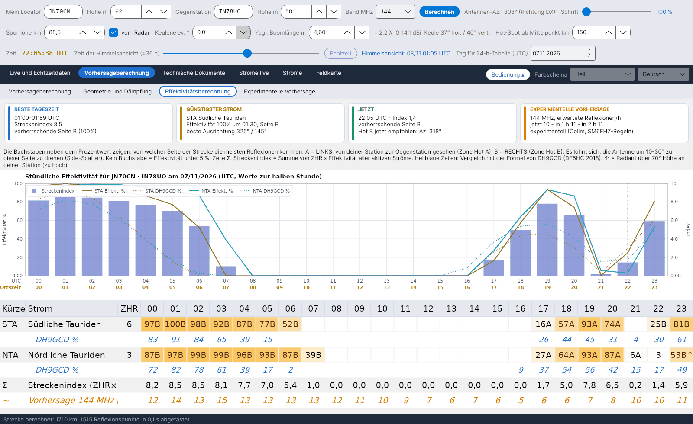

[English](Efficiency-Calculation) · [Italiano](Efficiency-Calculation-it) · **Deutsch** · [Nederlands](Efficiency-Calculation-nl) · [Français](Efficiency-Calculation-fr) · [Español](Efficiency-Calculation-es) · [Português](Efficiency-Calculation-pt) · [Dansk](Efficiency-Calculation-da) · [Norsk](Efficiency-Calculation-nb) · [Svenska](Efficiency-Calculation-sv) · [Íslenska](Efficiency-Calculation-is) · [Eesti](Efficiency-Calculation-et) · [Lietuvių](Efficiency-Calculation-lt) · [Latviešu](Efficiency-Calculation-lv) · [Русский](Efficiency-Calculation-ru) · [Українська](Efficiency-Calculation-uk) · [Türkçe](Efficiency-Calculation-tr) · [Afrikaans](Efficiency-Calculation-af) · [العربية](Efficiency-Calculation-ar) · [עברית](Efficiency-Calculation-he) · [اردو](Efficiency-Calculation-ur) · [हिन्दी](Efficiency-Calculation-hi) · [বাংলা](Efficiency-Calculation-bn) · [Bahasa Indonesia](Efficiency-Calculation-id) · [Tagalog](Efficiency-Calculation-tl) · [日本語](Efficiency-Calculation-ja) · [한국어](Efficiency-Calculation-ko) · [中文](Efficiency-Calculation-zh)

# Effektivitätsberechnung

*Reiter: Vorhersageberechnung › Effektivitätsberechnung.*

[](https://raw.githubusercontent.com/ic8tem/YA-MS/main/docs/screenshots/de-2_3.png)

Die **Effektivität** eines Meteorstroms gibt in Prozent an, wie sehr die Position seines Radianten Reflexionen auf **deiner** Strecke zulässt. Das Konzept stammt von Ilkka **OH5IY** (MS-Soft) und wird im Artikel Cerrotta–Sartori aufgegriffen: Das Maximum der Effektivität fällt nicht mit dem visuellen Maximum (ZHR) zusammen, weil es davon abhängt, wo der Radiant relativ zu den beiden Stationen steht. MCG_MS von DL5MCG wendet dieselbe Idee auf vier feste Richtungen an; YA-MS berechnet sie für die **tatsächliche Strecke** zwischen den beiden Locatoren.

Dieser Reiter zeigt sie Stunde für Stunde für den in *Tag für 24-h-Tabelle (UTC)* gewählten Tag (Werte zur halben Stunde).

## Übersichtskarten

| Karte | Inhalt |
|---|---|
| **BESTE TAGESZEIT** | Stunde mit dem höchsten Streckenindex, der Index und die überwiegende Seite (A/B mit ihrem %) |
| **GÜNSTIGSTER STROM** | Der Strom mit dem größten ZHR × Effektivität des Tages, seine Effektivität, Stunde und Seite sowie die **beste Ausrichtung** (Radiant-Azimut +90° / −90°) |
| **JETZT** | Index und überwiegende Seite zu dieser Stunde und der empfohlene Hot (nur wenn der gewählte Tag heute ist) |
| **EXPERIMENTELLE VORHERSAGE** | Erwartete Reflexionen/h jetzt, in 1 h und in 2 h auf der Vorhersagefrequenz (Collm, SM6FHZ-Regeln; siehe [Experimentelle Vorhersage](Experimental-Forecasts-de)) |

Unter den Karten erklärt ein Streifen die Buchstaben A und B (siehe unten).

## Diagramm

*Stündliche Effektivität für … am … (UTC, Werte zur halben Stunde).* Für bis zu fünf Ströme: Effektivität % als durchgezogene Linie und die DH9GCD-Formel als gepunktete Linie gleicher Farbe; der **Streckenindex** als blaue Balken auf der rechten Skala.

## Stundentabelle

Eine Zeile pro an diesem Tag aktivem Strom (nach ZHR sortiert), 24 Spalten für die Stunden (UTC):

| Zelle | Bedeutung |
|---|---|
| `63A` | Effektivität 63 %, die meisten Reflexionen von Seite **A** |
| `41B` | Effektivität 41 %, Seite **B** |
| `3` | Effektivität unter 5 %: Zahl ohne Seitenbuchstaben |
| leer | Effektivität unter 1 % |
| `…↑` | der Radiant steht zu dieser Stunde an deiner Station **höher als 70°** (zu hoch) |
| gelber Text | Effektivität ≥ 50 % |

- **A** = **links**, von deiner Station zur Gegenstation gesehen (Zone Hot A); **B** = **rechts** (Zone Hot B). Es lohnt sich, die Antenne **um 10–30° zu dieser Seite** zu drehen (Side-Scatter, Artikel Cerrotta–Sartori).
- **Hellblaue Zeilen** (*DH9GCD %*, unter jedem Strom): die DH9GCD-Formel zum Vergleich.
- **Zeile Σ**: *Streckenindex (ZHR×Eff.)*.
- **Orange Zeile** (*Vorhersage … MHz (Refl./h)*): die experimentelle Vorhersage für die Stunden, für die es sie gibt (heute und ein Teil von morgen).

## Das Modell

Alle Schritte stehen im [Berechnungshandbuch](Efficiency-Explanation-de) (`doc/YA-MS_manuale_calcoli.docx`, Kapitel 5). Kurz gefasst:

**1. Spiegelnde Reflexion.** Eine Spur leitet das Signal nur dann von A nach B, wenn sie ein Ellipsoid mit A und B in den Brennpunkten tangiert (McKinley 1961). Die Spuren eines Stroms verlaufen parallel zur Radiantenrichtung ŝ (Artikel; McKinley). Für jeden Punkt P der E-Schicht, mit Einheitsvektoren zu den Stationen:

```
ê_A = (A − P)/|A − P|     ê_B = (B − P)/|B − P|     n̂ = (ê_A + ê_B)/|ê_A + ê_B|     specular condition: ŝ·n̂ = 0
```

Dasselbe Gesetz liegt QTFGUI von DJ5HG (Kegelstreuung) zugrunde. Die Bedingung wird mit einer gaußförmigen Toleranz σ = 0,05 rad (etwa 3°) akzeptiert – *Entscheidung des Programms*:

```
S_P = exp( −(ŝ·n̂)² / (2σ²) )
```

**2. Gewicht jedes Punktes.** Leistung einer unterdichten Spur (McKinley), φ = halber Streuwinkel (begrenzt auf 85°, *Entscheidung*):

```
φ = ½·arccos(ê_A·ê_B)        w_P = 1 / [ R1·R2·(R1 + R2)·cos²φ ]
```

Die Zahl der Meteore, die einen Punkt erreichen, ist proportional zum Sinus der Radiantenhöhe dort (ŝ·û_P), dieselbe Korrektur, die die IMO für die ZHR verwendet.

**3. Summe und Prozentwert.** Punkte alle 15 km in Spurhöhe, nur dort, wo beide Stationen sie oberhalb der Keulenelevation sehen (*Entscheidung*). 100 % ist die günstigste Radiantenposition für diese Strecke:

```
F(ŝ) = Σ_P w_P · S_P · max(0, ŝ·û_P)          η(ŝ) = 100 · F(ŝ) / max F   %
```

F wird einmal pro Strecke auf einem Richtungsgitter berechnet (Azimut alle 5°, Elevation alle 2,5°) und interpoliert.

**4. Seite und Index.**

```
f_A = Σ_{P∈A} w_P·S_P·(ŝ·û_P) / Σ_P w_P·S_P·(ŝ·û_P)          I(t) = Σ_showers ZHR(t)·η(t) / 100
```

Der Buchstabe in der Tabelle ist die Seite mit dem größeren Anteil. *Entscheidungen des Programms (Handbuch Gl. 32–33).*

## Vergleich mit DH9GCD

Eine unabhängige Prüfung: die Formel der besten Richtung von **DH9GCD**, wiedergegeben von **DF5HC** (DARC-Vortrag, Januar 2018), mit El und Az als Elevation und Azimut des Radianten von deiner Station aus und P als Azimut der Gegenstation:

```
E = sin El · cos El · sin(P − Az)          shown as  E% = 200 · sin El · cos El · |sin(P − Az)|
```

Sie ist maximal, wenn der Radiant auf 45° und quer zur Strecke steht. DF5HC hält den Radianten unter 20° für zu niedrig und **über 70° für zu hoch**: Diese Stunden erhalten in der Tabelle ein ↑ und eine Warnung in der [Himmelsansicht](Sky-View-de#warnungen). Die Formel berücksichtigt weder Entfernung noch Höhen, ist aber ein guter Vergleichswert.

## Prüfungen

| Prüfung | Ergebnis |
|---|---|
| SM6FHZ-Regel (VUSHF 2025): beste Strecke rechtwinklig zum Radiant-Azimut, Ausrichtung = Radiant-Az. ±90°, Toleranz ±40–50° | Vom Modell reproduziert; mit dem Radianten in Streckenrichtung und hoch am Himmel ist die Effektivität fast null |
| QTFGUI von DJ5HG, Hamburg JO53IM – Barcelona, Quadrantiden, 4. Januar (Beispiel aus seinem Handbuch) | QTFGUI: 07:00 Ausrichtung 252°, −8 dB; 08:00 keine Reflexionszone; 09:00 Ausrichtung 168°, −4 dB. YA-MS (Höhe 102 km wie QTFGUI): 07:00 241°, −5,4 dB; 08:00 0,6 % (−22 dB); 09:00 161°, −4,0 dB. DH9GCD: 26 %, 2 %, 32 %. Alle drei Methoden sehen das Loch um 08:00, mit dem Radianten fast im Zenit |
| Abtastung alle 5 km statt 15 km | die Prozentwerte ändern sich um weniger als 0,3 Punkte |

> Die von OH5IY und MCG_MS verwendete Skala ist nicht im Detail bekannt (die Handbücher von MS-Soft sind nicht verfügbar): Vergleiche die Prozentwerte mit diesen Programmen, bevor du sie als gleichwertig betrachtest. Das Modell berücksichtigt nur unterdichte Spuren, mit isotropen Antennen; überdichte Bursts und der sporadische Untergrund sind nicht in der Effektivität enthalten (der sporadische Untergrund wird durch den Radarfluss dargestellt).
