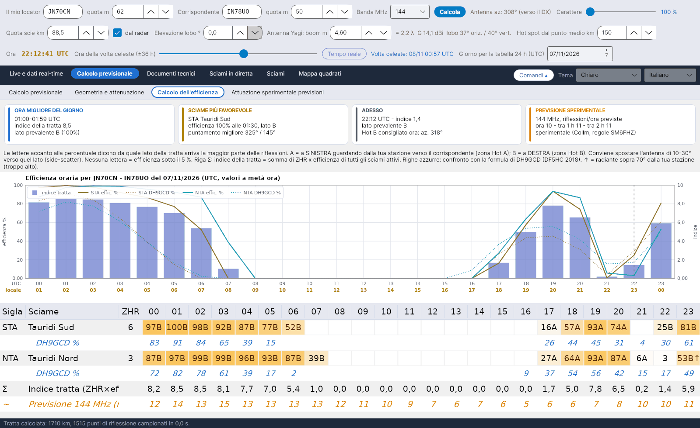

[English](Efficiency-Calculation) · **Italiano** · [Deutsch](Efficiency-Calculation-de) · [Nederlands](Efficiency-Calculation-nl) · [Français](Efficiency-Calculation-fr) · [Español](Efficiency-Calculation-es) · [Português](Efficiency-Calculation-pt) · [Português (Brasil)](Efficiency-Calculation-pt-br) · [Dansk](Efficiency-Calculation-da) · [Norsk](Efficiency-Calculation-nb) · [Svenska](Efficiency-Calculation-sv) · [Íslenska](Efficiency-Calculation-is) · [Eesti](Efficiency-Calculation-et) · [Lietuvių](Efficiency-Calculation-lt) · [Latviešu](Efficiency-Calculation-lv) · [Polski](Efficiency-Calculation-pl) · [Čeština](Efficiency-Calculation-cs) · [Magyar](Efficiency-Calculation-hu) · [Română](Efficiency-Calculation-ro) · [Ελληνικά](Efficiency-Calculation-el) · [Русский](Efficiency-Calculation-ru) · [Українська](Efficiency-Calculation-uk) · [Türkçe](Efficiency-Calculation-tr) · [Afrikaans](Efficiency-Calculation-af) · [العربية](Efficiency-Calculation-ar) · [עברית](Efficiency-Calculation-he) · [اردو](Efficiency-Calculation-ur) · [हिन्दी](Efficiency-Calculation-hi) · [বাংলা](Efficiency-Calculation-bn) · [ไทย](Efficiency-Calculation-th) · [Bahasa Indonesia](Efficiency-Calculation-id) · [Tagalog](Efficiency-Calculation-tl) · [日本語](Efficiency-Calculation-ja) · [한국어](Efficiency-Calculation-ko) · [中文](Efficiency-Calculation-zh) · [中文 (繁體)](Efficiency-Calculation-zh-tw)

# Calcolo dell'efficienza

*Linguetta: Calcolo previsionale › Calcolo dell'efficienza.*

[](https://raw.githubusercontent.com/ic8tem/YA-MS/main/docs/screenshots/it-2_3.png)

L'**efficienza** di uno sciame dice, in percentuale, quanto la posizione del suo radiante consente riflessioni sulla **tua** tratta. Il concetto è di Ilkka **OH5IY** (MS-Soft) ed è ripreso nell'articolo Cerrotta–Sartori: il massimo di efficienza non coincide con il massimo visuale (ZHR), perché dipende da dove si trova il radiante rispetto alle due stazioni. MCG_MS di DL5MCG applica la stessa idea a quattro direzioni fisse; YA-MS la calcola per la **tratta reale** tra i due locator.

Questa linguetta la mostra ora per ora per il giorno scelto in *Data del calcolo (UTC)* (valori alla mezza di ogni ora).

## Schede riassuntive

| Scheda | Contenuto |
|---|---|
| **ORA MIGLIORE DEL GIORNO** | Ora con l'indice di tratta più alto, l'indice e il lato prevalente (A/B con la sua %) |
| **SCIAME PIÙ FAVOREVOLE** | Lo sciame con il ZHR × efficienza più alto della giornata, la sua efficienza, ora e lato, e il **puntamento migliore** (azimut del radiante +90° / −90°) |
| **ADESSO** | Indice e lato prevalente in quest'ora, e l'Hot consigliato (solo quando il giorno scelto è oggi) |
| **PREVISIONE SPERIMENTALE** | Riflessioni/ora attese adesso, tra 1 h e tra 2 h alla frequenza della previsione (Collm, regole SM6FHZ; vedi [Attuazione sperimentale previsioni](Experimental-Forecasts-it)) |

Sotto le schede una fascia spiega le lettere A e B (vedi sotto).

## Grafico

*Efficienza oraria per … del … (UTC, valori a metà ora).* Per un massimo di cinque sciami: l'efficienza % come linea continua e la formula DH9GCD come linea punteggiata dello stesso colore; l'**indice della tratta** come barre blu sulla scala a destra.

## Tabella oraria

Una riga per ogni sciame attivo quel giorno (ordinati per ZHR), 24 colonne per le ore (UTC):

| Cella | Significato |
|---|---|
| `63A` | efficienza 63 %, la maggior parte delle riflessioni dal lato **A** |
| `41B` | efficienza 41 %, lato **B** |
| `3` | efficienza sotto il 5 %: numero senza lettera del lato |
| vuota | efficienza sotto l'1 % |
| `…↑` | il radiante è **sopra 70°** dalla tua stazione a quell'ora (troppo alto) |
| testo giallo | efficienza ≥ 50 % |

- **A** = a **sinistra** guardando dalla tua stazione verso il corrispondente (zona Hot A); **B** = a **destra** (zona Hot B). Conviene girare l'antenna di **10–30° verso quel lato** (side-scatter, articolo Cerrotta–Sartori).
- **Righe azzurre** (*DH9GCD %*, sotto ogni sciame): la formula DH9GCD, per confronto.
- **Riga Σ**: *Indice tratta (ZHR×eff.)*.
- **Riga arancione** (*Previsione … MHz (rifl./ora)*): la previsione sperimentale, per le ore in cui esiste (oggi e parte di domani).

## Il modello

Tutti i passaggi sono nel [manuale dei calcoli](Efficiency-Explanation-it) (`doc/YA-MS_manuale_calcoli.docx`, capitolo 5). In breve:

**1. Riflessione speculare.** Una scia manda il segnale da A a B solo se è tangente a un ellissoide con A e B nei fuochi (McKinley 1961). Le scie di uno sciame sono parallele alla direzione del radiante ŝ (articolo; McKinley). Per ogni punto P dello strato E, con i versori verso le stazioni:

```math
\hat{e}_A = \frac{A-P}{|A-P|},\qquad \hat{e}_B = \frac{B-P}{|B-P|},\qquad \hat{n} = \frac{\hat{e}_A+\hat{e}_B}{|\hat{e}_A+\hat{e}_B|},\qquad \hat{s}\cdot\hat{n} = 0
```

La stessa legge sta alla base di QTFGUI di DJ5HG e del suo testo *"Die Geometrie von Meteorscatterverbindungen"* (2004): la scia diffonde su un cono che ha la scia come asse, e solo un ricevitore sul cono la sente. Per una scia ideale la parete del cono è sottilissima (un radiatore lungo migliaia di lunghezze d'onda); il programma accetta la condizione con una tolleranza gaussiana σ = 0,05 rad (circa 3°), che rappresenta ciò che il cono ideale non vede: la dispersione dei radianti degli sciami (0,3–1,4° misurati da GMN), le scie piegate dal vento e la loro lunghezza finita – *scelta del programma*:

```math
S_P = \exp\left(-\frac{(\hat{s}\cdot\hat{n})^2}{2\sigma^2}\right)
```

**2. Peso di ogni punto.** Potenza di una scia sottodensa (McKinley; ITU-R P.843, eq. 3), φ = metà dell'angolo di diffusione (limitato a 85°, *scelta*), β = angolo tra la scia e il piano di propagazione A-P-B, p̂ = normale unitaria a quel piano:

```math
\varphi = \tfrac{1}{2}\arccos(\hat{e}_A\cdot\hat{e}_B),\qquad \hat{p} = \frac{\hat{e}_A\times\hat{e}_B}{|\hat{e}_A\times\hat{e}_B|},\qquad \sin\beta = |\hat{s}\cdot\hat{p}|,\qquad w_P(\hat{s}) = \frac{1}{R_1 R_2 (R_1+R_2)\,(1-\cos^2\beta\,\sin^2\varphi)}
```

**Opzione "Angolo β tra scia e tratta (McKinley completo)"** (attiva per impostazione predefinita, impostazione prudente). Attiva: le scie che attraversano il piano di propagazione valgono 10–15 dB meno di quelle che vi giacciono, così nessuna scia viene sopravvalutata. Disattivata: ogni scia pesa come se stesse nel piano (β = 0, peso con cos²φ), come fino alla versione 1.6. *Verifica:* su una tratta di 1000 km, senza β l'azimut migliore del radiante è a 15°–90° dalla tratta secondo l'elevazione del radiante (30° con il radiante a 30°, perpendicolare alla tratta con il radiante a 60°), e il radiante perpendicolare vale il 67 % a 30° di elevazione; con β il radiante migliore è sempre lungo la tratta e quello perpendicolare scende al 15 %. Con β si perde la regola della direzione migliore di SM6FHZ / DH9GCD; β resta un'opzione, attiva per impostazione predefinita perché dà i valori più prudenti, e disattivarla riporta la regola.

Il numero di meteore che raggiungono un punto è proporzionale al seno dell'elevazione del radiante in quel punto (ŝ·û_P), la stessa correzione che l'IMO usa per lo ZHR.

**Opzione "Scie più lunghe con radiante basso (DJ5HG)"** (casella sopra il grafico, disattivata per impostazione predefinita, con tooltip): DJ5HG osserva che con il radiante basso cadono meno meteore per km², ma le scie sono più lunghe (fino a 100 km utili) e soddisfano più spesso la legge di riflessione. Con l'opzione attiva il peso diventa min(sin El, 15/100): lo spessore utile dello strato, 15 km, diviso per il seno dell'elevazione dà la lunghezza della scia, limitata a 100 km. Sopra circa 9° i due effetti si compensano. Disattivata, il calcolo resta prudente.

**Impostazione del calcolo** (stessa riga, pulsanti di scelta): **Prudente** (predefinita, i valori più prudenti: quota delle scie dal radar, scie normali, β attivo), **Come DJ5HG** (102 km, scie più lunghe, β) e **Personalizzata**, selezionata automaticamente quando cambi a mano la quota, la casella *dal radar*, l'opzione delle scie più lunghe o β.

**3. Somma e percentuale.** Punti ogni 15 km alla quota delle scie, solo dove entrambe le stazioni li vedono sopra l'elevazione del lobo (*scelta*). Il 100 % è la posizione del radiante più favorevole per quella tratta:

```math
F(\hat{s}) = \sum_P w_P\, S_P\, \max(0,\ \hat{s}\cdot\hat{u}_P),\qquad \eta(\hat{s}) = 100\,\frac{F(\hat{s})}{\max F}\ \%
```

F si calcola una volta per tratta su una griglia di direzioni (azimut ogni 5°, elevazione ogni 2,5°) e si interpola.

**Efficienza in dB (riferimento DJ5HG).** La percentuale è relativa solo alla posizione migliore del radiante per quella tratta. Per confrontare tratte diverse il programma dà anche l'efficienza in dB rispetto al riferimento fisso di DJ5HG: 0 dB è il massimo di una tratta nord–sud di 1000 km a cavallo dell'equatore con il radiante sull'equatore celeste all'equinozio, calcolato con la stessa quota e gli stessi pesi. DJ5HG indica i suoi valori come migliori di 6 dB.

**4. Lato e indice.**

```math
f_A = \frac{\sum_{P\in A} w_P S_P\,(\hat{s}\cdot\hat{u}_P)}{\sum_P w_P S_P\,(\hat{s}\cdot\hat{u}_P)},\qquad I(t) = \sum \frac{ZHR(t)\,\eta(t)}{100}
```

La lettera nella tabella è il lato con la frazione maggiore. *Scelte del programma (eq. 32–33 del manuale).*

## Confronto con DH9GCD

Le fonti primarie per la direzione migliore sono Eshleman & Mlodnosky e Meeks & James (Proc. IRE, 1957), Hines (1955) e la sua verifica sperimentale di Forsyth, Hines & Vogan (1955): sono utili solo i radianti sul semicerchio di cielo perpendicolare alla bisettrice dell'angolo di diffusione, il numero di scie cresce con sin El e, vicino al punto medio, le scie utili cadono a circa H·tan El di lato, dalla parte opposta al radiante. DJ5HG aggiunge una riserva: con un radiante **basso** proprio lungo la tratta la formula di McKinley dà segnali forti (Amburgo–Narvik, Quadrantidi, verso le 19 UTC), quindi "radiante allineato con la tratta = quasi zero" vale solo per un radiante alto; il programma resta prudente e mostra l'avviso *RADIANTE BASSO LUNGO LA TRATTA*.

Una verifica indipendente: la formula della direzione migliore di **DH9GCD**, riportata da **DF5HC** (convegno DARC, gennaio 2018) – non ha una fonte primaria pubblicata – con El e Az elevazione e azimut del radiante visti dalla tua stazione e P l'azimut del corrispondente:

```math
E = \sin El\,\cos El\,\sin(P-Az),\qquad E\% = 200\,\sin El\,\cos El\,|\sin(P-Az)|
```

È massima con il radiante a 45° e di traverso rispetto alla tratta. DF5HC considera il radiante troppo basso sotto 20° e **troppo alto sopra 70°**: queste ore ricevono ↑ nella tabella e un avviso nella [Volta celeste](Sky-View-it#avvisi). La formula ignora distanza e quote, ma è un buon riferimento.

## Verifiche

| Verifica | Risultato |
|---|---|
| Regola di SM6FHZ (VUSHF 2025): tratta migliore ortogonale all'azimut del radiante, puntamento = az. del radiante ±90°, tolleranza ±40–50° | Riprodotta dal modello; con il radiante allineato alla tratta e alto nel cielo l'efficienza è quasi zero |
| QTFGUI di DJ5HG, Amburgo JO53IM – Barcellona, Quadrantidi, 4 gennaio (esempio del suo manuale) | QTFGUI: 07:00 puntamento 252°, −8 dB; 08:00 nessuna zona di riflessione; 09:00 puntamento 168°, −4 dB. YA-MS (quota 102 km come QTFGUI): 07:00 241°, −5,4 dB; 08:00 0,6 % (−22 dB); 09:00 161°, −4,0 dB. DH9GCD: 26 %, 2 %, 32 %. Tutti e tre i metodi vedono il buco delle 08:00, con il radiante quasi allo zenit |
| Curve di DJ5HG (*Die Geometrie…*, Bild 8–9: da Amburgo e da Monaco di Baviera, Quadrantidi, 4 gennaio; lette dal grafico, circa ±0,5 dB e ±15 min) contro la prova automatica `--prova-dj5hg` (un valore all'ora) | Orari: il buco con il radiante vicino allo zenit cade alle stesse ore (Barcellona 07:30–08:30 contro 07–09; Sofia 06:36–07:48 contro 07–08; Narvik 07–08:30 contro 07–09); Mosca è chiusa 03–10 in entrambi, aperta da Amburgo fino alle 02:30 circa e da Monaco fino alle 00:30 circa, come scrive DJ5HG. Puntamenti: 2–10° di differenza. Livelli e andamento a 102 km (scarto medio e RMS dalle curve): senza β e senza scie più lunghe −1,6 / 4,0 dB; scie più lunghe +1,1 / 4,6 dB; β −5,4 / 6,2 dB ma con l'andamento migliore (3,0 dB tolta la media, contro 3,6): compaiono i minimi profondi con il radiante basso (Barcellona −15,6 dB alle 17 contro −16 dB alle 19:36; Sofia −18,5 dB alle 20 contro −14 dB). β e scie più lunghe (*Come DJ5HG*) −2,2 / 4,7 dB; l'impostazione prudente (quota del radar 89,5 km, β attivo, senza scie più lunghe) −6,9 / 7,6 dB, andamento 3,3 dB. Senza β YA-MS mostra appena il minimo con il radiante basso e quasi allineato con la tratta (−8,6 e −10,4 dB): è la riserva dello stesso DJ5HG, da qui l'avviso |
| Campionamento ogni 5 km invece di 15 km | le percentuali cambiano di meno di 0,3 punti |

> La documentazione di MS-Soft 5.2 definisce l'efficienza di OH5IY come un indice relativo per le sole scie sottodense, con due fattori (elevazione del radiante, migliore verso 45°, e angolo con la tratta, migliore a 90°) e un minimo alzato a mano al 20 % per le scie sovradense; la formula non è pubblicata. MCG_MS la calcola per quattro direzioni fisse e, con il locatore del DX, per la tratta reale. Il modello considera solo le scie sottodense, con antenne isotrope; i burst sovradensi e il fondo sporadico non entrano nell'efficienza (il fondo sporadico è rappresentato dal flusso radar).
