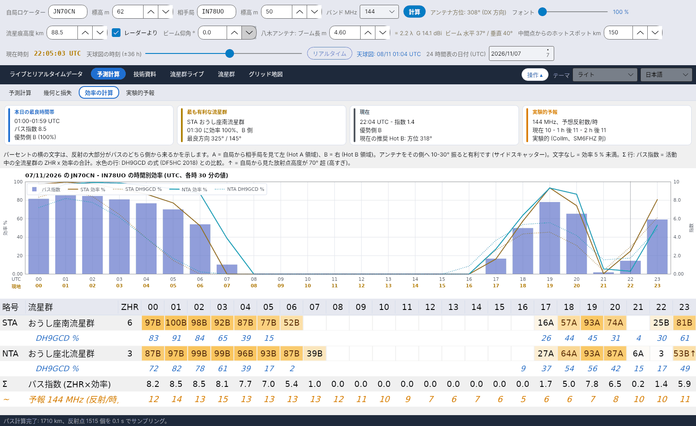

[English](Efficiency-Calculation) · [Italiano](Efficiency-Calculation-it) · [Deutsch](Efficiency-Calculation-de) · [Nederlands](Efficiency-Calculation-nl) · [Français](Efficiency-Calculation-fr) · [Español](Efficiency-Calculation-es) · [Português](Efficiency-Calculation-pt) · [Dansk](Efficiency-Calculation-da) · [Norsk](Efficiency-Calculation-nb) · [Svenska](Efficiency-Calculation-sv) · [Íslenska](Efficiency-Calculation-is) · [Eesti](Efficiency-Calculation-et) · [Lietuvių](Efficiency-Calculation-lt) · [Latviešu](Efficiency-Calculation-lv) · [Русский](Efficiency-Calculation-ru) · [Українська](Efficiency-Calculation-uk) · [Türkçe](Efficiency-Calculation-tr) · [Afrikaans](Efficiency-Calculation-af) · [العربية](Efficiency-Calculation-ar) · [עברית](Efficiency-Calculation-he) · [اردو](Efficiency-Calculation-ur) · [हिन्दी](Efficiency-Calculation-hi) · [বাংলা](Efficiency-Calculation-bn) · [Bahasa Indonesia](Efficiency-Calculation-id) · [Tagalog](Efficiency-Calculation-tl) · **日本語** · [한국어](Efficiency-Calculation-ko) · [中文](Efficiency-Calculation-zh)

# 効率の計算

*タブ: 予測計算 › 効率の計算。*

[](https://raw.githubusercontent.com/ic8tem/YA-MS/main/docs/screenshots/ja-2_3.png)

流星群の**効率**は、その放射点の位置が**自局の**パスでの反射をどれだけ可能にするかをパーセントで表します。この概念は Ilkka **OH5IY** (MS-Soft) によるもので、Cerrotta–Sartori の記事でも取り上げられています: 効率の極大は眼視の極大 (ZHR) とは一致しません。放射点が両局に対してどこにあるかに左右されるためです。DL5MCG の MCG_MS は同じ考え方を 4 つの固定方向に適用しますが、YA-MS は 2 つのロケーター間の**実際のパス**について計算します。

このタブは、*24 時間表の日付 (UTC)* で選んだ日について 1 時間ごとに効率を表示します (各時 30 分の値)。

## 概要カード

| カード | 内容 |
|---|---|
| **本日の最良時間帯** | パス指数が最も高い時間、その指数、優勢な側 (A/B とその %) |
| **最も有利な流星群** | その日の ZHR × 効率が最大の流星群、その効率、時間、側、そして **最良方向** (放射点方位 +90° / −90°) |
| **現在** | この時間の指数と優勢な側、および推奨 Hot (選んだ日が今日の場合のみ) |
| **実験的予報** | 予報周波数での現在、1 h 後、2 h 後の予想反射数/時 (Collm、SM6FHZ 則; [実験的予報](Experimental-Forecasts-ja) を参照) |

カードの下の帯には A と B の文字の説明があります (下記参照)。

## グラフ

*… の … の時間別効率 (UTC、各時 30 分の値)。* 最大 5 つの流星群について、効率 % を実線で、DH9GCD の式を同じ色の点線で表示します。**パス指数** は右目盛の青い棒で示されます。

## 時間別の表

その日に活動する流星群ごとに 1 行 (ZHR 順)、時間 (UTC) ごとに 24 列:

| セル | 意味 |
|---|---|
| `63A` | 効率 63 %、反射の大部分は **A** 側から |
| `41B` | 効率 41 %、**B** 側 |
| `3` | 効率 5 % 未満: 側の文字なしの数字 |
| 空欄 | 効率 1 % 未満 |
| `…↑` | その時間、放射点が自局から見て **70° より高い** (高すぎ) |
| 黄色の文字 | 効率 ≥ 50 % |

- **A** = 自局から相手局を見て**左** (Hot A 領域); **B** = **右** (Hot B 領域)。アンテナを**その側へ 10–30° 振る**と有利です (サイドスキャッター、Cerrotta–Sartori の記事)。
- **水色の行** (*DH9GCD %*、各流星群の下): 比較用の DH9GCD の式。
- **Σ 行**: *パス指数 (ZHR×効率)*。
- **橙の行** (*予報 … MHz (反射/時)*): 実験的予報。予報がある時間 (今日と明日の一部) のみ。

## モデル

すべての手順は [計算マニュアル](Efficiency-Explanation-ja) (`doc/YA-MS_manuale_calcoli.docx`、第 5 章) にあります。要約:

**1. 鏡面反射。** 流星痕が信号を A から B へ送るのは、A と B を焦点とする回転楕円体に流星痕が接するときだけです (McKinley 1961)。流星群の流星痕は放射点の方向 ŝ に平行です (記事; McKinley)。E 層の各点 P について、両局への単位ベクトルを用いて:

```
ê_A = (A − P)/|A − P|     ê_B = (B − P)/|B − P|     n̂ = (ê_A + ê_B)/|ê_A + ê_B|     specular condition: ŝ·n̂ = 0
```

同じ法則が DJ5HG の QTFGUI (円錐散乱) の基礎にもなっています。条件はガウス型の許容幅 σ = 0.05 rad (約 3°) で受け入れます – *プログラム独自の選択*:

```
S_P = exp( −(ŝ·n̂)² / (2σ²) )
```

**2. 各点の重み。** アンダーデンス流星痕の電力 (McKinley)。φ = 散乱角の半分 (85° で制限、*選択*):

```
φ = ½·arccos(ê_A·ê_B)        w_P = 1 / [ R1·R2·(R1 + R2)·cos²φ ]
```

ある点に到達する流星の数は、その点での放射点高度の正弦 (ŝ·û_P) に比例します。IMO が ZHR に用いるのと同じ補正です。

**3. 合計とパーセント。** 流星痕高度で 15 km ごとの点を、両局からビーム仰角より上に見える場所だけ使います (*選択*)。100 % はそのパスにとって最も有利な放射点の位置です:

```
F(ŝ) = Σ_P w_P · S_P · max(0, ŝ·û_P)          η(ŝ) = 100 · F(ŝ) / max F   %
```

F はパスごとに 1 度、方向のグリッド (方位 5° ごと、仰角 2.5° ごと) 上で計算し、補間します。

**4. 側と指数。**

```
f_A = Σ_{P∈A} w_P·S_P·(ŝ·û_P) / Σ_P w_P·S_P·(ŝ·û_P)          I(t) = Σ_showers ZHR(t)·η(t) / 100
```

表の文字は割合の大きい側です。*プログラム独自の選択 (マニュアル式 32–33)。*

## DH9GCD との比較

独立した検証: **DH9GCD** による最良方向の式。**DF5HC** による紹介 (DARC 講演、2018 年 1 月)。El と Az は自局から見た放射点の仰角と方位、P は相手局の方位です:

```
E = sin El · cos El · sin(P − Az)          shown as  E% = 200 · sin El · cos El · |sin(P − Az)|
```

放射点が 45° でパスに対して真横のとき最大になります。DF5HC は放射点が 20° 未満では低すぎ、**70° 超では高すぎ**とみなします: それらの時間は表で ↑ が付き、[天球図](Sky-View-ja#警告) に警告が出ます。この式は距離と高度を考慮しませんが、良い参考になります。

## 検証

| 検証 | 結果 |
|---|---|
| SM6FHZ 則 (VUSHF 2025): 最良のパスは放射点方位に直交、方向 = 放射点方位 ±90°、許容 ±40–50° | モデルで再現。放射点がパスと同じ向きで空高くにあると効率はほぼゼロ |
| DJ5HG の QTFGUI、ハンブルク JO53IM – バルセロナ、しぶんぎ座流星群、1 月 4 日 (そのマニュアルの例) | QTFGUI: 07:00 方向 252°、−8 dB; 08:00 反射領域なし; 09:00 方向 168°、−4 dB。YA-MS (QTFGUI と同じ高度 102 km): 07:00 241°、−5.4 dB; 08:00 0.6 % (−22 dB); 09:00 161°、−4.0 dB。DH9GCD: 26 %、2 %、32 %。3 つの方法すべてが、放射点がほぼ天頂にある 08:00 の落ち込みを示す |
| 15 km ではなく 5 km ごとのサンプリング | パーセントの変化は 0.3 ポイント未満 |

> OH5IY と MCG_MS が使う目盛の詳細は不明です (MS-Soft のマニュアルが入手できないため): 同等とみなす前に、それらのプログラムのパーセントと比較してください。モデルはアンダーデンス流星痕のみを、等方性アンテナで扱います。オーバーデンスのバーストと散在流星のバックグラウンドは効率に含まれません (散在流星のバックグラウンドはレーダーフラックスで表されます)。
