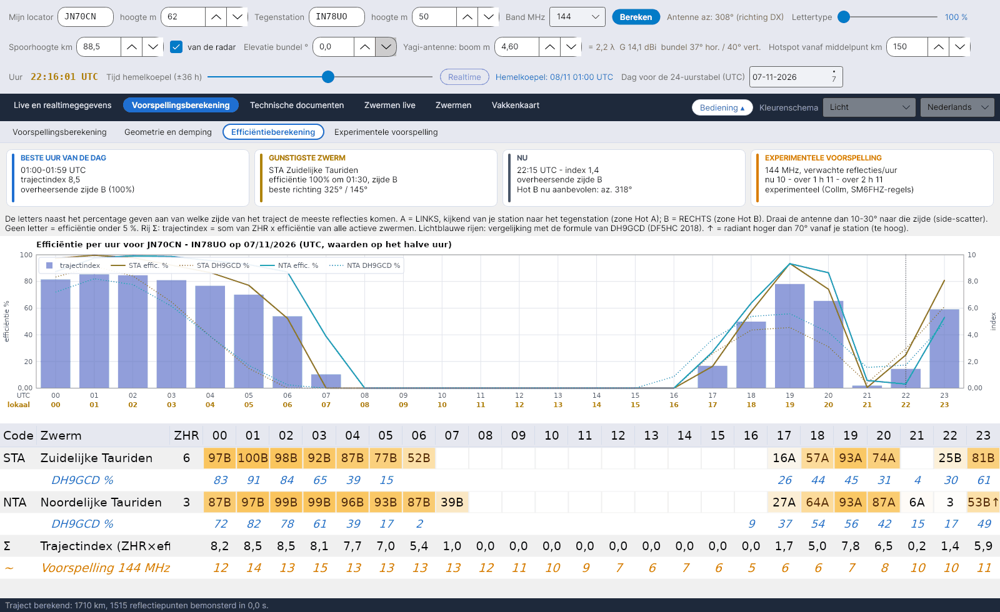

[English](Efficiency-Calculation) · [Italiano](Efficiency-Calculation-it) · [Deutsch](Efficiency-Calculation-de) · **Nederlands** · [Français](Efficiency-Calculation-fr) · [Español](Efficiency-Calculation-es) · [Português](Efficiency-Calculation-pt) · [Português (Brasil)](Efficiency-Calculation-pt-br) · [Dansk](Efficiency-Calculation-da) · [Norsk](Efficiency-Calculation-nb) · [Svenska](Efficiency-Calculation-sv) · [Íslenska](Efficiency-Calculation-is) · [Eesti](Efficiency-Calculation-et) · [Lietuvių](Efficiency-Calculation-lt) · [Latviešu](Efficiency-Calculation-lv) · [Polski](Efficiency-Calculation-pl) · [Čeština](Efficiency-Calculation-cs) · [Magyar](Efficiency-Calculation-hu) · [Română](Efficiency-Calculation-ro) · [Ελληνικά](Efficiency-Calculation-el) · [Русский](Efficiency-Calculation-ru) · [Українська](Efficiency-Calculation-uk) · [Türkçe](Efficiency-Calculation-tr) · [Afrikaans](Efficiency-Calculation-af) · [العربية](Efficiency-Calculation-ar) · [עברית](Efficiency-Calculation-he) · [اردو](Efficiency-Calculation-ur) · [हिन्दी](Efficiency-Calculation-hi) · [বাংলা](Efficiency-Calculation-bn) · [ไทย](Efficiency-Calculation-th) · [Bahasa Indonesia](Efficiency-Calculation-id) · [Tagalog](Efficiency-Calculation-tl) · [日本語](Efficiency-Calculation-ja) · [한국어](Efficiency-Calculation-ko) · [中文](Efficiency-Calculation-zh) · [中文 (繁體)](Efficiency-Calculation-zh-tw)

# Efficiëntieberekening

*Tabblad: Voorspellingsberekening › Efficiëntieberekening.*

[](https://raw.githubusercontent.com/ic8tem/YA-MS/main/docs/screenshots/nl-2_3.png)

De **efficiëntie** van een zwerm geeft in procenten aan in hoeverre de positie van de radiant reflecties op **jouw** traject mogelijk maakt. Het begrip is van Ilkka **OH5IY** (MS-Soft) en wordt overgenomen in het artikel van Cerrotta–Sartori: het maximum van de efficiëntie valt niet samen met het visuele maximum (ZHR), omdat het afhangt van waar de radiant staat ten opzichte van de twee stations. MCG_MS van DL5MCG past hetzelfde idee toe op vier vaste richtingen; YA-MS berekent het voor het **werkelijke traject** tussen de twee locators.

Dit tabblad toont haar uur voor uur voor de dag die is gekozen in *Dag voor de 24-uurstabel (UTC)* (waarden op het halve uur).

## Overzichtskaarten

| Kaart | Inhoud |
|---|---|
| **BESTE UUR VAN DE DAG** | Uur met de hoogste trajectindex, de index en de overheersende zijde (A/B met haar %) |
| **GUNSTIGSTE ZWERM** | De zwerm met de hoogste ZHR × efficiëntie van de dag, zijn efficiëntie, uur en zijde, en de **beste richting** (azimut van de radiant +90° / −90°) |
| **NU** | Index en overheersende zijde op dit uur, en de aanbevolen hot (alleen als de gekozen dag vandaag is) |
| **EXPERIMENTELE VOORSPELLING** | Verwachte reflecties/uur nu, over 1 h en over 2 h op de voorspellingsfrequentie (Collm, SM6FHZ-regels; zie [Experimentele voorspelling](Experimental-Forecasts-nl)) |

Onder de kaarten legt een balk de letters A en B uit (zie hieronder).

## Grafiek

*Efficiëntie per uur voor … op … (UTC, waarden op het halve uur).* Voor maximaal vijf zwermen: efficiëntie % als doorgetrokken lijn en de DH9GCD-formule als stippellijn in dezelfde kleur; de **trajectindex** als blauwe balken op de rechterschaal.

## Uurtabel

Eén regel per zwerm die die dag actief is (gesorteerd op ZHR), 24 kolommen voor de uren (UTC):

| Cel | Betekenis |
|---|---|
| `63A` | efficiëntie 63 %, de meeste reflecties van zijde **A** |
| `41B` | efficiëntie 41 %, zijde **B** |
| `3` | efficiëntie onder 5 %: getal zonder letter voor de zijde |
| leeg | efficiëntie onder 1 % |
| `…↑` | de radiant staat op dat uur **hoger dan 70°** vanaf jouw station (te hoog) |
| gele tekst | efficiëntie ≥ 50 % |

- **A** = **links**, kijkend van jouw station naar het tegenstation (zone Hot A); **B** = **rechts** (zone Hot B). Het loont om de antenne **10–30° naar die kant** te draaien (side-scatter, artikel van Cerrotta–Sartori).
- **Lichtblauwe regels** (*DH9GCD %*, onder elke zwerm): de DH9GCD-formule, ter vergelijking.
- **Σ-regel**: *Trajectindex (ZHR×eff.)*.
- **Oranje regel** (*Voorspelling … MHz (refl./uur)*): de experimentele voorspelling, voor de uren waarvoor die bestaat (vandaag en een deel van morgen).

## Het model

Alle stappen staan in de [rekenhandleiding](Efficiency-Explanation-nl) (`doc/YA-MS_manuale_calcoli.docx`, hoofdstuk 5). In het kort:

**1. Spiegelende reflectie.** Een spoor stuurt het signaal alleen van A naar B als het raakt aan een ellipsoïde met A en B in de brandpunten (McKinley 1961). De sporen van een zwerm lopen evenwijdig aan de richting van de radiant ŝ (artikel; McKinley). Voor elk punt P van de E-laag, met eenheidsvectoren naar de stations:

```math
\hat{e}_A = \frac{A-P}{|A-P|},\qquad \hat{e}_B = \frac{B-P}{|B-P|},\qquad \hat{n} = \frac{\hat{e}_A+\hat{e}_B}{|\hat{e}_A+\hat{e}_B|},\qquad \hat{s}\cdot\hat{n} = 0
```

Dezelfde wet ligt ten grondslag aan QTFGUI van DJ5HG en zijn tekst *"Die Geometrie von Meteorscatterverbindungen"* (2004): het spoor verstrooit op een kegel met het spoor als as, en alleen een ontvanger op de kegel hoort het. Voor een ideaal spoor is de kegelwand heel dun (een straler van duizenden golflengten lang); het programma accepteert de voorwaarde met een Gaussische tolerantie σ = 0,05 rad (ongeveer 3°), die staat voor wat de ideale kegel niet ziet: de spreiding van de radianten van de zwermen (0,3–1,4° gemeten door GMN), door de wind gebogen sporen en hun eindige lengte – *keuze van het programma*:

```math
S_P = \exp\left(-\frac{(\hat{s}\cdot\hat{n})^2}{2\sigma^2}\right)
```

**2. Gewicht van elk punt.** Vermogen van een onderdicht spoor (McKinley; ITU-R P.843, vgl. 3), φ = de halve verstrooiingshoek (begrensd op 85°, *keuze*), β = hoek tussen het spoor en het voortplantingsvlak A-P-B, p̂ = eenheidsnormaal op dat vlak:

```math
\varphi = \tfrac{1}{2}\arccos(\hat{e}_A\cdot\hat{e}_B),\qquad \hat{p} = \frac{\hat{e}_A\times\hat{e}_B}{|\hat{e}_A\times\hat{e}_B|},\qquad \sin\beta = |\hat{s}\cdot\hat{p}|,\qquad w_P(\hat{s}) = \frac{1}{R_1 R_2 (R_1+R_2)\,(1-\cos^2\beta\,\sin^2\varphi)}
```

**Optie "β-hoek tussen spoor en traject (volledige McKinley)"** (standaard aan, voorzichtige instelling). Aan: sporen die het voortplantingsvlak kruisen zijn 10–15 dB minder waard dan sporen die erin liggen, zodat geen enkel spoor wordt overschat. Uit: elk spoor weegt alsof het in het vlak ligt (β = 0, gewicht met cos²φ), zoals tot en met versie 1.6. *Controle:* op een traject van 1000 km ligt zonder β het beste radiantazimut 15°–90° van het traject, afhankelijk van de radiantelevatie (30° met de radiant op 30°, dwars op het traject met de radiant op 60°), en de dwarse radiant is 67 % waard bij 30° elevatie; met β ligt de beste radiant altijd langs het traject en zakt de dwarse naar 15 %. Met β gaat de regel van de beste richting van SM6FHZ / DH9GCD verloren; β blijft een optie, standaard aan omdat die de voorzichtigste waarden geeft, en uitzetten brengt de regel terug.

Het aantal meteoren dat een punt bereikt, is evenredig met de sinus van de elevatie van de radiant in dat punt (ŝ·û_P), dezelfde correctie die de IMO voor de ZHR gebruikt.

**Optie "Langere sporen bij een lage radiant (DJ5HG)"** (selectievakje boven de grafiek, standaard uit, met tooltip): DJ5HG merkt op dat bij een lage radiant minder meteoren per km² vallen, maar dat de sporen langer zijn (tot 100 km bruikbaar) en vaker aan de reflectiewet voldoen. Met de optie aan wordt het gewicht min(sin El, 15/100): de bruikbare laagdikte, 15 km, gedeeld door de sinus van de elevatie geeft de spoorlengte, begrensd op 100 km. Boven ongeveer 9° heffen de twee effecten elkaar op. Uit blijft de berekening voorzichtig.

**Berekeningsinstelling** (zelfde rij, keuzerondjes): **Voorzichtig** (standaard, de voorzichtigste waarden: spoorhoogte van de radar, normale sporen, β aan), **Zoals DJ5HG** (102 km, langere sporen, β) en **Aangepast**, dat automatisch wordt gekozen als je de hoogte, het vakje *van de radar*, de optie voor langere sporen of β met de hand wijzigt.

**3. Som en percentage.** Punten om de 15 km op spoorhoogte, alleen waar beide stations ze boven de bundelelevatie zien (*keuze*). 100 % is de gunstigste positie van de radiant voor dat traject:

```math
F(\hat{s}) = \sum_P w_P\, S_P\, \max(0,\ \hat{s}\cdot\hat{u}_P),\qquad \eta(\hat{s}) = 100\,\frac{F(\hat{s})}{\max F}\ \%
```

F wordt eenmaal per traject berekend op een raster van richtingen (azimut om de 5°, elevatie om de 2,5°) en geïnterpoleerd.

**Efficiëntie in dB (referentie DJ5HG).** Het percentage is alleen relatief ten opzichte van de beste radiantpositie voor dat traject. Om verschillende trajecten te vergelijken geeft het programma ook de efficiëntie in dB ten opzichte van de vaste referentie van DJ5HG: 0 dB is het maximum van een noord–zuidtraject van 1000 km over de evenaar, met de radiant op de hemelequator bij de equinox, berekend met dezelfde hoogte en dezelfde gewichten. DJ5HG geeft zijn waarden op als beter dan 6 dB.

**4. Zijde en index.**

```math
f_A = \frac{\sum_{P\in A} w_P S_P\,(\hat{s}\cdot\hat{u}_P)}{\sum_P w_P S_P\,(\hat{s}\cdot\hat{u}_P)},\qquad I(t) = \sum \frac{ZHR(t)\,\eta(t)}{100}
```

De letter in de tabel is de zijde met de grootste fractie. *Keuzes van het programma (vgl. 32–33 van de handleiding).*

## Vergelijking met DH9GCD

De primaire bronnen voor de beste richting zijn Eshleman & Mlodnosky en Meeks & James (Proc. IRE, 1957), Hines (1955) en de experimentele controle daarvan door Forsyth, Hines & Vogan (1955): alleen radianten op de halve cirkel aan de hemel loodrecht op de bissectrice van de verstrooiingshoek zijn bruikbaar, het aantal sporen groeit met sin El, en nabij het middelpunt vallen de bruikbare sporen ongeveer H·tan El opzij, aan de kant tegenover de radiant. DJ5HG maakt een voorbehoud: met een **lage** radiant precies langs het traject geeft de formule van McKinley sterke signalen (Hamburg–Narvik, Quadrantiden, rond 19 UTC), dus "radiant in lijn met het traject = bijna nul" geldt alleen voor een hoge radiant; het programma blijft voorzichtig en toont de waarschuwing *LAGE RADIANT LANGS HET TRAJECT*.

Een onafhankelijke controle: de formule voor de beste richting van **DH9GCD**, aangehaald door **DF5HC** (DARC-congres, januari 2018) – er is geen gepubliceerde primaire bron –, met El en Az de elevatie en het azimut van de radiant gezien vanaf jouw station en P het azimut van het tegenstation:

```math
E = \sin El\,\cos El\,\sin(P-Az),\qquad E\% = 200\,\sin El\,\cos El\,|\sin(P-Az)|
```

Ze is maximaal met de radiant op 45° en dwars op het traject. DF5HC vindt de radiant te laag onder 20° en **te hoog boven 70°**: die uren krijgen ↑ in de tabel en een waarschuwing in de [Hemelkoepel](Sky-View-nl#waarschuwingen). De formule negeert afstand en hoogtes, maar is een goede referentie.

## Controles

| Controle | Resultaat |
|---|---|
| Regel van SM6FHZ (VUSHF 2025): beste traject loodrecht op het azimut van de radiant, richting = az. radiant ±90°, tolerantie ±40–50° | Door het model gereproduceerd; met de radiant in lijn met het traject en hoog aan de hemel is de efficiëntie bijna nul |
| QTFGUI van DJ5HG, Hamburg JO53IM – Barcelona, Quadrantiden, 4 januari (voorbeeld uit zijn handleiding) | QTFGUI: 07:00 richting 252°, −8 dB; 08:00 geen reflectiezone; 09:00 richting 168°, −4 dB. YA-MS (hoogte 102 km zoals QTFGUI): 07:00 241°, −5,4 dB; 08:00 0,6 % (−22 dB); 09:00 161°, −4,0 dB. DH9GCD: 26 %, 2 %, 32 %. Alle drie de methoden zien het gat om 08:00, met de radiant bijna in het zenit |
| Curven van DJ5HG (*Die Geometrie…*, Bild 8–9: vanuit Hamburg en München, Quadrantiden, 4 januari; afgelezen uit de grafiek, ongeveer ±0,5 dB en ±15 min) tegenover de automatische test `--prova-dj5hg` (één waarde per uur) | Tijden: het gat met de radiant dicht bij het zenit valt op dezelfde uren (Barcelona 07:30–08:30 tegenover 07–09; Sofia 06:36–07:48 tegenover 07–08; Narvik 07–08:30 tegenover 07–09); Moskou is in beide 03–10 dicht, open vanuit Hamburg tot ongeveer 02:30 en vanuit München tot ongeveer 00:30, zoals DJ5HG schrijft. Richtingen: 2–10° verschil. Niveaus en vorm bij 102 km (gemiddeld en RMS-verschil met de curven): geen β, geen langere sporen −1,6 / 4,0 dB; langere sporen +1,1 / 4,6 dB; β −5,4 / 6,2 dB maar met de beste vorm (3,0 dB na aftrek van het gemiddelde, tegen 3,6): de diepe minima bij een lage radiant verschijnen (Barcelona −15,6 dB om 17 tegen −16 dB om 19:36; Sofia −18,5 dB om 20 tegen −14 dB). β en langere sporen (*Zoals DJ5HG*) −2,2 / 4,7 dB; de voorzichtige instelling (radarhoogte 89,5 km, β aan, geen langere sporen) −6,9 / 7,6 dB, vorm 3,3 dB. Zonder β toont YA-MS het minimum met de radiant laag en bijna in lijn met het traject nauwelijks (−8,6 en −10,4 dB): dit is het eigen voorbehoud van DJ5HG, vandaar de waarschuwing |
| Bemonstering om de 5 km in plaats van 15 km | de percentages veranderen minder dan 0,3 punt |

> De documentatie van MS-Soft 5.2 definieert de efficiëntie van OH5IY als een relatieve index voor alleen onderdichte sporen, met twee factoren (elevatie van de radiant, best rond 45°, en hoek met het traject, best 90°) en een minimum dat voor overdichte sporen met de hand op 20 % is gezet; de formule is niet gepubliceerd. MCG_MS berekent haar voor vier vaste richtingen en, met de locator van de DX, voor het werkelijke traject. Het model houdt alleen rekening met onderdichte sporen, met isotrope antennes; overdichte bursts en de sporadische achtergrond zitten niet in de efficiëntie (de sporadische achtergrond wordt vertegenwoordigd door de radarflux).
