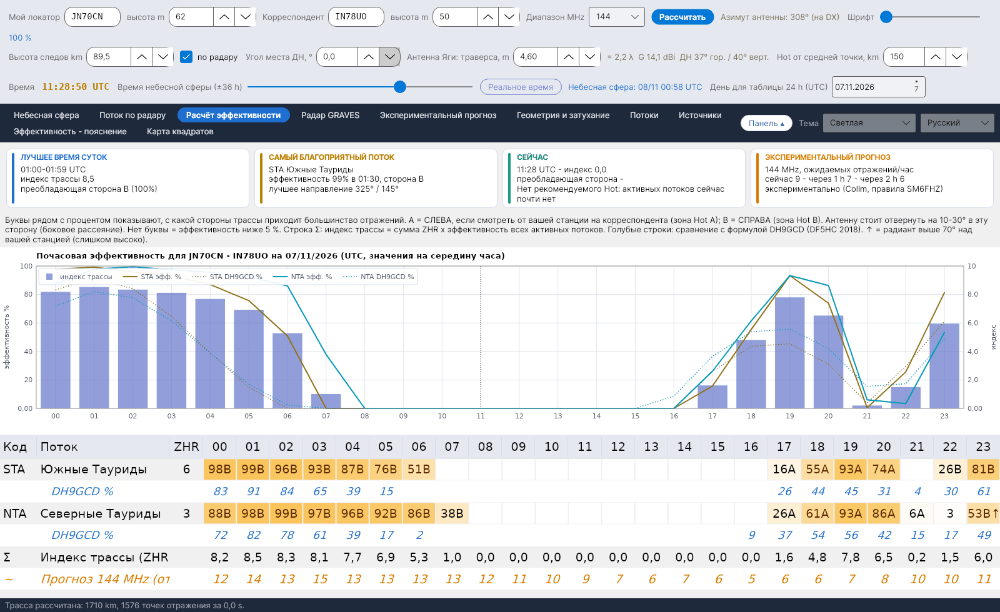

[English](Efficiency-Calculation) · **Русский** · [Deutsch](Efficiency-Calculation-de) · [日本語](Efficiency-Calculation-ja)

# Расчёт эффективности

*Вкладка 3.*

[](https://raw.githubusercontent.com/ic8tem/YA-MS/main/docs/screenshots/ru-3.png)

**Эффективность** потока показывает в процентах, насколько положение его радианта позволяет получать отражения на **вашей** трассе. Понятие введено Ilkka **OH5IY** (MS-Soft) и использовано в статье Cerrotta–Sartori: максимум эффективности не совпадает с визуальным максимумом (ZHR), потому что зависит от положения радианта относительно двух станций. MCG_MS от DL5MCG применяет ту же идею к четырём фиксированным направлениям; YA-MS рассчитывает её для **реальной трассы** между двумя локаторами.

Вкладка показывает эффективность по часам для дня, выбранного в *День для таблицы 24 h (UTC)* (значения на середину каждого часа).

## Сводные карточки

| Карточка | Содержание |
|---|---|
| **ЛУЧШЕЕ ВРЕМЯ СУТОК** | Час с наибольшим индексом трассы, индекс и преобладающая сторона (A/B с процентом) |
| **САМЫЙ БЛАГОПРИЯТНЫЙ ПОТОК** | Поток с наибольшим ZHR × эффективность за день, его эффективность, час и сторона, а также **лучшее направление** (азимут радианта +90° / −90°) |
| **СЕЙЧАС** | Индекс и преобладающая сторона в текущий час, а также рекомендуемый Hot (только если выбран сегодняшний день) |
| **ЭКСПЕРИМЕНТАЛЬНЫЙ ПРОГНОЗ** | Ожидаемое число отражений/час сейчас, через 1 h и через 2 h на частоте прогноза (Collm, правила SM6FHZ; см. [Экспериментальный прогноз](Experimental-Forecasts-ru)) |

Под карточками полоса с пояснением букв A и B (см. ниже).

## График

*Почасовая эффективность для … на … (UTC, значения на середину часа).* Для не более чем пяти потоков: эффективность в % сплошной линией и формула DH9GCD пунктиром того же цвета; **индекс трассы** – синими столбцами по правой шкале.

## Почасовая таблица

Одна строка на каждый поток, активный в этот день (по убыванию ZHR), 24 столбца по часам (UTC):

| Ячейка | Значение |
|---|---|
| `63A` | эффективность 63 %, большинство отражений со стороны **A** |
| `41B` | эффективность 41 %, сторона **B** |
| `3` | эффективность ниже 5 %: число без буквы стороны |
| пусто | эффективность ниже 1 % |
| `…↑` | радиант в этот час находится **выше 70°** над вашей станцией (слишком высоко) |
| жёлтый текст | эффективность ≥ 50 % |

- **A** = **слева**, если смотреть от вашей станции на корреспондента (зона Hot A); **B** = **справа** (зона Hot B). Антенну стоит отвернуть **на 10–30° в эту сторону** (боковое рассеяние, статья Cerrotta–Sartori).
- **Голубые строки** (*DH9GCD %*, под каждым потоком): формула DH9GCD для сравнения.
- **Строка Σ**: *Индекс трассы (ZHR×эфф.)*.
- **Оранжевая строка** (*Прогноз … MHz (отр./час)*): экспериментальный прогноз для часов, где он есть (сегодня и часть завтрашнего дня).

## Модель

Все шаги приведены в [руководстве по расчётам](Efficiency-Explanation-ru) (`doc/YA-MS_manuale_calcoli.docx`, глава 5). Коротко:

**1. Зеркальное отражение.** След передаёт сигнал от A к B только если он касается эллипсоида с фокусами в A и B (McKinley 1961). Следы потока параллельны направлению на радиант ŝ (статья; McKinley). Для каждой точки P слоя E, с единичными векторами на станции:

```
ê_A = (A − P)/|A − P|     ê_B = (B − P)/|B − P|     n̂ = (ê_A + ê_B)/|ê_A + ê_B|     specular condition: ŝ·n̂ = 0
```

Тот же закон лежит в основе QTFGUI от DJ5HG (конусное рассеяние). Условие принимается с гауссовым допуском σ = 0,05 rad (около 3°) – *выбор программы*:

```
S_P = exp( −(ŝ·n̂)² / (2σ²) )
```

**2. Вес каждой точки.** Мощность ненасыщенного следа (McKinley), φ = половина угла рассеяния (ограничена 85°, *выбор*):

```
φ = ½·arccos(ê_A·ê_B)        w_P = 1 / [ R1·R2·(R1 + R2)·cos²φ ]
```

Число метеоров, достигающих точки, пропорционально синусу угла места радианта в ней (ŝ·û_P) – та же поправка, что IMO использует для ZHR.

**3. Сумма и проценты.** Точки через каждые 15 km на высоте следов, только там, где обе станции видят их выше угла места ДН (*выбор*). 100 % – самое благоприятное положение радианта для данной трассы:

```
F(ŝ) = Σ_P w_P · S_P · max(0, ŝ·û_P)          η(ŝ) = 100 · F(ŝ) / max F   %
```

F рассчитывается один раз для трассы на сетке направлений (азимут через 5°, угол места через 2,5°) и интерполируется.

**4. Сторона и индекс.**

```
f_A = Σ_{P∈A} w_P·S_P·(ŝ·û_P) / Σ_P w_P·S_P·(ŝ·û_P)          I(t) = Σ_showers ZHR(t)·η(t) / 100
```

Буква в таблице – сторона с бо́льшей долей. *Выбор программы (руководство, ур. 32–33).*

## Сравнение с DH9GCD

Независимая проверка: формула лучшего направления **DH9GCD**, приведённая **DF5HC** (конференция DARC, январь 2018), где El и Az – угол места и азимут радианта, видимые с вашей станции, а P – азимут корреспондента:

```
E = sin El · cos El · sin(P − Az)          shown as  E% = 200 · sin El · cos El · |sin(P − Az)|
```

Она максимальна при радианте на высоте 45° и сбоку от трассы. DF5HC считает радиант слишком низким ниже 20° и **слишком высоким выше 70°**: эти часы получают ↑ в таблице и предупреждение на вкладке [Небесная сфера](Sky-View-ru#предупреждения). Формула не учитывает расстояние и высоты, но является хорошим ориентиром.

## Проверки

| Проверка | Результат |
|---|---|
| Правило SM6FHZ (VUSHF 2025): лучшая трасса ортогональна азимуту радианта, направление = азимут радианта ±90°, допуск ±40–50° | Воспроизводится моделью; при радианте, совпадающем по направлению с трассой и стоящем высоко, эффективность почти нулевая |
| QTFGUI от DJ5HG, Гамбург JO53IM – Барселона, Квадрантиды, 4 января (пример из его руководства) | QTFGUI: 07:00 направление 252°, −8 dB; 08:00 зоны отражения нет; 09:00 направление 168°, −4 dB. YA-MS (высота 102 km, как в QTFGUI): 07:00 241°, −5,4 dB; 08:00 0,6 % (−22 dB); 09:00 161°, −4,0 dB. DH9GCD: 26 %, 2 %, 32 %. Все три метода видят провал в 08:00, когда радиант почти в зените |
| Выборка через 5 km вместо 15 km | проценты меняются менее чем на 0,3 пункта |

> Шкала, используемая OH5IY и MCG_MS, в деталях неизвестна (руководства MS-Soft недоступны): прежде чем считать проценты равнозначными, сравните их с этими программами. Модель учитывает только ненасыщенные следы при изотропных антеннах; всплески от переуплотнённых следов и спорадический фон в эффективность не входят (спорадический фон представлен потоком по радару).
