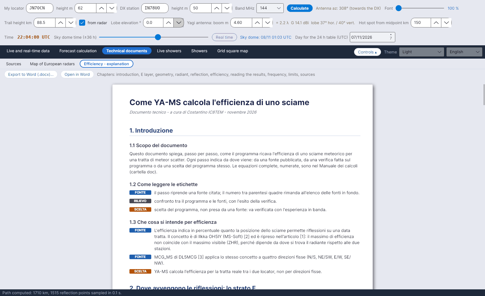

[English](Efficiency-Explanation) · [Italiano](Efficiency-Explanation-it) · [Deutsch](Efficiency-Explanation-de) · [Nederlands](Efficiency-Explanation-nl) · [Français](Efficiency-Explanation-fr) · [Español](Efficiency-Explanation-es) · [Português](Efficiency-Explanation-pt) · [Português (Brasil)](Efficiency-Explanation-pt-br) · [Dansk](Efficiency-Explanation-da) · [Norsk](Efficiency-Explanation-nb) · [Svenska](Efficiency-Explanation-sv) · [Íslenska](Efficiency-Explanation-is) · [Eesti](Efficiency-Explanation-et) · [Lietuvių](Efficiency-Explanation-lt) · [Latviešu](Efficiency-Explanation-lv) · [Polski](Efficiency-Explanation-pl) · [Čeština](Efficiency-Explanation-cs) · [Magyar](Efficiency-Explanation-hu) · [Română](Efficiency-Explanation-ro) · **Ελληνικά** · [Русский](Efficiency-Explanation-ru) · [Українська](Efficiency-Explanation-uk) · [Türkçe](Efficiency-Explanation-tr) · [Afrikaans](Efficiency-Explanation-af) · [العربية](Efficiency-Explanation-ar) · [עברית](Efficiency-Explanation-he) · [اردو](Efficiency-Explanation-ur) · [हिन्दी](Efficiency-Explanation-hi) · [বাংলা](Efficiency-Explanation-bn) · [ไทย](Efficiency-Explanation-th) · [Bahasa Indonesia](Efficiency-Explanation-id) · [Tagalog](Efficiency-Explanation-tl) · [日本語](Efficiency-Explanation-ja) · [한국어](Efficiency-Explanation-ko) · [中文](Efficiency-Explanation-zh) · [中文 (繁體)](Efficiency-Explanation-zh-tw)

# Εξήγηση του υπολογισμού της απόδοσης

*Καρτέλα: Τεχνικά έγγραφα › Εξήγηση του υπολογισμού της απόδοσης.*

Ένα τεχνικό έγγραφο, *"Come YA-MS calcola l'efficienza di uno sciame"* (Πώς υπολογίζει το YA-MS την απόδοση μιας βροχής μετεώρων), που εμφανίζεται μέσα στο πρόγραμμα ως ανοιχτόχρωμη σελίδα. Εξηγεί **βήμα προς βήμα** πώς προκύπτει η απόδοση και αναφέρει για κάθε βήμα **από πού προέρχεται**. Το πρόγραμμα το εμφανίζει **στη γλώσσα της διεπαφής** (και στις 36 γλώσσες), όπως και το εγχειρίδιο υπολογισμών· αυτό το wiki δίνει επίσης το περιεχόμενό του στις σελίδες [Υπολογισμός απόδοσης](Efficiency-Calculation-el#το-μοντέλο) και [Γεωμετρία και απώλεια διαδρομής](Geometry-and-Path-Loss-el).

## Ετικέτες

Κάθε βήμα φέρει μια χρωματιστή ετικέτα:

| Ετικέτα | Χρώμα | Σημασία |
|---|---|---|
| **FONTE** (πηγή) | μπλε | το βήμα στηρίζεται σε μια πηγή που παρατίθεται· ο αριθμός σε αγκύλες παραπέμπει στη λίστα στο τέλος |
| **RILIEVO** (έλεγχος) | πράσινο | σύγκριση ανάμεσα στο πρόγραμμα και τις πηγές, με το αποτέλεσμα |
| **SCELTA** (επιλογή) | πορτοκαλί | μια επιλογή του προγράμματος, που δεν προέρχεται από πηγή: πρέπει να ελεγχθεί με την εμπειρία στον αέρα |

## Κεφάλαια

| Κεφάλαιο | Περιεχόμενο |
|---|---|
| 1. Εισαγωγή | Σκοπός, ετικέτες, τι σημαίνει απόδοση (OH5IY, MCG_MS· το YA-MS χρησιμοποιεί την πραγματική διαδρομή) |
| 2. Πού συμβαίνουν οι ανακλάσεις: το στρώμα E | Ίχνη στα 80–120 km· ύψος ιχνών = επικρατούσα τιμή του ιστογράμματος του Collm (έλεγχος: 89,5 km στις 5/11/2026) |
| 3. Γεωμετρία της διαδρομής | Γη και μέσο· ανύψωση κεραίας (τύπος του άρθρου)· κοινή ζώνη και τα όριά της· Hot A / Hot B· λοβός κεραίας (DL6WU, Kraus, W4RNL) |
| 4. Το ακτινοβόλο σημείο της βροχής | Θέση του ακτινοβόλου (IMO 2026/2027), ημερομηνία κορύφωσης (IMO ή ηλιακό μήκος), προφίλ δραστηριότητας |
| 5. Συνθήκη ανάκλασης | Κατοπτρική ανάκλαση (McKinley), γκαουσιανή ανοχή 0,05 rad, καλύτερη κατεύθυνση (SM6FHZ), τύπος DH9GCD |
| 6. Από ένα σημείο στην απόδοση | Σημεία ανάκλασης κάθε 15 km, βάρος κάθε σημείου, ποσοστό· σύγκριση με το QTFGUI (DJ5HG) |
| 7. Ανάγνωση των αποτελεσμάτων | Πλευρά A / B, δείκτης διαδρομής, χρώματα ακτινοβόλων, ζώνες PREV, τομή όπως φαίνεται από την κεραία |
| 8. Συχνότητα εργασίας και απώλεια διαδρομής | Κανόνες λ³ / λ², από το ραντάρ στη ραδιοερασιτεχνική μπάντα, αναφορές για την απώλεια διαδρομής |
| 9. Γνωστοί περιορισμοί | Μόνο υποπυκνά ίχνη, ισοτροπικές κεραίες (στο αζιμούθιο· κατακόρυφο διάγραμμα προαιρετικό), τιμές εργασίας |
| 10. Πηγές | 17 αριθμημένες πηγές |

## Κουμπιά

| Κουμπί | Τι κάνει |
|---|---|
| **Εξαγωγή σε Word (.docx)...** | Αποθηκεύει ένα αντίγραφο του `data/efficienza_spiegazione.docx` όπου επιλέξετε (προτεινόμενο όνομα *YA-MS - calcolo dell'efficienza.docx*) |
| **Άνοιγμα σε Word** | Ανοίγει το ίδιο `.docx` με το προεπιλεγμένο πρόγραμμα για έγγραφα Word (Word, LibreOffice, …) |

## Αρχεία

| Αρχείο | Περιεχόμενο |
|---|---|
| `data/efficienza_spiegazione.txt` | Το κείμενο που εμφανίζεται στην καρτέλα, ένα μπλοκ ανά γραμμή (`TITLE`, `SUB`, `H1`, `H2`, `P`, `TAG|FONTE|…`, `TAG|RILIEVO|…`, `TAG|SCELTA|…`, `EQ`, `LI`, `SRC`) |
| `data/efficienza_spiegazione.docx` | Η έκδοση Word |
| `data/spiegazione/efficienza_spiegazione_<code>.txt` / `.docx` | Το ίδιο έγγραφο στις άλλες 35 γλώσσες (π.χ. `_en`, `_de`, `_pt-br`) |
| `doc/YA-MS_manuale_calcoli.docx` | Το **εγχειρίδιο υπολογισμών** (ιταλικά): όλες οι εξισώσεις (επεξεργαστής εξισώσεων του Word), αριθμημένες, με τις πηγές τους |
| `doc/manuali/YA-MS_manuale_calcoli_<code>.docx` | Το εγχειρίδιο υπολογισμών στις άλλες 35 γλώσσες |

Τα δύο έγγραφα αναπαράγονται από τον πηγαίο κώδικα με `tools/build_spiegazione.py data [code]` και `node tools/build_manuale.js <file.docx> [code]`· οι μεταφράσεις βρίσκονται στο `tools/traduzioni_doc/` (το `tools/build_documenti.sh` ξαναχτίζει όλες τις γλώσσες).
