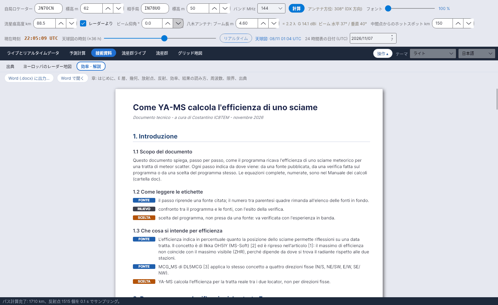

[English](Efficiency-Explanation) · [Italiano](Efficiency-Explanation-it) · [Deutsch](Efficiency-Explanation-de) · [Nederlands](Efficiency-Explanation-nl) · [Français](Efficiency-Explanation-fr) · [Español](Efficiency-Explanation-es) · [Português](Efficiency-Explanation-pt) · [Português (Brasil)](Efficiency-Explanation-pt-br) · [Dansk](Efficiency-Explanation-da) · [Norsk](Efficiency-Explanation-nb) · [Svenska](Efficiency-Explanation-sv) · [Íslenska](Efficiency-Explanation-is) · [Eesti](Efficiency-Explanation-et) · [Lietuvių](Efficiency-Explanation-lt) · [Latviešu](Efficiency-Explanation-lv) · [Polski](Efficiency-Explanation-pl) · [Čeština](Efficiency-Explanation-cs) · [Magyar](Efficiency-Explanation-hu) · [Română](Efficiency-Explanation-ro) · [Ελληνικά](Efficiency-Explanation-el) · [Русский](Efficiency-Explanation-ru) · [Українська](Efficiency-Explanation-uk) · [Türkçe](Efficiency-Explanation-tr) · [Afrikaans](Efficiency-Explanation-af) · [العربية](Efficiency-Explanation-ar) · [עברית](Efficiency-Explanation-he) · [اردو](Efficiency-Explanation-ur) · [हिन्दी](Efficiency-Explanation-hi) · [বাংলা](Efficiency-Explanation-bn) · [Bahasa Indonesia](Efficiency-Explanation-id) · [Tagalog](Efficiency-Explanation-tl) · **日本語** · [한국어](Efficiency-Explanation-ko) · [中文](Efficiency-Explanation-zh) · [中文 (繁體)](Efficiency-Explanation-zh-tw)

# 効率 - 解説

*タブ: 技術資料 › 効率 - 解説。*

技術文書 *"Come YA-MS calcola l'efficienza di uno sciame"* (YA-MS は流星群の効率をどう計算するか) を、プログラム内に明るいページとして表示します。効率がどのように求められるかを**順を追って**説明し、各手順が**何に基づくか**を示しています。この文書は現在**イタリア語**です。この wiki では、その内容を [効率の計算](Efficiency-Calculation-ja#モデル) と [幾何と損失](Geometry-and-Path-Loss-ja) で日本語で紹介しています。

## ラベル

各手順には色付きのラベルが付いています:

| ラベル | 色 | 意味 |
|---|---|---|
| **FONTE** (出典) | 青 | その手順は引用した出典に基づく。括弧内の番号は末尾のリストを指す |
| **RILIEVO** (検証) | 緑 | プログラムと出典の比較とその結果 |
| **SCELTA** (選択) | 橙 | 出典からではなくプログラム独自の選択: 実際の運用経験で確認が必要 |

## 章

| 章 | 内容 |
|---|---|
| 1. はじめに | 目的、ラベル、効率の意味 (OH5IY、MCG_MS; YA-MS は実際のパスを使用) |
| 2. 反射が起こる場所: E 層 | 80–120 km の流星痕; 流星痕高度 = Collm のヒストグラムの最頻値 (検証: 2026/11/5 に 89.5 km) |
| 3. パスの幾何 | 地球と中間点; アンテナ仰角 (記事の式); 共通領域とその限界; Hot A / Hot B; アンテナビーム (DL6WU、Kraus、W4RNL) |
| 4. 流星群の放射点 | 放射点の位置 (IMO 2026/2027)、極大日 (IMO または太陽黄経)、活動プロファイル |
| 5. 反射条件 | 鏡面反射 (McKinley)、ガウス型許容幅 0.05 rad、最良方向 (SM6FHZ)、DH9GCD の式 |
| 6. 1 点から効率へ | 15 km ごとの反射点、各点の重み、パーセント; QTFGUI (DJ5HG) との比較 |
| 7. 結果の読み方 | A / B 側、パス指数、放射点の色、PREV 領域、アンテナから見た断面 |
| 8. 運用周波数とパス損失 | λ³ / λ² 則、レーダーからアマチュアバンドへ、パス損失の基準値 |
| 9. 既知の限界 | アンダーデンス流星痕のみ、等方性アンテナ、作業値 |
| 10. 出典 | 番号付きの 17 の出典 |

## ボタン

| ボタン | 機能 |
|---|---|
| **Word (.docx) に出力...** | `data/efficienza_spiegazione.docx` のコピーを任意の場所に保存します (推奨ファイル名 *YA-MS - calcolo dell'efficienza.docx*) |
| **Word で開く** | 同じ `.docx` を Word 文書の既定のプログラム (Word、LibreOffice、…) で開きます |

## ファイル

| ファイル | 内容 |
|---|---|
| `data/efficienza_spiegazione.txt` | タブに表示されるテキスト。1 行に 1 ブロック (`TITLE`、`SUB`、`H1`、`H2`、`P`、`TAG|FONTE|…`、`TAG|RILIEVO|…`、`TAG|SCELTA|…`、`EQ`、`LI`、`SRC`) |
| `data/efficienza_spiegazione.docx` | Word 版 |
| `doc/YA-MS_manuale_calcoli.docx` | **計算マニュアル**: すべての式 (Word の数式エディター) に番号と出典付き |

2 つの文書は `tools/build_spiegazione.py data` と `node tools/build_manuale.js doc/YA-MS_manuale_calcoli.docx` でソースから再生成します。
