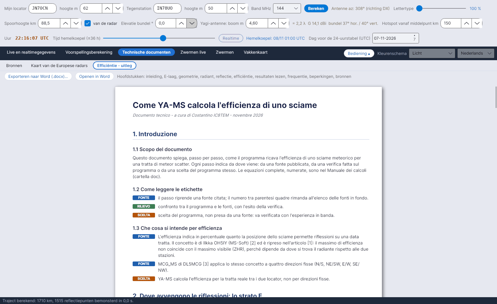

[English](Efficiency-Explanation) · [Italiano](Efficiency-Explanation-it) · [Deutsch](Efficiency-Explanation-de) · **Nederlands** · [Français](Efficiency-Explanation-fr) · [Español](Efficiency-Explanation-es) · [Português](Efficiency-Explanation-pt) · [Português (Brasil)](Efficiency-Explanation-pt-br) · [Dansk](Efficiency-Explanation-da) · [Norsk](Efficiency-Explanation-nb) · [Svenska](Efficiency-Explanation-sv) · [Íslenska](Efficiency-Explanation-is) · [Eesti](Efficiency-Explanation-et) · [Lietuvių](Efficiency-Explanation-lt) · [Latviešu](Efficiency-Explanation-lv) · [Polski](Efficiency-Explanation-pl) · [Čeština](Efficiency-Explanation-cs) · [Magyar](Efficiency-Explanation-hu) · [Română](Efficiency-Explanation-ro) · [Ελληνικά](Efficiency-Explanation-el) · [Русский](Efficiency-Explanation-ru) · [Українська](Efficiency-Explanation-uk) · [Türkçe](Efficiency-Explanation-tr) · [Afrikaans](Efficiency-Explanation-af) · [العربية](Efficiency-Explanation-ar) · [עברית](Efficiency-Explanation-he) · [اردو](Efficiency-Explanation-ur) · [हिन्दी](Efficiency-Explanation-hi) · [বাংলা](Efficiency-Explanation-bn) · [ไทย](Efficiency-Explanation-th) · [Bahasa Indonesia](Efficiency-Explanation-id) · [Tagalog](Efficiency-Explanation-tl) · [日本語](Efficiency-Explanation-ja) · [한국어](Efficiency-Explanation-ko) · [中文](Efficiency-Explanation-zh) · [中文 (繁體)](Efficiency-Explanation-zh-tw)

# Uitleg van de rendementsberekening

*Tabblad: Technische documenten › Uitleg van de rendementsberekening.*

Een technisch document, *"Come YA-MS calcola l'efficienza di uno sciame"* (Hoe YA-MS de efficiëntie van een zwerm berekent), dat in het programma als een lichte pagina wordt getoond. Het legt **stap voor stap** uit hoe de efficiëntie tot stand komt, en vermeldt bij elke stap **waar die vandaan komt**. Het programma toont het **in de taal van de interface** (alle 36 talen), net als de rekenhandleiding; dit wiki geeft de inhoud ook in [Efficiëntieberekening](Efficiency-Calculation-nl#het-model) en [Geometrie en demping](Geometry-and-Path-Loss-nl).

## Labels

Elke stap heeft een gekleurd label:

| Label | Kleur | Betekenis |
|---|---|---|
| **FONTE** (bron) | blauw | de stap neemt een geciteerde bron over; het getal tussen haken verwijst naar de lijst aan het eind |
| **RILIEVO** (controle) | groen | vergelijking tussen het programma en de bronnen, met het resultaat |
| **SCELTA** (keuze) | oranje | een keuze van het programma, niet uit een bron overgenomen: te controleren met ervaring in de lucht |

## Hoofdstukken

| Hoofdstuk | Inhoud |
|---|---|
| 1. Inleiding | Doel, labels, wat efficiëntie betekent (OH5IY, MCG_MS; YA-MS gebruikt het werkelijke traject) |
| 2. Waar reflecties plaatsvinden: de E-laag | Sporen op 80–120 km; spoorhoogte = modus van het histogram van Collm (controle: 89,5 km op 5/11/2026) |
| 3. Trajectgeometrie | Aarde en middelpunt; antenne-elevatie (formule uit het artikel); gemeenschappelijke zone en haar grenzen; Hot A / Hot B; antennebundel (DL6WU, Kraus, W4RNL) |
| 4. De radiant van de zwerm | Positie van de radiant (IMO 2026/2027), datum van het maximum (IMO of zonnelengte), activiteitsprofiel |
| 5. Reflectievoorwaarde | Spiegelende reflectie (McKinley), Gaussische tolerantie 0,05 rad, beste richting (SM6FHZ), DH9GCD-formule |
| 6. Van één punt naar de efficiëntie | Reflectiepunten om de 15 km, gewicht van elk punt, percentage; vergelijking met QTFGUI (DJ5HG) |
| 7. De resultaten lezen | Zijde A / B, trajectindex, kleuren van de radianten, PREV-zones, doorsnede gezien vanaf de antenne |
| 8. Werkfrequentie en trajectdemping | λ³- / λ²-regels, van radar naar amateurband, referenties voor de trajectdemping |
| 9. Bekende beperkingen | Alleen onderdichte sporen, isotrope antennes (in azimut; verticaal diagram optioneel), werkwaarden |
| 10. Bronnen | 17 genummerde bronnen |

## Knoppen

| Knop | Wat hij doet |
|---|---|
| **Exporteren naar Word (.docx)...** | Slaat een kopie van `data/efficienza_spiegazione.docx` op waar je wilt (voorgestelde naam *YA-MS - calcolo dell'efficienza.docx*) |
| **Openen in Word** | Opent dezelfde `.docx` met het standaardprogramma voor Word-documenten (Word, LibreOffice, …) |

## Bestanden

| Bestand | Inhoud |
|---|---|
| `data/efficienza_spiegazione.txt` | De tekst die in het tabblad wordt getoond, één blok per regel (`TITLE`, `SUB`, `H1`, `H2`, `P`, `TAG|FONTE|…`, `TAG|RILIEVO|…`, `TAG|SCELTA|…`, `EQ`, `LI`, `SRC`) |
| `data/efficienza_spiegazione.docx` | De Word-versie |
| `data/spiegazione/efficienza_spiegazione_<code>.txt` / `.docx` | Hetzelfde document in de andere 35 talen (bijv. `_en`, `_de`, `_pt-br`) |
| `doc/YA-MS_manuale_calcoli.docx` | De **rekenhandleiding** (Italiaans): alle vergelijkingen (vergelijkingseditor van Word), genummerd, met hun bronnen |
| `doc/manuali/YA-MS_manuale_calcoli_<code>.docx` | De rekenhandleiding in de andere 35 talen |

De twee documenten worden opnieuw gegenereerd vanuit de broncode met `tools/build_spiegazione.py data [code]` en `node tools/build_manuale.js <file.docx> [code]`. De vertalingen staan in `tools/traduzioni_doc/` (`tools/build_documenti.sh` bouwt alle talen opnieuw op).
