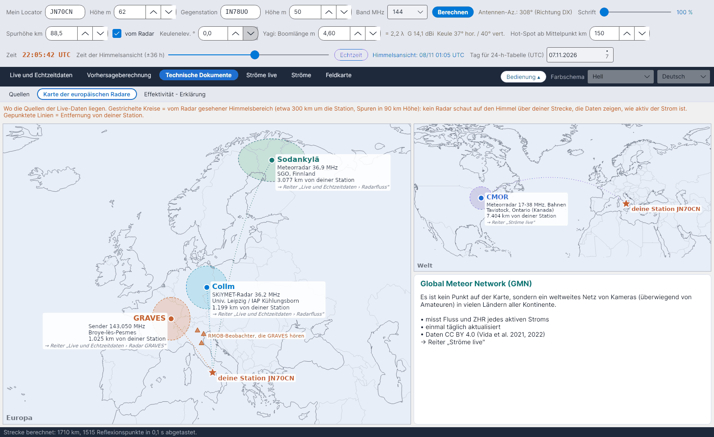

[English](European-Radar-Map) · [Italiano](European-Radar-Map-it) · **Deutsch** · [Nederlands](European-Radar-Map-nl) · [Français](European-Radar-Map-fr) · [Español](European-Radar-Map-es) · [Português](European-Radar-Map-pt) · [Dansk](European-Radar-Map-da) · [Norsk](European-Radar-Map-nb) · [Svenska](European-Radar-Map-sv) · [Íslenska](European-Radar-Map-is) · [Eesti](European-Radar-Map-et) · [Lietuvių](European-Radar-Map-lt) · [Latviešu](European-Radar-Map-lv) · [Русский](European-Radar-Map-ru) · [Українська](European-Radar-Map-uk) · [Türkçe](European-Radar-Map-tr) · [Afrikaans](European-Radar-Map-af) · [العربية](European-Radar-Map-ar) · [עברית](European-Radar-Map-he) · [اردو](European-Radar-Map-ur) · [हिन्दी](European-Radar-Map-hi) · [বাংলা](European-Radar-Map-bn) · [Bahasa Indonesia](European-Radar-Map-id) · [Tagalog](European-Radar-Map-tl) · [日本語](European-Radar-Map-ja) · [한국어](European-Radar-Map-ko) · [中文](European-Radar-Map-zh)

# Karte der europäischen Radare

*Reiter: Technische Dokumente › Karte der europäischen Radare.*

Wo die Quellen der Live-Daten liegen, bezogen auf **deine Station** (der Stern, aus *Mein Locator*):

| Quelle | Was sie ist | Verwendet in |
|---|---|---|
| **Collm** (Deutschland) | SKiYMET-Meteorradar, 36,2 MHz | [Radarfluss](Radar-Flux-de) |
| **Sodankylä** (Finnland) | Meteorradar, 36,9 MHz | [Radarfluss](Radar-Flux-de) |
| **GRAVES** (Frankreich) | Sender, 143,050 MHz | [Radar GRAVES](GRAVES-Radar-de) |
| **CMOR** (Ontario, Kanada) | Meteorradar 17–38 MHz, Bahnen | [Ströme live](Live-Showers-de) |

Die **gestrichelten Kreise** sind der Himmel, den jedes Radar sieht (etwa 300 km um die Station, Spuren in 90 km Höhe): Kein Radar schaut auf den Himmel über deiner Strecke; die Daten sagen, wie aktiv der Strom ist. **Gepunktete Linien** geben die Entfernung von deiner Station an. Gelbe Dreiecke markieren einige italienische RMOB-Beobachter, die GRAVES hören. Das **Global Meteor Network** ist kein Punkt auf der Karte, sondern ein weltweites Kameranetz, das in einem eigenen Kasten beschrieben wird.
