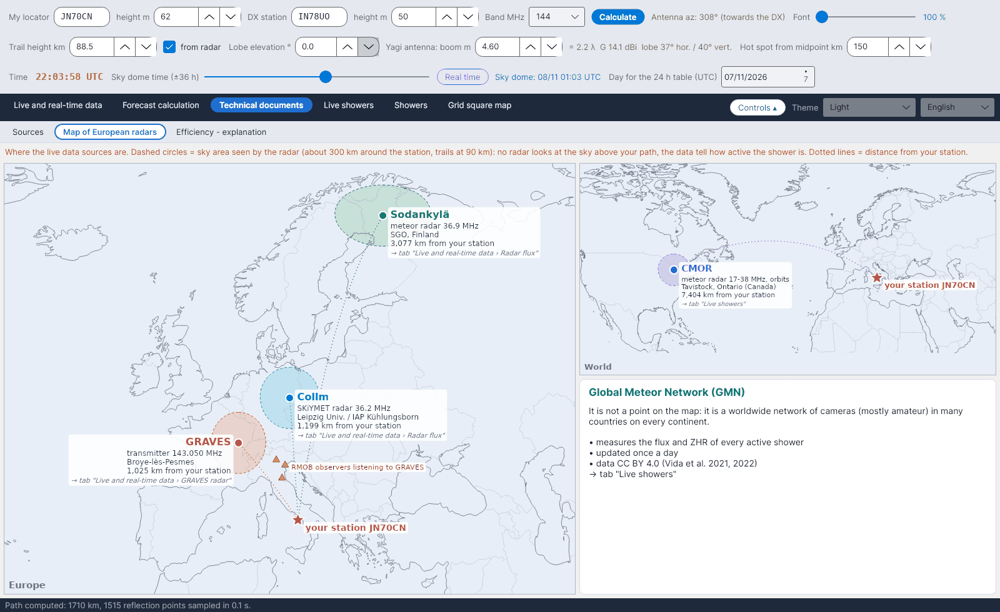

[English](European-Radar-Map) · [Italiano](European-Radar-Map-it) · [Deutsch](European-Radar-Map-de) · [Nederlands](European-Radar-Map-nl) · [Français](European-Radar-Map-fr) · [Español](European-Radar-Map-es) · [Português](European-Radar-Map-pt) · [Português (Brasil)](European-Radar-Map-pt-br) · [Dansk](European-Radar-Map-da) · [Norsk](European-Radar-Map-nb) · [Svenska](European-Radar-Map-sv) · [Íslenska](European-Radar-Map-is) · **Eesti** · [Lietuvių](European-Radar-Map-lt) · [Latviešu](European-Radar-Map-lv) · [Polski](European-Radar-Map-pl) · [Čeština](European-Radar-Map-cs) · [Русский](European-Radar-Map-ru) · [Українська](European-Radar-Map-uk) · [Türkçe](European-Radar-Map-tr) · [Afrikaans](European-Radar-Map-af) · [العربية](European-Radar-Map-ar) · [עברית](European-Radar-Map-he) · [اردو](European-Radar-Map-ur) · [हिन्दी](European-Radar-Map-hi) · [বাংলা](European-Radar-Map-bn) · [Bahasa Indonesia](European-Radar-Map-id) · [Tagalog](European-Radar-Map-tl) · [日本語](European-Radar-Map-ja) · [한국어](European-Radar-Map-ko) · [中文](European-Radar-Map-zh)

# Euroopa radarite kaart

*Sakk: Tehnilised dokumendid › Euroopa radarite kaart.*

Kus asuvad otseandmete allikad **sinu jaama** suhtes (täht, väljalt *Minu lokaator*):

| Allikas | Mis see on | Kasutatakse |
|---|---|---|
| **Collm** (Saksamaa) | SKiYMET meteoorradar, 36,2 MHz | [Radari voog](Radar-Flux-et) |
| **Sodankylä** (Soome) | meteoorradar, 36,9 MHz | [Radari voog](Radar-Flux-et) |
| **GRAVES** (Prantsusmaa) | saatja, 143,050 MHz | [GRAVESi radar](GRAVES-Radar-et) |
| **CMOR** (Ontario, Kanada) | meteoorradar 17–38 MHz, orbiidid | [Meteoorivoolud otse](Live-Showers-et) |

**Katkendlikud ringid** on iga radari nähtav taevas (umbes 300 km jaama ümber, jäljed 90 km kõrgusel): ükski radar ei vaata taevast sinu trassi kohal; andmed näitavad, kui aktiivne meteoorivool on. **Punktiirjooned** näitavad kaugust sinu jaamast. Kollased kolmnurgad tähistavad mõningaid GRAVESit kuulavaid Itaalia RMOB-i vaatlejaid. **Global Meteor Network** ei ole punkt kaardil, vaid ülemaailmne kaamerate võrk, mida kirjeldatakse eraldi kastis.
