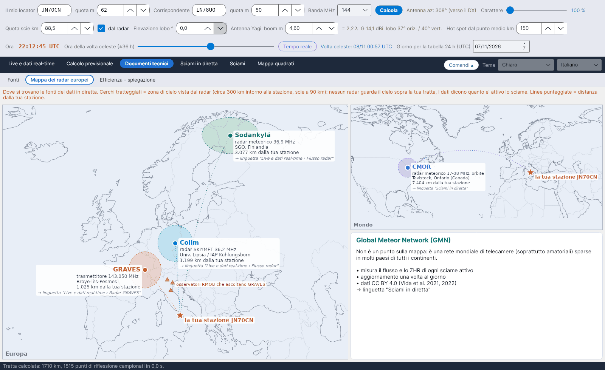

[English](European-Radar-Map) · **Italiano** · [Deutsch](European-Radar-Map-de) · [Nederlands](European-Radar-Map-nl) · [Français](European-Radar-Map-fr) · [Español](European-Radar-Map-es) · [Português](European-Radar-Map-pt) · [Português (Brasil)](European-Radar-Map-pt-br) · [Dansk](European-Radar-Map-da) · [Norsk](European-Radar-Map-nb) · [Svenska](European-Radar-Map-sv) · [Íslenska](European-Radar-Map-is) · [Eesti](European-Radar-Map-et) · [Lietuvių](European-Radar-Map-lt) · [Latviešu](European-Radar-Map-lv) · [Polski](European-Radar-Map-pl) · [Čeština](European-Radar-Map-cs) · [Magyar](European-Radar-Map-hu) · [Română](European-Radar-Map-ro) · [Ελληνικά](European-Radar-Map-el) · [Русский](European-Radar-Map-ru) · [Українська](European-Radar-Map-uk) · [Türkçe](European-Radar-Map-tr) · [Afrikaans](European-Radar-Map-af) · [العربية](European-Radar-Map-ar) · [עברית](European-Radar-Map-he) · [اردو](European-Radar-Map-ur) · [हिन्दी](European-Radar-Map-hi) · [বাংলা](European-Radar-Map-bn) · [ไทย](European-Radar-Map-th) · [Bahasa Indonesia](European-Radar-Map-id) · [Tagalog](European-Radar-Map-tl) · [日本語](European-Radar-Map-ja) · [한국어](European-Radar-Map-ko) · [中文](European-Radar-Map-zh) · [中文 (繁體)](European-Radar-Map-zh-tw)

# Mappa dei radar europei

*Linguetta: Documenti tecnici › Mappa dei radar europei.*

Dove si trovano le fonti dei dati in diretta, rispetto alla **tua stazione** (la stella, da *Il mio locator*):

| Fonte | Che cos'è | Usata in |
|---|---|---|
| **Collm** (Germania) | radar meteorico SKiYMET, 36,2 MHz | [Flusso radar](Radar-Flux-it) |
| **Sodankylä** (Finlandia) | radar meteorico, 36,9 MHz | [Flusso radar](Radar-Flux-it) |
| **GRAVES** (Francia) | trasmettitore, 143,050 MHz | [Radar GRAVES](GRAVES-Radar-it) |
| **CMOR** (Ontario, Canada) | radar meteorico 17–38 MHz, orbite | [Sciami in diretta](Live-Showers-it) |

I **cerchi tratteggiati** sono il cielo visto da ciascun radar (circa 300 km attorno alla stazione, scie a 90 km): nessun radar guarda il cielo sopra la tua tratta; i dati dicono quanto è attivo lo sciame. Le **linee punteggiate** danno la distanza dalla tua stazione. I triangoli gialli segnano alcuni osservatori RMOB italiani che ascoltano GRAVES. Il **Global Meteor Network** non è un punto sulla mappa ma una rete mondiale di telecamere, descritta in un riquadro a parte.
