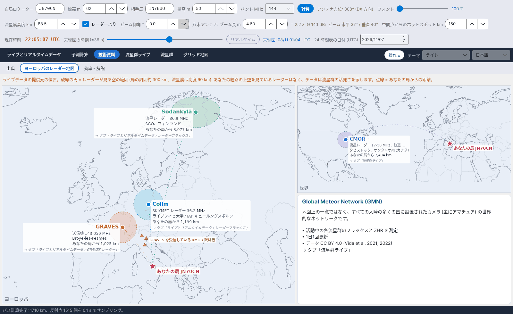

[English](European-Radar-Map) · [Italiano](European-Radar-Map-it) · [Deutsch](European-Radar-Map-de) · [Nederlands](European-Radar-Map-nl) · [Français](European-Radar-Map-fr) · [Español](European-Radar-Map-es) · [Português](European-Radar-Map-pt) · [Português (Brasil)](European-Radar-Map-pt-br) · [Dansk](European-Radar-Map-da) · [Norsk](European-Radar-Map-nb) · [Svenska](European-Radar-Map-sv) · [Íslenska](European-Radar-Map-is) · [Eesti](European-Radar-Map-et) · [Lietuvių](European-Radar-Map-lt) · [Latviešu](European-Radar-Map-lv) · [Polski](European-Radar-Map-pl) · [Čeština](European-Radar-Map-cs) · [Magyar](European-Radar-Map-hu) · [Română](European-Radar-Map-ro) · [Ελληνικά](European-Radar-Map-el) · [Русский](European-Radar-Map-ru) · [Українська](European-Radar-Map-uk) · [Türkçe](European-Radar-Map-tr) · [Afrikaans](European-Radar-Map-af) · [العربية](European-Radar-Map-ar) · [עברית](European-Radar-Map-he) · [اردو](European-Radar-Map-ur) · [हिन्दी](European-Radar-Map-hi) · [বাংলা](European-Radar-Map-bn) · [ไทย](European-Radar-Map-th) · [Bahasa Indonesia](European-Radar-Map-id) · [Tagalog](European-Radar-Map-tl) · **日本語** · [한국어](European-Radar-Map-ko) · [中文](European-Radar-Map-zh) · [中文 (繁體)](European-Radar-Map-zh-tw)

# ヨーロッパのレーダー地図

*タブ: 技術資料 › ヨーロッパのレーダー地図。*

ライブデータの提供元が**自局** (*自局ロケーター* による星印) から見てどこにあるかを示します:

| 提供元 | 内容 | 使用先 |
|---|---|---|
| **Collm** (ドイツ) | SKiYMET 流星レーダー、36.2 MHz | [レーダーフラックス](Radar-Flux-ja) |
| **Sodankylä** (フィンランド) | 流星レーダー、36.9 MHz | [レーダーフラックス](Radar-Flux-ja) |
| **GRAVES** (フランス) | 送信機、143.050 MHz | [GRAVES レーダー](GRAVES-Radar-ja) |
| **CMOR** (カナダ、オンタリオ州) | 流星レーダー 17–38 MHz、軌道 | [流星群ライブ](Live-Showers-ja) |

**破線の円**は各レーダーが見る空です (局の周囲約 300 km、流星痕は高度 90 km): 自局のパスの上空を見ているレーダーはなく、データは流星群がどれだけ活発かを示します。**点線**は自局からの距離を示します。黄色の三角形は、GRAVES を受信しているイタリアの RMOB 観測者の一部です。**Global Meteor Network** は地図上の点ではなく世界規模のカメラ網で、専用の枠内で説明しています。
