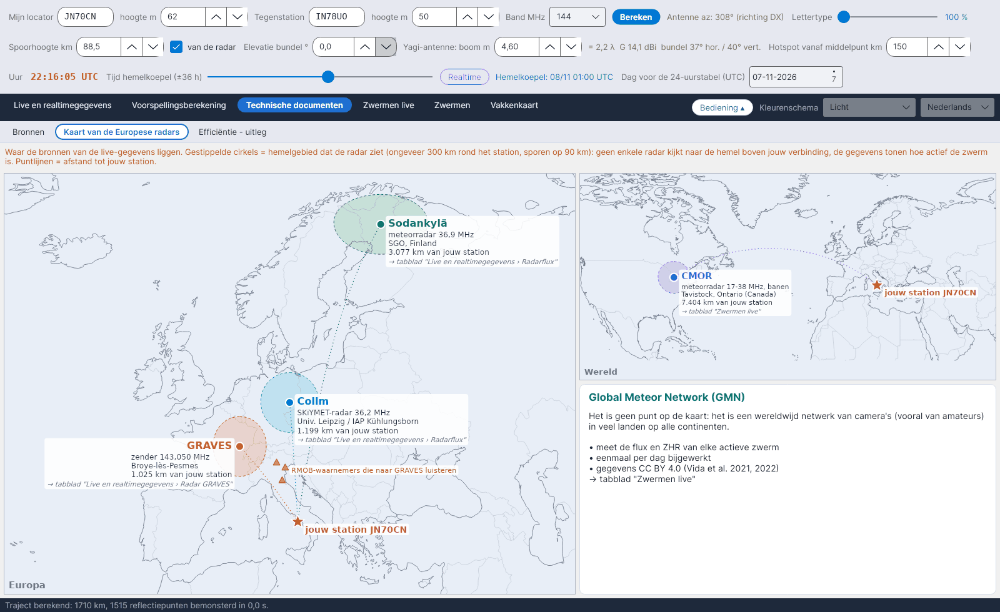

[English](European-Radar-Map) · [Italiano](European-Radar-Map-it) · [Deutsch](European-Radar-Map-de) · **Nederlands** · [Français](European-Radar-Map-fr) · [Español](European-Radar-Map-es) · [Português](European-Radar-Map-pt) · [Português (Brasil)](European-Radar-Map-pt-br) · [Dansk](European-Radar-Map-da) · [Norsk](European-Radar-Map-nb) · [Svenska](European-Radar-Map-sv) · [Íslenska](European-Radar-Map-is) · [Eesti](European-Radar-Map-et) · [Lietuvių](European-Radar-Map-lt) · [Latviešu](European-Radar-Map-lv) · [Polski](European-Radar-Map-pl) · [Čeština](European-Radar-Map-cs) · [Magyar](European-Radar-Map-hu) · [Română](European-Radar-Map-ro) · [Ελληνικά](European-Radar-Map-el) · [Русский](European-Radar-Map-ru) · [Українська](European-Radar-Map-uk) · [Türkçe](European-Radar-Map-tr) · [Afrikaans](European-Radar-Map-af) · [العربية](European-Radar-Map-ar) · [עברית](European-Radar-Map-he) · [اردو](European-Radar-Map-ur) · [हिन्दी](European-Radar-Map-hi) · [বাংলা](European-Radar-Map-bn) · [Bahasa Indonesia](European-Radar-Map-id) · [Tagalog](European-Radar-Map-tl) · [日本語](European-Radar-Map-ja) · [한국어](European-Radar-Map-ko) · [中文](European-Radar-Map-zh)

# Kaart van de Europese radars

*Tabblad: Technische documenten › Kaart van de Europese radars.*

Waar de bronnen van de live gegevens liggen ten opzichte van **jouw station** (de ster, uit *Mijn locator*):

| Bron | Wat het is | Gebruikt in |
|---|---|---|
| **Collm** (Duitsland) | SKiYMET-meteorradar, 36,2 MHz | [Radarflux](Radar-Flux-nl) |
| **Sodankylä** (Finland) | meteorradar, 36,9 MHz | [Radarflux](Radar-Flux-nl) |
| **GRAVES** (Frankrijk) | zender, 143,050 MHz | [Radar GRAVES](GRAVES-Radar-nl) |
| **CMOR** (Ontario, Canada) | meteorradar 17–38 MHz, banen | [Zwermen live](Live-Showers-nl) |

De **gestippelde cirkels** zijn de hemel die elke radar ziet (ongeveer 300 km rond het station, sporen op 90 km): geen enkele radar kijkt naar de hemel boven jouw traject; de gegevens zeggen hoe actief de zwerm is. **Puntlijnen** geven de afstand vanaf jouw station. Gele driehoeken markeren enkele Italiaanse RMOB-waarnemers die naar GRAVES luisteren. Het **Global Meteor Network** is geen punt op de kaart maar een wereldwijd cameranetwerk, beschreven in een eigen vak.
