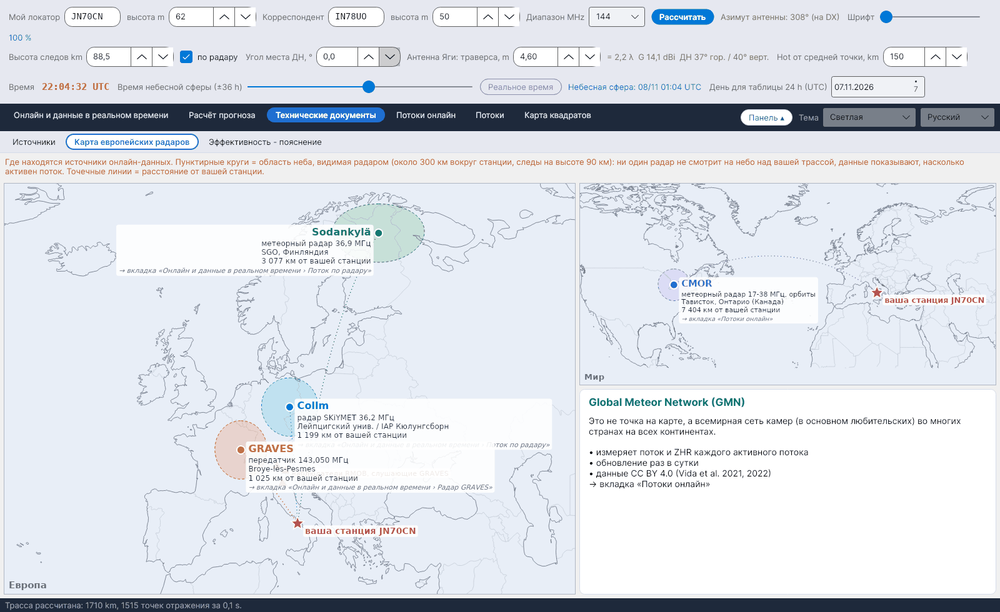

[English](European-Radar-Map) · [Italiano](European-Radar-Map-it) · [Deutsch](European-Radar-Map-de) · [Nederlands](European-Radar-Map-nl) · [Français](European-Radar-Map-fr) · [Español](European-Radar-Map-es) · [Português](European-Radar-Map-pt) · [Português (Brasil)](European-Radar-Map-pt-br) · [Dansk](European-Radar-Map-da) · [Norsk](European-Radar-Map-nb) · [Svenska](European-Radar-Map-sv) · [Íslenska](European-Radar-Map-is) · [Eesti](European-Radar-Map-et) · [Lietuvių](European-Radar-Map-lt) · [Latviešu](European-Radar-Map-lv) · [Polski](European-Radar-Map-pl) · [Čeština](European-Radar-Map-cs) · **Русский** · [Українська](European-Radar-Map-uk) · [Türkçe](European-Radar-Map-tr) · [Afrikaans](European-Radar-Map-af) · [العربية](European-Radar-Map-ar) · [עברית](European-Radar-Map-he) · [اردو](European-Radar-Map-ur) · [हिन्दी](European-Radar-Map-hi) · [বাংলা](European-Radar-Map-bn) · [Bahasa Indonesia](European-Radar-Map-id) · [Tagalog](European-Radar-Map-tl) · [日本語](European-Radar-Map-ja) · [한국어](European-Radar-Map-ko) · [中文](European-Radar-Map-zh)

# Карта европейских радаров

*Вкладка: Технические документы › Карта европейских радаров.*

Где находятся источники онлайн-данных относительно **вашей станции** (звёздочка, по полю *Мой локатор*):

| Источник | Что это | Где используется |
|---|---|---|
| **Collm** (Германия) | метеорный радар SKiYMET, 36,2 MHz | [Поток по радару](Radar-Flux-ru) |
| **Sodankylä** (Финляндия) | метеорный радар, 36,9 MHz | [Поток по радару](Radar-Flux-ru) |
| **GRAVES** (Франция) | передатчик, 143,050 MHz | [Радар GRAVES](GRAVES-Radar-ru) |
| **CMOR** (Онтарио, Канада) | метеорный радар 17–38 MHz, орбиты | [Потоки онлайн](Live-Showers-ru) |

**Пунктирные круги** – небо, видимое каждым радаром (около 300 km вокруг станции, следы на высоте 90 km): ни один радар не смотрит на небо над вашей трассой; данные говорят о том, насколько активен поток. **Точечные линии** показывают расстояние от вашей станции. Жёлтые треугольники отмечают некоторых итальянских наблюдателей RMOB, слушающих GRAVES. **Global Meteor Network** – не точка на карте, а всемирная сеть камер; она описана в отдельной рамке.
