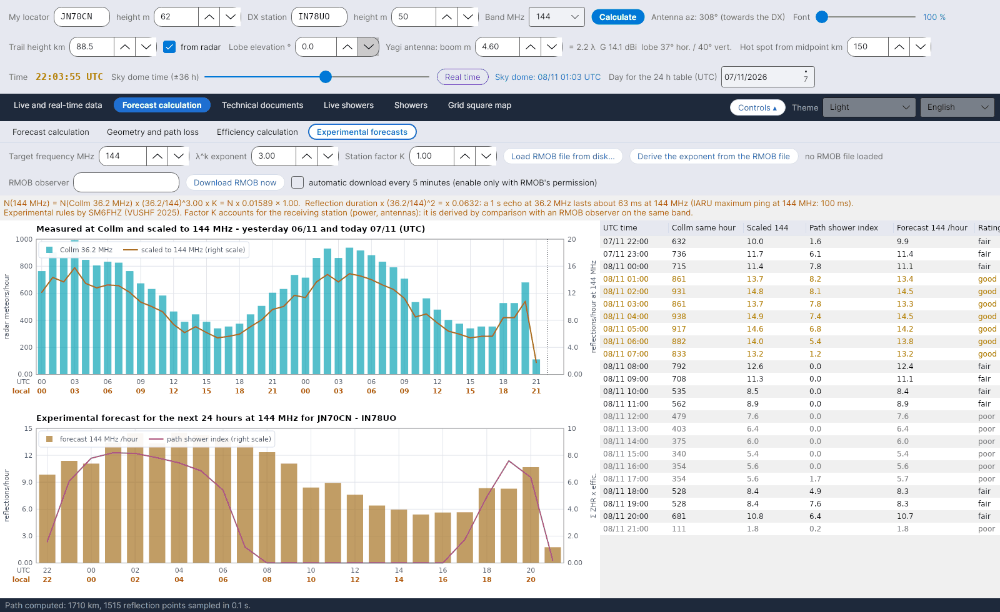

[English](Experimental-Forecasts) · [Italiano](Experimental-Forecasts-it) · [Deutsch](Experimental-Forecasts-de) · [Nederlands](Experimental-Forecasts-nl) · [Français](Experimental-Forecasts-fr) · [Español](Experimental-Forecasts-es) · [Português](Experimental-Forecasts-pt) · **Dansk** · [Norsk](Experimental-Forecasts-nb) · [Svenska](Experimental-Forecasts-sv) · [Íslenska](Experimental-Forecasts-is) · [Eesti](Experimental-Forecasts-et) · [Lietuvių](Experimental-Forecasts-lt) · [Latviešu](Experimental-Forecasts-lv) · [Русский](Experimental-Forecasts-ru) · [Українська](Experimental-Forecasts-uk) · [Türkçe](Experimental-Forecasts-tr) · [Afrikaans](Experimental-Forecasts-af) · [العربية](Experimental-Forecasts-ar) · [עברית](Experimental-Forecasts-he) · [اردو](Experimental-Forecasts-ur) · [हिन्दी](Experimental-Forecasts-hi) · [বাংলা](Experimental-Forecasts-bn) · [Bahasa Indonesia](Experimental-Forecasts-id) · [Tagalog](Experimental-Forecasts-tl) · [日本語](Experimental-Forecasts-ja) · [한국어](Experimental-Forecasts-ko) · [中文](Experimental-Forecasts-zh)

# Eksperimentelle prognoser

*Fane: Prognoseberegning › Eksperimentelle prognoser.*

[](https://raw.githubusercontent.com/ic8tem/YA-MS/main/docs/screenshots/en-2_4.png)

Denne fane omsætter **Collm-radarens (36,2 MHz)** meteortællinger til en vurdering af **refleksioner pr. time på et amatørbånd** (144 MHz som standard, enhver frekvens fra 28 til 1300 MHz), laver en prognose for de **næste 24 timer** for din strækning og lader dig **sammenligne** vurderingen med en **RMOB**-observatør – fx en, der lytter til GRAVES på 143,050 MHz.

> Alt her er **eksperimentelt**: frekvensreglen er en empirisk regel, og stationsfaktoren afhænger af din station. Brug tallene til at sammenligne timer og dage, og kontrollér dem på båndet.

## Betjening

| Element | Standard | Hvad det gør |
|---|---|---|
| **Målfrekvens MHz** | 144 | Prognosens frekvens (28–1300 MHz) |
| **λ^k-eksponent** | 3 | Eksponenten k i frekvensreglen (SM6FHZ: 3) |
| **Stationsfaktor K** | 1 | Tager højde for modtagestationen (effekt, antenner); findes ved sammenligning med en RMOB-observatør på samme bånd |
| **Indlæs RMOB-fil fra disken...** | | Læser en månedlig RMOB-tekstfil (se nedenfor) |
| **Udled eksponenten fra RMOB-filen** | | Tilpasser k ud fra de fælles timer for Collm og RMOB |
| **RMOB-observatør** | tom | Observatørens navn, som det står i filnavnet (fx `NAME_112026rmob.TXT` → `NAME`) |
| **Hent RMOB nu** | | Henter én gang denne observatørs fil for den aktuelle måned |
| **automatisk hentning hvert 5. minut (aktivér kun med tilladelse fra RMOB)** | **fra** | Se [RMOB og automatiske programmer](#rmob-og-automatiske-programmer) |

Den orange linje under betjeningselementerne viser reglen med de aktuelle tal, fx *N(144 MHz) = N(Collm 36,2 MHz) x (36,2/144)^3,00 x K = N x 0,01589 x 1,00*, skaleringen af varigheden og IARU's maksimale ping ved den frekvens.

## Fra radaren til amatørbåndet

```math
N(f) = N(36{.}2\ \mathrm{MHz})\left(\frac{36{.}2}{f}\right)^{k} K,\quad k = 3,\qquad \tau(f) = \tau(36{.}2\ \mathrm{MHz})\left(\frac{36{.}2}{f}\right)^{2}
```

**Kilde:** SM6FHZ, *"432 MHz Meteorscatter, Challenges and Techniques"*, 45th Nordic VUSHF, maj 2025 – antal og intensitet af refleksioner skalerer med **λ³**, varigheden med **λ²** (432 MHz ligger 14–15 dB under 144 MHz og varer 1/9). **Kontrol:** λ³-afhængigheden er den samme som i McKinleys ligning for underdense spor. Med k = 3 bliver 1000 meteorer/time i Collm til ca. **16 refleksioner/time ved 144 MHz**; RMOB-observatører, der lytter til GRAVES på 143,050 MHz, tæller som regel **20 til 140 ekkoer/time** (RMOB-bulletin, juni 2018): størrelsesordenen er forenelig, og forskellen er stationsfaktoren K. (Manualens lign. 44–45.)

## De næste 24 timer

```math
N_{prev}(t) = N(f,\ t-24\,\mathrm{h})\,\frac{I(t)+10}{I(t-24\,\mathrm{h})+10}
```

**Persistens:** den skalerede værdi for samme time dagen før (eller to dage før, hvis den mangler), korrigeret med ændringen i **strækningens sværmindeks** I (Σ ZHR × effektivitet, se [Effektivitetsberegning](Efficiency-Calculation-da#modellen)). Konstanten 10 repræsenterer den sporadiske baggrund og begrænser korrektionen, når indekset er lille. *Programmets valg (manualens lign. 47).*

| Panel | Indhold |
|---|---|
| **Målt i Collm og skaleret til f MHz – i går og i dag (UTC)** | Collm-radarens meteorer/time; skalerede værdier (orange, højre skala); RMOB-tællingerne, hvis de er indlæst (grøn, højre skala) |
| **Eksperimentel prognose for de næste 24 timer ved f MHz for …** | Forventede refleksioner/time (søjler) og strækningens sværmindeks (højre skala) |
| Tabel | UTC-tid · Collm samme time · Skaleret · Strækningens sværmindeks · Prognose /time · **Vurdering** |

**Vurdering:** *god*, når prognosen er mindst 1,3 × gennemsnittet over 24 timer, *middel* fra 0,8 ×, *ringe* derunder. Samme prognose vises i boksen **EKSPERIMENTEL PROGNOSE** og i den orange række i [Effektivitetsberegning](Efficiency-Calculation-da), og den er grundlaget for de forventede ekkoer i fanen [GRAVES-radar](GRAVES-Radar-da#forventede-ekkoer-eksperimentelt).

## Sammenligning med RMOB

[RMOB](https://www.rmob.org) (Radio Meteor Observatories On Line, Pierre Terrier) samler radioobservatørers meteortællinger pr. time; mange i Italien lytter til GRAVES på 143,050 MHz (Venedigs planetarium, Faenza, Rovereto m.fl.).

**Indlæsning af RMOB-filer.** To tekstformater accepteres:

| Format | Udseende | Bemærkninger |
|---|---|---|
| Månedsfil (Colorgramme / Spectrum Lab) | én række pr. dag, `day| n| n| …` med 24 timeværdier | den sædvanlige `NAME_MMYYYYrmob.TXT` |
| Bulletinens tabel | overskrift ` UT |  1   2   3 …`, rækker `0h|175 166 …` | hvis filen indeholder flere observatører, læses de efter hinanden: brug en fil med kun én observatør |

Måned og år tages fra filnavnet (`…_MMYYYYrmob…`) eller fra overskriften; ellers bruges den aktuelle måned (og programmet siger det).

**Tilpasning af eksponenten.** Med K = 1, ud fra medianen af forholdene RMOB/Collm over de fælles timer (mindst 3):

```math
k_{emp} = -\frac{\ln\left(\mathrm{median}\,(N_{RMOB}/N_{Collm})\right)}{\ln(f/36{.}2)}
```

*Programmets valg (manualens lign. 46).* Dialogen viser de fælles timer, medianforholdet og k; **Ja** anvender k (og sætter K = 1), **Nej** beholder k = 3 – juster så K manuelt til den værdi, der foreslås i samme dialog.

## RMOB og automatiske programmer

RMOB beder om, at **automatiske programmer ikke henter deres filer**. Derfor er **automatisk hentning slået fra** fra starten og bør kun slås til **efter at have bedt RMOB om tilladelse**. Uden den kan du altid bruge **Indlæs RMOB-fil fra disken...** eller trykke på **Hent RMOB nu**, når du har brug for det.

Hentningsadressen er en skabelon i `config.ini` (nøglen `rmob_url`, standard `https://rmob.org/index.php/livedata/live_datas/{NOME}_{MMAAAA}rmob.TXT`, hvor `{NOME}` er observatøren og `{MMAAAA}` måned og år); hentede filer gemmes i `data/radar/`.
