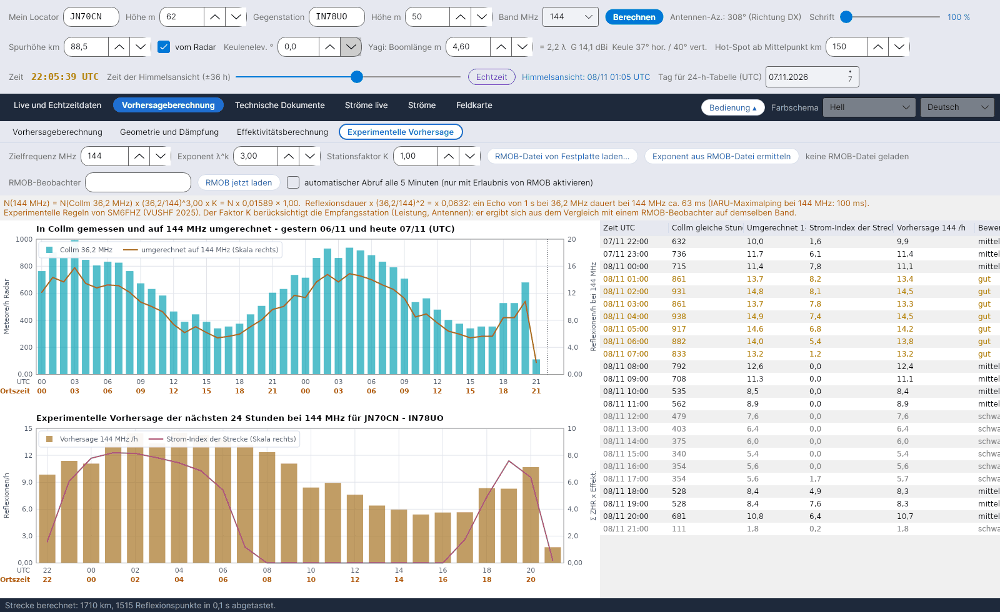

[English](Experimental-Forecasts) · [Italiano](Experimental-Forecasts-it) · **Deutsch** · [Nederlands](Experimental-Forecasts-nl) · [Français](Experimental-Forecasts-fr) · [Español](Experimental-Forecasts-es) · [Português](Experimental-Forecasts-pt) · [Dansk](Experimental-Forecasts-da) · [Norsk](Experimental-Forecasts-nb) · [Svenska](Experimental-Forecasts-sv) · [Íslenska](Experimental-Forecasts-is) · [Eesti](Experimental-Forecasts-et) · [Lietuvių](Experimental-Forecasts-lt) · [Latviešu](Experimental-Forecasts-lv) · [Русский](Experimental-Forecasts-ru) · [Українська](Experimental-Forecasts-uk) · [Türkçe](Experimental-Forecasts-tr) · [Afrikaans](Experimental-Forecasts-af) · [العربية](Experimental-Forecasts-ar) · [עברית](Experimental-Forecasts-he) · [اردو](Experimental-Forecasts-ur) · [हिन्दी](Experimental-Forecasts-hi) · [বাংলা](Experimental-Forecasts-bn) · [Bahasa Indonesia](Experimental-Forecasts-id) · [Tagalog](Experimental-Forecasts-tl) · [日本語](Experimental-Forecasts-ja) · [한국어](Experimental-Forecasts-ko) · [中文](Experimental-Forecasts-zh)

# Experimentelle Vorhersage

*Reiter: Vorhersageberechnung › Experimentelle Vorhersage.*

[](https://raw.githubusercontent.com/ic8tem/YA-MS/main/docs/screenshots/de-2_4.png)

Dieser Reiter rechnet die Meteorzählungen des **Collm-Radars (36,2 MHz)** in eine Schätzung der **Reflexionen pro Stunde auf einem Amateurfunkband** um (standardmäßig 144 MHz, jede Frequenz von 28 bis 1300 MHz), sagt die **nächsten 24 Stunden** für deine Strecke voraus und lässt dich die Schätzung mit einem **RMOB**-Beobachter **vergleichen** – zum Beispiel mit einem, der GRAVES auf 143,050 MHz abhört.

> Alles hier ist **experimentell**: Die Frequenzregel ist eine empirische Regel, und der Stationsfaktor hängt von deiner Station ab. Nutze die Zahlen, um Stunden und Tage zu vergleichen, und prüfe sie auf dem Band.

## Bedienelemente

| Bedienelement | Standard | Was es tut |
|---|---|---|
| **Zielfrequenz MHz** | 144 | Frequenz der Vorhersage (28–1300 MHz) |
| **Exponent λ^k** | 3 | Exponent k der Frequenzregel (SM6FHZ: 3) |
| **Stationsfaktor K** | 1 | Berücksichtigt die Empfangsstation (Leistung, Antennen); ergibt sich aus dem Vergleich mit einem RMOB-Beobachter auf demselben Band |
| **RMOB-Datei von Festplatte laden...** | | Liest eine monatliche RMOB-Textdatei (siehe unten) |
| **Exponent aus RMOB-Datei ermitteln** | | Passt k aus den gemeinsamen Stunden von Collm und RMOB an |
| **RMOB-Beobachter** | leer | Name des Beobachters, wie er im Dateinamen steht (z. B. `NAME_112026rmob.TXT` → `NAME`) |
| **RMOB jetzt laden** | | Lädt einmalig die Datei des laufenden Monats dieses Beobachters |
| **automatischer Abruf alle 5 Minuten (nur mit Erlaubnis von RMOB aktivieren)** | **aus** | Siehe [RMOB und automatische Programme](#rmob-und-automatische-programme) |

Die orange Zeile unter den Bedienelementen zeigt die Regel mit den aktuellen Zahlen, z. B. *N(144 MHz) = N(Collm 36,2 MHz) x (36,2/144)^3,00 x K = N x 0,01589 x 1,00*, die Umrechnung der Dauer und den IARU-Maximalping auf dieser Frequenz.

## Vom Radar zum Amateurfunkband

```
N(f) = N(36.2 MHz) · (36.2 / f)^k · K        k = 3
τ(f) = τ(36.2 MHz) · (36.2 / f)²
```

**Quelle:** SM6FHZ, *"432 MHz Meteorscatter, Challenges and Techniques"*, 45th Nordic VUSHF, Mai 2025 – Anzahl und Intensität der Reflexionen skalieren mit **λ³**, die Dauer mit **λ²** (432 MHz liegt 14–15 dB unter 144 MHz und dauert 1/9). **Prüfung:** Die λ³-Abhängigkeit ist dieselbe wie in McKinleys Gleichung für unterdichte Spuren. Mit k = 3 werden aus 1000 Meteoren/h in Collm etwa **16 Reflexionen/h auf 144 MHz**; RMOB-Beobachter von GRAVES auf 143,050 MHz zählen üblicherweise **20 bis 140 Echos/h** (RMOB-Bulletin, Juni 2018): Die Größenordnung ist verträglich, und der Unterschied ist der Stationsfaktor K. (Handbuch Gl. 44–45.)

## Nächste 24 Stunden

```
N_forecast(t) = N(f, t − 24 h) · (I(t) + 10) / (I(t − 24 h) + 10)
```

**Persistenz:** der umgerechnete Wert derselben Stunde des Vortags (oder, falls er fehlt, von vor zwei Tagen), korrigiert um die Änderung des **Strom-Index der Strecke** I (Σ ZHR × Effektivität, siehe [Effektivitätsberechnung](Efficiency-Calculation-de#das-modell)). Die Konstante 10 steht für den sporadischen Untergrund und begrenzt die Korrektur, wenn der Index klein ist. *Entscheidung des Programms (Handbuch Gl. 47).*

| Feld | Inhalt |
|---|---|
| **In Collm gemessen und auf f MHz umgerechnet - gestern und heute (UTC)** | Meteore/h des Collm-Radars; umgerechnete Werte (orange, rechte Skala); die RMOB-Zählungen, falls geladen (grün, rechte Skala) |
| **Experimentelle Vorhersage der nächsten 24 Stunden bei f MHz für …** | Vorhergesagte Reflexionen/h (Balken) und der Strom-Index der Strecke (rechte Skala) |
| Tabelle | Zeit UTC · Collm gleiche Stunde · Umgerechnet · Strom-Index der Strecke · Vorhersage /h · **Bewertung** |

**Bewertung:** *gut*, wenn die Vorhersage mindestens das 1,3-Fache des 24-Stunden-Mittels erreicht, *mittel* ab dem 0,8-Fachen, *schwach* darunter. Dieselbe Vorhersage erscheint in der Karte **EXPERIMENTELLE VORHERSAGE** und in der orangen Zeile der [Effektivitätsberechnung](Efficiency-Calculation-de), und sie ist die Grundlage der erwarteten Echos im Reiter [Radar GRAVES](GRAVES-Radar-de#erwartete-echos-experimentell).

## RMOB-Vergleich

[RMOB](https://www.rmob.org) (Radio Meteor Observatories On Line, Pierre Terrier) sammelt die stündlichen Meteorzählungen von Radiobeobachtern; viele in Italien hören GRAVES auf 143,050 MHz ab (Planetarium Venedig, Faenza, Rovereto u. a.).

**RMOB-Dateien lesen.** Zwei Textformate werden akzeptiert:

| Format | Aussehen | Hinweise |
|---|---|---|
| Monatsdatei (Colorgramme / Spectrum Lab) | eine Zeile pro Tag, `day| n| n| …` mit 24 Stundenwerten | die übliche `NAME_MMYYYYrmob.TXT` |
| Tabelle des Bulletins | Kopfzeile ` UT |  1   2   3 …`, Zeilen `0h|175 166 …` | enthält die Datei mehrere Beobachter, werden sie nacheinander gelesen: Datei mit nur einem Beobachter verwenden |

Monat und Jahr stammen aus dem Dateinamen (`…_MMYYYYrmob…`) oder aus der Kopfzeile; sonst wird der laufende Monat verwendet (und das Programm weist darauf hin).

**Anpassen des Exponenten.** Mit K = 1, aus dem Median der Verhältnisse RMOB/Collm über die gemeinsamen Stunden (mindestens 3):

```
k_emp = − ln( median(N_RMOB / N_Collm) ) / ln( f / 36.2 )
```

*Entscheidung des Programms (Handbuch Gl. 46).* Der Dialog zeigt die gemeinsamen Stunden, das Median-Verhältnis und k; **Ja** übernimmt k (und setzt K = 1), **Nein** behält k = 3 – dann passe K von Hand auf den im selben Dialog vorgeschlagenen Wert an.

## RMOB und automatische Programme

RMOB bittet darum, dass **automatische Programme seine Dateien nicht abrufen**. Deshalb ist der **automatische Abruf** beim Start **ausgeschaltet** und sollte **erst nach einer Anfrage um Erlaubnis bei RMOB** aktiviert werden. Ohne ihn kannst du jederzeit **RMOB-Datei von Festplatte laden...** verwenden oder bei Bedarf **RMOB jetzt laden** drücken.

Die Abrufadresse ist eine Vorlage in `config.ini` (Schlüssel `rmob_url`, Standard `https://rmob.org/index.php/livedata/live_datas/{NOME}_{MMAAAA}rmob.TXT`, wobei `{NOME}` der Beobachter und `{MMAAAA}` Monat und Jahr sind); geladene Dateien werden in `data/radar/` aufbewahrt.
