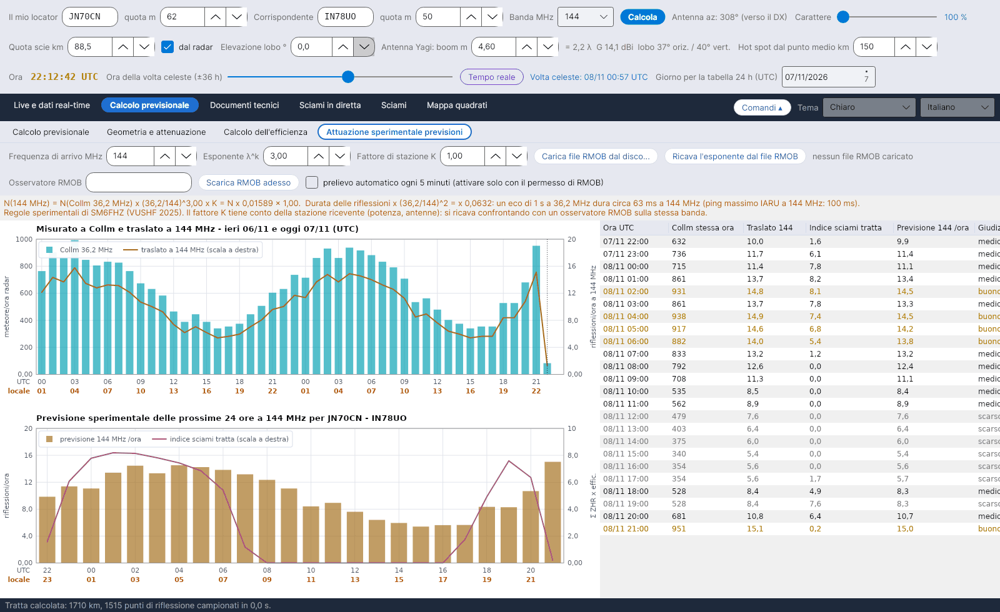

[English](Experimental-Forecasts) · **Italiano** · [Deutsch](Experimental-Forecasts-de) · [Nederlands](Experimental-Forecasts-nl) · [Français](Experimental-Forecasts-fr) · [Español](Experimental-Forecasts-es) · [Português](Experimental-Forecasts-pt) · [Dansk](Experimental-Forecasts-da) · [Norsk](Experimental-Forecasts-nb) · [Svenska](Experimental-Forecasts-sv) · [Íslenska](Experimental-Forecasts-is) · [Eesti](Experimental-Forecasts-et) · [Lietuvių](Experimental-Forecasts-lt) · [Latviešu](Experimental-Forecasts-lv) · [Русский](Experimental-Forecasts-ru) · [Українська](Experimental-Forecasts-uk) · [Türkçe](Experimental-Forecasts-tr) · [Afrikaans](Experimental-Forecasts-af) · [العربية](Experimental-Forecasts-ar) · [עברית](Experimental-Forecasts-he) · [اردو](Experimental-Forecasts-ur) · [हिन्दी](Experimental-Forecasts-hi) · [বাংলা](Experimental-Forecasts-bn) · [Bahasa Indonesia](Experimental-Forecasts-id) · [Tagalog](Experimental-Forecasts-tl) · [日本語](Experimental-Forecasts-ja) · [한국어](Experimental-Forecasts-ko) · [中文](Experimental-Forecasts-zh)

# Attuazione sperimentale previsioni

*Linguetta: Calcolo previsionale › Attuazione sperimentale previsioni.*

[](https://raw.githubusercontent.com/ic8tem/YA-MS/main/docs/screenshots/it-2_4.png)

Questa linguetta trasforma i conteggi di meteore del **radar di Collm (36,2 MHz)** in una stima delle **riflessioni all'ora su una banda radioamatoriale** (144 MHz per impostazione predefinita, qualsiasi frequenza da 28 a 1300 MHz), fa la previsione delle **prossime 24 ore** per la tua tratta e ti permette di **confrontare** la stima con un osservatore **RMOB** – per esempio uno che ascolta GRAVES su 143,050 MHz.

> Tutto qui è **sperimentale**: la regola sulla frequenza è una regola empirica e il fattore di stazione dipende dalla tua stazione. Usa i numeri per confrontare ore e giorni, e verificali in aria.

## Comandi

| Comando | Predefinito | Che cosa fa |
|---|---|---|
| **Frequenza di arrivo MHz** | 144 | Frequenza della previsione (28–1300 MHz) |
| **Esponente λ^k** | 3 | Esponente k della regola sulla frequenza (SM6FHZ: 3) |
| **Fattore di stazione K** | 1 | Tiene conto della stazione ricevente (potenza, antenne); si ricava confrontando con un osservatore RMOB sulla stessa banda |
| **Carica file RMOB dal disco...** | | Legge un file di testo mensile RMOB (vedi sotto) |
| **Ricava l'esponente dal file RMOB** | | Ricava k dalle ore in comune tra Collm e RMOB |
| **Osservatore RMOB** | vuoto | Nome dell'osservatore come compare nel nome del file (per esempio `NOME_112026rmob.TXT` → `NOME`) |
| **Scarica RMOB adesso** | | Scarica una volta il file del mese corrente di quell'osservatore |
| **prelievo automatico ogni 5 minuti (attivare solo con il permesso di RMOB)** | **spento** | Vedi [RMOB e programmi automatici](#rmob-e-programmi-automatici) |

La riga arancione sotto i comandi mostra la regola con i numeri attuali, per esempio *N(144 MHz) = N(Collm 36,2 MHz) x (36,2/144)^3,00 x K = N x 0,01589 x 1,00*, la scalatura della durata e il ping massimo IARU a quella frequenza.

## Dal radar alla banda radioamatoriale

```math
N(f) = N(36{.}2\ \mathrm{MHz})\left(\frac{36{.}2}{f}\right)^{k} K,\quad k = 3,\qquad \tau(f) = \tau(36{.}2\ \mathrm{MHz})\left(\frac{36{.}2}{f}\right)^{2}
```

**Fonte:** SM6FHZ, *"432 MHz Meteorscatter, Challenges and Techniques"*, 45th Nordic VUSHF, maggio 2025 – numero e intensità delle riflessioni scalano con **λ³**, la durata con **λ²** (432 MHz sta 14–15 dB sotto 144 MHz e dura 1/9). **Verifica:** la dipendenza da λ³ è la stessa dell'equazione delle scie sottodense di McKinley. Con k = 3, 1000 meteore/ora a Collm diventano circa **16 riflessioni/ora a 144 MHz**; gli osservatori RMOB di GRAVES su 143,050 MHz contano di solito **da 20 a 140 eco/ora** (bollettino RMOB, giugno 2018): l'ordine di grandezza è compatibile e la differenza è il fattore di stazione K. (Eq. 44–45 del manuale.)

## Prossime 24 ore

```math
N_{prev}(t) = N(f,\ t-24\,\mathrm{h})\,\frac{I(t)+10}{I(t-24\,\mathrm{h})+10}
```

**Persistenza:** il valore traslato della stessa ora del giorno prima (o di due giorni prima se manca), corretto per la variazione dell'**indice sciami della tratta** I (Σ ZHR × efficienza, vedi [Calcolo dell'efficienza](Efficiency-Calculation-it#il-modello)). La costante 10 rappresenta il fondo sporadico e limita la correzione quando l'indice è piccolo. *Scelta del programma (eq. 47 del manuale).*

| Riquadro | Contenuto |
|---|---|
| **Misurato a Collm e traslato a f MHz – ieri e oggi (UTC)** | Meteore/ora del radar di Collm; valori traslati (arancione, scala a destra); i conteggi RMOB se caricati (verde, scala a destra) |
| **Previsione sperimentale delle prossime 24 ore a f MHz per …** | Riflessioni/ora previste (barre) e indice sciami della tratta (scala a destra) |
| Tabella | Ora UTC · Collm stessa ora · Traslato · Indice sciami tratta · Previsione /ora · **Giudizio** |

**Giudizio:** *buono* quando la previsione è almeno 1,3 × la media delle 24 ore, *medio* da 0,8 ×, *scarso* sotto. La stessa previsione compare nella scheda **PREVISIONE SPERIMENTALE** e nella riga arancione del [Calcolo dell'efficienza](Efficiency-Calculation-it), ed è la base delle eco attese nella linguetta [Radar GRAVES](GRAVES-Radar-it#eco-attese-sperimentale).

## Confronto con RMOB

[RMOB](https://www.rmob.org) (Radio Meteor Observatories On Line, Pierre Terrier) raccoglie i conteggi orari di meteore degli osservatori radio; molti in Italia ascoltano GRAVES su 143,050 MHz (Planetario di Venezia, Faenza, Rovereto e altri).

**Lettura dei file RMOB.** Sono accettati due formati di testo:

| Formato | Aspetto | Note |
|---|---|---|
| File mensile (Colorgramme / Spectrum Lab) | una riga per giorno, `day| n| n| …` con 24 valori orari | il solito `NOME_MMAAAArmob.TXT` |
| Tabella del bollettino | intestazione ` UT |  1   2   3 …`, righe `0h|175 166 …` | se il file contiene più osservatori vengono letti di seguito: usa un file con un solo osservatore |

Mese e anno vengono dal nome del file (`…_MMAAAArmob…`) o dall'intestazione; altrimenti si usa il mese corrente (e il programma lo dice).

**Ricavare l'esponente.** Con K = 1, dalla mediana dei rapporti RMOB/Collm sulle ore in comune (almeno 3):

```math
k_{emp} = -\frac{\ln\left(\mathrm{median}\,(N_{RMOB}/N_{Collm})\right)}{\ln(f/36{.}2)}
```

*Scelta del programma (eq. 46 del manuale).* La finestra di dialogo mostra le ore in comune, il rapporto mediano e k; **Sì** applica k (e imposta K = 1), **No** mantiene k = 3 – poi regola K a mano sul valore suggerito nella stessa finestra.

## RMOB e programmi automatici

RMOB chiede ai **programmi automatici di non prelevare i suoi file**. Per questo il **prelievo automatico è spento** all'avvio e va attivato **solo dopo aver chiesto il permesso a RMOB**. Senza di esso puoi sempre usare **Carica file RMOB dal disco...** oppure premere **Scarica RMOB adesso** quando ti serve.

L'indirizzo di download è un modello in `config.ini` (chiave `rmob_url`, predefinito `https://rmob.org/index.php/livedata/live_datas/{NOME}_{MMAAAA}rmob.TXT`, dove `{NOME}` è l'osservatore e `{MMAAAA}` mese e anno); i file scaricati vengono conservati in `data/radar/`.
