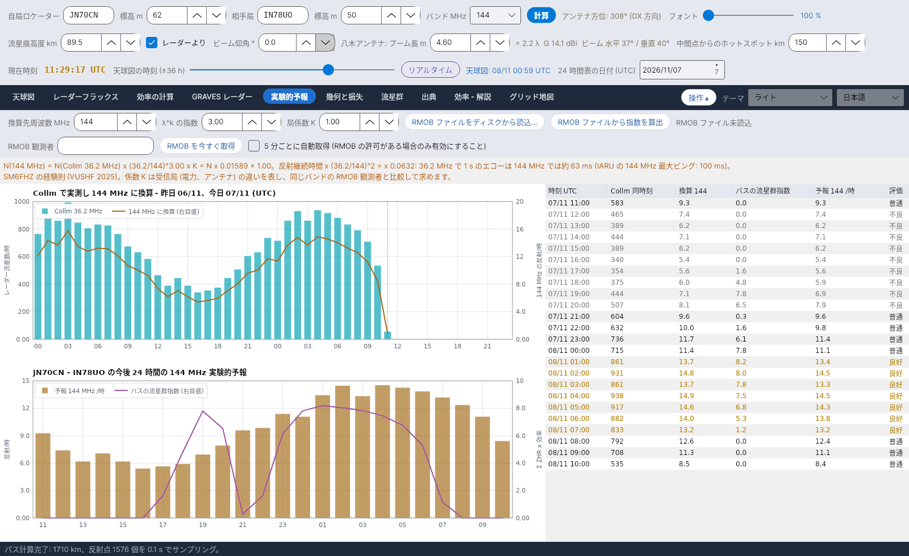

[English](Experimental-Forecasts) · [Русский](Experimental-Forecasts-ru) · [Deutsch](Experimental-Forecasts-de) · **日本語**

# 実験的予報

*タブ 5。*

[](https://raw.githubusercontent.com/ic8tem/YA-MS/main/docs/screenshots/ja-5.png)

このタブは **Collm レーダー (36.2 MHz)** の流星数を**アマチュアバンドでの 1 時間あたりの反射数**の推定 (既定は 144 MHz、28–1300 MHz の任意の周波数) に換算し、自局のパスについて**今後 24 時間**を予報し、その推定を **RMOB** の観測者 – 例えば 143.050 MHz で GRAVES を受信している観測者 – と**比較**できるようにします。

> ここにあるものはすべて**実験的**です: 周波数則は経験則であり、局係数は自局の設備に依存します。数値は時間や日を比較するために使い、実際の運用で確かめてください。

## 操作

| 操作 | 既定値 | 機能 |
|---|---|---|
| **換算先周波数 MHz** | 144 | 予報の周波数 (28–1300 MHz) |
| **λ^k の指数** | 3 | 周波数則の指数 k (SM6FHZ: 3) |
| **局係数 K** | 1 | 受信局 (電力、アンテナ) の違いを表す。同じバンドの RMOB 観測者と比較して求める |
| **RMOB ファイルをディスクから読込...** | | RMOB の月間テキストファイルを読み込む (下記参照) |
| **RMOB ファイルから指数を算出** | | Collm と RMOB の共通時間から k を当てはめる |
| **RMOB 観測者** | 空 | ファイル名に現れる観測者名 (例: `NAME_112026rmob.TXT` → `NAME`) |
| **RMOB を今すぐ取得** | | その観測者の今月のファイルを 1 回ダウンロードする |
| **5 分ごとに自動取得 (RMOB の許可がある場合のみ有効にすること)** | **オフ** | [RMOB と自動プログラム](#rmob-と自動プログラム) を参照 |

操作部の下の橙の行には、現在の数値を入れた規則が表示されます。例: *N(144 MHz) = N(Collm 36.2 MHz) x (36.2/144)^3.00 x K = N x 0.01589 x 1.00*。さらに継続時間の換算と、その周波数での IARU の最大ピングも表示されます。

## レーダーからアマチュアバンドへ

```
N(f) = N(36.2 MHz) · (36.2 / f)^k · K        k = 3
τ(f) = τ(36.2 MHz) · (36.2 / f)²
```

**出典:** SM6FHZ、*"432 MHz Meteorscatter, Challenges and Techniques"*、45th Nordic VUSHF、2025 年 5 月 – 反射の数と強度は **λ³** に、継続時間は **λ²** に比例します (432 MHz は 144 MHz より 14–15 dB 低く、継続時間は 1/9)。**検証:** λ³ への依存は McKinley のアンダーデンスの式と同じです。k = 3 では、Collm での 1000 流星/時は **144 MHz で約 16 反射/時** になります。143.050 MHz で GRAVES を受信する RMOB 観測者は通常 **20–140 エコー/時** を数えます (RMOB 会報、2018 年 6 月): 桁は整合しており、差は局係数 K によるものです。(マニュアル式 44–45。)

## 今後 24 時間

```
N_forecast(t) = N(f, t − 24 h) · (I(t) + 10) / (I(t − 24 h) + 10)
```

**持続性:** 前日 (なければ 2 日前) の同じ時刻の換算値を、**パスの流星群指数** I (Σ ZHR × 効率、[効率の計算](Efficiency-Calculation-ja#モデル) を参照) の変化で補正します。定数 10 は散在流星のバックグラウンドを表し、指数が小さいときの補正を抑えます。*プログラム独自の選択 (マニュアル式 47)。*

| パネル | 内容 |
|---|---|
| **Collm で実測し f MHz に換算 - 昨日 …、今日 … (UTC)** | Collm レーダーの流星数/時; 換算値 (橙、右目盛); 読み込んだ場合は RMOB のカウント (緑、右目盛) |
| **… の今後 24 時間の f MHz 実験的予報** | 予報反射数/時 (棒) とパスの流星群指数 (右目盛) |
| 表 | 時刻 UTC · Collm 同時刻 · 換算値 · パスの流星群指数 · 予報 /時 · **評価** |

**評価:** 予報が 24 時間平均の 1.3 倍以上なら *良好*、0.8 倍以上なら *普通*、それ未満は *不良*。同じ予報が **実験的予報** カードと [効率の計算](Efficiency-Calculation-ja) の橙の行に表示され、[GRAVES レーダー](GRAVES-Radar-ja#予想エコー-実験的) タブの予想エコーの基礎にもなります。

## RMOB との比較

[RMOB](https://www.rmob.org) (Radio Meteor Observatories On Line、Pierre Terrier) は電波観測者の時間別流星数を集めています。イタリアでは多くの観測者が 143.050 MHz で GRAVES を受信しています (ヴェネツィア・プラネタリウム、ファエンツァ、ロヴェレート ほか)。

**RMOB ファイルの読み込み。** 2 つのテキスト形式に対応しています:

| 形式 | 見た目 | 備考 |
|---|---|---|
| 月間ファイル (Colorgramme / Spectrum Lab) | 1 日 1 行、24 時間分の値を `day| n| n| …` で | 通常の `NAME_MMYYYYrmob.TXT` |
| 会報の表 | 見出し ` UT |  1   2   3 …`、行 `0h|175 166 …` | 複数の観測者を含むファイルは続けて読み込まれます: 観測者 1 人のファイルを使ってください |

月と年はファイル名 (`…_MMYYYYrmob…`) または見出しから取得します。どちらにもなければ今月を使います (プログラムがその旨を表示します)。

**指数の当てはめ。** K = 1 として、共通時間 (3 時間以上) の RMOB/Collm 比の中央値から:

```
k_emp = − ln( median(N_RMOB / N_Collm) ) / ln( f / 36.2 )
```

*プログラム独自の選択 (マニュアル式 46)。* ダイアログに共通の時間数、比の中央値、k が表示されます。**はい** で k を適用し (K = 1 に設定)、**いいえ** で k = 3 のまま – その場合は同じダイアログで提案される値に K を手で合わせてください。

## RMOB と自動プログラム

RMOB は**自動プログラムがファイルを取得しないよう**求めています。そのため**自動取得は初期状態でオフ**であり、**RMOB に許可を求めた後でのみ**有効にしてください。許可がなくても、必要なときに **RMOB ファイルをディスクから読込...** を使うか、**RMOB を今すぐ取得** を押すことはいつでもできます。

ダウンロード先は `config.ini` のテンプレートです (キー `rmob_url`、既定値 `https://rmob.org/index.php/livedata/live_datas/{NOME}_{MMAAAA}rmob.TXT`。`{NOME}` は観測者、`{MMAAAA}` は月と年)。ダウンロードしたファイルは `data/radar/` に保存されます。
