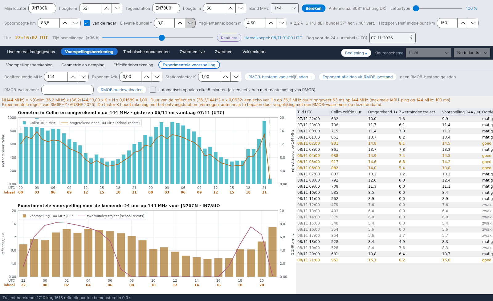

[English](Experimental-Forecasts) · [Italiano](Experimental-Forecasts-it) · [Deutsch](Experimental-Forecasts-de) · **Nederlands** · [Français](Experimental-Forecasts-fr) · [Español](Experimental-Forecasts-es) · [Português](Experimental-Forecasts-pt) · [Dansk](Experimental-Forecasts-da) · [Norsk](Experimental-Forecasts-nb) · [Svenska](Experimental-Forecasts-sv) · [Íslenska](Experimental-Forecasts-is) · [Eesti](Experimental-Forecasts-et) · [Lietuvių](Experimental-Forecasts-lt) · [Latviešu](Experimental-Forecasts-lv) · [Русский](Experimental-Forecasts-ru) · [Українська](Experimental-Forecasts-uk) · [Türkçe](Experimental-Forecasts-tr) · [Afrikaans](Experimental-Forecasts-af) · [العربية](Experimental-Forecasts-ar) · [עברית](Experimental-Forecasts-he) · [اردو](Experimental-Forecasts-ur) · [हिन्दी](Experimental-Forecasts-hi) · [বাংলা](Experimental-Forecasts-bn) · [Bahasa Indonesia](Experimental-Forecasts-id) · [Tagalog](Experimental-Forecasts-tl) · [日本語](Experimental-Forecasts-ja) · [한국어](Experimental-Forecasts-ko) · [中文](Experimental-Forecasts-zh)

# Experimentele voorspelling

*Tabblad: Voorspellingsberekening › Experimentele voorspelling.*

[](https://raw.githubusercontent.com/ic8tem/YA-MS/main/docs/screenshots/nl-2_4.png)

Dit tabblad zet de meteortellingen van de **radar in Collm (36,2 MHz)** om in een schatting van de **reflecties per uur op een amateurband** (standaard 144 MHz, elke frequentie van 28 tot 1300 MHz), voorspelt de **komende 24 uur** voor jouw traject en laat je de schatting **vergelijken** met een **RMOB**-waarnemer – bijvoorbeeld een die naar GRAVES op 143,050 MHz luistert.

> Alles hier is **experimenteel**: de frequentieregel is een empirische regel en de stationsfactor hangt af van jouw station. Gebruik de getallen om uren en dagen te vergelijken, en controleer ze in de lucht.

## Bediening

| Element | Standaard | Wat het doet |
|---|---|---|
| **Doelfrequentie MHz** | 144 | Frequentie van de voorspelling (28–1300 MHz) |
| **Exponent λ^k** | 3 | Exponent k van de frequentieregel (SM6FHZ: 3) |
| **Stationsfactor K** | 1 | Houdt rekening met het ontvangststation (vermogen, antennes); te bepalen door vergelijking met een RMOB-waarnemer op dezelfde band |
| **RMOB-bestand van schijf laden...** | | Leest een maandelijks RMOB-tekstbestand (zie hieronder) |
| **Exponent afleiden uit RMOB-bestand** | | Bepaalt k uit de gemeenschappelijke uren van Collm en RMOB |
| **RMOB-waarnemer** | leeg | Naam van de waarnemer zoals die in de bestandsnaam staat (bijv. `NAAM_112026rmob.TXT` → `NAAM`) |
| **RMOB nu downloaden** | | Downloadt eenmalig het bestand van de huidige maand van die waarnemer |
| **automatisch ophalen elke 5 minuten (alleen activeren met toestemming van RMOB)** | **uit** | Zie [RMOB en automatische programma's](#rmob-en-automatische-programmas) |

De oranje regel onder de bediening toont de regel met de actuele getallen, bijv. *N(144 MHz) = N(Collm 36,2 MHz) x (36,2/144)^3,00 x K = N x 0,01589 x 1,00*, de schaling van de duur en de maximale IARU-ping op die frequentie.

## Van de radar naar de amateurband

```math
N(f) = N(36{.}2\ \mathrm{MHz})\left(\frac{36{.}2}{f}\right)^{k} K,\quad k = 3,\qquad \tau(f) = \tau(36{.}2\ \mathrm{MHz})\left(\frac{36{.}2}{f}\right)^{2}\sec^2\varphi
```

**Bron:** SM6FHZ, *"432 MHz Meteorscatter, Challenges and Techniques"*, 45th Nordic VUSHF, mei 2025 – aantal en intensiteit van de reflecties schalen met **λ³**, de duur met **λ²** (432 MHz ligt 14–15 dB onder 144 MHz en duurt 1/9). **Controle:** in de vergelijking van McKinley is λ³ het vermogen van één onderdicht spoor, niet het aantal sporen; bij massa-index 2 schaalt het aantal sporen boven een vaste drempel ongeveer met λ^1,5 (IZ5TEK; OH5IY). Het programma houdt k = 3 aan, de experimentele regel van SM6FHZ, en zegt dat ook; de juiste k voor jouw station volgt uit de vergelijking met RMOB. Bij voorwaartse verstrooiing groeit de duur bovendien met sec²φ (McKinley; OH5IY): Collm meet in terugverstrooiing (φ = 0), dus de voorspelling vermenigvuldigt met sec²φ in het middelpunt van het traject (×4 bij 60°, ×8,5 bij 70°, ×33 bij 80°). Met k = 3 worden 1000 meteoren/uur in Collm ongeveer **16 reflecties/uur op 144 MHz**; RMOB-waarnemers van GRAVES op 143,050 MHz tellen meestal **20 tot 140 echo's/uur** (RMOB-bulletin, juni 2018): de orde van grootte is verenigbaar, en het verschil is de stationsfactor K. (Vgl. 44–45 van de handleiding.)

## Komende 24 uur

```math
N_{prev}(t) = N(f,\ t-24\,\mathrm{h})\,\frac{I(t)+10}{I(t-24\,\mathrm{h})+10}
```

**Persistentie:** de omgerekende waarde van hetzelfde uur van de dag ervoor (of twee dagen ervoor als die ontbreekt), gecorrigeerd voor de verandering van de **zwermindex van het traject** I (Σ ZHR × efficiëntie, zie [Efficiëntieberekening](Efficiency-Calculation-nl#het-model)). De constante 10 staat voor de sporadische achtergrond en beperkt de correctie als de index klein is. *Keuze van het programma (vgl. 47 van de handleiding).*

| Paneel | Inhoud |
|---|---|
| **Gemeten in Collm en omgerekend naar f MHz – gisteren en vandaag (UTC)** | Meteoren/uur van de radar in Collm; omgerekende waarden (oranje, rechterschaal); de RMOB-tellingen indien geladen (groen, rechterschaal) |
| **Experimentele voorspelling voor de komende 24 uur op f MHz voor …** | Voorspelde reflecties/uur (balken) en de zwermindex van het traject (rechterschaal) |
| Tabel | Tijd UTC · Collm zelfde uur · Omgerekend · Zwermindex traject · Voorspelling /uur · **Oordeel** |

**Oordeel:** *goed* als de voorspelling minstens 1,3 × het 24-uursgemiddelde is, *matig* vanaf 0,8 ×, *zwak* daaronder. Dezelfde voorspelling verschijnt op de kaart **EXPERIMENTELE VOORSPELLING** en in de oranje regel van de [Efficiëntieberekening](Efficiency-Calculation-nl), en vormt de basis van de verwachte echo's in het tabblad [Radar GRAVES](GRAVES-Radar-nl#verwachte-echos-experimenteel).

## Vergelijking met RMOB

[RMOB](https://www.rmob.org) (Radio Meteor Observatories On Line, Pierre Terrier) verzamelt de uurtellingen van meteoren van radiowaarnemers; velen in Italië luisteren naar GRAVES op 143,050 MHz (Planetarium van Venetië, Faenza, Rovereto en anderen).

**RMOB-bestanden lezen.** Twee tekstformaten worden geaccepteerd:

| Formaat | Uiterlijk | Opmerkingen |
|---|---|---|
| Maandbestand (Colorgramme / Spectrum Lab) | één regel per dag, `day| n| n| …` met 24 uurwaarden | het gebruikelijke `NAAM_MMJJJJrmob.TXT` |
| Bulletintabel | kop ` UT |  1   2   3 …`, regels `0h|175 166 …` | bevat het bestand meerdere waarnemers, dan worden ze achter elkaar gelezen: gebruik een bestand met één waarnemer |

Maand en jaar komen uit de bestandsnaam (`…_MMJJJJrmob…`) of uit de kop; anders wordt de huidige maand gebruikt (en meldt het programma dat).

**De exponent bepalen.** Met K = 1, uit de mediaan van de verhoudingen RMOB/Collm over de gemeenschappelijke uren (minstens 3):

```math
k_{emp} = -\frac{\ln\left(\mathrm{median}\,(N_{RMOB}/N_{Collm})\right)}{\ln(f/36{.}2)}
```

*Keuze van het programma (vgl. 46 van de handleiding).* Het dialoogvenster toont de gemeenschappelijke uren, de mediane verhouding en k; **Ja** past k toe (en zet K = 1), **Nee** houdt k = 3 – stel K dan met de hand in op de waarde die in hetzelfde venster wordt voorgesteld.

## RMOB en automatische programma's

RMOB vraagt **automatische programma's om zijn bestanden niet op te halen**. Daarom staat het **automatisch ophalen uit** bij de start en moet het **pas worden ingeschakeld nadat je RMOB om toestemming hebt gevraagd**. Zonder die functie kun je altijd **RMOB-bestand van schijf laden...** gebruiken of op **RMOB nu downloaden** drukken als je het nodig hebt.

Het downloadadres is een sjabloon in `config.ini` (sleutel `rmob_url`, standaard `https://rmob.org/index.php/livedata/live_datas/{NOME}_{MMAAAA}rmob.TXT`, waarbij `{NOME}` de waarnemer is en `{MMAAAA}` maand en jaar); gedownloade bestanden worden bewaard in `data/radar/`.
