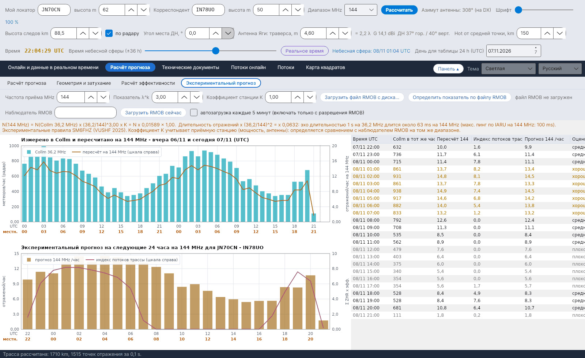

[English](Experimental-Forecasts) · [Italiano](Experimental-Forecasts-it) · [Deutsch](Experimental-Forecasts-de) · [Nederlands](Experimental-Forecasts-nl) · [Français](Experimental-Forecasts-fr) · [Español](Experimental-Forecasts-es) · [Português](Experimental-Forecasts-pt) · [Português (Brasil)](Experimental-Forecasts-pt-br) · [Dansk](Experimental-Forecasts-da) · [Norsk](Experimental-Forecasts-nb) · [Svenska](Experimental-Forecasts-sv) · [Íslenska](Experimental-Forecasts-is) · [Eesti](Experimental-Forecasts-et) · [Lietuvių](Experimental-Forecasts-lt) · [Latviešu](Experimental-Forecasts-lv) · [Polski](Experimental-Forecasts-pl) · [Čeština](Experimental-Forecasts-cs) · **Русский** · [Українська](Experimental-Forecasts-uk) · [Türkçe](Experimental-Forecasts-tr) · [Afrikaans](Experimental-Forecasts-af) · [العربية](Experimental-Forecasts-ar) · [עברית](Experimental-Forecasts-he) · [اردو](Experimental-Forecasts-ur) · [हिन्दी](Experimental-Forecasts-hi) · [বাংলা](Experimental-Forecasts-bn) · [Bahasa Indonesia](Experimental-Forecasts-id) · [Tagalog](Experimental-Forecasts-tl) · [日本語](Experimental-Forecasts-ja) · [한국어](Experimental-Forecasts-ko) · [中文](Experimental-Forecasts-zh)

# Экспериментальный прогноз

*Вкладка: Расчёт прогноза › Экспериментальный прогноз.*

[](https://raw.githubusercontent.com/ic8tem/YA-MS/main/docs/screenshots/ru-2_4.png)

Эта вкладка превращает число метеоров по **радару Collm (36,2 MHz)** в оценку **числа отражений в час на любительском диапазоне** (по умолчанию 144 MHz, любая частота от 28 до 1300 MHz), даёт прогноз на **следующие 24 часа** для вашей трассы и позволяет **сравнить** оценку с **наблюдателем RMOB** – например, слушающим GRAVES на 143,050 MHz.

> Всё здесь **экспериментальное**: частотное правило эмпирическое, а коэффициент станции зависит от вашей станции. Используйте числа для сравнения часов и дней и проверяйте их в эфире.

## Элементы управления

| Элемент | По умолчанию | Что делает |
|---|---|---|
| **Частота приёма MHz** | 144 | Частота прогноза (28–1300 MHz) |
| **Показатель λ^k** | 3 | Показатель k частотного правила (SM6FHZ: 3) |
| **Коэффициент станции K** | 1 | Учитывает приёмную станцию (мощность, антенны); определяется сравнением с наблюдателем RMOB на том же диапазоне |
| **Загрузить файл RMOB с диска...** | | Читает месячный текстовый файл RMOB (см. ниже) |
| **Определить показатель по файлу RMOB** | | Подбирает k по общим часам Collm и RMOB |
| **Наблюдатель RMOB** | пусто | Имя наблюдателя, как в имени файла (например, `NAME_112026rmob.TXT` → `NAME`) |
| **Загрузить RMOB сейчас** | | Один раз загружает файл этого наблюдателя за текущий месяц |
| **автозагрузка каждые 5 минут (включать только с разрешения RMOB)** | **выкл.** | См. [RMOB и автоматические программы](#rmob-и-автоматические-программы) |

Оранжевая строка под элементами управления показывает правило с текущими числами, например *N(144 MHz) = N(Collm 36.2 MHz) x (36.2/144)^3.00 x K = N x 0.01589 x 1.00*, пересчёт длительности и максимальный пинг по IARU на этой частоте.

## От радара к любительскому диапазону

```
N(f) = N(36.2 MHz) · (36.2 / f)^k · K        k = 3
τ(f) = τ(36.2 MHz) · (36.2 / f)²
```

**Источник:** SM6FHZ, *«432 MHz Meteorscatter, Challenges and Techniques»*, 45th Nordic VUSHF, май 2025 – число и интенсивность отражений масштабируются как **λ³**, длительность – как **λ²** (на 432 MHz на 14–15 dB слабее, чем на 144 MHz, и в 9 раз короче). **Проверка:** зависимость λ³ та же, что и в уравнении McKinley для ненасыщенных следов. При k = 3 1000 метеоров/час в Collm превращаются примерно в **16 отражений/час на 144 MHz**; наблюдатели RMOB, слушающие GRAVES на 143,050 MHz, обычно насчитывают **от 20 до 140 эхо/час** (бюллетень RMOB, июнь 2018): порядок величины совместим, а разницу объясняет коэффициент станции K. (Руководство, ур. 44–45.)

## Следующие 24 часа

```
N_forecast(t) = N(f, t − 24 h) · (I(t) + 10) / (I(t − 24 h) + 10)
```

**Персистентность:** пересчитанное значение того же часа предыдущего дня (или позапрошлого, если данных нет), скорректированное на изменение **индекса потоков трассы** I (Σ ZHR × эффективность, см. [Расчёт эффективности](Efficiency-Calculation-ru#модель)). Константа 10 представляет спорадический фон и ограничивает поправку при малом индексе. *Выбор программы (руководство, ур. 47).*

| Панель | Содержание |
|---|---|
| **Измерено в Collm и пересчитано на f MHz - вчера и сегодня (UTC)** | Метеоры/час по радару Collm; пересчитанные значения (оранжевым, шкала справа); подсчёты RMOB, если файл загружен (зелёным, шкала справа) |
| **Экспериментальный прогноз на следующие 24 часа на f MHz для …** | Прогноз отражений/час (столбцы) и индекс потоков трассы (шкала справа) |
| Таблица | Время UTC · Collm в тот же час · Пересчёт · Индекс потоков трассы · Прогноз /час · **Оценка** |

**Оценка:** *хорошо*, если прогноз не менее 1,3 × среднего за 24 часа, *средне* – от 0,8 ×, *плохо* – ниже. Тот же прогноз показывается в карточке **ЭКСПЕРИМЕНТАЛЬНЫЙ ПРОГНОЗ** и в оранжевой строке [Расчёта эффективности](Efficiency-Calculation-ru), и он же лежит в основе ожидаемых эхо на вкладке [Радар GRAVES](GRAVES-Radar-ru#ожидаемые-эхо-экспериментально).

## Сравнение с RMOB

[RMOB](https://www.rmob.org) (Radio Meteor Observatories On Line, Pierre Terrier) собирает почасовые подсчёты метеоров радионаблюдателей; многие в Италии слушают GRAVES на 143,050 MHz (Планетарий Венеции, Фаэнца, Роверето и др.).

**Чтение файлов RMOB.** Принимаются два текстовых формата:

| Формат | Вид | Примечания |
|---|---|---|
| Месячный файл (Colorgramme / Spectrum Lab) | одна строка на день, `day| n| n| …` с 24 почасовыми значениями | обычный `NAME_MMYYYYrmob.TXT` |
| Таблица бюллетеня | заголовок ` UT |  1   2   3 …`, строки `0h|175 166 …` | если в файле несколько наблюдателей, они читаются подряд: используйте файл с одним наблюдателем |

Месяц и год берутся из имени файла (`…_MMYYYYrmob…`) или из заголовка; иначе используется текущий месяц (и программа сообщает об этом).

**Подбор показателя.** При K = 1, по медиане отношений RMOB/Collm за общие часы (не менее 3):

```
k_emp = − ln( median(N_RMOB / N_Collm) ) / ln( f / 36.2 )
```

*Выбор программы (руководство, ур. 46).* Диалог показывает число общих часов, медианное отношение и k; **Да** применяет k (и устанавливает K = 1), **Нет** оставляет k = 3 – тогда вручную настройте K на значение, предложенное в том же диалоге.

## RMOB и автоматические программы

RMOB просит **автоматические программы не загружать его файлы**. Поэтому **автозагрузка выключена** при запуске, и включать её следует **только после получения разрешения от RMOB**. Без него всегда можно воспользоваться кнопкой **Загрузить файл RMOB с диска...** или нажать **Загрузить RMOB сейчас**, когда это нужно.

Адрес загрузки – шаблон в `config.ini` (ключ `rmob_url`, по умолчанию `https://rmob.org/index.php/livedata/live_datas/{NOME}_{MMAAAA}rmob.TXT`, где `{NOME}` – наблюдатель, а `{MMAAAA}` – месяц и год); загруженные файлы хранятся в `data/radar/`.
