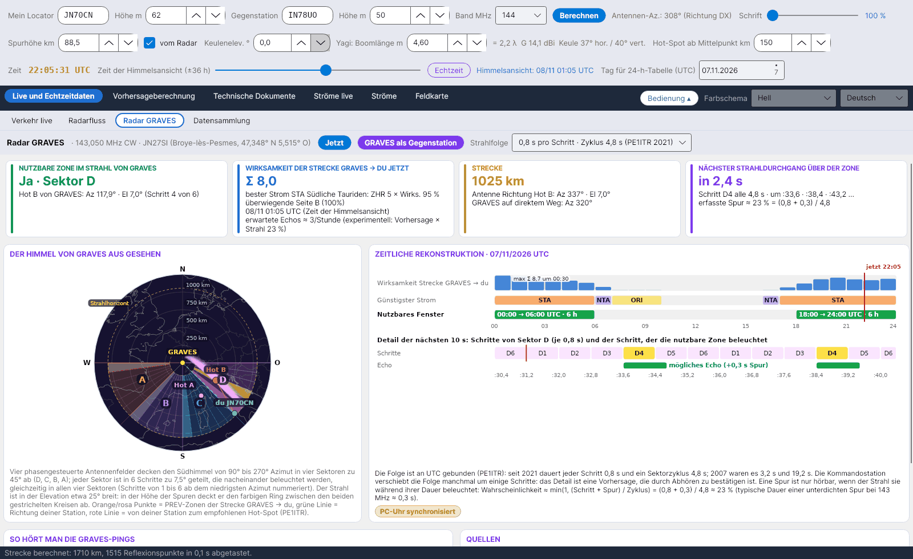

[English](GRAVES-Radar) · [Italiano](GRAVES-Radar-it) · **Deutsch** · [Nederlands](GRAVES-Radar-nl) · [Français](GRAVES-Radar-fr) · [Español](GRAVES-Radar-es) · [Português](GRAVES-Radar-pt) · [Português (Brasil)](GRAVES-Radar-pt-br) · [Dansk](GRAVES-Radar-da) · [Norsk](GRAVES-Radar-nb) · [Svenska](GRAVES-Radar-sv) · [Íslenska](GRAVES-Radar-is) · [Eesti](GRAVES-Radar-et) · [Lietuvių](GRAVES-Radar-lt) · [Latviešu](GRAVES-Radar-lv) · [Polski](GRAVES-Radar-pl) · [Čeština](GRAVES-Radar-cs) · [Magyar](GRAVES-Radar-hu) · [Română](GRAVES-Radar-ro) · [Ελληνικά](GRAVES-Radar-el) · [Русский](GRAVES-Radar-ru) · [Українська](GRAVES-Radar-uk) · [Türkçe](GRAVES-Radar-tr) · [Afrikaans](GRAVES-Radar-af) · [العربية](GRAVES-Radar-ar) · [עברית](GRAVES-Radar-he) · [اردو](GRAVES-Radar-ur) · [हिन्दी](GRAVES-Radar-hi) · [বাংলা](GRAVES-Radar-bn) · [ไทย](GRAVES-Radar-th) · [Bahasa Indonesia](GRAVES-Radar-id) · [Tagalog](GRAVES-Radar-tl) · [日本語](GRAVES-Radar-ja) · [한국어](GRAVES-Radar-ko) · [中文](GRAVES-Radar-zh) · [中文 (繁體)](GRAVES-Radar-zh-tw)

# Radar GRAVES

*Reiter: Live und Echtzeitdaten › Radar GRAVES.*

[](https://raw.githubusercontent.com/ic8tem/YA-MS/main/docs/screenshots/de-1_3.png)

## Was GRAVES ist

**GRAVES** ist ein französisches Radar, das **CW auf 143,050 MHz** aus **Broye-lès-Pesmes** sendet (47,348° N 5,515° O, Locator **JN27SI**, etwa 200 m ü. NN; Wikipedia). Meteorspuren in der Zone, die sowohl GRAVES als auch du sehen, reflektieren sein Signal per **Forward-Scatter** zu dir: Du hörst kurze *Pings* nahe dem Träger. So zählen die **RMOB**-Beobachter auf 143,050 MHz die Meteore Stunde für Stunde, und es ist ein kostenloses, ständig verfügbares Testsignal für deine 2-m-Meteorscatter-Station.

Der Reiter behandelt **GRAVES → du** als eigene Meteorscatter-Strecke: Mit denselben Funktionen wie die Hauptstrecke (gleiche Spurhöhe, Keulenelevation und Hot-Spot-Abstand) berechnet er Effektivität der Ströme, empfohlenen Hot und PREV-Zonen und prüft dann, ob diese Zone **im Strahl von GRAVES** liegt und **wann** der Strahl sie beleuchtet.

## Obere Leiste

| Bedienelement | Was es tut |
|---|---|
| **Jetzt** | Setzt die Berechnung auf Echtzeit zurück: das heutige Datum und den Stundenregler auf null (der Reiter folgt *Berechnungsdatum* und *Stunden*). |
| **GRAVES als Gegenstation** | Die Gegenstation wird GRAVES (JN27SI, Höhe 200 m) und die Hauptstrecke wird neu berechnet: Alle anderen Reiter zeigen dann die Strecke zu GRAVES. |
| **Strahlfolge** | *0,8 s pro Schritt · Zyklus 4,8 s (PE1ITR 2021)* (Standard) oder *3,2 s pro Schritt · Zyklus 19,2 s (PE1ITR 2007)*. |

## Die vier Karten

| Karte | Inhalt |
|---|---|
| **NUTZBARE ZONE IM STRAHL VON GRAVES** | *Ja · Sektor X* mit Azimut und Elevation des empfohlenen Hot-Spots von GRAVES aus gesehen und dem Schritt (1–6); oder *Nein: außerhalb der Sektoren* / *Nein: unter dem Horizont von GRAVES* / *Nein: über dem Strahl (etwa 25°)* |
| **WIRKSAMKEIT DER STRECKE GRAVES → DU JETZT** | Streckenindex Σ ZHR × Effektivität, bester Strom, überwiegende Seite A/B und *erwartete Echos ≈ …/Stunde* (experimentell, siehe unten) |
| **STRECKE** | Entfernung zu GRAVES; Antenne Richtung empfohlener Hot (Azimut und Elevation); direkter Azimut zu GRAVES |
| **NÄCHSTER STRAHLDURCHGANG ÜBER DER ZONE** | *jetzt · noch … s* oder *in … s*, der Schritt (z. B. *B4*), die nächsten drei Zeitpunkte (Sekunden innerhalb der Minute) und der Anteil erfasster Spuren |

Ist zu diesem Zeitpunkt kein Strom nutzbar, zeigt das Programm den Hot-Spot, **der am besten zum Strahl passt** (innerhalb der Sektoren, möglichst nahe an Süd), und weist darauf hin.

## Der Himmel von GRAVES aus gesehen

Laut PE1ITR und dem Bolidozor-Wiki decken **vier phasengesteuerte Antennenfelder** den Südhimmel von **90° bis 270°** Azimut in vier **Sektoren zu 45°** ab:

| Sektor | Azimut von GRAVES |
|---|---|
| D | 90°–135° |
| C | 135°–180° |
| B | 180°–225° |
| A | 225°–270° |

Jeder Sektor ist in **6 Schritte zu 7,5°** geteilt, von 1 bis 6 ab dem niedrigsten Azimut nummeriert, die nacheinander beleuchtet werden, **gleichzeitig in allen vier Sektoren**. Der Strahl ist in der **Elevation etwa 25° breit**: In Spurhöhe deckt er den farbigen Ring zwischen den beiden gestrichelten Kreisen ab (*Strahlhorizont*). In der Zeichnung: orange/rosa Punkte = PREV-Zonen der Strecke GRAVES → du, grüne Linie = Richtung deiner Station, rote Linie = von deiner Station zum empfohlenen Hot-Spot; der jetzt beleuchtete Schritt ist hervorgehoben.

## Zeitliche Rekonstruktion

*ZEITLICHE REKONSTRUKTION · Datum UTC* (gleicher Tag wie die 24-h-Tabelle): für jede Stunde die Effektivität der Strecke GRAVES → du, der günstigste Strom und das nutzbare Fenster (*hh:00 → hh:00 UTC · n h*), mit dem Maximum (*max Σ … um hh:30*) und einer roten Markierung *jetzt*. Darunter das **Detail der nächsten Sekunden**: die sechs Schritte des Sektors, der Schritt, der die nutzbare Zone beleuchtet, und *mögliches Echo (+0,3 s Spur)*.

### Strahlzeiten

Die Folge ist an **UTC** gebunden (PE1ITR): Der jetzt beleuchtete Schritt wird aus den Sekunden seit 00:00 UTC modulo Zyklus berechnet (86 400 s ist ein Vielfaches sowohl von 4,8 s als auch von 19,2 s). Die Kommandostation verschiebt die Folge manchmal um einige Schritte, deshalb ist das Detail eine **Vorhersage, die durch Abhören zu bestätigen ist**. Die gelbe Pille **PC-Uhr synchronisiert** erinnert dich daran: Synchronisiere deinen PC mit einem NTP-Server (Fehler höchstens wenige Zehntelsekunden).

### Erfassungsfaktor

Eine Spur ist nur hörbar, wenn der Strahl sie während ihrer Dauer beleuchtet:

```math
p \approx \min\left(1,\ \frac{t_{step} + \tau}{T_{cycle}}\right):\qquad 2021:\ \frac{0{.}8+0{.}3}{4{.}8} \approx 23\ \%,\qquad 2007:\ \frac{3{.}2+0{.}3}{19{.}2} \approx 18\ \%
```

0,3 s ist eine typische Dauer einer unterdichten Spur bei 143 MHz – ein fester Wert, *Entscheidung des Programms* (die λ²-Regel von SM6FHZ skaliert Dauern zwischen Bändern, liefert aber keinen Ausgangswert).

### Erwartete Echos (experimentell)

```math
N_{GRAVES} \approx N_{prev}(f_{fc})\left(\frac{f_{fc}}{143{.}05}\right)^{k}\frac{I_{GRAVES}+10}{I_{DX}+10}\; p
```

Die Vorhersage aus [Experimentelle Vorhersage](Experimental-Forecasts-de) (die bereits den Stationsfaktor K enthält) wird mit der SM6FHZ-Regel (gleicher Exponent k) von ihrer Frequenz f_fc auf 143,050 MHz umgerechnet, mit dem Verhältnis der Strom-Indizes der beiden Strecken korrigiert (die Konstante 10 steht für den sporadischen Untergrund, wie in der Vorhersage) und mit dem Erfassungsfaktor multipliziert. Nur ein Richtwert: Vergleiche mit RMOB-Beobachtern.

## So hört man die GRAVES-Pings

| Schritt | Was tun |
|---|---|
| Empfänger | **USB auf 143,049 MHz** (Ton bei etwa 1 kHz) oder 143,050 MHz, **AGC langsam oder aus**, NF-Bandbreite **mindestens 2,4 kHz** |
| Antenne | Zum **empfohlenen Hot-Spot** der Strecke GRAVES → du (Karte *STRECKE*), mit **niedriger Elevation** |
| Wasserfall | Pings sind **kurze Linien nahe dem Träger**; lange (überdichte) Spuren sind breiter und zeigen Doppler |
| Zählung | RMOB nutzt GRAVES für die stündlichen Meteorzählungen: **vergleiche deine Pings mit den Beobachtern auf 143,050 MHz** ([Experimentelle Vorhersage](Experimental-Forecasts-de#rmob-vergleich)) |

## Quellen

1. Rob Hardenberg **PE1ITR**, *„The 143.050 MHz Graves Radar, a VHF Beacon“* (DUBUS 4/2007) und *„Graves Radar Update April 2021“* – [pe1itr.com/graves](https://pe1itr.com/graves)
2. **Bolidozor**-Wiki, „Graves“ – Antennenfelder, Sektoren und Strahlzeiten
3. **Wikipedia**, „GRAVES (system)“ – Sender bei Broye-lès-Pesmes (47,348° N 5,515° O)
4. **RMOB** – Beobachter auf 143,050 MHz ([rmob.org](https://www.rmob.org))
5. **YAEC** von IC8TEM – Reiter Radar GRAVES (der Entwurf, aus dem dieser Reiter abgeleitet ist)
