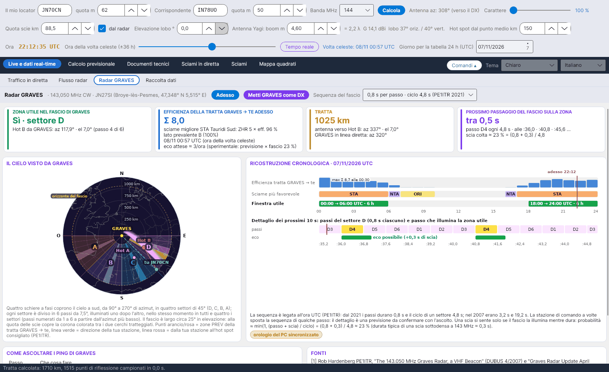

[English](GRAVES-Radar) · **Italiano** · [Deutsch](GRAVES-Radar-de) · [Nederlands](GRAVES-Radar-nl) · [Français](GRAVES-Radar-fr) · [Español](GRAVES-Radar-es) · [Português](GRAVES-Radar-pt) · [Dansk](GRAVES-Radar-da) · [Norsk](GRAVES-Radar-nb) · [Svenska](GRAVES-Radar-sv) · [Íslenska](GRAVES-Radar-is) · [Eesti](GRAVES-Radar-et) · [Lietuvių](GRAVES-Radar-lt) · [Latviešu](GRAVES-Radar-lv) · [Русский](GRAVES-Radar-ru) · [Українська](GRAVES-Radar-uk) · [Türkçe](GRAVES-Radar-tr) · [Afrikaans](GRAVES-Radar-af) · [العربية](GRAVES-Radar-ar) · [עברית](GRAVES-Radar-he) · [اردو](GRAVES-Radar-ur) · [हिन्दी](GRAVES-Radar-hi) · [বাংলা](GRAVES-Radar-bn) · [Bahasa Indonesia](GRAVES-Radar-id) · [Tagalog](GRAVES-Radar-tl) · [日本語](GRAVES-Radar-ja) · [한국어](GRAVES-Radar-ko) · [中文](GRAVES-Radar-zh)

# Radar GRAVES

*Linguetta: Live e dati real-time › Radar GRAVES.*

[](https://raw.githubusercontent.com/ic8tem/YA-MS/main/docs/screenshots/it-1_3.png)

## Che cos'è GRAVES

**GRAVES** è un radar francese che trasmette in **CW su 143,050 MHz** da **Broye-lès-Pesmes** (47,348° N 5,515° E, locator **JN27SI**, circa 200 m s.l.m.; Wikipedia). Le scie meteoriche nella zona vista sia da GRAVES sia da te riflettono il suo segnale verso di te per **forward scatter**: si sentono brevi *ping* vicino alla portante. È così che gli osservatori **RMOB** su 143,050 MHz contano le meteore ora per ora, ed è un segnale di prova gratuito e sempre acceso per la tua stazione meteor scatter sui 2 m.

La linguetta tratta **GRAVES → te** come una tratta meteor scatter a sé: con le stesse funzioni della tratta principale (stessa quota delle scie, elevazione del lobo e distanza degli hot spot) calcola l'efficienza degli sciami, l'Hot consigliato e le zone PREV, poi verifica se quella zona è **dentro il fascio di GRAVES** e **quando** il fascio la illumina.

## Barra superiore

| Comando | Che cosa fa |
|---|---|
| **Adesso** | Riporta l'ora della volta celeste al tempo reale (la linguetta segue il cursore *Ora della volta celeste*). |
| **Metti GRAVES come DX** | Il corrispondente diventa GRAVES (JN27SI, quota 200 m) e la tratta principale viene ricalcolata: tutte le altre linguette mostrano allora la tratta di GRAVES. |
| **Sequenza del fascio** | *0,8 s per passo · ciclo 4,8 s (PE1ITR 2021)* (predefinita) oppure *3,2 s per passo · ciclo 19,2 s (PE1ITR 2007)*. |

## Le quattro schede

| Scheda | Contenuto |
|---|---|
| **ZONA UTILE NEL FASCIO DI GRAVES** | *Sì · settore X* con azimut ed elevazione dell'hot spot consigliato visto da GRAVES e il passo (1–6); oppure *No: fuori dai settori* / *No: sotto l'orizzonte di GRAVES* / *No: sopra il fascio (circa 25°)* |
| **EFFICIENZA DELLA TRATTA GRAVES → TE ADESSO** | Indice della tratta Σ ZHR × efficienza, sciame migliore, lato prevalente A/B ed *eco attese ≈ …/ora* (sperimentale, vedi sotto) |
| **TRATTA** | Distanza da GRAVES; antenna verso l'Hot consigliato (azimut ed elevazione); azimut di GRAVES in linea diretta |
| **PROSSIMO PASSAGGIO DEL FASCIO SULLA ZONA** | *adesso · ancora … s* oppure *tra … s*, il passo (per esempio *B4*), i tre istanti successivi (secondi all'interno del minuto) e la frazione di scie intercettate |

Se in quel momento nessuno sciame è utile, il programma mostra l'hot spot **più adatto al fascio** (dentro i settori, il più vicino al sud) e lo dice.

## Il cielo visto da GRAVES

Secondo PE1ITR e il wiki di Bolidozor, **quattro schiere a fasatura** coprono il cielo meridionale da **90° a 270°** di azimut in quattro **settori da 45°**:

| Settore | Azimut da GRAVES |
|---|---|
| D | 90°–135° |
| C | 135°–180° |
| B | 180°–225° |
| A | 225°–270° |

Ogni settore è diviso in **6 passi da 7,5°**, numerati da 1 a 6 a partire dall'azimut più basso, illuminati uno dopo l'altro, **nello stesso istante in tutti e quattro i settori**. Il fascio è largo circa **25° in elevazione**: alla quota delle scie copre l'anello colorato tra i due cerchi tratteggiati (*orizzonte del fascio*). Nel disegno: punti arancioni/rosa = zone PREV della tratta GRAVES → te, linea verde = direzione della tua stazione, linea rossa = dalla tua stazione all'hot spot consigliato; il passo illuminato adesso è evidenziato.

## Ricostruzione cronologica

*RICOSTRUZIONE CRONOLOGICA · data UTC* (stesso giorno della tabella 24 h): per ogni ora l'efficienza della tratta GRAVES → te, lo sciame più favorevole e la finestra utile (*hh:00 → hh:00 UTC · n h*), con il massimo (*max Σ … alle hh:30*) e un indicatore rosso *adesso*. Sotto, il **dettaglio dei prossimi secondi**: i sei passi del settore, il passo che illumina la zona utile ed *eco possibile (+0,3 s di scia)*.

### Tempi del fascio

La sequenza è legata all'**UTC** (PE1ITR): il passo illuminato adesso si calcola dai secondi trascorsi dalle 00:00 UTC modulo il ciclo (86 400 s è multiplo sia di 4,8 s sia di 19,2 s). La stazione di comando a volte sposta la sequenza di qualche passo, quindi il dettaglio è una **previsione da confermare all'ascolto**. La pillola gialla **orologio del PC sincronizzato** te lo ricorda: sincronizza il PC con un server NTP (errore al massimo di qualche decimo di secondo).

### Fattore di rilevamento

Una scia si sente solo se il fascio la illumina mentre dura:

```math
p \approx \min\left(1,\ \frac{t_{step} + \tau}{T_{cycle}}\right):\qquad 2021:\ \frac{0{.}8+0{.}3}{4{.}8} \approx 23\ \%,\qquad 2007:\ \frac{3{.}2+0{.}3}{19{.}2} \approx 18\ \%
```

0,3 s è una durata tipica di una scia sottodensa a 143 MHz – un valore fisso, *scelta del programma* (la regola λ² di SM6FHZ scala le durate tra le bande ma non dà un valore di partenza).

### Eco attese (sperimentale)

```math
N_{GRAVES} \approx N_{prev}(f_{fc})\left(\frac{f_{fc}}{143{.}05}\right)^{k}\frac{I_{GRAVES}+10}{I_{DX}+10}\; p
```

La previsione dell'[Attuazione sperimentale previsioni](Experimental-Forecasts-it) (che contiene già il fattore di stazione K) viene traslata dalla sua frequenza f_fc a 143,050 MHz con la regola di SM6FHZ (stesso esponente k), corretta con il rapporto tra gli indici sciami delle due tratte (la costante 10 rappresenta il fondo sporadico, come nella previsione) e moltiplicata per il fattore di rilevamento. Solo indicativo: confrontalo con gli osservatori RMOB.

## Come ascoltare i ping di GRAVES

| Passo | Che cosa fare |
|---|---|
| Ricevitore | **USB su 143,049 MHz** (tono a circa 1 kHz) oppure 143,050 MHz, **AGC lento o spento**, banda audio di **almeno 2,4 kHz** |
| Antenna | Verso l'**hot spot consigliato** della tratta GRAVES → te (scheda *TRATTA*), a **bassa elevazione** |
| Waterfall | I ping sono **brevi righe vicino alla portante**; le scie lunghe (sovradense) sono più larghe e mostrano il Doppler |
| Conteggio | RMOB usa GRAVES per i conteggi orari delle meteore: **confronta i tuoi ping con gli osservatori su 143,050 MHz** ([Attuazione sperimentale previsioni](Experimental-Forecasts-it#confronto-con-rmob)) |

## Fonti

1. Rob Hardenberg **PE1ITR**, *"The 143.050 MHz Graves Radar, a VHF Beacon"* (DUBUS 4/2007) e *"Graves Radar Update April 2021"* – [pe1itr.com/graves](https://pe1itr.com/graves)
2. Wiki di **Bolidozor**, "Graves" – schiere, settori e tempi del fascio
3. **Wikipedia**, "GRAVES (system)" – trasmettitore a Broye-lès-Pesmes (47,348° N 5,515° E)
4. **RMOB** – osservatori su 143,050 MHz ([rmob.org](https://www.rmob.org))
5. **YAEC** di IC8TEM – linguetta Radar GRAVES (il prototipo da cui deriva questa linguetta)
