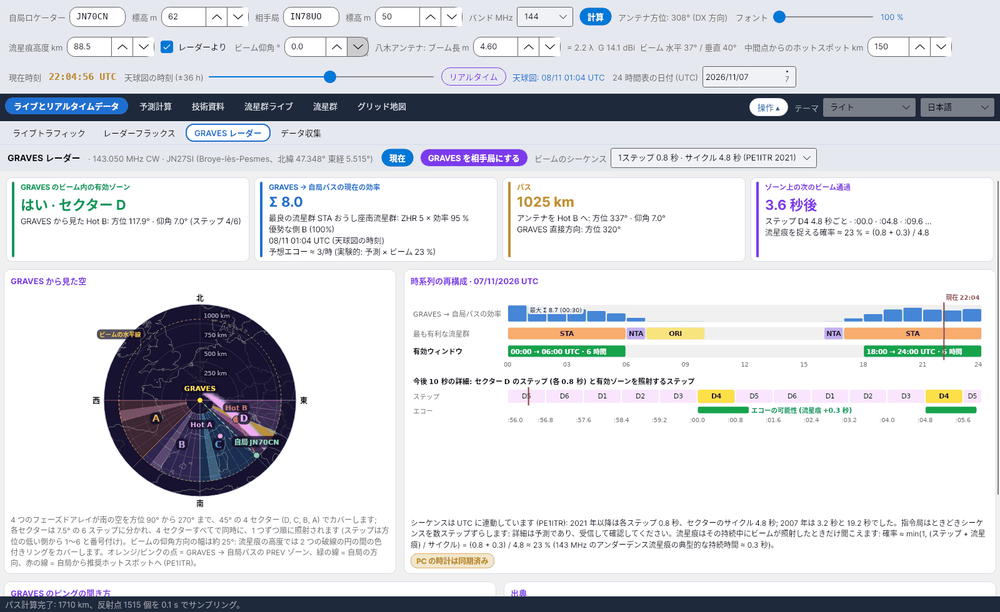

[English](GRAVES-Radar) · [Italiano](GRAVES-Radar-it) · [Deutsch](GRAVES-Radar-de) · [Nederlands](GRAVES-Radar-nl) · [Français](GRAVES-Radar-fr) · [Español](GRAVES-Radar-es) · [Português](GRAVES-Radar-pt) · [Português (Brasil)](GRAVES-Radar-pt-br) · [Dansk](GRAVES-Radar-da) · [Norsk](GRAVES-Radar-nb) · [Svenska](GRAVES-Radar-sv) · [Íslenska](GRAVES-Radar-is) · [Eesti](GRAVES-Radar-et) · [Lietuvių](GRAVES-Radar-lt) · [Latviešu](GRAVES-Radar-lv) · [Polski](GRAVES-Radar-pl) · [Čeština](GRAVES-Radar-cs) · [Magyar](GRAVES-Radar-hu) · [Română](GRAVES-Radar-ro) · [Ελληνικά](GRAVES-Radar-el) · [Русский](GRAVES-Radar-ru) · [Українська](GRAVES-Radar-uk) · [Türkçe](GRAVES-Radar-tr) · [Afrikaans](GRAVES-Radar-af) · [العربية](GRAVES-Radar-ar) · [עברית](GRAVES-Radar-he) · [اردو](GRAVES-Radar-ur) · [हिन्दी](GRAVES-Radar-hi) · [বাংলা](GRAVES-Radar-bn) · [ไทย](GRAVES-Radar-th) · [Bahasa Indonesia](GRAVES-Radar-id) · [Tagalog](GRAVES-Radar-tl) · **日本語** · [한국어](GRAVES-Radar-ko) · [中文](GRAVES-Radar-zh) · [中文 (繁體)](GRAVES-Radar-zh-tw)

# GRAVES レーダー

*タブ: ライブとリアルタイムデータ › GRAVES レーダー。*

[](https://raw.githubusercontent.com/ic8tem/YA-MS/main/docs/screenshots/ja-1_3.png)

## GRAVES とは

**GRAVES** はフランスのレーダーで、**Broye-lès-Pesmes** (北緯 47.348° 東経 5.515°、ロケーター **JN27SI**、海抜約 200 m; Wikipedia) から **143.050 MHz の CW** を送信しています。GRAVES と自局の両方から見える領域にある流星痕は、その信号を**前方散乱**で自局へ反射します: キャリア付近に短い*ピング*が聞こえます。143.050 MHz の **RMOB** 観測者はこの方法で流星を 1 時間ごとに数えています。2 m の流星散乱通信局にとっては、無料で常時出ている試験信号です。

このタブは **GRAVES → 自局** を独立した流星散乱通信のパスとして扱います: メインパスと同じ機能 (同じ流星痕高度、ビーム仰角、ホットスポット距離) で流星群の効率、推奨 Hot、PREV 領域を計算し、その領域が **GRAVES のビーム内**にあるか、ビームが**いつ**照射するかを調べます。

## 上部バー

| 操作 | 機能 |
|---|---|
| **現在** | 計算をリアルタイムに戻します。日付は今日、時間スライダーはゼロになります (このタブは *計算日* と *時間* に従います)。 |
| **GRAVES を相手局にする** | 相手局を GRAVES (JN27SI、高度 200 m) にしてメインパスを再計算します: 他のすべてのタブも GRAVES のパスを表示するようになります。 |
| **ビームのシーケンス** | *1ステップ 0.8 秒 · サイクル 4.8 秒 (PE1ITR 2021)* (既定) または *1ステップ 3.2 秒 · サイクル 19.2 秒 (PE1ITR 2007)*。 |

## 4 枚のカード

| カード | 内容 |
|---|---|
| **GRAVES のビーム内の有効ゾーン** | *はい · セクター X* と、GRAVES から見た推奨ホットスポットの方位・仰角とステップ (1–6); または *いいえ: セクターの外* / *いいえ: GRAVES の水平線より下* / *いいえ: ビームより上 (約 25°)* |
| **GRAVES → 自局パスの現在の効率** | パス指数 Σ ZHR × 効率、最良の流星群、優勢な側 A/B、*予想エコー ≈ …/時* (実験的、下記参照) |
| **パス** | GRAVES までの距離; 推奨 Hot へのアンテナ (方位と仰角); GRAVES の直接方向の方位 |
| **ゾーン上の次のビーム通過** | *現在 · 残り … 秒* または *… 秒後*、ステップ (例: *B4*)、次の 3 回の時刻 (分内の秒) と流星痕を捉える割合 |

その時点で有効な流星群がない場合、プログラムは**ビームに最も適した**ホットスポット (セクター内で最も南に近いもの) を表示し、その旨を示します。

## GRAVES から見た空

PE1ITR と Bolidozor wiki によると、**4 つのフェーズドアレイ**が南の空を方位 **90° から 270°** まで、4 つの **45° セクター**でカバーしています:

| セクター | GRAVES からの方位 |
|---|---|
| D | 90°–135° |
| C | 135°–180° |
| B | 180°–225° |
| A | 225°–270° |

各セクターは **7.5° の 6 ステップ**に分かれ、方位の低い側から 1–6 と番号が付けられ、**4 セクターすべてで同時に** 1 つずつ順に照射されます。ビームの**仰角方向の幅は約 25°** です: 流星痕高度では 2 つの破線の円の間の色付きリングをカバーします (*ビームの水平線*)。図中: オレンジ/ピンクの点 = GRAVES → 自局パスの PREV 領域、緑の線 = 自局の方向、赤の線 = 自局から推奨ホットスポットへ。現在照射中のステップが強調表示されます。

## 時系列の再構成

*時系列の再構成 · 日付 UTC* (24 時間表と同じ日): 各時間について GRAVES → 自局パスの効率、最も有利な流星群、有効ウィンドウ (*hh:00 → hh:00 UTC · n 時間*) を、最大値 (*最大 Σ … (hh:30)*) と赤の *現在* マーカー付きで表示します。その下は**今後数秒の詳細**: セクターの 6 ステップ、有効ゾーンを照射するステップ、*エコーの可能性 (流星痕 +0.3 秒)*。

### ビームのタイミング

シーケンスは **UTC** に連動しています (PE1ITR): 現在照射中のステップは、00:00 UTC からの秒数をサイクルで割った余りから計算します (86 400 s は 4.8 s と 19.2 s の両方の倍数)。指令局はときどきシーケンスを数ステップずらすため、詳細は**受信して確認すべき予測**です。黄色のピル **PC の時計は同期済み** がそのことを思い出させます: PC を NTP サーバーと同期してください (誤差は最大でも 0.数秒)。

### 検出係数

流星痕はその持続中にビームが照射したときだけ聞こえます:

```math
p \approx \min\left(1,\ \frac{t_{step} + \tau}{T_{cycle}}\right):\qquad 2021:\ \frac{0{.}8+0{.}3}{4{.}8} \approx 23\ \%,\qquad 2007:\ \frac{3{.}2+0{.}3}{19{.}2} \approx 18\ \%
```

0.3 s は 143 MHz のアンダーデンス流星痕の典型的な持続時間で、固定値です。*プログラム独自の選択* (SM6FHZ の λ² 則はバンド間で継続時間を換算しますが、出発点の値は与えません)。

### 予想エコー (実験的)

```math
N_{GRAVES} \approx N_{prev}(f_{fc})\left(\frac{f_{fc}}{143{.}05}\right)^{k}\frac{I_{GRAVES}+10}{I_{DX}+10}\; p
```

[実験的予報](Experimental-Forecasts-ja) の予報 (局係数 K を既に含む) を、SM6FHZ 則 (同じ指数 k) で予報周波数 f_fc から 143.050 MHz に換算し、2 つのパスの流星群指数の比で補正し (定数 10 は予報と同じく散在流星のバックグラウンドを表す)、検出係数を掛けます。目安にすぎません: RMOB 観測者と比較してください。

## GRAVES のピングの聞き方

| ステップ | すること |
|---|---|
| 受信機 | **USB 143.049 MHz** (約 1 kHz のトーン) または 143.050 MHz、**AGC はスローまたはオフ**、音声帯域幅 **2.4 kHz 以上** |
| アンテナ | GRAVES → 自局パスの**推奨ホットスポット**へ (*パス* カード)、**低い仰角**で |
| ウォーターフォール | ピングは**キャリア付近の短い線**; 長い (オーバーデンス) 流星痕は幅が広くドップラーが見える |
| カウント | RMOB は GRAVES を流星の毎時カウントに使います: **自局のピングを 143.050 MHz の観測者と比較してください** ([実験的予報](Experimental-Forecasts-ja#rmob-との比較)) |

## 出典

1. Rob Hardenberg **PE1ITR**、*「The 143.050 MHz Graves Radar, a VHF Beacon」* (DUBUS 4/2007) および *「Graves Radar Update April 2021」* – [pe1itr.com/graves](https://pe1itr.com/graves)
2. **Bolidozor** wiki「Graves」– アレイ、セクター、ビームのタイミング
3. **Wikipedia**「GRAVES (system)」– Broye-lès-Pesmes の送信所 (北緯 47.348° 東経 5.515°)
4. **RMOB** – 143.050 MHz の観測者 ([rmob.org](https://www.rmob.org))
5. IC8TEM の **YAEC** – Radar GRAVES タブ (このタブの元になったデザイン)
