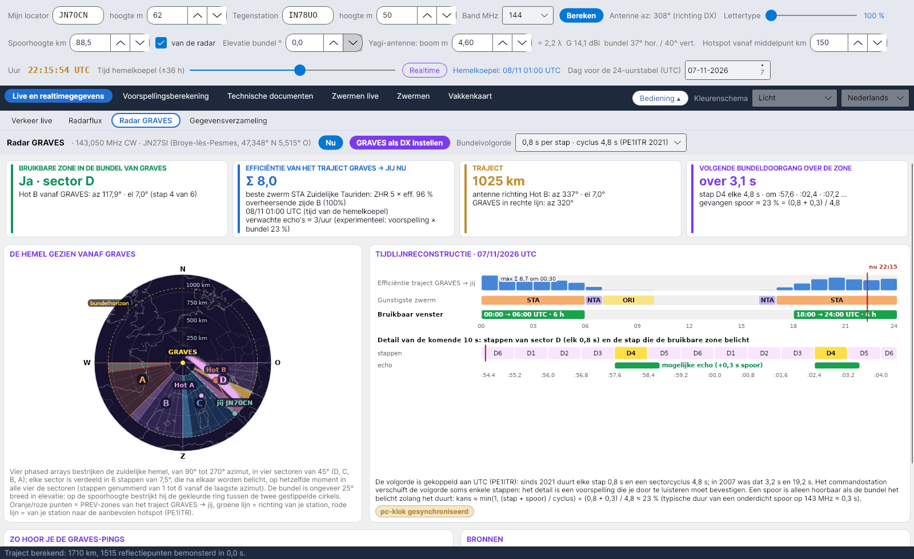

[English](GRAVES-Radar) · [Italiano](GRAVES-Radar-it) · [Deutsch](GRAVES-Radar-de) · **Nederlands** · [Français](GRAVES-Radar-fr) · [Español](GRAVES-Radar-es) · [Português](GRAVES-Radar-pt) · [Dansk](GRAVES-Radar-da) · [Norsk](GRAVES-Radar-nb) · [Svenska](GRAVES-Radar-sv) · [Íslenska](GRAVES-Radar-is) · [Eesti](GRAVES-Radar-et) · [Lietuvių](GRAVES-Radar-lt) · [Latviešu](GRAVES-Radar-lv) · [Русский](GRAVES-Radar-ru) · [Українська](GRAVES-Radar-uk) · [Türkçe](GRAVES-Radar-tr) · [Afrikaans](GRAVES-Radar-af) · [العربية](GRAVES-Radar-ar) · [עברית](GRAVES-Radar-he) · [اردو](GRAVES-Radar-ur) · [हिन्दी](GRAVES-Radar-hi) · [বাংলা](GRAVES-Radar-bn) · [Bahasa Indonesia](GRAVES-Radar-id) · [Tagalog](GRAVES-Radar-tl) · [日本語](GRAVES-Radar-ja) · [한국어](GRAVES-Radar-ko) · [中文](GRAVES-Radar-zh)

# Radar GRAVES

*Tabblad: Live en realtimegegevens › Radar GRAVES.*

[](https://raw.githubusercontent.com/ic8tem/YA-MS/main/docs/screenshots/nl-1_3.png)

## Wat GRAVES is

**GRAVES** is een Franse radar die **CW uitzendt op 143,050 MHz** vanuit **Broye-lès-Pesmes** (47,348° N 5,515° O, locator **JN27SI**, ongeveer 200 m boven zeeniveau; Wikipedia). Meteorensporen in de zone die zowel GRAVES als jij kunnen zien, reflecteren het signaal naar jou via **forward scatter**: je hoort korte *pings* vlak bij de draaggolf. Zo tellen de **RMOB**-waarnemers op 143,050 MHz de meteoren uur voor uur, en het is een gratis, altijd aanwezig testsignaal voor je meteorscatter-station op 2 m.

Het tabblad behandelt **GRAVES → jij** als een zelfstandig meteorscatter-traject: met dezelfde functies als het hoofdtraject (dezelfde spoorhoogte, bundelelevatie en hotspot-afstand) berekent het de efficiëntie van de zwermen, de aanbevolen hot en de PREV-zones, en controleert het daarna of die zone **binnen de bundel van GRAVES** ligt en **wanneer** de bundel haar belicht.

## Bovenste balk

| Element | Wat het doet |
|---|---|
| **Nu** | Zet de tijd van de hemelkoepel terug op realtime (het tabblad volgt de schuifregelaar *Tijd hemelkoepel*). |
| **GRAVES als DX instellen** | Het tegenstation wordt GRAVES (JN27SI, hoogte 200 m) en het hoofdtraject wordt herberekend: alle andere tabbladen tonen dan het traject naar GRAVES. |
| **Bundelvolgorde** | *0,8 s per stap · cyclus 4,8 s (PE1ITR 2021)* (standaard) of *3,2 s per stap · cyclus 19,2 s (PE1ITR 2007)*. |

## De vier kaarten

| Kaart | Inhoud |
|---|---|
| **BRUIKBARE ZONE IN DE BUNDEL VAN GRAVES** | *Ja · sector X* met azimut en elevatie van de aanbevolen hotspot gezien vanaf GRAVES en de stap (1–6); of *Nee: buiten de sectoren* / *Nee: onder de horizon van GRAVES* / *Nee: boven de bundel (ongeveer 25°)* |
| **EFFICIËNTIE VAN HET TRAJECT GRAVES → JIJ NU** | Trajectindex Σ ZHR × efficiëntie, beste zwerm, overheersende zijde A/B, en *verwachte echo's ≈ …/uur* (experimenteel, zie hieronder) |
| **TRAJECT** | Afstand tot GRAVES; antenne richting de aanbevolen hot (azimut en elevatie); azimut van GRAVES in rechte lijn |
| **VOLGENDE BUNDELDOORGANG OVER DE ZONE** | *nu · nog … s* of *over … s*, de stap (bijv. *B4*), de volgende drie tijdstippen (seconden binnen de minuut) en het aandeel opgevangen sporen |

Als op dat moment geen enkele zwerm bruikbaar is, toont het programma de hotspot **die het best bij de bundel past** (binnen de sectoren, het dichtst bij het zuiden) en meldt dat.

## De hemel gezien vanaf GRAVES

Volgens PE1ITR en de Bolidozor-wiki bestrijken **vier phased arrays** de zuidelijke hemel van **90° tot 270°** azimut in vier **sectoren van 45°**:

| Sector | Azimut vanaf GRAVES |
|---|---|
| D | 90°–135° |
| C | 135°–180° |
| B | 180°–225° |
| A | 225°–270° |

Elke sector is verdeeld in **6 stappen van 7,5°**, genummerd 1 tot 6 vanaf het laagste azimut, die na elkaar worden belicht, **op hetzelfde moment in alle vier de sectoren**. De bundel is ongeveer **25° breed in elevatie**: op spoorhoogte bestrijkt hij de gekleurde ring tussen de twee gestippelde cirkels (*bundelhorizon*). Op de tekening: oranje/roze stippen = PREV-zones van het traject GRAVES → jij, groene lijn = richting van jouw station, rode lijn = van jouw station naar de aanbevolen hotspot; de stap die nu wordt belicht, is gemarkeerd.

## Tijdlijnreconstructie

*TIJDLIJNRECONSTRUCTIE · datum UTC* (dezelfde dag als de 24-uurstabel): per uur de efficiëntie van het traject GRAVES → jij, de gunstigste zwerm en het bruikbare venster (*hh:00 → hh:00 UTC · n h*), met het maximum (*max Σ … om hh:30*) en een rode markering *nu*. Daaronder het **detail van de komende seconden**: de zes stappen van de sector, de stap die de bruikbare zone belicht, en *mogelijke echo (+0,3 s spoor)*.

### Timing van de bundel

De volgorde is gekoppeld aan **UTC** (PE1ITR): de stap die nu wordt belicht, wordt berekend uit de seconden sinds 00:00 UTC modulo de cyclus (86 400 s is een veelvoud van zowel 4,8 s als 19,2 s). Het commandostation verschuift de volgorde soms een paar stappen, dus het detail is een **voorspelling die je door te luisteren moet bevestigen**. Het gele label **pc-klok gesynchroniseerd** herinnert je eraan: synchroniseer je pc met een NTP-server (fout van hooguit enkele tienden van een seconde).

### Detectiefactor

Een spoor is alleen hoorbaar als de bundel het belicht terwijl het bestaat:

```
probability ≈ min(1, (step + trail) / cycle)
2021 sequence:  (0.8 + 0.3) / 4.8  ≈ 23 %
2007 sequence:  (3.2 + 0.3) / 19.2 ≈ 18 %
```

0,3 s is een typische duur van een onderdicht spoor op 143 MHz – een vaste waarde, *keuze van het programma* (de λ²-regel van SM6FHZ schaalt de duur tussen banden, maar geeft geen startwaarde).

### Verwachte echo's (experimenteel)

```
echoes/hour ≈ forecast(main path, f_fc) · (f_fc / 143.05)^k · (I_GRAVES + 10) / (I_main + 10) · probability
```

De voorspelling uit [Experimentele voorspelling](Experimental-Forecasts-nl) (die de stationsfactor K al bevat) wordt met de regel van SM6FHZ (dezelfde exponent k) van haar frequentie f_fc omgerekend naar 143,050 MHz, gecorrigeerd met de verhouding van de zwermindexen van de twee trajecten (de constante 10 staat voor de sporadische achtergrond, zoals in de voorspelling) en vermenigvuldigd met de detectiefactor. Alleen indicatief: vergelijk met de RMOB-waarnemers.

## Zo hoor je de GRAVES-pings

| Stap | Wat te doen |
|---|---|
| Ontvanger | **USB op 143,049 MHz** (toon rond 1 kHz) of 143,050 MHz, **langzame of uitgeschakelde AGC**, audiobandbreedte van **minstens 2,4 kHz** |
| Antenne | Richting de **aanbevolen hotspot** van het traject GRAVES → jij (kaart *TRAJECT*), op **lage elevatie** |
| Waterval | Pings zijn **korte streepjes vlak bij de draaggolf**; lange (overdichte) sporen zijn breder en tonen Doppler |
| Telling | RMOB gebruikt GRAVES voor uurtellingen van meteoren: **vergelijk je pings met de waarnemers op 143,050 MHz** ([Experimentele voorspelling](Experimental-Forecasts-nl#vergelijking-met-rmob)) |

## Bronnen

1. Rob Hardenberg **PE1ITR**, *"The 143.050 MHz Graves Radar, a VHF Beacon"* (DUBUS 4/2007) en *"Graves Radar Update April 2021"* – [pe1itr.com/graves](https://pe1itr.com/graves)
2. **Bolidozor**-wiki, "Graves" – arrays, sectoren en bundeltijden
3. **Wikipedia**, "GRAVES (system)" – zender in Broye-lès-Pesmes (47,348° N 5,515° O)
4. **RMOB** – waarnemers op 143,050 MHz ([rmob.org](https://www.rmob.org))
5. **YAEC** van IC8TEM – tabblad GRAVES Radar (het prototype waarvan dit tabblad is afgeleid)
