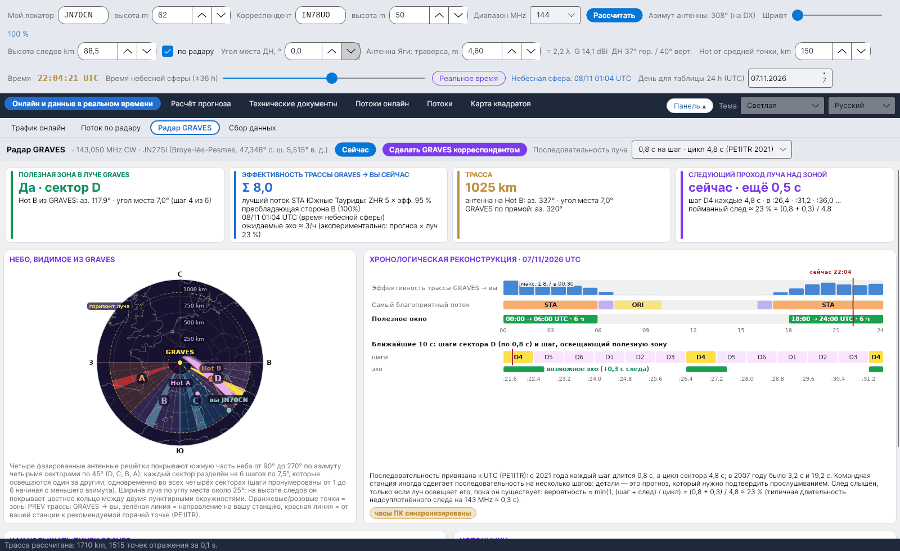

[English](GRAVES-Radar) · [Italiano](GRAVES-Radar-it) · [Deutsch](GRAVES-Radar-de) · [Nederlands](GRAVES-Radar-nl) · [Français](GRAVES-Radar-fr) · [Español](GRAVES-Radar-es) · [Português](GRAVES-Radar-pt) · [Dansk](GRAVES-Radar-da) · [Norsk](GRAVES-Radar-nb) · [Svenska](GRAVES-Radar-sv) · [Íslenska](GRAVES-Radar-is) · [Eesti](GRAVES-Radar-et) · [Lietuvių](GRAVES-Radar-lt) · [Latviešu](GRAVES-Radar-lv) · **Русский** · [Українська](GRAVES-Radar-uk) · [Türkçe](GRAVES-Radar-tr) · [Afrikaans](GRAVES-Radar-af) · [العربية](GRAVES-Radar-ar) · [עברית](GRAVES-Radar-he) · [اردو](GRAVES-Radar-ur) · [हिन्दी](GRAVES-Radar-hi) · [বাংলা](GRAVES-Radar-bn) · [Bahasa Indonesia](GRAVES-Radar-id) · [Tagalog](GRAVES-Radar-tl) · [日本語](GRAVES-Radar-ja) · [한국어](GRAVES-Radar-ko) · [中文](GRAVES-Radar-zh)

# Радар GRAVES

*Вкладка: Онлайн и данные в реальном времени › Радар GRAVES.*

[](https://raw.githubusercontent.com/ic8tem/YA-MS/main/docs/screenshots/ru-1_3.png)

## Что такое GRAVES

**GRAVES** – французский радар, излучающий **CW на 143,050 MHz** из **Broye-lès-Pesmes** (47,348° с. ш. 5,515° в. д., локатор **JN27SI**, около 200 m над уровнем моря; Wikipedia). Метеорные следы в зоне, которую видят и GRAVES, и вы, отражают его сигнал к вам за счёт **рассеяния вперёд**: вы слышите короткие *пинги* рядом с несущей. Так наблюдатели **RMOB** на 143,050 MHz подсчитывают метеоры по часам, и это бесплатный, постоянно работающий тестовый сигнал для вашей станции метеорного рассеяния на 2 m.

Вкладка рассматривает **GRAVES → вы** как отдельную трассу метеорного рассеяния: теми же функциями, что и для основной трассы (та же высота следов, угол места ДН и расстояние горячих точек), рассчитываются эффективность потоков, рекомендуемый Hot и зоны PREV, а затем проверяется, находится ли эта зона **в луче GRAVES** и **когда** луч её освещает.

## Верхняя панель

| Элемент | Что делает |
|---|---|
| **Сейчас** | Возвращает момент расчёта к реальному времени (вкладка следует ползунку *Момент расчёта*). |
| **Сделать GRAVES корреспондентом** | Корреспондентом становится GRAVES (JN27SI, высота 200 m), основная трасса пересчитывается: все остальные вкладки показывают трассу на GRAVES. |
| **Последовательность луча** | *0,8 с на шаг · цикл 4,8 с (PE1ITR 2021)* (по умолчанию) или *3,2 с на шаг · цикл 19,2 с (PE1ITR 2007)*. |

## Четыре карточки

| Карточка | Содержание |
|---|---|
| **ПОЛЕЗНАЯ ЗОНА В ЛУЧЕ GRAVES** | *Да · сектор X* с азимутом и углом места рекомендуемой горячей точки, видимой из GRAVES, и шагом (1–6); или *Нет: вне секторов* / *Нет: ниже горизонта GRAVES* / *Нет: выше луча (около 25°)* |
| **ЭФФЕКТИВНОСТЬ ТРАССЫ GRAVES → ВЫ СЕЙЧАС** | Индекс трассы Σ ZHR × эффективность, лучший поток, преобладающая сторона A/B и *ожидаемые эхо ≈ …/ч* (экспериментально, см. ниже) |
| **ТРАССА** | Расстояние до GRAVES; антенна на рекомендуемый Hot (азимут и угол места); прямой азимут на GRAVES |
| **СЛЕДУЮЩИЙ ПРОХОД ЛУЧА НАД ЗОНОЙ** | *сейчас · ещё … с* или *через … с*, шаг (например, *B4*), три следующих момента (секунды внутри минуты) и доля пойманных следов |

Если в данный момент нет полезных потоков, программа показывает горячую точку, **лучше всего подходящую к лучу** (внутри секторов, ближе всего к югу), и сообщает об этом.

## Небо, видимое из GRAVES

По данным PE1ITR и вики Bolidozor, **четыре фазированные антенные решётки** покрывают южную часть неба от **90° до 270°** по азимуту четырьмя **секторами по 45°**:

| Сектор | Азимут из GRAVES |
|---|---|
| D | 90°–135° |
| C | 135°–180° |
| B | 180°–225° |
| A | 225°–270° |

Каждый сектор разделён на **6 шагов по 7,5°**, пронумерованных от 1 до 6 начиная с меньшего азимута, которые освещаются один за другим, **одновременно во всех четырёх секторах**. Ширина луча **по углу места около 25°**: на высоте следов он покрывает цветное кольцо между двумя пунктирными окружностями (*горизонт луча*). На рисунке: оранжевые/розовые точки = зоны PREV трассы GRAVES → вы, зелёная линия = направление на вашу станцию, красная линия = от вашей станции к рекомендуемой горячей точке; освещаемый сейчас шаг выделен.

## Хронологическая реконструкция

*ХРОНОЛОГИЧЕСКАЯ РЕКОНСТРУКЦИЯ · дата UTC* (тот же день, что и в таблице 24 h): для каждого часа – эффективность трассы GRAVES → вы, самый благоприятный поток и полезное окно (*hh:00 → hh:00 UTC · n ч*), с максимумом (*макс. Σ … в hh:30*) и красной отметкой *сейчас*. Ниже – **детали ближайших секунд**: шесть шагов сектора, шаг, освещающий полезную зону, и *возможное эхо (+0,3 с следа)*.

### Синхронизация луча

Последовательность привязана к **UTC** (PE1ITR): освещаемый сейчас шаг вычисляется по числу секунд с 00:00 UTC по модулю цикла (86 400 s кратно и 4,8 s, и 19,2 s). Командная станция иногда сдвигает последовательность на несколько шагов, поэтому детали – это **прогноз, который нужно подтвердить прослушиванием**. Жёлтая «таблетка» **часы ПК синхронизированы** напоминает: синхронизируйте ПК с сервером NTP (ошибка не более нескольких десятых секунды).

### Коэффициент обнаружения

След слышен, только если луч освещает его, пока он существует:

```math
p \approx \min\left(1,\ \frac{t_{step} + \tau}{T_{cycle}}\right):\qquad 2021:\ \frac{0{.}8+0{.}3}{4{.}8} \approx 23\ \%,\qquad 2007:\ \frac{3{.}2+0{.}3}{19{.}2} \approx 18\ \%
```

0,3 s – типичная длительность ненасыщенного следа на 143 MHz; это фиксированное значение, *выбор программы* (правило λ² SM6FHZ пересчитывает длительности между диапазонами, но не даёт исходного значения).

### Ожидаемые эхо (экспериментально)

```math
N_{GRAVES} \approx N_{prev}(f_{fc})\left(\frac{f_{fc}}{143{.}05}\right)^{k}\frac{I_{GRAVES}+10}{I_{DX}+10}\; p
```

Прогноз из [Экспериментального прогноза](Experimental-Forecasts-ru) (уже включающий коэффициент станции K) пересчитывается с его частоты f_fc на 143,050 MHz по правилу SM6FHZ (с тем же показателем k), корректируется отношением индексов потоков двух трасс (константа 10 представляет спорадический фон, как и в прогнозе) и умножается на коэффициент обнаружения. Только для ориентира: сравнивайте с наблюдателями RMOB.

## Как услышать пинги GRAVES

| Шаг | Что делать |
|---|---|
| Приёмник | **USB на 143,049 MHz** (тон около 1 kHz) или 143,050 MHz, **АРУ медленная или выключена**, полоса НЧ **не менее 2,4 kHz** |
| Антенна | На **рекомендуемую горячую точку** трассы GRAVES → вы (карточка *ТРАССА*), с **малым углом места** |
| Водопад | Пинги – **короткие линии рядом с несущей**; длинные (переуплотнённые) следы шире и показывают доплеровский сдвиг |
| Подсчёт | RMOB использует GRAVES для почасового подсчёта метеоров: **сравните свои пинги с наблюдателями на 143,050 MHz** ([Экспериментальный прогноз](Experimental-Forecasts-ru#сравнение-с-rmob)) |

## Источники

1. Rob Hardenberg **PE1ITR**, *«The 143.050 MHz Graves Radar, a VHF Beacon»* (DUBUS 4/2007) и *«Graves Radar Update April 2021»* – [pe1itr.com/graves](https://pe1itr.com/graves)
2. Вики **Bolidozor**, «Graves» – антенные решётки, секторы и время луча
3. **Wikipedia**, «GRAVES (system)» – передатчик в Broye-lès-Pesmes (47,348° с. ш. 5,515° в. д.)
4. **RMOB** – наблюдатели на 143,050 MHz ([rmob.org](https://www.rmob.org))
5. **YAEC** от IC8TEM – вкладка «Радар GRAVES» (макет, на основе которого сделана эта вкладка)
