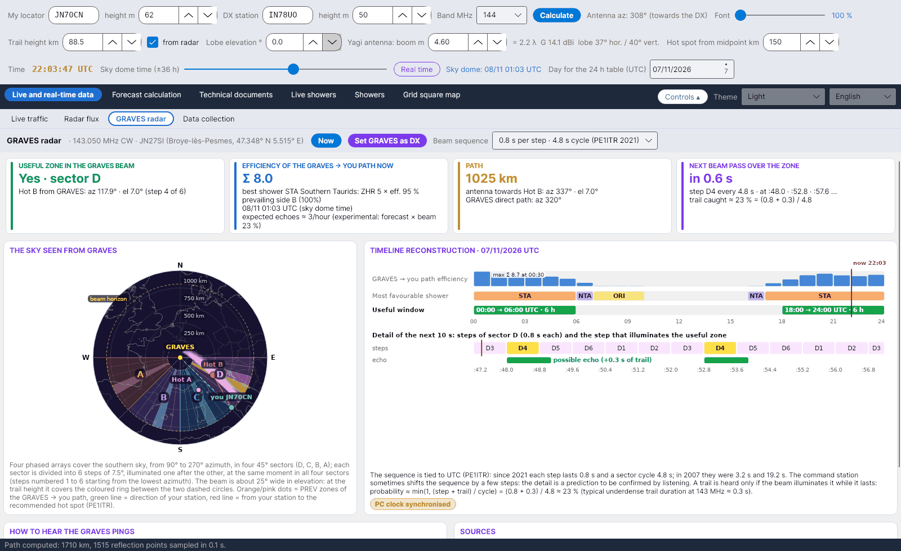

[English](GRAVES-Radar) · [Italiano](GRAVES-Radar-it) · [Deutsch](GRAVES-Radar-de) · [Nederlands](GRAVES-Radar-nl) · [Français](GRAVES-Radar-fr) · [Español](GRAVES-Radar-es) · [Português](GRAVES-Radar-pt) · [Português (Brasil)](GRAVES-Radar-pt-BR) · [Dansk](GRAVES-Radar-da) · [Norsk](GRAVES-Radar-nb) · [Svenska](GRAVES-Radar-sv) · [Íslenska](GRAVES-Radar-is) · [Eesti](GRAVES-Radar-et) · [Lietuvių](GRAVES-Radar-lt) · [Latviešu](GRAVES-Radar-lv) · [Polski](GRAVES-Radar-pl) · [Čeština](GRAVES-Radar-cs) · [Magyar](GRAVES-Radar-hu) · [Română](GRAVES-Radar-ro) · [Ελληνικά](GRAVES-Radar-el) · [Русский](GRAVES-Radar-ru) · [Українська](GRAVES-Radar-uk) · [Türkçe](GRAVES-Radar-tr) · [Afrikaans](GRAVES-Radar-af) · [العربية](GRAVES-Radar-ar) · [עברית](GRAVES-Radar-he) · [اردو](GRAVES-Radar-ur) · [हिन्दी](GRAVES-Radar-hi) · [বাংলা](GRAVES-Radar-bn) · **ไทย** · [Bahasa Indonesia](GRAVES-Radar-id) · [Tagalog](GRAVES-Radar-tl) · [日本語](GRAVES-Radar-ja) · [한국어](GRAVES-Radar-ko) · [中文](GRAVES-Radar-zh) · [中文 (繁體)](GRAVES-Radar-zh-TW)

# เรดาร์ GRAVES

*แท็บ: สดและข้อมูลเรียลไทม์ › เรดาร์ GRAVES*

[](https://raw.githubusercontent.com/ic8tem/YA-MS/main/docs/screenshots/en-1_3.png)

## GRAVES คืออะไร

**GRAVES** เป็นเรดาร์ของฝรั่งเศสที่ส่ง **CW บน 143.050 MHz** จาก **Broye-lès-Pesmes** (47.348° N 5.515° E locator **JN27SI** สูงประมาณ 200 m จากระดับน้ำทะเล; Wikipedia) รอยดาวตกในโซนที่ทั้ง GRAVES และคุณมองเห็นจะสะท้อนสัญญาณของมันมาถึงคุณด้วย **forward scatter**: คุณจะได้ยิน *ping* สั้น ๆ ใกล้คลื่นพาห์ นี่คือวิธีที่ผู้สังเกตการณ์ของ **RMOB** บน 143.050 MHz ใช้นับดาวตกทีละชั่วโมง และยังเป็นสัญญาณทดสอบฟรีที่เปิดตลอดเวลาสำหรับสถานี meteor scatter ย่าน 2 m ของคุณ

แท็บนี้ถือว่า **GRAVES → คุณ** เป็นเส้นทาง meteor scatter อีกเส้นหนึ่ง: ด้วยฟังก์ชันเดียวกับเส้นทางหลัก (ความสูงของรอยดาวตก มุมเงยของโลบ และระยะ hot spot เท่ากัน) โปรแกรมจะคำนวณประสิทธิภาพของฝนดาวตก Hot ที่แนะนำ และโซน PREV จากนั้นตรวจสอบว่าโซนนั้นอยู่ **ภายในลำคลื่นของ GRAVES** หรือไม่ และลำคลื่นจะส่องถึง **เมื่อไร**

## แถบด้านบน

| ตัวควบคุม | หน้าที่ |
|---|---|
| **ตอนนี้** | นำการคำนวณกลับสู่เวลาจริง: วันที่ของวันนี้และแถบเลื่อนชั่วโมงที่ศูนย์ (แท็บนี้อิงตาม *วันที่คำนวณ* และ *ชั่วโมง*) |
| **ตั้ง GRAVES เป็น DX** | สถานี DX จะกลายเป็น GRAVES (JN27SI ความสูง 200 m) และเส้นทางหลักจะถูกคำนวณใหม่: แท็บอื่นทั้งหมดจะแสดงเส้นทางของ GRAVES |
| **ลำดับของลำคลื่น** | *0.8 s ต่อขั้น · รอบ 4.8 s (PE1ITR 2021)* (ค่าเริ่มต้น) หรือ *3.2 s ต่อขั้น · รอบ 19.2 s (PE1ITR 2007)* |

## การ์ดสี่ใบ

| การ์ด | เนื้อหา |
|---|---|
| **โซนที่ใช้ได้ในลำคลื่น GRAVES** | *ใช่ · เซกเตอร์ X* พร้อมแอซิมัทและมุมเงยของ hot spot ที่แนะนำเมื่อมองจาก GRAVES และขั้น (1–6) หรือ *ไม่: อยู่นอกเซกเตอร์* / *ไม่: ต่ำกว่าขอบฟ้าของ GRAVES* / *ไม่: อยู่เหนือลำคลื่น (ประมาณ 25°)* |
| **ประสิทธิภาพของเส้นทาง GRAVES → คุณ ตอนนี้** | ดัชนีเส้นทาง Σ ZHR × ประสิทธิภาพ ฝนดาวตกที่ดีที่สุด ด้านที่เด่น A/B และ *เสียงสะท้อนที่คาดไว้ ≈ …/ชั่วโมง* (เชิงทดลอง ดูด้านล่าง) |
| **เส้นทาง** | ระยะทางถึง GRAVES สายอากาศหันไปยัง Hot ที่แนะนำ (แอซิมัทและมุมเงย) แอซิมัทตรงไปยัง GRAVES |
| **ลำคลื่นผ่านโซนครั้งถัดไป** | *ตอนนี้ · เหลือ … s* หรือ *ในอีก … s* ขั้น (เช่น *B4*) เวลาสามครั้งถัดไป (วินาทีภายในนาที) และสัดส่วนของรอยดาวตกที่จับได้ |

หากในขณะนั้นไม่มีฝนดาวตกที่ใช้ได้ โปรแกรมจะแสดง hot spot ที่ **เหมาะกับลำคลื่นที่สุด** (อยู่ในเซกเตอร์ ใกล้ทิศใต้ที่สุด) และแจ้งให้ทราบ

## ท้องฟ้าเมื่อมองจาก GRAVES

ตามข้อมูลของ PE1ITR และวิกิของ Bolidozor **แอร์เรย์แบบเฟสสี่ชุด** ครอบคลุมท้องฟ้าด้านใต้ตั้งแต่แอซิมัท **90° ถึง 270°** แบ่งเป็นสี่ **เซกเตอร์ เซกเตอร์ละ 45°**:

| เซกเตอร์ | แอซิมัทจาก GRAVES |
|---|---|
| D | 90°–135° |
| C | 135°–180° |
| B | 180°–225° |
| A | 225°–270° |

แต่ละเซกเตอร์แบ่งเป็น **6 ขั้น ขั้นละ 7.5°** หมายเลข 1 ถึง 6 เริ่มจากแอซิมัทต่ำสุด ส่องสว่างทีละขั้น **พร้อมกันทั้งสี่เซกเตอร์** ลำคลื่นกว้างประมาณ **25° ในแนวมุมเงย**: ที่ความสูงของรอยดาวตกจะครอบคลุมวงแหวนสีระหว่างวงกลมเส้นประสองวง (*ขอบฟ้าของลำคลื่น*) บนภาพ: จุดสีส้ม/ชมพู = โซน PREV ของเส้นทาง GRAVES → คุณ เส้นสีเขียว = ทิศของสถานีคุณ เส้นสีแดง = จากสถานีของคุณไปยัง hot spot ที่แนะนำ ขั้นที่กำลังส่องอยู่ตอนนี้จะถูกเน้น

## การจำลองลำดับเวลาย้อนหลัง

*การจำลองลำดับเวลาย้อนหลัง · วันที่ UTC* (วันเดียวกับตาราง 24 h): สำหรับแต่ละชั่วโมง แสดงประสิทธิภาพของเส้นทาง GRAVES → คุณ ฝนดาวตกที่เอื้ออำนวยที่สุด และช่วงเวลาที่ใช้ได้ (*hh:00 → hh:00 UTC · n h*) พร้อมค่าสูงสุด (*สูงสุด Σ … ที่ hh:30*) และเครื่องหมาย *ตอนนี้* สีแดง ด้านล่างคือ **รายละเอียดของวินาทีถัดไป**: หกขั้นของเซกเตอร์ ขั้นที่ส่องโซนที่ใช้ได้ และ *อาจมีเสียงสะท้อน (+0.3 s ของรอยดาวตก)*

### จังหวะเวลาของลำคลื่น

ลำดับผูกกับ **UTC** (PE1ITR): ขั้นที่กำลังส่องตอนนี้คำนวณจากจำนวนวินาทีนับตั้งแต่ 00:00 UTC มอดุโลรอบ (86 400 s เป็นพหุคูณของทั้ง 4.8 s และ 19.2 s) สถานีควบคุมบางครั้งเลื่อนลำดับไปไม่กี่ขั้น ดังนั้นรายละเอียดนี้จึงเป็น **การคาดการณ์ที่ต้องยืนยันด้วยการรับฟัง** ป้ายสีเหลือง **นาฬิกาคอมพิวเตอร์ซิงโครไนซ์แล้ว** เตือนคุณว่า: ให้ซิงโครไนซ์ PC ของคุณกับเซิร์ฟเวอร์ NTP (คลาดเคลื่อนไม่เกินไม่กี่สิบของวินาที)

### ตัวประกอบการตรวจจับ

รอยดาวตกจะได้ยินก็ต่อเมื่อลำคลื่นส่องถึงในขณะที่รอยยังคงอยู่:

```math
p \approx \min\left(1,\ \frac{t_{step} + \tau}{T_{cycle}}\right):\qquad 2021:\ \frac{0{.}8+0{.}3}{4{.}8} \approx 23\ \%,\qquad 2007:\ \frac{3{.}2+0{.}3}{19{.}2} \approx 18\ \%
```

0.3 s เป็นระยะเวลาทั่วไปของรอยดาวตกแบบ underdense ที่ 143 MHz – เป็นค่าคงที่ *การเลือกของโปรแกรม* (กฎ λ² ของ SM6FHZ ปรับสเกลระยะเวลาระหว่างย่านความถี่ แต่ไม่ได้ให้ค่าเริ่มต้น)

### เสียงสะท้อนที่คาดไว้ (เชิงทดลอง)

```math
N_{GRAVES} \approx N_{prev}(f_{fc})\left(\frac{f_{fc}}{143{.}05}\right)^{k}\frac{I_{GRAVES}+10}{I_{DX}+10}\; p
```

พยากรณ์จาก [การพยากรณ์ทดลอง](Experimental-Forecasts-th) (ซึ่งรวมตัวประกอบสถานี K ไว้แล้ว) ถูกปรับสเกลจากความถี่ f_fc ไปเป็น 143.050 MHz ด้วยกฎของ SM6FHZ (เลขชี้กำลัง k เดียวกัน) แก้ไขด้วยอัตราส่วนของดัชนีฝนดาวตกของสองเส้นทาง (ค่าคงที่ 10 แทนพื้นหลังจากดาวตกประปราย เหมือนในพยากรณ์) และคูณด้วยตัวประกอบการตรวจจับ ใช้เป็นเพียงค่าบ่งชี้: โปรดเปรียบเทียบกับผู้สังเกตการณ์ RMOB

## วิธีฟัง ping ของ GRAVES

| ขั้นตอน | สิ่งที่ต้องทำ |
|---|---|
| เครื่องรับ | **USB บน 143.049 MHz** (โทนประมาณ 1 kHz) หรือ 143.050 MHz **AGC ช้าหรือปิด** แบนด์วิดท์เสียง **อย่างน้อย 2.4 kHz** |
| สายอากาศ | หันไปยัง **hot spot ที่แนะนำ** ของเส้นทาง GRAVES → คุณ (การ์ด *เส้นทาง*) ที่ **มุมเงยต่ำ** |
| Waterfall | ping คือ **เส้นสั้น ๆ ใกล้คลื่นพาห์** รอยดาวตกยาว (overdense) จะกว้างกว่าและแสดงดอปเพลอร์ |
| การนับ | RMOB ใช้ GRAVES นับดาวตกรายชั่วโมง: **เปรียบเทียบ ping ของคุณกับผู้สังเกตการณ์บน 143.050 MHz** ([การพยากรณ์ทดลอง](Experimental-Forecasts-th#การเปรียบเทียบกับ-rmob)) |

## แหล่งอ้างอิง

1. Rob Hardenberg **PE1ITR**, *"The 143.050 MHz Graves Radar, a VHF Beacon"* (DUBUS 4/2007) และ *"Graves Radar Update April 2021"* – [pe1itr.com/graves](https://pe1itr.com/graves)
2. วิกิของ **Bolidozor**, "Graves" – แอร์เรย์ เซกเตอร์ และจังหวะเวลาของลำคลื่น
3. **Wikipedia**, "GRAVES (system)" – เครื่องส่งที่ Broye-lès-Pesmes (47.348° N 5.515° E)
4. **RMOB** – ผู้สังเกตการณ์บน 143.050 MHz ([rmob.org](https://www.rmob.org))
5. **YAEC** โดย IC8TEM – แท็บ GRAVES Radar (ต้นแบบที่แท็บนี้พัฒนามา)
