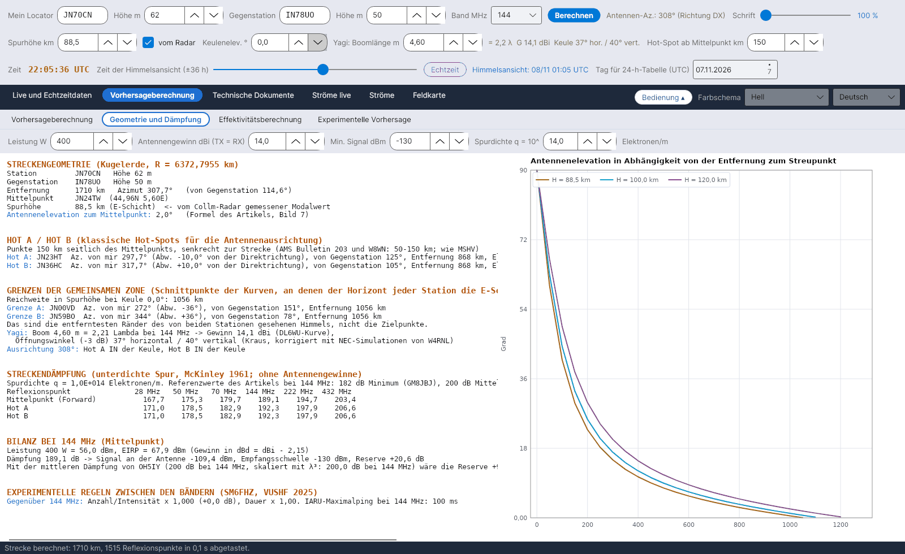

[English](Geometry-and-Path-Loss) · [Italiano](Geometry-and-Path-Loss-it) · **Deutsch** · [Nederlands](Geometry-and-Path-Loss-nl) · [Français](Geometry-and-Path-Loss-fr) · [Español](Geometry-and-Path-Loss-es) · [Português](Geometry-and-Path-Loss-pt) · [Português (Brasil)](Geometry-and-Path-Loss-pt-br) · [Dansk](Geometry-and-Path-Loss-da) · [Norsk](Geometry-and-Path-Loss-nb) · [Svenska](Geometry-and-Path-Loss-sv) · [Íslenska](Geometry-and-Path-Loss-is) · [Eesti](Geometry-and-Path-Loss-et) · [Lietuvių](Geometry-and-Path-Loss-lt) · [Latviešu](Geometry-and-Path-Loss-lv) · [Polski](Geometry-and-Path-Loss-pl) · [Čeština](Geometry-and-Path-Loss-cs) · [Magyar](Geometry-and-Path-Loss-hu) · [Română](Geometry-and-Path-Loss-ro) · [Ελληνικά](Geometry-and-Path-Loss-el) · [Русский](Geometry-and-Path-Loss-ru) · [Українська](Geometry-and-Path-Loss-uk) · [Türkçe](Geometry-and-Path-Loss-tr) · [Afrikaans](Geometry-and-Path-Loss-af) · [العربية](Geometry-and-Path-Loss-ar) · [עברית](Geometry-and-Path-Loss-he) · [اردو](Geometry-and-Path-Loss-ur) · [हिन्दी](Geometry-and-Path-Loss-hi) · [বাংলা](Geometry-and-Path-Loss-bn) · [Bahasa Indonesia](Geometry-and-Path-Loss-id) · [Tagalog](Geometry-and-Path-Loss-tl) · [日本語](Geometry-and-Path-Loss-ja) · [한국어](Geometry-and-Path-Loss-ko) · [中文](Geometry-and-Path-Loss-zh) · [中文 (繁體)](Geometry-and-Path-Loss-zh-tw)

# Geometrie und Dämpfung

*Reiter: Vorhersageberechnung › Geometrie und Dämpfung.*

[](https://raw.githubusercontent.com/ic8tem/YA-MS/main/docs/screenshots/de-2_2.png)

Ein Textbericht der Strecke (markierbar, du kannst ihn also kopieren) und rechts das Diagramm **Antennenelevation in Abhängigkeit von der Entfernung zum Streupunkt**. Zahlen in eckigen Klammern verweisen auf die Gleichungen des Berechnungshandbuchs (`doc/YA-MS_manuale_calcoli.docx`).

## Eingaben dieses Reiters

| Feld | Standard | Verwendung |
|---|---|---|
| **Leistung W** | 400 | Sendeleistung für die Streckenbilanz |
| **Antennengewinn dBi (TX = RX)** | 14 | Gleiche Antenne an beiden Enden |
| **Min. Signal dBm** | −130 | Empfangsschwelle (Artikel: 8-Element-Yagi + Vorverstärker) |
| **Spurdichte q = 10^ … Elektronen/m** | 14 | Elektronen-Liniendichte der unterdichten Spur |

Stationen, Band, Spurhöhe, Keulenelevation, Boom und Hot-Spot-Abstand kommen aus den [Bedienzeilen](Getting-Started-de#1-die-drei-bedienzeilen).

## Abschnitte des Berichts

| Abschnitt | Inhalt |
|---|---|
| **STRECKENGEOMETRIE (Kugelerde, R = 6372,7955 km)** | Station und Gegenstation mit Höhen; Entfernung, Azimut und Gegenazimut; Mittelpunkt (Locator und Koordinaten); Spurhöhe (*← vom Collm-Radar gemessener Modalwert*, wenn vom Radar übernommen); Antennenelevation zum Mittelpunkt |
| **HOT A / HOT B (klassische Hot-Spots für die Antennenausrichtung)** | Für jeden: Locator, Azimut von dir und Abweichung von der Direktrichtung, Azimut von der Gegenstation, Entfernung, Elevation |
| **GRENZEN DER GEMEINSAMEN ZONE** | Reichweite in Spurhöhe bei der Keulenelevation; Grenze A / Grenze B mit Azimuten |
| Antenne | Boom in λ, Gewinn, horizontale / vertikale Keule; ob Hot A und Hot B in oder außerhalb der Keule liegen |
| **STRECKENDÄMPFUNG (unterdichte Spur, McKinley 1961; ohne Antennengewinne)** | Tabelle für Mittelpunkt (Forward), Hot A und Hot B auf 28, 50, 70, 144, 222 und 432 MHz |
| **BILANZ BEI … MHz (Mittelpunkt)** | Leistung und EIRP, Streckendämpfung, Signal an der Antenne, Empfangsschwelle, **Reserve**; dieselbe Reserve mit der mittleren Dämpfung von OH5IY |
| **EXPERIMENTELLE REGELN ZWISCHEN DEN BÄNDERN (SM6FHZ, VUSHF 2025)** | Anzahl/Intensität und Dauer gegenüber 144 MHz; IARU-Maximalping |

## Locator und Strecke

Locator (4, 6 oder 8 Zeichen; Feldmitte, IARU-Maidenhead-System) [14]. Entfernung, Azimut und Mittelpunkt mit Großkreisformeln auf einer Kugel mit Radius **r = 6372,7955 km** (Artikel Cerrotta–Sartori) [15–16]. Zeitabhängige Berechnungen beziehen sich auf den **Mittelpunkt**, weil die beste Zeit an den beiden Enden um bis zu 1,5 Stunden abweichen kann (SM6FHZ).

## Antennenelevation

**Quelle:** Formel des Artikels Cerrotta–Sartori (Bild 7), mit x = d/r, d der Bodenentfernung zum Reflexionspunkt, H der Spurhöhe und h der Stationshöhe [17]:

```
e = 90° − 57.3 · arctan[ ( r·tan x + (H − r(1 − cos x)/cos x)·sin x ) / ( H − r(1 − cos x)/cos x − h·sin x ) ]
```

**Prüfung:** Sie stimmt mit der exakten Kugelgeometrie auf 0,03° überein. Das Programm verwendet den Arkustangens mit zwei Argumenten, der jenseits des Horizonts negative Werte liefert und das im Artikel erwähnte Periodizitätsproblem vermeidet. Eine negative Elevation zum Mittelpunkt bedeutet *Strecke jenseits der geometrischen Reichweite eines Einzelsprungs*.

## Horizontreichweite

Bodenentfernung, in der ein Strahl mit der Elevation e die Höhe H erreicht (geometrische Umkehrung der obigen Formel) [18]:

```
d_H = r · [ π/2 − e − arcsin( (r + h)·cos e / (r + H) ) ]
```

**Prüfung:** H = 89,5 km, e = 0° → **1062 km**. Im Beispiel des Artikels (JN44BB–IO53RT) setzt die Zeichnung die Horizontschnittpunkte etwa 870 km von den Stationen entfernt, was einer um etwa 2° angehobenen Keule entspricht (865 km).

## Grenzen der gemeinsamen Zone

**Quelle:** Der Artikel bestimmt die Schnittpunkte der Kurven, an denen der Horizont jeder Station die E-Schicht trifft: die Schnittpunkte zweier Kreise mit dem Winkelradius ρ = d_H/r um A und B [19–20]:

```
p0 = cos ρ / (1 + û_A·û_B) · (û_A + û_B)
p_A,B = p0 ± sqrt( (1 − |p0|²) / |û_A × û_B|² ) · (û_A × û_B)
```

Ist 1 − |p0|² < 0, ist die Strecke länger als 2·d_H und die Stationen sehen **keine gemeinsame Zone der E-Schicht**.

**Prüfung:** Das sind die **entferntesten Ränder** des von beiden Stationen gesehenen Himmels, **nicht die Zielpunkte**. Auf JN70CN–IN78UO (1710 km, Azimut 308°) liegen sie 1062 km von der Station entfernt, 37° links und rechts der Direktrichtung, während MSHV 10° vorschlägt. Deshalb heißen sie *Grenze A* / *Grenze B* und werden auf der Karte blass gezeichnet.

## Hot A und Hot B

**Quelle:** Die Reflexionen konzentrieren sich in zwei Zonen („Hot-Spots“) etwa **50–150 km beiderseits des Mittelpunkts**. Das ist die Grundlage der Tabelle der Antennenablage im AMS Bulletin Nr. 203, aufgegriffen von W8WN (10° Ablage für Strecken von 1500 und 1800 km); MSHV von LZ2HV verwendet dasselbe Kriterium.

**Entscheidung:** Hot A und Hot B sind die Punkte im Abstand s vom Mittelpunkt M, senkrecht zur Strecke (s = 150 km, einstellbar 30–400 km); A links, von deiner Station zur Gegenstation gesehen, B rechts [21]. Die von der Station aus gesehene Abweichung beträgt etwa [22]:

```
ΔAz_hot ≈ arctan( s / (D/2) )
```

**Prüfung:** JN70CN–IN78UO, D = 1710 km: 6,7° mit s = 100 km, **10,0° mit s = 150 km** (wie MSHV und AMS/W8WN), 13,2° mit s = 200 km.

## Dämpfung unterdichter Spuren

**Quelle:** McKinleys Gleichung für unterdichte Spuren (β = 0, sin α = 1), ohne Antennengewinne; q = Elektronen-Liniendichte, r_e = klassischer Elektronenradius = 2,818·10⁻¹⁵ m, R1, R2 Entfernungen von der Spur, φ halber Streuwinkel [36]:

```
L = 10·log10[ 16·π²·R1·R2·(R1 + R2)·cos²φ / ( λ³·q²·r_e² ) ]   dB
```

**Prüfung:** Mit q = 10¹⁴ Elektronen/m auf 144 MHz: **181–192 dB** zwischen 600 und 2200 km, im Einklang mit den Referenzwerten des Artikels bei 144 MHz: **182 dB Minimum** (GM8JBJ, nach Kaiser & Closs 1952) und **200 dB Mittel** (OH5IY).

## Streckenbilanz

```
P_rx = P_tx(dBm) + G_tx − 2.15 − L + G_rx − 2.15        margin = P_rx − P_min,   P_min = −130 dBm
```

[37–38]. Die Gewinne werden in dBi eingegeben und in dBd verwendet (dBi − 2,15). Der Bericht nennt auch die Reserve mit der **mittleren Dämpfung von OH5IY** (200 dB bei 144 MHz, mit λ³ auf das gewählte Band umgerechnet). Referenz des Artikels: Benötigt werden etwa **70 dBm EIRP** (−130 dBm + 200 dB, z. B. etwa 400 W an 14 dBi).

## Antennengewinn und Keule

**Gewinn – Quelle:** Kurve von Günter Hoch **DL6WU** für lange Yagis in Abhängigkeit von der Boomlänge L, wiedergegeben von W8IO (gültig ab etwa 2 λ) [39]:

```
G = 7.773 · log10(L/λ) + 11.43   dBi
```

**Prüfung anhand der NEC-Modelle von L.B. Cebik W4RNL auf 432 MHz** (*Appreciating DL6WU Wide-Band Long-Boom Yagi Design*; *70-CM Yagi Stacks Part 2*):

| Yagi | Elemente | Boom (λ) | W4RNL NEC (dBi) | Formel (dBi) |
|---|---|---|---|---|
| DL6WU | 13 / 22 / 31 | 3,23 / 6,82 / 10,42 | 15,28 / 17,82 / 19,35 | 15,38 / 17,91 / 19,34 |
| VK3AUU (David Tanner) | 16 / 28 / 40 | 3,12 / 6,88 / 10,79 | 15,17 / 17,91 / 19,46 | 15,27 / 17,94 / 19,45 |

Die Abweichung übersteigt nie **0,1 dB**: Der Gewinn hängt mehr von der Boomlänge als vom Design ab (VK3AUU-Yagis haben bei gleicher Elementzahl einen kürzeren Boom). Der Yagi Calculator von VK5DJ liefert auch Schätzungen für die Varianten VK3AUU, WA2PHW und DJ9BV, deren Formeln nicht veröffentlicht sind.

**Keule – Quelle:** Kraus-Regel, mit kreisförmiger Keule θE = θH = θK [40]:

```
G_lin = 41253 / (θE · θH)   ⇒   θK = sqrt( 41253 / 10^(G/10) )
```

**Prüfung:** Die NEC-Modelle von W4RNL für DL6WU-Yagis ergeben eine **um 5–10 % schmalere horizontale Keule** als Kraus: 33,8° / 26,4° / 22,6° für 12, 19 und 26 Elemente, gegenüber 37,3° / 28,0° / 23,9°. Einfache Formeln vernachlässigen die vorderen Nebenkeulen (W4RNL, *Long-Boom Yagi Rules of Thumb*). Bei langen Booms ist die vertikale Keule etwas breiter als die horizontale (14 λ: 18,4° / 18,8°).

**Entscheidung** [41]:

```
θ_horizontal = 0.93 · θK        θ_vertical = θK
```

Beispiel: Yagi mit 14 λ auf 432 MHz → 20,3 dBi, Keule 18,1° horizontal und 19,5° vertikal; die Modelle von W4RNL ergeben 20,4 dBi und 18,4° / 18,8°. Das sind Näherungsregeln, abgeleitet aus einigen wenigen DL6WU-Antennen.

Die Antenne gilt immer als auf die Gegenstation gerichtet. Ein Hot-Spot liegt **in der Keule**, wenn |Az(Hot) − Az(Antenne)| ≤ θ_horizontal/2: Dann wird er in der [Himmelsansicht](Sky-View-de) grau gezeichnet und eine Warnung erscheint. In der Effektivitätsberechnung sind die Antennen isotrop; die tatsächliche Keule wird nur für diese Prüfung verwendet.

## Experimentelle Regeln zwischen den Bändern

Gegenüber 144 MHz: Anzahl/Intensität × (144/f)³ (in dB), Dauer × (144/f)² (SM6FHZ, VUSHF 2025). Maximale Pingdauer nach IARU Region 1: 1000 ms auf 50 MHz, 500 ms auf 70 MHz, 100 ms auf 144 MHz, 13 ms auf 432 MHz (VHF Handbook, im Artikel zitiert). Siehe auch [Experimentelle Vorhersage](Experimental-Forecasts-de).
