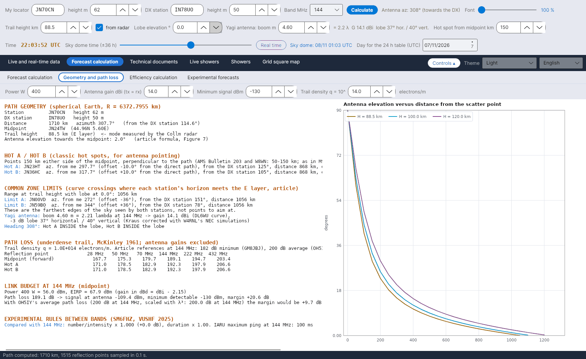

[English](Geometry-and-Path-Loss) · [Italiano](Geometry-and-Path-Loss-it) · [Deutsch](Geometry-and-Path-Loss-de) · [Nederlands](Geometry-and-Path-Loss-nl) · [Français](Geometry-and-Path-Loss-fr) · [Español](Geometry-and-Path-Loss-es) · [Português](Geometry-and-Path-Loss-pt) · [Português (Brasil)](Geometry-and-Path-Loss-pt-BR) · [Dansk](Geometry-and-Path-Loss-da) · [Norsk](Geometry-and-Path-Loss-nb) · [Svenska](Geometry-and-Path-Loss-sv) · [Íslenska](Geometry-and-Path-Loss-is) · [Eesti](Geometry-and-Path-Loss-et) · [Lietuvių](Geometry-and-Path-Loss-lt) · [Latviešu](Geometry-and-Path-Loss-lv) · [Polski](Geometry-and-Path-Loss-pl) · [Čeština](Geometry-and-Path-Loss-cs) · [Magyar](Geometry-and-Path-Loss-hu) · [Română](Geometry-and-Path-Loss-ro) · [Ελληνικά](Geometry-and-Path-Loss-el) · [Русский](Geometry-and-Path-Loss-ru) · [Українська](Geometry-and-Path-Loss-uk) · [Türkçe](Geometry-and-Path-Loss-tr) · [Afrikaans](Geometry-and-Path-Loss-af) · [العربية](Geometry-and-Path-Loss-ar) · [עברית](Geometry-and-Path-Loss-he) · [اردو](Geometry-and-Path-Loss-ur) · **हिन्दी** · [বাংলা](Geometry-and-Path-Loss-bn) · [ไทย](Geometry-and-Path-Loss-th) · [Bahasa Indonesia](Geometry-and-Path-Loss-id) · [Tagalog](Geometry-and-Path-Loss-tl) · [日本語](Geometry-and-Path-Loss-ja) · [한국어](Geometry-and-Path-Loss-ko) · [中文](Geometry-and-Path-Loss-zh) · [中文 (繁體)](Geometry-and-Path-Loss-zh-TW)

# ज्यामिति और क्षीणन

*टैब: पूर्वानुमान गणना › ज्यामिति और क्षीणन।*

[](https://raw.githubusercontent.com/ic8tem/YA-MS/main/docs/screenshots/en-2_2.png)

पथ की एक पाठ रिपोर्ट (चयन योग्य, ताकि आप उसे कॉपी कर सकें) और दाईं ओर ग्राफ़ **स्कैटर पॉइंट से दूरी के अनुसार ऐंटेना उन्नयन**। कोष्ठक में दी गई संख्याएँ गणना पुस्तिका (`doc/YA-MS_manuale_calcoli.docx`) के समीकरणों को दर्शाती हैं।

## इस टैब के इनपुट

| फ़ील्ड | डिफ़ॉल्ट | उपयोग |
|---|---|---|
| **शक्ति W** | 400 | लिंक बजट के लिए ट्रांसमीटर शक्ति |
| **ऐंटेना गेन dBi (tx = rx)** | 14 | दोनों सिरों पर एक ही ऐंटेना |
| **न्यूनतम सिग्नल dBm** | −130 | न्यूनतम पहचान योग्य सिग्नल (लेख: 8-एलिमेंट यागी + प्रीएम्प) |
| **ट्रेल घनत्व q = 10^ … इलेक्ट्रॉन/m** | 14 | अल्प-घनत्व ट्रेल का रैखिक इलेक्ट्रॉन घनत्व |

स्टेशन, बैंड, ट्रेल ऊँचाई, लोब उन्नयन, बूम और हॉट स्पॉट दूरी [नियंत्रणों की पंक्तियों](Getting-Started-hi#1-नियंत्रणों-की-तीन-पंक्तियाँ) से आते हैं।

## रिपोर्ट के खंड

| खंड | सामग्री |
|---|---|
| **पथ ज्यामिति (गोलाकार पृथ्वी, R = 6372.7955 km)** | ऊँचाइयों सहित स्टेशन और DX; दूरी, दिगंश और विपरीत दिगंश; मध्य बिंदु (लोकेटर और निर्देशांक); ट्रेल ऊँचाई (रडार से ली गई हो तो *<- Collm रडार द्वारा मापा गया बहुलक*); मध्य बिंदु की ओर ऐंटेना उन्नयन |
| **HOT A / HOT B (क्लासिक हॉट स्पॉट, ऐंटेना दिशा के लिए)** | हर एक के लिए: लोकेटर, आपसे दिगंश और सीधे पथ से विचलन, DX से दिगंश, दूरी, उन्नयन |
| **साझा क्षेत्र की सीमाएँ** | लोब उन्नयन के साथ ट्रेल ऊँचाई पर पहुँच; दिगंशों सहित सीमा A / सीमा B |
| ऐंटेना | λ में बूम, गेन, क्षैतिज / ऊर्ध्व लोब; Hot A और Hot B लोब के भीतर हैं या बाहर |
| **पथ क्षीणन (अल्प-घनत्व ट्रेल, McKinley 1961; ऐंटेना गेन शामिल नहीं)** | 28, 50, 70, 144, 222 और 432 MHz पर मध्य बिंदु (forward), Hot A और Hot B के लिए तालिका |
| **… MHz पर लिंक बजट (मध्य बिंदु)** | शक्ति और EIRP, पथ क्षीणन, ऐंटेना पर सिग्नल, न्यूनतम ग्राह्य, **मार्जिन**; OH5IY के औसत क्षीणन के साथ वही मार्जिन |
| **बैंडों के बीच प्रायोगिक नियम (SM6FHZ, VUSHF 2025)** | 144 MHz की तुलना में संख्या/तीव्रता और अवधि; IARU अधिकतम पिंग |

## लोकेटर और पथ

लोकेटर (4, 6 या 8 अक्षर; वर्ग का केंद्र, IARU Maidenhead प्रणाली) [14]। दूरी, दिगंश और मध्य बिंदु त्रिज्या **r = 6372.7955 km** (Cerrotta–Sartori लेख) वाले गोले पर ग्रेट-सर्कल सूत्रों से [15–16]। समय पर निर्भर गणनाएँ **मध्य बिंदु** से संबंधित हैं, क्योंकि दोनों सिरों के बीच सर्वोत्तम समय में 1.5 घंटे तक का अंतर हो सकता है (SM6FHZ)।

## ऐंटेना उन्नयन

**स्रोत:** Cerrotta–Sartori लेख का सूत्र (चित्र 7), जहाँ x = d/r, d परावर्तन बिंदु तक भूमि दूरी, H ट्रेल ऊँचाई और h स्टेशन की ऊँचाई है [17]:

```math
e = 90^\circ - 57{.}3\,\arctan\left[\frac{r\tan x + \left(H - \frac{r(1-\cos x)}{\cos x}\right)\sin x}{H - \frac{r(1-\cos x)}{\cos x} - h\sin x}\right]
```

**जाँच:** यह सटीक गोलीय ज्यामिति से 0.03° के भीतर मेल खाता है। प्रोग्राम दो-तर्क वाले arctangent का उपयोग करता है, जो क्षितिज से परे ऋणात्मक मान देता है और लेख में बताई गई आवर्तिता की समस्या से बचाता है। मध्य बिंदु की ओर ऋणात्मक उन्नयन का अर्थ है *पथ एकल हॉप की ज्यामितीय पहुँच से परे*।

## क्षितिज तक पहुँच

वह भूमि दूरी जिस पर उन्नयन e वाली किरण ऊँचाई H तक पहुँचती है (ऊपर के सूत्र का ज्यामितीय व्युत्क्रम) [18]:

```math
d_H = r\left[\frac{\pi}{2} - e - \arcsin\left(\frac{(r+h)\cos e}{r+H}\right)\right]
```

**जाँच:** H = 89.5 km, e = 0° → **1062 km**। लेख के उदाहरण (JN44BB–IO53RT) में चित्र क्षितिज-प्रतिच्छेदों को स्टेशनों से लगभग 870 km पर रखता है, जो लगभग 2° उठे हुए लोब (865 km) के अनुरूप है।

## साझा क्षेत्र की सीमाएँ

**स्रोत:** लेख उन वक्रों के प्रतिच्छेद बताता है जहाँ प्रत्येक स्टेशन का क्षितिज E परत से मिलता है: A और B पर केंद्रित, कोणीय त्रिज्या ρ = d_H/r वाले दो वृत्तों के प्रतिच्छेद [19–20]:

```math
p_0 = \frac{\cos\rho}{1+\hat{u}_A\cdot\hat{u}_B}\,(\hat{u}_A+\hat{u}_B),\qquad p_{A,B} = p_0 \pm \sqrt{\frac{1-|p_0|^2}{|\hat{u}_A\times\hat{u}_B|^2}}\,(\hat{u}_A\times\hat{u}_B)
```

यदि 1 − |p0|² < 0 हो, तो पथ 2·d_H से लंबा है और स्टेशन **E परत का कोई साझा क्षेत्र नहीं** देखते।

**जाँच:** ये दोनों स्टेशनों द्वारा देखे गए आकाश के **सबसे दूर के किनारे** हैं, **निशाना लगाने के बिंदु नहीं**। JN70CN–IN78UO (1710 km, दिगंश 308°) पर ये स्टेशन से 1062 km पर, सीधे पथ के बाएँ और दाएँ 37° पर पड़ते हैं, जबकि MSHV 10° सुझाता है। इसीलिए इन्हें *सीमा A* / *सीमा B* कहा जाता है और मानचित्र पर हल्के रंग में बनाया जाता है।

## Hot A और Hot B

**स्रोत:** छिटपुट उल्काओं के परावर्तन मध्य बिंदु के दोनों ओर दो क्षेत्रों ("हॉट स्पॉट") में केंद्रित होते हैं। J. Richardson (AMS), DJ5HG द्वारा उद्धृत तालिका में (*Die Geometrie von Meteorscatterverbindungen*, 2004), सीधी दिशा से ऐंटेना विचलन देते हैं: **1000 km पर 13°, 1250 km पर 11°, 1500 और 2000 km पर 10°**। W8WN द्वारा अपनाया गया AMS Bulletin No. 203, 1500 और 1800 km पर 10° देता है।

**चयन:** Hot A और Hot B मध्य बिंदु M से दूरी s पर, पथ के लंबवत बिंदु हैं। *auto (AMS)* चुना हो (डिफ़ॉल्ट) तो s, Richardson की तालिका के विचलन से रैखिक अंतर्वेशन द्वारा निकलता है (1000 km से कम पर 13°, 2000 km से अधिक पर 10°): s = (D/2)·tan(विचलन)। न चुना हो तो s हाथ से दर्ज किया जाता है, 30–400 km (MSHV 150 km उपयोग करता है); अपने स्टेशन से DX की ओर देखते हुए A बाईं ओर, B दाईं ओर [21]। स्टेशन से देखा गया विचलन लगभग है [22]:

```math
\Delta Az_{hot} \approx \arctan\frac{s}{D/2}
```

**जाँच:** AMS तालिका से, 1000 km → 13°, s ≈ 115 km; 1250 km → 11°, s ≈ 121 km; 1500 km → 10°, s ≈ 132 km; 2000 km → 10°, s ≈ 176 km। JN70CN–IN78UO (1710 km) → 10°, s ≈ 151 km, यानी वही 150 km जो पहले और MSHV में उपयोग होते थे; छोटे पथों पर तालिका हॉट स्पॉट को मध्य बिंदु के निकट ले आती है।

## अल्प-घनत्व पथ क्षीणन

**स्रोत:** अल्प-घनत्व ट्रेलों के लिए McKinley का समीकरण और ITU-R सिफ़ारिश P.843 (sin α = 1), ऐंटेना गेन शामिल नहीं; q = रैखिक इलेक्ट्रॉन घनत्व, r_e = शास्त्रीय इलेक्ट्रॉन त्रिज्या = 2.818·10⁻¹⁵ m, R1, R2 ट्रेल से दूरियाँ, φ प्रकीर्णन कोण का आधा, β ट्रेल और पथ तल के बीच का कोण, a₁ प्रारंभिक त्रिज्या गुणक, r₀ m में और h km में (P.843, समी. 4 और 7) [36]:

```math
L = 10\log_{10}\left[\frac{16\pi^2 R_1 R_2 (R_1+R_2)\,(1-\cos^2\beta\,\sin^2\varphi)}{\lambda^3 q^2 r_e^2}\right] - 10\log_{10} a_1\ \mathrm{dB},\qquad a_1 = \exp\left(-\frac{8\pi^2 r_0^2}{\lambda^2\sec^2\varphi}\right),\qquad \log_{10} r_0 = 0{.}035\,h - 3{.}45
```

**चयन:** लिंक बजट और क्षीणन तालिका β = 90° का उपयोग करते हैं (ट्रेल पथ तल को पार करता है, सबसे प्रतिकूल स्थिति: सतर्क मान) और बजट सबसे अच्छी स्थिति, β = 0, भी दिखाता है। r₀ आवृत्ति की औसत प्रतिध्वनि ऊँचाई पर लिया जाता है, h = 124 − 17 log f (P.843, समी. 15): 50 MHz के लिए 95 km पर 0.76 m, 144 MHz के लिए 87 km पर 0.40 m, 432 MHz के लिए 79 km पर 0.21 m। 1000 km पर a₁ 50 MHz पर 0.2 dB, 144 MHz पर 0.6 dB और 432 MHz पर 1.4 dB है (600 km पर 2.9 dB); DJ5HG की स्थिर 102 km ऊँचाई पर यह 432 MHz पर लगभग 70 dB होता, यानी कोई प्रतिध्वनि नहीं।

**जाँच:** 144 MHz पर q = 10¹⁴ इलेक्ट्रॉन/m, 89.5 km पर ट्रेल और β = 0 के साथ: 600 और 2100 km के बीच **182–192 dB** (1000 km पर 185 dB), जो John Worsnop **G4BAO** द्वारा अपने PhD शोध-प्रबंध में गणना की गई **172–190 dB** की सीमा के भीतर है, जैसा GM8JBJ बताते हैं। β = 90° पर क्षीणन 600 km पर 10 dB, 1000 km पर 13 dB और 2100 km पर 16 dB बढ़ जाता है; OH5IY का **औसत 200 dB** दोनों स्थितियों के बीच है। GM8JBJ की तालिका के 182 dB कोई पुष्टि नहीं हैं: तालिका कोई आवृत्ति नहीं बताती, प्रति खंड उसके 86.4 dB 1 MHz पर 500 km का मुक्त-आकाश क्षीणन हैं (20 log f पद गायब है: 144 MHz पर 129.6 dB) और उसकी मदों का योग 163.8 dB है, 182 नहीं; पृष्ठ न "न्यूनतम" कहता है न "144 MHz"।

## लिंक बजट

```math
P_{rx} = P_{tx}(\mathrm{dBm}) + G_{tx} - L + G_{rx},\qquad M = P_{rx} - P_{min},\quad P_{min} = -130\ \mathrm{dBm}
```

[37–38]। गेन dBi में दर्ज किए जाते हैं और dBi में ही उपयोग होते हैं: McKinley का क्षीणन समदैशिक (isotropic) ऐंटेना के लिए है, इसलिए डाइपोल का 2.15 dB सुधार नहीं घटाया जाता (EIRP = पावर + गेन)। रिपोर्ट **OH5IY के औसत पथ क्षीणन** (144 MHz पर 200 dB, λ³ के साथ चुने गए बैंड पर स्केल) के साथ मार्जिन भी देती है। लेख का संदर्भ: लगभग **70 dBm EIRP** चाहिए (−130 dBm + 200 dB, उदा. 14 dBi में लगभग 400 W)।

## ऐंटेना गेन और लोब

**गेन – स्रोत:** लंबे यागी के लिए बूम लंबाई L के फलन के रूप में Günter Hoch **DL6WU** का वक्र, W8IO द्वारा उद्धृत (लगभग 2 λ से मान्य) [39]:

```math
G = 7{.}773\,\log_{10}(L/\lambda) + 11{.}43\ \mathrm{dBi}
```

**432 MHz पर L.B. Cebik W4RNL के NEC मॉडलों से जाँच** (*Appreciating DL6WU Wide-Band Long-Boom Yagi Design*; *70-CM Yagi Stacks Part 2*):

| यागी | एलिमेंट | बूम (λ) | W4RNL NEC (dBi) | सूत्र (dBi) |
|---|---|---|---|---|
| DL6WU | 13 / 22 / 31 | 3.23 / 6.82 / 10.42 | 15.28 / 17.82 / 19.35 | 15.38 / 17.91 / 19.34 |
| VK3AUU (David Tanner) | 16 / 28 / 40 | 3.12 / 6.88 / 10.79 | 15.17 / 17.91 / 19.46 | 15.27 / 17.94 / 19.45 |

अंतर कभी **0.1 dB** से अधिक नहीं होता: गेन डिज़ाइन की तुलना में बूम की लंबाई पर अधिक निर्भर करता है (समान एलिमेंट संख्या के लिए VK3AUU यागी का बूम छोटा होता है)। VK5DJ का Yagi Calculator भी VK3AUU, WA2PHW और DJ9BV प्रकारों के अनुमान देता है, जिनके सूत्र प्रकाशित नहीं हैं।

**लोब – स्रोत:** Kraus नियम, वृत्ताकार लोब θE = θH = θK के साथ [40]:

```math
G_{lin} = \frac{41253}{\theta_E\,\theta_H}\quad\Rightarrow\quad \theta_K = \sqrt{\frac{41253}{10^{G/10}}}
```

**जाँच:** DL6WU यागी के W4RNL के NEC मॉडल Kraus से **5–10 % संकरा क्षैतिज लोब** देते हैं: 12, 19 और 26 एलिमेंट के लिए 33.8° / 26.4° / 22.6°, जबकि Kraus 37.3° / 28.0° / 23.9° देता है। सरल सूत्र आगे के साइड लोब को अनदेखा करते हैं (W4RNL, *Long-Boom Yagi Rules of Thumb*)। लंबे बूम पर ऊर्ध्व लोब क्षैतिज से थोड़ा चौड़ा होता है (14 λ: 18.4° / 18.8°)।

**चयन** [41]:

```math
\theta_{horizontal} = 0{.}93\,\theta_K,\qquad \theta_{vertical} = \theta_K
```

उदाहरण: 432 MHz पर 14 λ यागी → 20.3 dBi, लोब 18.1° क्षैतिज और 19.5° ऊर्ध्व; W4RNL के मॉडल 20.4 dBi और 18.4° / 18.8° देते हैं। ये कुछ DL6WU ऐंटेनाओं से निकाले गए अनुमानित नियम हैं।

ऐंटेना को हमेशा DX की ओर माना जाता है। कोई हॉट स्पॉट **लोब के भीतर** है यदि |Az(Hot) − Az(antenna)| ≤ θ_horizontal/2: तब उसे [आकाश गुंबद](Sky-View-hi) पर धूसर में बनाया जाता है और चेतावनी आती है। दक्षता गणना में ऐंटेना समदैशिक (isotropic) माने जाते हैं; वास्तविक लोब केवल इसी जाँच के लिए उपयोग होता है।

## बैंडों के बीच प्रायोगिक नियम

144 MHz की तुलना में: संख्या/तीव्रता × (144/f)³ (dB में), अवधि × (144/f)² (SM6FHZ, VUSHF 2025)। IARU Region 1 की अधिकतम पिंग अवधि: 50 MHz पर 1000 ms, 70 MHz पर 500 ms, 144 MHz पर 100 ms, 432 MHz पर 13 ms (VHF Handbook, लेख में उद्धृत)। यह भी देखें [प्रायोगिक पूर्वानुमान](Experimental-Forecasts-hi)।
