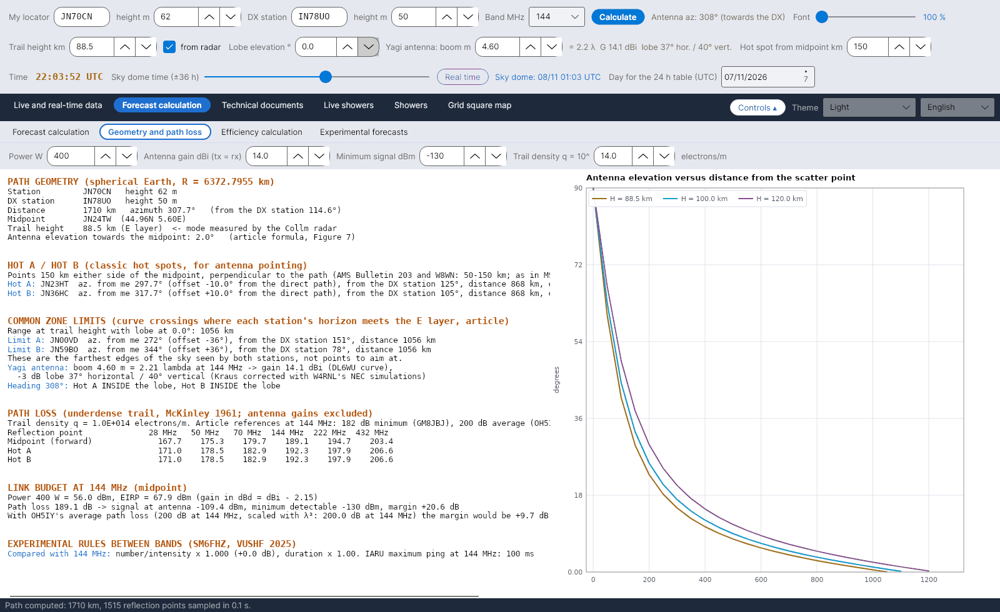

[English](Geometry-and-Path-Loss) · [Italiano](Geometry-and-Path-Loss-it) · [Deutsch](Geometry-and-Path-Loss-de) · [Nederlands](Geometry-and-Path-Loss-nl) · [Français](Geometry-and-Path-Loss-fr) · [Español](Geometry-and-Path-Loss-es) · [Português](Geometry-and-Path-Loss-pt) · [Português (Brasil)](Geometry-and-Path-Loss-pt-br) · [Dansk](Geometry-and-Path-Loss-da) · [Norsk](Geometry-and-Path-Loss-nb) · [Svenska](Geometry-and-Path-Loss-sv) · [Íslenska](Geometry-and-Path-Loss-is) · [Eesti](Geometry-and-Path-Loss-et) · [Lietuvių](Geometry-and-Path-Loss-lt) · [Latviešu](Geometry-and-Path-Loss-lv) · [Polski](Geometry-and-Path-Loss-pl) · [Čeština](Geometry-and-Path-Loss-cs) · [Magyar](Geometry-and-Path-Loss-hu) · [Română](Geometry-and-Path-Loss-ro) · [Ελληνικά](Geometry-and-Path-Loss-el) · [Русский](Geometry-and-Path-Loss-ru) · [Українська](Geometry-and-Path-Loss-uk) · [Türkçe](Geometry-and-Path-Loss-tr) · [Afrikaans](Geometry-and-Path-Loss-af) · [العربية](Geometry-and-Path-Loss-ar) · [עברית](Geometry-and-Path-Loss-he) · [اردو](Geometry-and-Path-Loss-ur) · [हिन्दी](Geometry-and-Path-Loss-hi) · [বাংলা](Geometry-and-Path-Loss-bn) · [ไทย](Geometry-and-Path-Loss-th) · **Bahasa Indonesia** · [Tagalog](Geometry-and-Path-Loss-tl) · [日本語](Geometry-and-Path-Loss-ja) · [한국어](Geometry-and-Path-Loss-ko) · [中文](Geometry-and-Path-Loss-zh) · [中文 (繁體)](Geometry-and-Path-Loss-zh-tw)

# Geometri dan redaman

*Tab: Perhitungan prakiraan › Geometri dan redaman.*

[](https://raw.githubusercontent.com/ic8tem/YA-MS/main/docs/screenshots/en-2_2.png)

Laporan teks tentang lintasan (dapat diseleksi, sehingga bisa Anda salin) dan, di sebelah kanan, grafik **Elevasi antena terhadap jarak dari scatter point**. Angka dalam kurung siku merujuk ke persamaan dalam manual perhitungan (`doc/YA-MS_manuale_calcoli.docx`).

## Masukan pada tab ini

| Isian | Bawaan | Kegunaan |
|---|---|---|
| **Daya W** | 400 | Daya pemancar untuk anggaran link |
| **Penguatan antena dBi (tx = rx)** | 14 | Antena yang sama di kedua ujung |
| **Sinyal minimum dBm** | −130 | Sinyal minimum yang dapat dideteksi (artikel: Yagi 8 elemen + preamp) |
| **Kerapatan jejak q = 10^ … elektron/m** | 14 | Kerapatan elektron linear jejak underdense |

Stasiun, band, ketinggian jejak, elevasi lobus, boom dan jarak hot spot diambil dari [baris kontrol](Getting-Started-id#1-tiga-baris-kontrol).

## Bagian-bagian laporan

| Bagian | Isi |
|---|---|
| **GEOMETRI LINTASAN (Bumi bulat, R = 6372,7955 km)** | Stasiun dan DX dengan ketinggiannya; jarak, azimut dan azimut balik; titik tengah (locator dan koordinat); ketinggian jejak (*<- modus terukur oleh radar Collm* bila diambil dari radar); elevasi antena ke arah titik tengah |
| **HOT A / HOT B (hot spot klasik, untuk mengarahkan antena)** | Untuk masing-masing: locator, azimut dari Anda dan offset dari lintasan langsung, azimut dari DX, jarak, elevasi |
| **BATAS ZONA BERSAMA** | Jangkauan pada ketinggian jejak dengan elevasi lobus; Batas A / Batas B dengan azimutnya |
| Antena | Boom dalam λ, penguatan, lobus horizontal / vertikal; apakah Hot A dan Hot B di dalam atau di luar lobus |
| **REDAMAN LINTASAN (jejak underdense, McKinley 1961; tanpa penguatan antena)** | Tabel untuk titik tengah (forward), Hot A dan Hot B pada 28, 50, 70, 144, 222 dan 432 MHz |
| **ANGGARAN LINK PADA … MHz (titik tengah)** | Daya dan EIRP, redaman lintasan, sinyal di antena, minimum terdeteksi, **margin**; margin yang sama dengan redaman rata-rata OH5IY |
| **ATURAN EKSPERIMENTAL ANTARBAND (SM6FHZ, VUSHF 2025)** | Jumlah/intensitas dan durasi dibandingkan dengan 144 MHz; ping maksimum IARU |

## Locator dan lintasan

Locator (4, 6 atau 8 karakter; pusat kotak, sistem Maidenhead IARU) [14]. Jarak, azimut dan titik tengah dengan rumus lingkaran besar pada bola berjari-jari **r = 6372,7955 km** (artikel Cerrotta–Sartori) [15–16]. Perhitungan yang bergantung waktu mengacu pada **titik tengah**, karena jam terbaik dapat berbeda hingga 1,5 jam antara kedua ujung (SM6FHZ).

## Elevasi antena

**Sumber:** rumus dari artikel Cerrotta–Sartori (Gambar 7), dengan x = d/r, d jarak permukaan ke titik pantul, H ketinggian jejak dan h ketinggian stasiun [17]:

```math
e = 90^\circ - 57{.}3\,\arctan\left[\frac{r\tan x + \left(H - \frac{r(1-\cos x)}{\cos x}\right)\sin x}{H - \frac{r(1-\cos x)}{\cos x} - h\sin x}\right]
```

**Verifikasi:** cocok dengan geometri bola eksak dalam 0,03°. Program memakai arktangen dua argumen, yang memberikan nilai negatif di luar cakrawala dan menghindari masalah periodisitas yang disebut dalam artikel. Elevasi negatif ke arah titik tengah berarti *lintasan melebihi jangkauan geometris satu lompatan*.

## Jangkauan cakrawala

Jarak permukaan tempat sinar dengan elevasi e mencapai ketinggian H (invers geometris dari rumus di atas) [18]:

```math
d_H = r\left[\frac{\pi}{2} - e - \arcsin\left(\frac{(r+h)\cos e}{r+H}\right)\right]
```

**Verifikasi:** H = 89,5 km, e = 0° → **1062 km**. Pada contoh dalam artikel (JN44BB–IO53RT) gambar menempatkan perpotongan cakrawala sekitar 870 km dari stasiun, yang sesuai dengan lobus yang dinaikkan sekitar 2° (865 km).

## Refraksi troposfer (GFS)

Refraksi troposfer (kotak "Refraksi troposfer (GFS)", mati saat mulai). Dengan kotak dicentang, program mengunduh dari Open-Meteo profil model GFS di atas kedua stasiun (tekanan, suhu, dan kelembapan di permukaan dan pada level 1000 hingga 500 hPa, pada jam terdekat dalam 6 jam), menghitung ketinggian level dengan persamaan hipsometrik (suhu virtual) dan refraktivitas dengan rumus Rekomendasi ITU-R P.453:

```math
N = \frac{77{.}6}{T}\left(P + \frac{4810\,e}{T}\right)
```

dengan P dan e (tekanan uap, dari rumus Magnus) dalam hPa dan T dalam kelvin. Di atas level teratas N menurun secara eksponensial dengan tinggi skala 7,35 km. Bila GFS tidak menjawab, dipakai atmosfer acuan P.453, N = 315·exp(−h/7,35), dan laporan menyebutkannya.

Sinar ditelusuri melalui kulit bola tipis dengan hukum Snell dalam bentuk bola (n·r·cos e konstan) sampai ketinggian jejak; dari situ diperoleh jangkauan pada ketinggian H dan koreksi elevasi:

```math
\Delta\varphi = \frac{k\,\Delta r}{r_m\,\bar u},\quad u = \sqrt{n^2r^2-k^2},\quad k = n_0 r_0\cos e
```

Contoh dengan atmosfer acuan dan jejak pada 89,5 km: pada 0° jangkauan naik dari 1061,5 menjadi sekitar 1133 km (+72 km) dan titik tampak 0,62° lebih tinggi; pada 4° jangkauan bertambah 14 km dan koreksinya 0,20°; di atas 10° efeknya dapat diabaikan. Koreksi diterapkan pada elevasi ke titik tengah, jari-jari zona bersama, hot spot, dan titik-titik peta efisiensi; titik di bawah cakrawala terbias dibuang. Laporan memberikannya pada baris "Refraksi".

Jari-jari Bumi ekuivalen k = 4/3 berlaku untuk sinar yang tetap berada di beberapa kilometer pertama troposfer, tempat N turun sekitar 40 satuan per km. Sinar menuju jejak pada 90 km melintasi seluruh troposfer dan di atas 10-15 km, tempat N hampir nol, berlanjut hampir lurus: dengan k = 4/3 sepanjang pendakian, jangkauan pada 0° akan sekitar 1230 km, hampir 100 km lebih jauh daripada sinar yang ditelusuri. Karena itu program menelusuri sinar dalam profil GFS, seperti yang dilakukan LIVETROPOVHF milik penulis untuk propagasi troposfer, alih-alih memakai k = 4/3.

→ [Open-Meteo (GFS)](https://open-meteo.com/) · [ITU-R P.453](https://www.itu.int/rec/R-REC-P.453)

## Batas zona bersama

**Sumber:** artikel menentukan perpotongan kurva tempat cakrawala tiap stasiun bertemu lapisan E: perpotongan dua lingkaran berjari-jari sudut ρ = d_H/r yang berpusat di A dan B [19–20]:

```math
p_0 = \frac{\cos\rho}{1+\hat{u}_A\cdot\hat{u}_B}\,(\hat{u}_A+\hat{u}_B),\qquad p_{A,B} = p_0 \pm \sqrt{\frac{1-|p_0|^2}{|\hat{u}_A\times\hat{u}_B|^2}}\,(\hat{u}_A\times\hat{u}_B)
```

Jika 1 − |p0|² < 0, lintasan lebih panjang dari 2·d_H dan kedua stasiun **tidak melihat zona bersama lapisan E**.

**Verifikasi:** ini adalah **tepi terjauh** langit yang terlihat oleh kedua stasiun, **bukan titik untuk dibidik**. Pada JN70CN–IN78UO (1710 km, azimut 308°) titik-titik ini jatuh 1062 km dari stasiun, 37° di kiri dan kanan lintasan langsung, sedangkan MSHV menyarankan 10°. Karena itu keduanya disebut *Batas A* / *Batas B* dan digambar samar di peta.

## Hot A dan Hot B

**Sumber:** pantulan meteor sporadis terkonsentrasi di dua zona ("hot spot") di kedua sisi titik tengah. J. Richardson (AMS), dalam tabel yang dikutip DJ5HG (*Die Geometrie von Meteorscatterverbindungen*, 2004), memberikan offset antena dari arah langsung: **13° pada 1000 km, 11° pada 1250 km, 10° pada 1500 dan 2000 km**. AMS Bulletin No. 203, yang diambil oleh W8WN, memberikan 10° pada 1500 dan 1800 km.

**Pilihan:** Hot A dan Hot B adalah titik pada jarak s dari titik tengah M, tegak lurus terhadap lintasan. Dengan *auto (AMS)* dicentang (bawaan), s diperoleh dari offset tabel Richardson, diinterpolasi linear (13° di bawah 1000 km, 10° di atas 2000 km): s = (D/2)·tan(offset). Jika tidak dicentang, s dimasukkan secara manual, 30–400 km (MSHV memakai 150 km); A di kiri jika melihat dari stasiun Anda ke DX, B di kanan [21]. Offset yang terlihat dari stasiun kira-kira [22]:

```math
\Delta Az_{hot} \approx \arctan\frac{s}{D/2}
```

**Verifikasi:** dengan tabel AMS, 1000 km → 13°, s ≈ 115 km; 1250 km → 11°, s ≈ 121 km; 1500 km → 10°, s ≈ 132 km; 2000 km → 10°, s ≈ 176 km. JN70CN–IN78UO (1710 km) → 10°, s ≈ 151 km, sama dengan 150 km yang dipakai sebelumnya dan oleh MSHV; pada lintasan pendek, tabel mendekatkan hot spot ke titik tengah.

## Redaman lintasan underdense

**Sumber:** persamaan McKinley dan Rekomendasi ITU-R P.843 untuk jejak underdense (sin α = 1), tanpa penguatan antena; q = kerapatan elektron linear, r_e = jari-jari elektron klasik = 2,818·10⁻¹⁵ m, R1, R2 jarak ke jejak, φ setengah sudut hambur, β sudut antara jejak dan bidang lintasan, a₁ faktor jari-jari awal dengan r₀ dalam m dan h dalam km (P.843, pers. 4 dan 7) [36]:

```math
L = 10\log_{10}\left[\frac{16\pi^2 R_1 R_2 (R_1+R_2)\,(1-\cos^2\beta\,\sin^2\varphi)}{\lambda^3 q^2 r_e^2}\right] - 10\log_{10} a_1\ \mathrm{dB},\qquad a_1 = \exp\left(-\frac{8\pi^2 r_0^2}{\lambda^2\sec^2\varphi}\right),\qquad \log_{10} r_0 = 0{.}035\,h - 3{.}45
```

**Pilihan:** anggaran link dan tabel redaman memakai β = 90° (jejak memotong bidang lintasan, kasus paling tidak menguntungkan: nilai hati-hati) dan anggaran juga menampilkan kasus terbaik, β = 0. r₀ diambil pada ketinggian gema rata-rata untuk frekuensi tersebut, h = 124 − 17 log f (P.843, pers. 15): 0,76 m pada 95 km untuk 50 MHz, 0,40 m pada 87 km untuk 144 MHz, 0,21 m pada 79 km untuk 432 MHz. Pada 1000 km a₁ adalah 0,2 dB pada 50 MHz, 0,6 dB pada 144 MHz, dan 1,4 dB pada 432 MHz (2,9 dB pada 600 km); pada ketinggian tetap 102 km milik DJ5HG nilainya sekitar 70 dB pada 432 MHz, artinya sama sekali tidak ada gema.

**Verifikasi:** dengan q = 10¹⁴ elektron/m, jejak pada 89,5 km dan β = 0, pada 144 MHz: **182–192 dB** antara 600 dan 2100 km (185 dB pada 1000 km), di dalam rentang **172–190 dB** yang dihitung John Worsnop **G4BAO** dalam disertasi PhD-nya, sebagaimana dilaporkan GM8JBJ. Dengan β = 90° redaman bertambah 10 dB pada 600 km, 13 dB pada 1000 km, dan 16 dB pada 2100 km; **rata-rata 200 dB** dari OH5IY berada di antara kedua kasus. Nilai 182 dB dalam tabel GM8JBJ bukan konfirmasi: tabel tidak menyebut frekuensi, 86,4 dB per ruasnya adalah redaman ruang bebas sejauh 500 km pada 1 MHz (suku 20 log f hilang: 129,6 dB pada 144 MHz), dan pos-posnya berjumlah 163,8 dB, bukan 182; halaman itu tidak menyebut "minimum" maupun "144 MHz".

## Anggaran link

```math
P_{rx} = P_{tx}(\mathrm{dBm}) + G_{tx} - L + G_{rx},\qquad M = P_{rx} - P_{min},\quad P_{min} = -130\ \mathrm{dBm}
```

[37–38]. Penguatan dimasukkan dan dipakai dalam dBi: redaman McKinley mengacu pada antena isotropik, sehingga koreksi dipol 2,15 dB tidak dikurangkan (EIRP = daya + penguatan). Laporan juga memberikan margin dengan **redaman rata-rata OH5IY** (200 dB pada 144 MHz, diskalakan dengan λ³ ke band yang dipilih). Referensi artikel: diperlukan sekitar **70 dBm EIRP** (−130 dBm + 200 dB, mis. sekitar 400 W ke antena 14 dBi).

## Penguatan dan lobus antena

**VE7BQH** – Gain sebuah Yagi sebagai fungsi panjang boom L: garis rata-rata tabel VE7BQH per band (sekitar 60 Yagi per band, gain NEC). Dalam kurung rentang sampel dan simpangan baku:

```math
\begin{aligned}50\,\mathrm{MHz}:\ & G = 7{.}36\,\log_{10}(L/\lambda) + 11{.}67\ \mathrm{dBi} \\ 144\,\mathrm{MHz}:\ & G = 8{.}27\,\log_{10}(L/\lambda) + 11{.}31\ \mathrm{dBi} \\ 432\,\mathrm{MHz}:\ & G = 8{.}68\,\log_{10}(L/\lambda) + 11{.}03\ \mathrm{dBi}\end{aligned}
```

(50 MHz: 0,3–5 λ, 0,25 dB · 144 MHz: 0,75–8,9 λ, 0,15 dB · 432 MHz: 1,8–16 λ, 0,17 dB)

Dipakai garis band terdekat: di bawah 100 MHz garis 50 MHz, antara 100 dan 300 MHz garis 144 MHz, di atas 300 MHz garis 432 MHz (untuk 1296 MHz ini ekstrapolasi). Di luar rentang sampel jendela utama memperingatkan bahwa perkiraannya kasar.

Kurva historis DL6WU (VHF Communications 3/1982, gbr. 1): pengukuran pada 432 dan 1296 MHz tahun 1981, 2,35 dB per oktaf boom, akurasi yang dinyatakan 0,5 dB; G ≈ 9,2 + 7,81 log10(L/λ) dBd. W8IO menuliskannya sebagai 7,773 log10(L/λ) + 11,43 dBi (selisih kurang dari 0,1 dB). Program menuliskannya di laporan sebagai pembanding:

```math
G = 7{.}81\,\log_{10}(L/\lambda) + 11{.}35\ \mathrm{dBi}
```

**Verifikasi terhadap model NEC L.B. Cebik W4RNL pada 432 MHz** (*Appreciating DL6WU Wide-Band Long-Boom Yagi Design*; *70-CM Yagi Stacks Part 2*):

| Yagi | Elemen | Boom (λ) | W4RNL NEC (dBi) | Rumus (dBi) |
|---|---|---|---|---|
| DL6WU | 13 / 22 / 31 | 3,23 / 6,82 / 10,42 | 15,28 / 17,82 / 19,35 | 15,38 / 17,91 / 19,34 |
| VK3AUU (David Tanner) | 16 / 28 / 40 | 3,12 / 6,88 / 10,79 | 15,17 / 17,91 / 19,46 | 15,27 / 17,94 / 19,45 |

Selisihnya tidak pernah melebihi **0,1 dB**: penguatan lebih bergantung pada panjang boom daripada desainnya (Yagi VK3AUU memiliki boom lebih pendek untuk jumlah elemen yang sama). Yagi Calculator karya VK5DJ juga memberikan perkiraan untuk varian VK3AUU, WA2PHW dan DJ9BV, yang rumusnya tidak dipublikasikan.

Rata-rata VE7BQH dikurangi kurva DL6WU: pada 50 MHz dalam 0,25 dB dari 2 sampai 16 λ; pada 144 MHz dari −0,04 dB pada 1 λ hingga +0,42 dB pada 10 λ; pada 432 MHz dari −0,06 dB pada 2 λ hingga +0,55 dB pada 10 λ. Pada Yagi DL6WU dan VK3AUU yang disimulasikan W4RNL di 432 MHz, rata-rata VE7BQH 0,15–0,55 dB di atas NEC: pada boom panjang Yagi dalam tabel, yang dioptimalkan dengan komputer, memberi lebih dari desain aslinya.

**Lobus – sumber:** aturan Kraus, dengan lobus melingkar θE = θH = θK [40]:

```math
G_{lin} = \frac{41253}{\theta_E\,\theta_H}\quad\Rightarrow\quad \theta_K = \sqrt{\frac{41253}{10^{G/10}}}
```

**Verifikasi:** model NEC W4RNL untuk Yagi DL6WU memberikan **lobus horizontal 5–10 % lebih sempit** daripada Kraus: 33,8° / 26,4° / 22,6° untuk 12, 19 dan 26 elemen, dibandingkan 37,3° / 28,0° / 23,9°. Rumus sederhana mengabaikan lobus samping depan (W4RNL, *Long-Boom Yagi Rules of Thumb*). Pada boom panjang lobus vertikal sedikit lebih lebar daripada horizontal (14 λ: 18,4° / 18,8°).

**Pilihan** [41]:

```math
\theta_{horizontal} = 0{.}93\,\theta_K,\qquad \theta_{vertical} = \theta_K
```

Contoh: Yagi 14 λ pada 432 MHz → 20,3 dBi, lobus 18,1° horizontal dan 19,5° vertikal; model W4RNL memberikan 20,4 dBi dan 18,4° / 18,8°. Ini adalah aturan perkiraan yang diturunkan dari beberapa antena DL6WU.

Dengan rata-rata VE7BQH Yagi 14 λ yang sama memberi 21,0 dBi dan lobe 16,9° horizontal dan 18,1° vertikal; 20,3 dBi di atas berasal dari kurva DL6WU. Koreksi lobe (0,93 · θK dan θK) tetap yang diturunkan dari Yagi DL6WU.

Antena selalu dianggap diarahkan ke DX. Sebuah hot spot berada **di dalam lobus** jika |Az(Hot) − Az(antena)| ≤ θ_horizontal/2: lalu digambar abu-abu di [Kubah langit](Sky-View-id) dan muncul peringatan. Lobus vertikal juga masuk ke perhitungan efisiensi: dengan kotak *pola antena* aktif, titik pantulan diberi bobot dengan penguatan vertikal kedua antena (lebar θ_vertical, puncak pada elevasi lobus, faktor tanah sampai nol di cakrawala).

## Aturan eksperimental antarband

Dibandingkan dengan 144 MHz: jumlah/intensitas × (144/f)³ (dalam dB), durasi × (144/f)² (SM6FHZ, VUSHF 2025). Durasi ping maksimum IARU Region 1: 1000 ms di 50 MHz, 500 ms di 70 MHz, 100 ms di 144 MHz, 13 ms di 432 MHz (VHF Handbook, dikutip dalam artikel). Lihat juga [Prakiraan eksperimental](Experimental-Forecasts-id).
