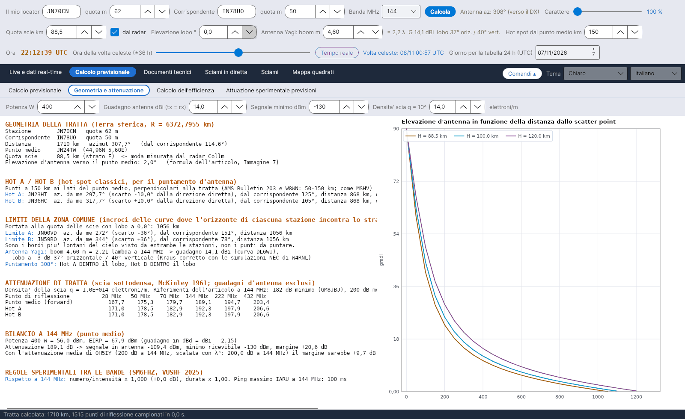

[English](Geometry-and-Path-Loss) · **Italiano** · [Deutsch](Geometry-and-Path-Loss-de) · [Nederlands](Geometry-and-Path-Loss-nl) · [Français](Geometry-and-Path-Loss-fr) · [Español](Geometry-and-Path-Loss-es) · [Português](Geometry-and-Path-Loss-pt) · [Português (Brasil)](Geometry-and-Path-Loss-pt-br) · [Dansk](Geometry-and-Path-Loss-da) · [Norsk](Geometry-and-Path-Loss-nb) · [Svenska](Geometry-and-Path-Loss-sv) · [Íslenska](Geometry-and-Path-Loss-is) · [Eesti](Geometry-and-Path-Loss-et) · [Lietuvių](Geometry-and-Path-Loss-lt) · [Latviešu](Geometry-and-Path-Loss-lv) · [Polski](Geometry-and-Path-Loss-pl) · [Čeština](Geometry-and-Path-Loss-cs) · [Magyar](Geometry-and-Path-Loss-hu) · [Română](Geometry-and-Path-Loss-ro) · [Ελληνικά](Geometry-and-Path-Loss-el) · [Русский](Geometry-and-Path-Loss-ru) · [Українська](Geometry-and-Path-Loss-uk) · [Türkçe](Geometry-and-Path-Loss-tr) · [Afrikaans](Geometry-and-Path-Loss-af) · [العربية](Geometry-and-Path-Loss-ar) · [עברית](Geometry-and-Path-Loss-he) · [اردو](Geometry-and-Path-Loss-ur) · [हिन्दी](Geometry-and-Path-Loss-hi) · [বাংলা](Geometry-and-Path-Loss-bn) · [Bahasa Indonesia](Geometry-and-Path-Loss-id) · [Tagalog](Geometry-and-Path-Loss-tl) · [日本語](Geometry-and-Path-Loss-ja) · [한국어](Geometry-and-Path-Loss-ko) · [中文](Geometry-and-Path-Loss-zh) · [中文 (繁體)](Geometry-and-Path-Loss-zh-tw)

# Geometria e attenuazione

*Linguetta: Calcolo previsionale › Geometria e attenuazione.*

[](https://raw.githubusercontent.com/ic8tem/YA-MS/main/docs/screenshots/it-2_2.png)

Un resoconto testuale della tratta (selezionabile, così puoi copiarlo) e, a destra, il grafico **Elevazione d'antenna in funzione della distanza dallo scatter point**. I numeri tra parentesi rimandano alle equazioni del manuale dei calcoli (`doc/YA-MS_manuale_calcoli.docx`).

## Dati di questa linguetta

| Campo | Predefinito | Uso |
|---|---|---|
| **Potenza W** | 400 | Potenza del trasmettitore per il bilancio del collegamento |
| **Guadagno antenna dBi (tx = rx)** | 14 | Stessa antenna ai due estremi |
| **Segnale minimo dBm** | −130 | Segnale minimo rilevabile (articolo: Yagi a 8 elementi + preamplificatore) |
| **Densita' scia q = 10^ … elettroni/m** | 14 | Densità lineare di elettroni della scia sottodensa |

Stazioni, banda, quota delle scie, elevazione del lobo, boom e distanza degli hot spot vengono dalle [righe di comandi](Getting-Started-it#1-le-tre-righe-di-comandi).

## Sezioni del resoconto

| Sezione | Contenuto |
|---|---|
| **GEOMETRIA DELLA TRATTA (Terra sferica, R = 6372,7955 km)** | Stazione e corrispondente con le quote; distanza, azimut e azimut inverso; punto medio (locator e coordinate); quota delle scie (*<- moda misurata dal radar Collm* quando è presa dal radar); elevazione d'antenna verso il punto medio |
| **HOT A / HOT B (hot spot classici, per il puntamento d'antenna)** | Per ciascuno: locator, azimut da te e scostamento dalla tratta diretta, azimut dal corrispondente, distanza, elevazione |
| **LIMITI DELLA ZONA COMUNE** | Portata alla quota delle scie con l'elevazione del lobo; Limite A / Limite B con gli azimut |
| Antenna | Boom in λ, guadagno, lobo orizzontale / verticale; se Hot A e Hot B sono dentro o fuori dal lobo |
| **ATTENUAZIONE DI TRATTA (scia sottodensa, McKinley 1961; guadagni d'antenna esclusi)** | Tabella per il punto medio (forward), Hot A e Hot B a 28, 50, 70, 144, 222 e 432 MHz |
| **BILANCIO A … MHz (punto medio)** | Potenza ed EIRP, attenuazione di tratta, segnale in antenna, minimo rilevabile, **margine**; lo stesso margine con l'attenuazione media di OH5IY |
| **REGOLE SPERIMENTALI TRA LE BANDE (SM6FHZ, VUSHF 2025)** | Numero/intensità e durata rispetto a 144 MHz; ping massimo IARU |

## Locator e tratta

Locator (4, 6 o 8 caratteri; centro del quadrato, sistema IARU Maidenhead) [14]. Distanza, azimut e punto medio con le formule ortodromiche su una sfera di raggio **r = 6372,7955 km** (articolo Cerrotta–Sartori) [15–16]. I calcoli che dipendono dall'ora si riferiscono al **punto medio**, perché l'ora migliore può differire fino a 1,5 ore tra i due estremi (SM6FHZ).

## Elevazione d'antenna

**Fonte:** formula dell'articolo Cerrotta–Sartori (Figura 7), con x = d/r, d la distanza al suolo fino al punto di riflessione, H la quota delle scie e h la quota della stazione [17]:

```
e = 90° − 57.3 · arctan[ ( r·tan x + (H − r(1 − cos x)/cos x)·sin x ) / ( H − r(1 − cos x)/cos x − h·sin x ) ]
```

**Verifica:** coincide con la geometria sferica esatta entro 0,03°. Il programma usa l'arcotangente a due argomenti, che dà valori negativi oltre l'orizzonte ed evita il problema di periodicità citato nell'articolo. Un'elevazione negativa verso il punto medio significa *tratta oltre la portata geometrica del singolo salto*.

## Portata all'orizzonte

Distanza al suolo alla quale un raggio con elevazione e raggiunge la quota H (inversa geometrica della formula precedente) [18]:

```
d_H = r · [ π/2 − e − arcsin( (r + h)·cos e / (r + H) ) ]
```

**Verifica:** H = 89,5 km, e = 0° → **1062 km**. Nell'esempio dell'articolo (JN44BB–IO53RT) il disegno pone gli incroci con l'orizzonte a circa 870 km dalle stazioni, il che corrisponde a un lobo alzato di circa 2° (865 km).

## Limiti della zona comune

**Fonte:** l'articolo individua gli incroci delle curve dove l'orizzonte di ciascuna stazione incontra lo strato E: gli incroci di due cerchi di raggio angolare ρ = d_H/r centrati in A e B [19–20]:

```
p0 = cos ρ / (1 + û_A·û_B) · (û_A + û_B)
p_A,B = p0 ± sqrt( (1 − |p0|²) / |û_A × û_B|² ) · (û_A × û_B)
```

Se 1 − |p0|² < 0 la tratta è più lunga di 2·d_H e le stazioni non vedono **nessuna zona comune dello strato E**.

**Verifica:** questi sono i **bordi più lontani** del cielo visto da entrambe le stazioni, **non punti verso cui puntare**. Su JN70CN–IN78UO (1710 km, azimut 308°) cadono a 1062 km dalla stazione, 37° a sinistra e a destra della tratta diretta, mentre MSHV suggerisce 10°. Per questo si chiamano *Limite A* / *Limite B* e sono disegnati tenui sulla mappa.

## Hot A e Hot B

**Fonte:** le riflessioni si concentrano in due zone ("hot spot") a circa **50–150 km da una parte e dall'altra del punto medio**. È la base della tabella degli scostamenti d'antenna dell'AMS Bulletin n. 203, ripresa da W8WN (scostamento di 10° per tratte di 1500 e 1800 km); MSHV di LZ2HV usa lo stesso criterio.

**Scelta:** Hot A e Hot B sono i punti a distanza s dal punto medio M, perpendicolari alla tratta (s = 150 km, regolabile 30–400 km); A a sinistra guardando dalla tua stazione verso il DX, B a destra [21]. Lo scostamento visto dalla stazione è circa [22]:

```
ΔAz_hot ≈ arctan( s / (D/2) )
```

**Verifica:** JN70CN–IN78UO, D = 1710 km: 6,7° con s = 100 km, **10,0° con s = 150 km** (come MSHV e AMS/W8WN), 13,2° con s = 200 km.

## Attenuazione per scie sottodense

**Fonte:** equazione di McKinley per le scie sottodense (β = 0, sin α = 1), guadagni d'antenna esclusi; q = densità lineare di elettroni, r_e = raggio classico dell'elettrone = 2,818·10⁻¹⁵ m, R1, R2 distanze dalla scia, φ metà dell'angolo di diffusione [36]:

```
L = 10·log10[ 16·π²·R1·R2·(R1 + R2)·cos²φ / ( λ³·q²·r_e² ) ]   dB
```

**Verifica:** con q = 10¹⁴ elettroni/m a 144 MHz: **181–192 dB** tra 600 e 2200 km, in linea con i riferimenti dell'articolo a 144 MHz: **182 dB minimo** (GM8JBJ, da Kaiser & Closs 1952) e **200 dB medio** (OH5IY).

## Bilancio del collegamento

```
P_rx = P_tx(dBm) + G_tx − 2.15 − L + G_rx − 2.15        margin = P_rx − P_min,   P_min = −130 dBm
```

[37–38]. I guadagni si inseriscono in dBi e si usano in dBd (dBi − 2,15). Il resoconto dà anche il margine con l'**attenuazione media di OH5IY** (200 dB a 144 MHz, scalata con λ³ alla banda scelta). Riferimento dell'articolo: servono circa **70 dBm di EIRP** (−130 dBm + 200 dB, per esempio circa 400 W su 14 dBi).

## Guadagno e lobo dell'antenna

**Guadagno – fonte:** curva di Günter Hoch **DL6WU** per le Yagi lunghe in funzione della lunghezza del boom L, riportata da W8IO (valida da circa 2 λ) [39]:

```
G = 7.773 · log10(L/λ) + 11.43   dBi
```

**Verifica con i modelli NEC di L.B. Cebik W4RNL a 432 MHz** (*Appreciating DL6WU Wide-Band Long-Boom Yagi Design*; *70-CM Yagi Stacks Part 2*):

| Yagi | Elementi | Boom (λ) | W4RNL NEC (dBi) | Formula (dBi) |
|---|---|---|---|---|
| DL6WU | 13 / 22 / 31 | 3,23 / 6,82 / 10,42 | 15,28 / 17,82 / 19,35 | 15,38 / 17,91 / 19,34 |
| VK3AUU (David Tanner) | 16 / 28 / 40 | 3,12 / 6,88 / 10,79 | 15,17 / 17,91 / 19,46 | 15,27 / 17,94 / 19,45 |

La differenza non supera mai **0,1 dB**: il guadagno dipende dalla lunghezza del boom più che dal progetto (le Yagi VK3AUU hanno un boom più corto a parità di elementi). Lo Yagi Calculator di VK5DJ dà stime anche per le varianti VK3AUU, WA2PHW e DJ9BV, le cui formule non sono pubblicate.

**Lobo – fonte:** regola di Kraus, con lobo circolare θE = θH = θK [40]:

```
G_lin = 41253 / (θE · θH)   ⇒   θK = sqrt( 41253 / 10^(G/10) )
```

**Verifica:** i modelli NEC di W4RNL delle Yagi DL6WU danno un **lobo orizzontale più stretto del 5–10 %** rispetto a Kraus: 33,8° / 26,4° / 22,6° per 12, 19 e 26 elementi, contro 37,3° / 28,0° / 23,9°. Le formule semplici ignorano i lobi laterali anteriori (W4RNL, *Long-Boom Yagi Rules of Thumb*). Sui boom lunghi il lobo verticale è un po' più largo di quello orizzontale (14 λ: 18,4° / 18,8°).

**Scelta** [41]:

```
θ_horizontal = 0.93 · θK        θ_vertical = θK
```

Esempio: Yagi da 14 λ a 432 MHz → 20,3 dBi, lobo di 18,1° in orizzontale e 19,5° in verticale; i modelli di W4RNL danno 20,4 dBi e 18,4° / 18,8°. Sono regole approssimate ricavate da poche antenne DL6WU.

L'antenna si considera sempre puntata verso il DX. Un hot spot è **dentro il lobo** se |Az(Hot) − Az(antenna)| ≤ θ_horizontal/2: allora viene disegnato in grigio nella [Volta celeste](Sky-View-it) e compare un avviso. Nel calcolo dell'efficienza le antenne sono isotrope; il lobo reale si usa solo per questa verifica.

## Regole sperimentali tra le bande

Rispetto a 144 MHz: numero/intensità × (144/f)³ (in dB), durata × (144/f)² (SM6FHZ, VUSHF 2025). Durata massima del ping secondo la IARU Regione 1: 1000 ms a 50 MHz, 500 ms a 70 MHz, 100 ms a 144 MHz, 13 ms a 432 MHz (VHF Handbook, citato nell'articolo). Vedi anche [Attuazione sperimentale previsioni](Experimental-Forecasts-it).
