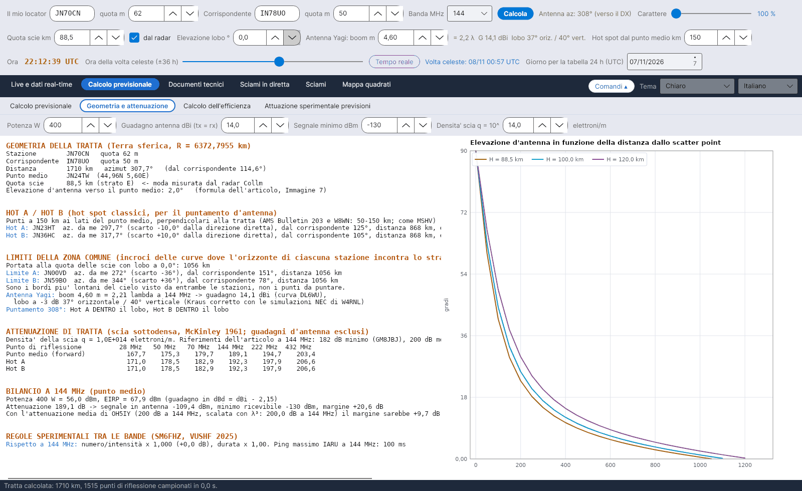

[English](Geometry-and-Path-Loss) · **Italiano** · [Deutsch](Geometry-and-Path-Loss-de) · [Nederlands](Geometry-and-Path-Loss-nl) · [Français](Geometry-and-Path-Loss-fr) · [Español](Geometry-and-Path-Loss-es) · [Português](Geometry-and-Path-Loss-pt) · [Português (Brasil)](Geometry-and-Path-Loss-pt-br) · [Dansk](Geometry-and-Path-Loss-da) · [Norsk](Geometry-and-Path-Loss-nb) · [Svenska](Geometry-and-Path-Loss-sv) · [Íslenska](Geometry-and-Path-Loss-is) · [Eesti](Geometry-and-Path-Loss-et) · [Lietuvių](Geometry-and-Path-Loss-lt) · [Latviešu](Geometry-and-Path-Loss-lv) · [Polski](Geometry-and-Path-Loss-pl) · [Čeština](Geometry-and-Path-Loss-cs) · [Magyar](Geometry-and-Path-Loss-hu) · [Română](Geometry-and-Path-Loss-ro) · [Ελληνικά](Geometry-and-Path-Loss-el) · [Русский](Geometry-and-Path-Loss-ru) · [Українська](Geometry-and-Path-Loss-uk) · [Türkçe](Geometry-and-Path-Loss-tr) · [Afrikaans](Geometry-and-Path-Loss-af) · [العربية](Geometry-and-Path-Loss-ar) · [עברית](Geometry-and-Path-Loss-he) · [اردو](Geometry-and-Path-Loss-ur) · [हिन्दी](Geometry-and-Path-Loss-hi) · [বাংলা](Geometry-and-Path-Loss-bn) · [ไทย](Geometry-and-Path-Loss-th) · [Bahasa Indonesia](Geometry-and-Path-Loss-id) · [Tagalog](Geometry-and-Path-Loss-tl) · [日本語](Geometry-and-Path-Loss-ja) · [한국어](Geometry-and-Path-Loss-ko) · [中文](Geometry-and-Path-Loss-zh) · [中文 (繁體)](Geometry-and-Path-Loss-zh-tw)

# Geometria e attenuazione

*Linguetta: Calcolo previsionale › Geometria e attenuazione.*

[](https://raw.githubusercontent.com/ic8tem/YA-MS/main/docs/screenshots/it-2_2.png)

Un resoconto testuale della tratta (selezionabile, così puoi copiarlo) e, a destra, il grafico **Elevazione d'antenna in funzione della distanza dallo scatter point**. I numeri tra parentesi rimandano alle equazioni del manuale dei calcoli (`doc/YA-MS_manuale_calcoli.docx`).

## Dati di questa linguetta

| Campo | Predefinito | Uso |
|---|---|---|
| **Potenza W** | 400 | Potenza del trasmettitore per il bilancio del collegamento |
| **Guadagno antenna dBi (tx = rx)** | 14 | Stessa antenna ai due estremi |
| **Segnale minimo dBm** | −130 | Segnale minimo rilevabile (articolo: Yagi a 8 elementi + preamplificatore) |
| **Densita' scia q = 10^ … elettroni/m** | 14 | Densità lineare di elettroni della scia sottodensa |

Stazioni, banda, quota delle scie, elevazione del lobo, boom e distanza degli hot spot vengono dalle [righe di comandi](Getting-Started-it#1-le-tre-righe-di-comandi).

## Sezioni del resoconto

| Sezione | Contenuto |
|---|---|
| **GEOMETRIA DELLA TRATTA (ellissoide WGS84)** | Stazione e corrispondente con le quote; distanza, azimut e azimut inverso; punto medio (locator e coordinate); quota delle scie (*<- moda misurata dal radar Collm* quando è presa dal radar); elevazione d'antenna verso il punto medio |
| **HOT A / HOT B (hot spot classici, per il puntamento d'antenna)** | Per ciascuno: locator, azimut da te e scostamento dalla tratta diretta, azimut dal corrispondente, distanza, elevazione |
| **LIMITI DELLA ZONA COMUNE** | Portata alla quota delle scie con l'elevazione del lobo; Limite A / Limite B con gli azimut |
| Antenna | Boom in λ, guadagno, lobo orizzontale / verticale; se Hot A e Hot B sono dentro o fuori dal lobo |
| **ATTENUAZIONE DI TRATTA (scia sottodensa, McKinley 1961; guadagni d'antenna esclusi)** | Tabella per il punto medio (forward), Hot A e Hot B a 28, 50, 70, 144, 222 e 432 MHz |
| **BILANCIO A … MHz (punto medio)** | Potenza ed EIRP, attenuazione di tratta, segnale in antenna, minimo rilevabile, **margine**; lo stesso margine con l'attenuazione media di OH5IY |
| **REGOLE SPERIMENTALI TRA LE BANDE (SM6FHZ, VUSHF 2025)** | Numero/intensità e durata rispetto a 144 MHz; ping massimo IARU |

## Locator e tratta

Locator (4, 6 o 8 caratteri; centro del quadrato, sistema IARU Maidenhead) [14]. Distanza, azimut e punto medio sulla geodetica dell'ellissoide **WGS84** con il metodo di Karney (dalla versione 1.8.24; prima sfera di raggio r = 6372,7955 km dell'articolo Cerrotta–Sartori [15–16]). I calcoli che dipendono dall'ora si riferiscono al **punto medio**, perché l'ora migliore può differire fino a 1,5 ore tra i due estremi (SM6FHZ).

## Elevazione d'antenna

**Fonte:** formula dell'articolo Cerrotta–Sartori (Figura 7), con x = d/r, d la distanza al suolo fino al punto di riflessione, H la quota delle scie e h la quota della stazione [17]:

```math
e = 90^\circ - 57{.}3\,\arctan\left[\frac{r\tan x + \left(H - \frac{r(1-\cos x)}{\cos x}\right)\sin x}{H - \frac{r(1-\cos x)}{\cos x} - h\sin x}\right]
```

**Verifica:** coincide con la geometria sferica esatta entro 0,03°. Il programma usa l'arcotangente a due argomenti, che dà valori negativi oltre l'orizzonte ed evita il problema di periodicità citato nell'articolo. Un'elevazione negativa verso il punto medio significa *tratta oltre la portata geometrica del singolo salto*.

## Portata all'orizzonte

Distanza al suolo alla quale un raggio con elevazione e raggiunge la quota H (inversa geometrica della formula precedente) [18]:

```math
d_H = r\left[\frac{\pi}{2} - e - \arcsin\left(\frac{(r+h)\cos e}{r+H}\right)\right]
```

**Verifica:** H = 89,5 km, e = 0° → **1062 km**. Nell'esempio dell'articolo (JN44BB–IO53RT) il disegno pone gli incroci con l'orizzonte a circa 870 km dalle stazioni, il che corrisponde a un lobo alzato di circa 2° (865 km).

## Rifrazione troposferica (GFS)

Rifrazione troposferica (casella "Rifrazione troposferica (GFS)", spenta all'avvio). Con la casella accesa il programma scarica da Open-Meteo il profilo del modello GFS sopra le due stazioni (pressione, temperatura e umidità al suolo e ai livelli da 1000 a 500 hPa, all'ora più vicina entro 6 ore), ricava le quote dei livelli con l'equazione ipsometrica (temperatura virtuale) e la rifrattività con la formula della Raccomandazione ITU-R P.453:

```math
N = \frac{77{.}6}{T}\left(P + \frac{4810\,e}{T}\right)
```

con P ed e (pressione del vapore, dalla formula di Magnus) in hPa e T in kelvin. Sopra l'ultimo livello N decresce in modo esponenziale con altezza di scala 7,35 km. Se il GFS non risponde si usa l'atmosfera di riferimento della P.453, N = 315·exp(−h/7,35), e il resoconto lo dice.

Il raggio si traccia a gusci sferici sottili con la legge di Snell in forma sferica (n·r·cos e costante) fino alla quota delle scie; ne vengono la portata alla quota H e la correzione dell'elevazione:

```math
\Delta\varphi = \frac{k\,\Delta r}{r_m\,\bar u},\quad u = \sqrt{n^2r^2-k^2},\quad k = n_0 r_0\cos e
```

Esempio con l'atmosfera di riferimento e scie a 89,5 km: a 0° la portata passa da 1061,5 a circa 1133 km (+72 km) e il punto appare 0,62° più alto; a 4° la portata cresce di 14 km e la correzione vale 0,20°; sopra 10° l'effetto è trascurabile. La correzione si applica all'elevazione verso il punto medio, al raggio della zona comune, agli hot spot e ai punti della mappa d'efficienza; i punti sotto l'orizzonte rifratto si scartano. Il resoconto la riporta nella riga "Rifrazione".

Il raggio terrestre equivalente k = 4/3 vale per raggi che restano nei primi chilometri della troposfera, dove N cala di circa 40 unità per km. Il raggio verso una scia a 90 km attraversa tutta la troposfera e sopra i 10-15 km, dove N è quasi nullo, prosegue quasi diritto: con k = 4/3 su tutta la salita la portata a 0° sarebbe circa 1230 km, quasi 100 km più del raggio tracciato. Per questo il programma traccia il raggio nel profilo del GFS, come fa LIVETROPOVHF dell'autore per la propagazione troposferica, invece di usare k = 4/3.

→ [Open-Meteo (GFS)](https://open-meteo.com/) · [ITU-R P.453](https://www.itu.int/rec/R-REC-P.453)

## Limiti della zona comune

**Fonte:** l'articolo individua gli incroci delle curve dove l'orizzonte di ciascuna stazione incontra lo strato E: gli incroci di due cerchi di raggio angolare ρ = d_H/r centrati in A e B [19–20]:

```math
p_0 = \frac{\cos\rho}{1+\hat{u}_A\cdot\hat{u}_B}\,(\hat{u}_A+\hat{u}_B),\qquad p_{A,B} = p_0 \pm \sqrt{\frac{1-|p_0|^2}{|\hat{u}_A\times\hat{u}_B|^2}}\,(\hat{u}_A\times\hat{u}_B)
```

Se 1 − |p0|² < 0 la tratta è più lunga di 2·d_H e le stazioni non vedono **nessuna zona comune dello strato E**.

**Verifica:** questi sono i **bordi più lontani** del cielo visto da entrambe le stazioni, **non punti verso cui puntare**. Su JN70CN–IN78UO (1710 km, azimut 308°) cadono a 1062 km dalla stazione, 37° a sinistra e a destra della tratta diretta, mentre MSHV suggerisce 10°. Per questo si chiamano *Limite A* / *Limite B* e sono disegnati tenui sulla mappa.

## Hot A e Hot B

**Fonte:** le riflessioni delle meteore sporadiche si concentrano in due zone ("hot spot") da una parte e dall'altra del punto medio. J. Richardson (AMS), nella tabella citata da DJ5HG (*Die Geometrie von Meteorscatterverbindungen*, 2004), dà lo scostamento d'antenna rispetto al puntamento diretto: **13° a 1000 km, 11° a 1250 km, 10° a 1500 e 2000 km**. L'AMS Bulletin n. 203, ripreso da W8WN, dà 10° a 1500 e 1800 km.

**Scelta:** Hot A e Hot B sono i punti a distanza s dal punto medio M, perpendicolari alla tratta. Con *auto (AMS)* spuntato (predefinito) s deriva dallo scostamento della tabella di Richardson, interpolato linearmente (13° sotto 1000 km, 10° sopra 2000 km): s = (D/2)·tan(scostamento). Non spuntato, s si inserisce a mano, 30–400 km (MSHV usa 150 km); A a sinistra guardando dalla tua stazione verso il DX, B a destra [21]. Lo scostamento visto dalla stazione è circa [22]:

```math
\Delta Az_{hot} \approx \arctan\frac{s}{D/2}
```

**Verifica:** con la tabella AMS, 1000 km → 13°, s ≈ 115 km; 1250 km → 11°, s ≈ 121 km; 1500 km → 10°, s ≈ 132 km; 2000 km → 10°, s ≈ 176 km. JN70CN–IN78UO (1710 km) → 10°, s ≈ 151 km, uguale ai 150 km usati prima e da MSHV; sulle tratte corte la tabella avvicina gli hot spot al punto medio.

## Attenuazione per scie sottodense

**Fonte:** equazione di McKinley e Raccomandazione ITU-R P.843 per le scie sottodense (sin α = 1), guadagni d'antenna esclusi; q = densità lineare di elettroni, r_e = raggio classico dell'elettrone = 2,818·10⁻¹⁵ m, R1, R2 distanze dalla scia, φ metà dell'angolo di diffusione, β angolo tra la scia e il piano della tratta, a₁ fattore del raggio iniziale con r₀ in m e h in km (P.843, eq. 4 e 7) [36]:

```math
L = 10\log_{10}\left[\frac{16\pi^2 R_1 R_2 (R_1+R_2)\,(1-\cos^2\beta\,\sin^2\varphi)}{\lambda^3 q^2 r_e^2}\right] - 10\log_{10} a_1\ \mathrm{dB},\qquad a_1 = \exp\left(-\frac{8\pi^2 r_0^2}{\lambda^2\sec^2\varphi}\right),\qquad \log_{10} r_0 = 0{.}035\,h - 3{.}45
```

**Scelta:** il bilancio e la tabella delle attenuazioni usano β = 90° (scia che attraversa il piano della tratta, il caso meno favorevole: valore prudente) e il bilancio mostra anche il caso migliore, β = 0. r₀ è preso alla quota media degli echi per la frequenza, h = 124 − 17 log f (P.843, eq. 15): 0,76 m a 95 km per 50 MHz, 0,40 m a 87 km per 144 MHz, 0,21 m a 79 km per 432 MHz. Su 1000 km a₁ vale 0,2 dB a 50 MHz, 0,6 dB a 144 MHz e 1,4 dB a 432 MHz (2,9 dB a 600 km); alla quota fissa di 102 km di DJ5HG sarebbe circa 70 dB a 432 MHz, cioè nessun eco.

**Verifica:** con q = 10¹⁴ elettroni/m, scie a 89,5 km e β = 0, a 144 MHz: **182–192 dB** tra 600 e 2100 km (185 dB a 1000 km), dentro l'intervallo di **172–190 dB** calcolato da John Worsnop **G4BAO** nella sua tesi di dottorato, come riportato da GM8JBJ. Con β = 90° l'attenuazione cresce di 10 dB a 600 km, 13 dB a 1000 km e 16 dB a 2100 km; i **200 dB medi** di OH5IY stanno tra i due casi. I 182 dB della tabella di GM8JBJ non sono una conferma: la tabella non indica la frequenza, i suoi 86,4 dB per tratto sono l'attenuazione di spazio libero su 500 km a 1 MHz (manca il termine 20 log f: 129,6 dB a 144 MHz) e le sue voci sommano 163,8 dB, non 182; la pagina non dice né "minimo" né "144 MHz".

## Bilancio del collegamento

```math
P_{rx} = P_{tx}(\mathrm{dBm}) + G_{tx} - L + G_{rx},\qquad M = P_{rx} - P_{min},\quad P_{min} = -130\ \mathrm{dBm}
```

[37–38]. I guadagni si inseriscono e si usano in dBi: l'attenuazione di McKinley si riferisce ad antenne isotrope, quindi non si sottrae la correzione di 2,15 dB del dipolo (EIRP = potenza + guadagno). Il resoconto dà anche il margine con l'**attenuazione media di OH5IY** (200 dB a 144 MHz, scalata con λ³ alla banda scelta). Riferimento dell'articolo: servono circa **70 dBm di EIRP** (−130 dBm + 200 dB, per esempio circa 400 W su 14 dBi).

## Guadagno e lobo dell'antenna

**VE7BQH** – Guadagno di una Yagi in funzione della lunghezza del boom L: retta media delle tabelle di VE7BQH per banda (circa 60 Yagi per banda, guadagni NEC). Tra parentesi l'intervallo del campione e lo scarto tipo:

```math
\begin{aligned}50\,\mathrm{MHz}:\ & G = 7{.}36\,\log_{10}(L/\lambda) + 11{.}67\ \mathrm{dBi} \\ 144\,\mathrm{MHz}:\ & G = 8{.}27\,\log_{10}(L/\lambda) + 11{.}31\ \mathrm{dBi} \\ 432\,\mathrm{MHz}:\ & G = 8{.}68\,\log_{10}(L/\lambda) + 11{.}03\ \mathrm{dBi}\end{aligned}
```

(50 MHz: 0,3–5 λ, 0,25 dB · 144 MHz: 0,75–8,9 λ, 0,15 dB · 432 MHz: 1,8–16 λ, 0,17 dB)

Si usa la retta della banda più vicina: sotto 100 MHz quella dei 50 MHz, tra 100 e 300 MHz quella dei 144 MHz, sopra 300 MHz quella dei 432 MHz (per 1296 MHz è un'estrapolazione). Fuori dall'intervallo del campione la finestra principale avvisa che la stima è poco precisa.

Curva storica di DL6WU (VHF Communications 3/1982, fig. 1): misure a 432 e 1296 MHz del 1981, 2,35 dB per ottava di boom, precisione dichiarata 0,5 dB; G ≈ 9,2 + 7,81 log10(L/λ) dBd. W8IO la riporta come 7,773 log10(L/λ) + 11,43 dBi (meno di 0,1 dB di differenza). Il programma la scrive nel resoconto per confronto:

```math
G = 7{.}81\,\log_{10}(L/\lambda) + 11{.}35\ \mathrm{dBi}
```

**Verifica con i modelli NEC di L.B. Cebik W4RNL a 432 MHz** (*Appreciating DL6WU Wide-Band Long-Boom Yagi Design*; *70-CM Yagi Stacks Part 2*):

| Yagi | Elementi | Boom (λ) | W4RNL NEC (dBi) | Formula (dBi) |
|---|---|---|---|---|
| DL6WU | 13 / 22 / 31 | 3,23 / 6,82 / 10,42 | 15,28 / 17,82 / 19,35 | 15,38 / 17,91 / 19,34 |
| VK3AUU (David Tanner) | 16 / 28 / 40 | 3,12 / 6,88 / 10,79 | 15,17 / 17,91 / 19,46 | 15,27 / 17,94 / 19,45 |

La differenza non supera mai **0,1 dB**: il guadagno dipende dalla lunghezza del boom più che dal progetto (le Yagi VK3AUU hanno un boom più corto a parità di elementi). Lo Yagi Calculator di VK5DJ dà stime anche per le varianti VK3AUU, WA2PHW e DJ9BV, le cui formule non sono pubblicate.

Media VE7BQH meno curva DL6WU: a 50 MHz entro 0,25 dB da 2 a 16 λ; a 144 MHz da −0,04 dB a 1 λ a +0,42 dB a 10 λ; a 432 MHz da −0,06 dB a 2 λ a +0,55 dB a 10 λ. Sulle Yagi DL6WU e VK3AUU simulate da W4RNL a 432 MHz la media VE7BQH sta 0,15–0,55 dB sopra il NEC: sui boom lunghi le Yagi delle tabelle, ottimizzate al calcolatore, rendono più dei progetti originali.

**Lobo – fonte:** regola di Kraus, con lobo circolare θE = θH = θK [40]:

```math
G_{lin} = \frac{41253}{\theta_E\,\theta_H}\quad\Rightarrow\quad \theta_K = \sqrt{\frac{41253}{10^{G/10}}}
```

**Verifica:** i modelli NEC di W4RNL delle Yagi DL6WU danno un **lobo orizzontale più stretto del 5–10 %** rispetto a Kraus: 33,8° / 26,4° / 22,6° per 12, 19 e 26 elementi, contro 37,3° / 28,0° / 23,9°. Le formule semplici ignorano i lobi laterali anteriori (W4RNL, *Long-Boom Yagi Rules of Thumb*). Sui boom lunghi il lobo verticale è un po' più largo di quello orizzontale (14 λ: 18,4° / 18,8°).

**Scelta** [41]:

```math
\theta_{horizontal} = 0{.}93\,\theta_K,\qquad \theta_{vertical} = \theta_K
```

Esempio: Yagi da 14 λ a 432 MHz → 20,3 dBi, lobo di 18,1° in orizzontale e 19,5° in verticale; i modelli di W4RNL danno 20,4 dBi e 18,4° / 18,8°. Sono regole approssimate ricavate da poche antenne DL6WU.

Con la media VE7BQH la stessa Yagi di 14 λ dà 21,0 dBi e lobo 16,9° orizzontale e 18,1° verticale; i 20,3 dBi qui sopra sono quelli della curva DL6WU. Le correzioni del lobo (0,93 · θK e θK) restano quelle ricavate dalle Yagi DL6WU.

L'antenna si considera sempre puntata verso il DX. Un hot spot è **dentro il lobo** se |Az(Hot) − Az(antenna)| ≤ θ_horizontal/2: allora viene disegnato in grigio nella [Volta celeste](Sky-View-it) e compare un avviso. Il lobo verticale entra anche nel calcolo dell'efficienza: con la casella *diagramma d'antenna* accesa i punti di riflessione pesano con il guadagno verticale delle due antenne (larghezza θ_vertical, massimo all'elevazione del lobo, fattore del terreno fino a zero all'orizzonte).

## Regole sperimentali tra le bande

Rispetto a 144 MHz: numero/intensità × (144/f)³ (in dB), durata × (144/f)² (SM6FHZ, VUSHF 2025). Durata massima del ping secondo la IARU Regione 1: 1000 ms a 50 MHz, 500 ms a 70 MHz, 100 ms a 144 MHz, 13 ms a 432 MHz (VHF Handbook, citato nell'articolo). Vedi anche [Attuazione sperimentale previsioni](Experimental-Forecasts-it).
