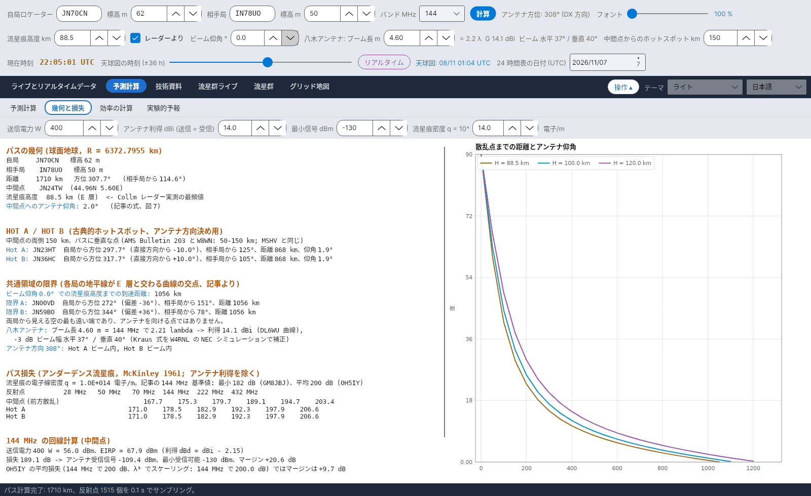

[English](Geometry-and-Path-Loss) · [Italiano](Geometry-and-Path-Loss-it) · [Deutsch](Geometry-and-Path-Loss-de) · [Nederlands](Geometry-and-Path-Loss-nl) · [Français](Geometry-and-Path-Loss-fr) · [Español](Geometry-and-Path-Loss-es) · [Português](Geometry-and-Path-Loss-pt) · [Português (Brasil)](Geometry-and-Path-Loss-pt-br) · [Dansk](Geometry-and-Path-Loss-da) · [Norsk](Geometry-and-Path-Loss-nb) · [Svenska](Geometry-and-Path-Loss-sv) · [Íslenska](Geometry-and-Path-Loss-is) · [Eesti](Geometry-and-Path-Loss-et) · [Lietuvių](Geometry-and-Path-Loss-lt) · [Latviešu](Geometry-and-Path-Loss-lv) · [Polski](Geometry-and-Path-Loss-pl) · [Čeština](Geometry-and-Path-Loss-cs) · [Русский](Geometry-and-Path-Loss-ru) · [Українська](Geometry-and-Path-Loss-uk) · [Türkçe](Geometry-and-Path-Loss-tr) · [Afrikaans](Geometry-and-Path-Loss-af) · [العربية](Geometry-and-Path-Loss-ar) · [עברית](Geometry-and-Path-Loss-he) · [اردو](Geometry-and-Path-Loss-ur) · [हिन्दी](Geometry-and-Path-Loss-hi) · [বাংলা](Geometry-and-Path-Loss-bn) · [Bahasa Indonesia](Geometry-and-Path-Loss-id) · [Tagalog](Geometry-and-Path-Loss-tl) · **日本語** · [한국어](Geometry-and-Path-Loss-ko) · [中文](Geometry-and-Path-Loss-zh)

# 幾何と損失

*タブ: 予測計算 › 幾何と損失。*

[](https://raw.githubusercontent.com/ic8tem/YA-MS/main/docs/screenshots/ja-2_2.png)

パスのテキストレポート (選択してコピーできます) と、右側のグラフ **散乱点までの距離とアンテナ仰角** です。角括弧内の番号は計算マニュアル (`doc/YA-MS_manuale_calcoli.docx`) の式番号を示します。

## このタブの入力項目

| 項目 | 既定値 | 用途 |
|---|---|---|
| **送信電力 W** | 400 | 回線計算の送信電力 |
| **アンテナ利得 dBi (送信 = 受信)** | 14 | 両端で同じアンテナ |
| **最小信号 dBm** | −130 | 最小受信可能信号 (記事: 8 エレ八木 + プリアンプ) |
| **流星痕密度 q = 10^ … 電子/m** | 14 | アンダーデンス流星痕の電子線密度 |

局、バンド、流星痕高度、ビーム仰角、ブーム長、ホットスポット距離は [操作部](Getting-Started-ja#1-3-段の操作部) から取得します。

## レポートの各セクション

| セクション | 内容 |
|---|---|
| **パスの幾何 (球面地球, R = 6372.7955 km)** | 標高付きの自局と相手局; 距離、方位と逆方位; 中間点 (ロケーターと座標); 流星痕高度 (レーダーから取得した場合は *<- Collm レーダー実測の最頻値*); 中間点へのアンテナ仰角 |
| **HOT A / HOT B (古典的ホットスポット、アンテナ方向決め用)** | それぞれについて: ロケーター、自局からの方位と直接方向からの偏差、相手局からの方位、距離、仰角 |
| **共通領域の限界** | ビーム仰角での流星痕高度までの到達距離; 方位付きの 限界 A / 限界 B |
| アンテナ | λ 単位のブーム長、利得、水平 / 垂直ビーム幅; Hot A と Hot B がビーム内かビーム外か |
| **パス損失 (アンダーデンス流星痕, McKinley 1961; アンテナ利得を除く)** | 中間点 (前方散乱)、Hot A、Hot B について 28、50、70、144、222、432 MHz の表 |
| **… MHz の回線計算 (中間点)** | 電力と EIRP、パス損失、アンテナ受信信号、最小受信可能信号、**マージン**; OH5IY の平均損失での同じマージン |
| **バンド間の経験則 (SM6FHZ, VUSHF 2025)** | 144 MHz と比較した数/強度と継続時間; IARU の最大ピング |

## ロケーターとパス

ロケーター (4、6、8 文字; グリッドの中心、IARU マイデンヘッド方式) [14]。距離、方位、中間点は半径 **r = 6372.7955 km** の球面上の大圏の式で求めます (Cerrotta–Sartori の記事) [15–16]。時刻に依存する計算は**中間点**を基準にします。最良の時刻は両端で最大 1.5 時間異なることがあるためです (SM6FHZ)。

## アンテナ仰角

**出典:** Cerrotta–Sartori の記事の式 (図 7)。x = d/r、d は反射点までの地上距離、H は流星痕高度、h は局の標高 [17]:

```
e = 90° − 57.3 · arctan[ ( r·tan x + (H − r(1 − cos x)/cos x)·sin x ) / ( H − r(1 − cos x)/cos x − h·sin x ) ]
```

**検証:** 厳密な球面幾何と 0.03° 以内で一致します。プログラムは 2 引数の逆正接を使うため、地平線の向こうでは負の値になり、記事で触れられている周期性の問題を避けられます。中間点への仰角が負の場合は *パスが1ホップの幾何学的到達距離を超えています* を意味します。

## 地平線までの到達距離

仰角 e の電波が高度 H に達する地上距離 (上の式の幾何学的な逆) [18]:

```
d_H = r · [ π/2 − e − arcsin( (r + h)·cos e / (r + H) ) ]
```

**検証:** H = 89.5 km、e = 0° → **1062 km**。記事の例 (JN44BB–IO53RT) では、図の地平線との交点は局から約 870 km にあり、これはビームを約 2° 上げた場合 (865 km) に相当します。

## 共通領域の限界

**出典:** 記事は各局の地平線が E 層と交わる曲線の交点を求めています: A と B を中心とする角半径 ρ = d_H/r の 2 つの円の交点です [19–20]:

```
p0 = cos ρ / (1 + û_A·û_B) · (û_A + û_B)
p_A,B = p0 ± sqrt( (1 − |p0|²) / |û_A × û_B|² ) · (û_A × û_B)
```

1 − |p0|² < 0 の場合、パスは 2·d_H より長く、両局には **E 層の共通領域がありません**。

**検証:** これらは両局から見える空の**最も遠い端**であり、**アンテナを向ける点ではありません**。JN70CN–IN78UO (1710 km、方位 308°) では局から 1062 km、直接方向の左右 37° にありますが、MSHV は 10° を示します。そのため *限界 A* / *限界 B* と呼び、地図上では淡く描いています。

## Hot A と Hot B

**出典:** 反射は中間点の両側 **約 50–150 km** の 2 つの領域 (「ホットスポット」) に集中します。これは AMS Bulletin No. 203 のアンテナ偏差の表の基礎であり、W8WN が取り上げています (1500 km と 1800 km のパスで偏差 10°)。LZ2HV の MSHV も同じ基準を使っています。

**選択:** Hot A と Hot B は中間点 M から距離 s、パスに垂直な点です (s = 150 km、30–400 km で調整可)。自局から相手局を見て A が左、B が右 [21]。局から見た偏差はおよそ [22]:

```
ΔAz_hot ≈ arctan( s / (D/2) )
```

**検証:** JN70CN–IN78UO、D = 1710 km: s = 100 km で 6.7°、**s = 150 km で 10.0°** (MSHV および AMS/W8WN と同じ)、s = 200 km で 13.2°。

## アンダーデンスのパス損失

**出典:** アンダーデンス流星痕に対する McKinley の式 (β = 0、sin α = 1)。アンテナ利得を除く。q = 電子線密度、r_e = 古典電子半径 = 2.818·10⁻¹⁵ m、R1、R2 は流星痕からの距離、φ は散乱角の半分 [36]:

```
L = 10·log10[ 16·π²·R1·R2·(R1 + R2)·cos²φ / ( λ³·q²·r_e² ) ]   dB
```

**検証:** 144 MHz で q = 10¹⁴ 電子/m のとき、600–2200 km で **181–192 dB**。記事の 144 MHz 基準値: **最小 182 dB** (GM8JBJ、Kaiser & Closs 1952 より) と **平均 200 dB** (OH5IY) に合っています。

## 回線計算

```
P_rx = P_tx(dBm) + G_tx − 2.15 − L + G_rx − 2.15        margin = P_rx − P_min,   P_min = −130 dBm
```

[37–38]。利得は dBi で入力し、dBd (dBi − 2.15) で使います。レポートには **OH5IY の平均損失** (144 MHz で 200 dB、選んだバンドへ λ³ でスケーリング) でのマージンも示されます。記事の基準: 約 **70 dBm の EIRP** が必要 (−130 dBm + 200 dB、例えば 14 dBi に約 400 W)。

## アンテナの利得とビーム幅

**利得 – 出典:** Günter Hoch **DL6WU** によるロング八木のブーム長 L に対する利得曲線。W8IO による紹介 (約 2 λ 以上で有効) [39]:

```
G = 7.773 · log10(L/λ) + 11.43   dBi
```

**432 MHz での L.B. Cebik W4RNL の NEC モデルとの比較** (*Appreciating DL6WU Wide-Band Long-Boom Yagi Design*; *70-CM Yagi Stacks Part 2*):

| 八木 | エレメント数 | ブーム長 (λ) | W4RNL NEC (dBi) | 式 (dBi) |
|---|---|---|---|---|
| DL6WU | 13 / 22 / 31 | 3.23 / 6.82 / 10.42 | 15.28 / 17.82 / 19.35 | 15.38 / 17.91 / 19.34 |
| VK3AUU (David Tanner) | 16 / 28 / 40 | 3.12 / 6.88 / 10.79 | 15.17 / 17.91 / 19.46 | 15.27 / 17.94 / 19.45 |

差は **0.1 dB** を超えません: 利得は設計よりもブーム長に依存します (VK3AUU 八木は同じエレメント数でブームが短い)。VK5DJ の Yagi Calculator も VK3AUU、WA2PHW、DJ9BV 各型の推定値を出しますが、その式は公表されていません。

**ビーム幅 – 出典:** Kraus の式。円形ビーム θE = θH = θK として [40]:

```
G_lin = 41253 / (θE · θH)   ⇒   θK = sqrt( 41253 / 10^(G/10) )
```

**検証:** DL6WU 八木の W4RNL の NEC モデルでは、**水平ビーム幅が Kraus より 5–10 % 狭く**なります: 12、19、26 エレで 33.8° / 26.4° / 22.6°、Kraus では 37.3° / 28.0° / 23.9°。単純な式は前方のサイドローブを無視しています (W4RNL、*Long-Boom Yagi Rules of Thumb*)。ロングブームでは垂直ビーム幅が水平よりわずかに広くなります (14 λ: 18.4° / 18.8°)。

**選択** [41]:

```
θ_horizontal = 0.93 · θK        θ_vertical = θK
```

例: 432 MHz の 14 λ 八木 → 20.3 dBi、ビーム幅 水平 18.1°、垂直 19.5°; W4RNL のモデルでは 20.4 dBi と 18.4° / 18.8°。これらは少数の DL6WU アンテナから導いた近似則です。

アンテナは常に相手局に向いているとみなします。|Az(Hot) − Az(antenna)| ≤ θ_horizontal/2 のとき、ホットスポットは**ビーム内**です: その場合 [天球図](Sky-View-ja) では灰色で描かれ、注意が表示されます。効率の計算ではアンテナは等方性とし、実際のビーム幅はこの判定にだけ使います。

## バンド間の経験則

144 MHz と比較して: 数/強度 × (144/f)³ (dB で)、継続時間 × (144/f)² (SM6FHZ、VUSHF 2025)。IARU Region 1 の最大ピング継続時間: 50 MHz で 1000 ms、70 MHz で 500 ms、144 MHz で 100 ms、432 MHz で 13 ms (VHF Handbook、記事で引用)。[実験的予報](Experimental-Forecasts-ja) も参照してください。
