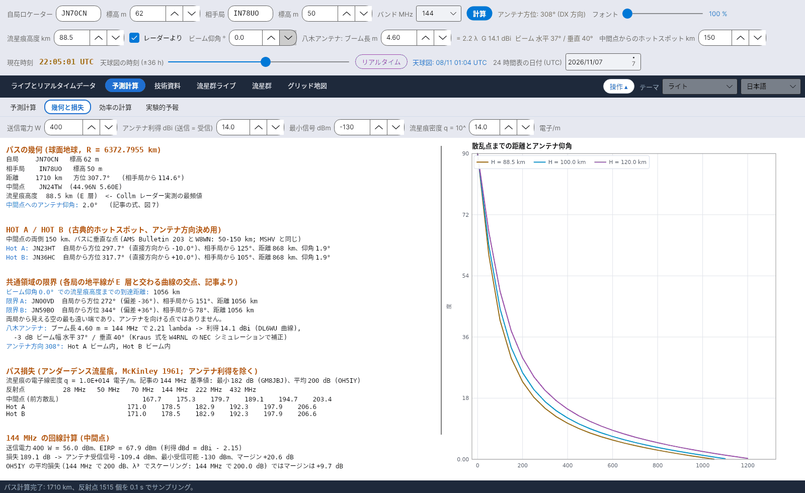

[English](Geometry-and-Path-Loss) · [Italiano](Geometry-and-Path-Loss-it) · [Deutsch](Geometry-and-Path-Loss-de) · [Nederlands](Geometry-and-Path-Loss-nl) · [Français](Geometry-and-Path-Loss-fr) · [Español](Geometry-and-Path-Loss-es) · [Português](Geometry-and-Path-Loss-pt) · [Português (Brasil)](Geometry-and-Path-Loss-pt-br) · [Dansk](Geometry-and-Path-Loss-da) · [Norsk](Geometry-and-Path-Loss-nb) · [Svenska](Geometry-and-Path-Loss-sv) · [Íslenska](Geometry-and-Path-Loss-is) · [Eesti](Geometry-and-Path-Loss-et) · [Lietuvių](Geometry-and-Path-Loss-lt) · [Latviešu](Geometry-and-Path-Loss-lv) · [Polski](Geometry-and-Path-Loss-pl) · [Čeština](Geometry-and-Path-Loss-cs) · [Magyar](Geometry-and-Path-Loss-hu) · [Română](Geometry-and-Path-Loss-ro) · [Ελληνικά](Geometry-and-Path-Loss-el) · [Русский](Geometry-and-Path-Loss-ru) · [Українська](Geometry-and-Path-Loss-uk) · [Türkçe](Geometry-and-Path-Loss-tr) · [Afrikaans](Geometry-and-Path-Loss-af) · [العربية](Geometry-and-Path-Loss-ar) · [עברית](Geometry-and-Path-Loss-he) · [اردو](Geometry-and-Path-Loss-ur) · [हिन्दी](Geometry-and-Path-Loss-hi) · [বাংলা](Geometry-and-Path-Loss-bn) · [ไทย](Geometry-and-Path-Loss-th) · [Bahasa Indonesia](Geometry-and-Path-Loss-id) · [Tagalog](Geometry-and-Path-Loss-tl) · **日本語** · [한국어](Geometry-and-Path-Loss-ko) · [中文](Geometry-and-Path-Loss-zh) · [中文 (繁體)](Geometry-and-Path-Loss-zh-tw)

# 幾何と損失

*タブ: 予測計算 › 幾何と損失。*

[](https://raw.githubusercontent.com/ic8tem/YA-MS/main/docs/screenshots/ja-2_2.png)

パスのテキストレポート (選択してコピーできます) と、右側のグラフ **散乱点までの距離とアンテナ仰角** です。角括弧内の番号は計算マニュアル (`doc/YA-MS_manuale_calcoli.docx`) の式番号を示します。

## このタブの入力項目

| 項目 | 既定値 | 用途 |
|---|---|---|
| **送信電力 W** | 400 | 回線計算の送信電力 |
| **アンテナ利得 dBi (送信 = 受信)** | 14 | 両端で同じアンテナ |
| **最小信号 dBm** | −130 | 最小受信可能信号 (記事: 8 エレ八木 + プリアンプ) |
| **流星痕密度 q = 10^ … 電子/m** | 14 | アンダーデンス流星痕の電子線密度 |

局、バンド、流星痕高度、ビーム仰角、ブーム長、ホットスポット距離は [操作部](Getting-Started-ja#1-3-段の操作部) から取得します。

## レポートの各セクション

| セクション | 内容 |
|---|---|
| **パスの幾何 (球面地球, R = 6372.7955 km)** | 標高付きの自局と相手局; 距離、方位と逆方位; 中間点 (ロケーターと座標); 流星痕高度 (レーダーから取得した場合は *<- Collm レーダー実測の最頻値*); 中間点へのアンテナ仰角 |
| **HOT A / HOT B (古典的ホットスポット、アンテナ方向決め用)** | それぞれについて: ロケーター、自局からの方位と直接方向からの偏差、相手局からの方位、距離、仰角 |
| **共通領域の限界** | ビーム仰角での流星痕高度までの到達距離; 方位付きの 限界 A / 限界 B |
| アンテナ | λ 単位のブーム長、利得、水平 / 垂直ビーム幅; Hot A と Hot B がビーム内かビーム外か |
| **パス損失 (アンダーデンス流星痕, McKinley 1961; アンテナ利得を除く)** | 中間点 (前方散乱)、Hot A、Hot B について 28、50、70、144、222、432 MHz の表 |
| **… MHz の回線計算 (中間点)** | 電力と EIRP、パス損失、アンテナ受信信号、最小受信可能信号、**マージン**; OH5IY の平均損失での同じマージン |
| **バンド間の経験則 (SM6FHZ, VUSHF 2025)** | 144 MHz と比較した数/強度と継続時間; IARU の最大ピング |

## ロケーターとパス

ロケーター (4、6、8 文字; グリッドの中心、IARU マイデンヘッド方式) [14]。距離、方位、中間点は半径 **r = 6372.7955 km** の球面上の大圏の式で求めます (Cerrotta–Sartori の記事) [15–16]。時刻に依存する計算は**中間点**を基準にします。最良の時刻は両端で最大 1.5 時間異なることがあるためです (SM6FHZ)。

## アンテナ仰角

**出典:** Cerrotta–Sartori の記事の式 (図 7)。x = d/r、d は反射点までの地上距離、H は流星痕高度、h は局の標高 [17]:

```math
e = 90^\circ - 57{.}3\,\arctan\left[\frac{r\tan x + \left(H - \frac{r(1-\cos x)}{\cos x}\right)\sin x}{H - \frac{r(1-\cos x)}{\cos x} - h\sin x}\right]
```

**検証:** 厳密な球面幾何と 0.03° 以内で一致します。プログラムは 2 引数の逆正接を使うため、地平線の向こうでは負の値になり、記事で触れられている周期性の問題を避けられます。中間点への仰角が負の場合は *パスが1ホップの幾何学的到達距離を超えています* を意味します。

## 地平線までの到達距離

仰角 e の電波が高度 H に達する地上距離 (上の式の幾何学的な逆) [18]:

```math
d_H = r\left[\frac{\pi}{2} - e - \arcsin\left(\frac{(r+h)\cos e}{r+H}\right)\right]
```

**検証:** H = 89.5 km、e = 0° → **1062 km**。記事の例 (JN44BB–IO53RT) では、図の地平線との交点は局から約 870 km にあり、これはビームを約 2° 上げた場合 (865 km) に相当します。

## 対流圏屈折（GFS）

対流圏屈折（「対流圏屈折（GFS）」のチェックボックス、起動時はオフ）。オンにすると、プログラムは Open-Meteo から両局上空の GFS モデルのプロファイル（地上と 1000〜500 hPa の各気圧面の気圧・気温・湿度、6 時間以内で最も近い時刻）を取得し、測高公式（仮温度）で各気圧面の高度を、ITU-R 勧告 P.453 の式で屈折率を求めます：

```math
N = \frac{77{.}6}{T}\left(P + \frac{4810\,e}{T}\right)
```

ここで P と e（水蒸気圧、マグヌスの式による）は hPa、T はケルビンです。最上層より上では N はスケールハイト 7.35 km で指数関数的に減少します。GFS が応答しない場合は P.453 の基準大気 N = 315·exp(−h/7.35) を使い、レポートにその旨を表示します。

電波の経路は、球面形のスネルの法則（n·r·cos e が一定）を使って薄い球殻を通して流星痕の高度まで追跡します。これにより高度 H での到達距離と仰角の補正が得られます：

```math
\Delta\varphi = \frac{k\,\Delta r}{r_m\,\bar u},\quad u = \sqrt{n^2r^2-k^2},\quad k = n_0 r_0\cos e
```

基準大気、流星痕高度 89.5 km の例：0° では到達距離が 1061.5 km から約 1133 km（+72 km）に伸び、点は 0.62° 高く見えます。4° では到達距離が 14 km 伸び、補正は 0.20° です。10° を超えると影響は無視できます。補正は中間点への仰角、共通ゾーンの半径、ホットスポット、効率マップの各点に適用され、屈折後の地平線より下の点は除外されます。レポートでは「大気屈折」の行に表示されます。

等価地球半径 k = 4/3 は、N が 1 km あたり約 40 単位減少する対流圏の最初の数 km にとどまる電波に当てはまります。高度 90 km の流星痕に向かう電波は対流圏全体を通過し、N がほぼゼロになる 10〜15 km より上ではほぼ直進します。上昇の全区間に k = 4/3 を使うと 0° での到達距離は約 1230 km となり、追跡した電波より 100 km 近く長くなります。そのためプログラムは k = 4/3 を使わず、作者の LIVETROPOVHF が対流圏伝搬で行っているように、GFS のプロファイルの中で電波を追跡します。

→ [Open-Meteo (GFS)](https://open-meteo.com/) · [ITU-R P.453](https://www.itu.int/rec/R-REC-P.453)

## 共通領域の限界

**出典:** 記事は各局の地平線が E 層と交わる曲線の交点を求めています: A と B を中心とする角半径 ρ = d_H/r の 2 つの円の交点です [19–20]:

```math
p_0 = \frac{\cos\rho}{1+\hat{u}_A\cdot\hat{u}_B}\,(\hat{u}_A+\hat{u}_B),\qquad p_{A,B} = p_0 \pm \sqrt{\frac{1-|p_0|^2}{|\hat{u}_A\times\hat{u}_B|^2}}\,(\hat{u}_A\times\hat{u}_B)
```

1 − |p0|² < 0 の場合、パスは 2·d_H より長く、両局には **E 層の共通領域がありません**。

**検証:** これらは両局から見える空の**最も遠い端**であり、**アンテナを向ける点ではありません**。JN70CN–IN78UO (1710 km、方位 308°) では局から 1062 km、直接方向の左右 37° にありますが、MSHV は 10° を示します。そのため *限界 A* / *限界 B* と呼び、地図上では淡く描いています。

## Hot A と Hot B

**出典:** 散在流星の反射は中間点の両側の 2 つの領域 (「ホットスポット」) に集中します。J. Richardson (AMS) は、DJ5HG が引用した表 (*Die Geometrie von Meteorscatterverbindungen*, 2004) で、直接方向からのアンテナ偏差を示しています: **1000 km で 13°、1250 km で 11°、1500 km と 2000 km で 10°**。W8WN が取り上げた AMS Bulletin No. 203 は、1500 km と 1800 km で 10° としています。

**選択:** Hot A と Hot B は中間点 M から距離 s、パスに垂直な点です。*auto (AMS)* にチェックを入れると (既定)、s は Richardson の表の偏差を線形補間して求めます (1000 km 未満は 13°、2000 km 超は 10°): s = (D/2)·tan(偏差)。チェックを外すと s を手入力します、30–400 km (MSHV は 150 km を使用)。自局から相手局を見て A が左、B が右 [21]。局から見た偏差はおよそ [22]:

```math
\Delta Az_{hot} \approx \arctan\frac{s}{D/2}
```

**検証:** AMS の表では、1000 km → 13°、s ≈ 115 km; 1250 km → 11°、s ≈ 121 km; 1500 km → 10°、s ≈ 132 km; 2000 km → 10°、s ≈ 176 km。JN70CN–IN78UO (1710 km) → 10°、s ≈ 151 km で、以前の値および MSHV の 150 km と同じです。短いパスでは、表によりホットスポットが中間点に近づきます。

## アンダーデンスのパス損失

**出典:** アンダーデンス流星痕に対する McKinley の式と ITU-R 勧告 P.843 (sin α = 1)。アンテナ利得を除く。q = 電子線密度、r_e = 古典電子半径 = 2.818·10⁻¹⁵ m、R1、R2 は流星痕からの距離、φ は散乱角の半分、β は流星痕とパス面のなす角、a₁ は初期半径の係数 (r₀ は m、h は km。P.843 の式 4 と 7) [36]:

```math
L = 10\log_{10}\left[\frac{16\pi^2 R_1 R_2 (R_1+R_2)\,(1-\cos^2\beta\,\sin^2\varphi)}{\lambda^3 q^2 r_e^2}\right] - 10\log_{10} a_1\ \mathrm{dB},\qquad a_1 = \exp\left(-\frac{8\pi^2 r_0^2}{\lambda^2\sec^2\varphi}\right),\qquad \log_{10} r_0 = 0{.}035\,h - 3{.}45
```

**選択:** 回線計算と損失の表では β = 90° (流星痕がパス面を横切る、最も不利な場合: 控えめな値) を使い、回線計算では最良の場合 β = 0 も表示します。r₀ は周波数ごとの平均エコー高度 h = 124 − 17 log f (P.843 の式 15) でとります: 50 MHz では 95 km で 0.76 m、144 MHz では 87 km で 0.40 m、432 MHz では 79 km で 0.21 m。1000 km のパスでは a₁ は 50 MHz で 0.2 dB、144 MHz で 0.6 dB、432 MHz で 1.4 dB (600 km では 2.9 dB) です。DJ5HG の固定高度 102 km では 432 MHz で約 70 dB となり、エコーはまったく得られません。

**検証:** q = 10¹⁴ 電子/m、流星痕高度 89.5 km、β = 0 のとき、144 MHz で 600–2100 km において **182–192 dB** (1000 km で 185 dB)。GM8JBJ が紹介している、John Worsnop **G4BAO** が博士論文で計算した **172–190 dB** の範囲に入っています。β = 90° では損失は 600 km で 10 dB、1000 km で 13 dB、2100 km で 16 dB 増えます。OH5IY の **平均 200 dB** は 2 つの場合の間にあります。GM8JBJ の表にある 182 dB は裏付けにはなりません: 表には周波数がなく、区間ごとの 86.4 dB は 1 MHz での 500 km の自由空間損失であり (20 log f の項が抜けています: 144 MHz では 129.6 dB)、項目の合計は 182 ではなく 163.8 dB です。そのページには「最小」とも「144 MHz」とも書かれていません。

## 回線計算

```math
P_{rx} = P_{tx}(\mathrm{dBm}) + G_{tx} - L + G_{rx},\qquad M = P_{rx} - P_{min},\quad P_{min} = -130\ \mathrm{dBm}
```

[37–38]。利得は dBi で入力し、そのまま dBi で使います。McKinley の損失は等方性アンテナを基準とするため、2.15 dB のダイポール補正は差し引きません (EIRP = 電力 + 利得)。レポートには **OH5IY の平均損失** (144 MHz で 200 dB、選んだバンドへ λ³ でスケーリング) でのマージンも示されます。記事の基準: 約 **70 dBm の EIRP** が必要 (−130 dBm + 200 dB、例えば 14 dBi に約 400 W)。

## アンテナの利得とビーム幅

**VE7BQH** – ブーム長 L に対する八木の利得: VE7BQH の表 のバンドごとの平均直線 (各バンド約 60 本の八木、NEC による利得)。括弧内は標本の範囲と標準偏差:

```math
\begin{aligned}50\,\mathrm{MHz}:\ & G = 7{.}36\,\log_{10}(L/\lambda) + 11{.}67\ \mathrm{dBi} \\ 144\,\mathrm{MHz}:\ & G = 8{.}27\,\log_{10}(L/\lambda) + 11{.}31\ \mathrm{dBi} \\ 432\,\mathrm{MHz}:\ & G = 8{.}68\,\log_{10}(L/\lambda) + 11{.}03\ \mathrm{dBi}\end{aligned}
```

(50 MHz: 0.3–5 λ, 0.25 dB · 144 MHz: 0.75–8.9 λ, 0.15 dB · 432 MHz: 1.8–16 λ, 0.17 dB)

最も近いバンドの直線を使う: 100 MHz 未満は 50 MHz、100～300 MHz は 144 MHz、300 MHz を超えると 432 MHz の直線 (1296 MHz では外挿)。標本の範囲外ではメインウィンドウが推定精度が低いと警告する。

DL6WU の歴史的な曲線 (VHF Communications 3/1982, 図 1): 1981 年の 432 MHz と 1296 MHz での測定、ブーム長 1 オクターブあたり 2.35 dB、公称精度 0.5 dB; G ≈ 9.2 + 7.81 log10(L/λ) dBd。W8IO は 7.773 log10(L/λ) + 11.43 dBi と記載している (差は 0.1 dB 未満)。プログラムは比較のためにこれをレポートに書く:

```math
G = 7{.}81\,\log_{10}(L/\lambda) + 11{.}35\ \mathrm{dBi}
```

**432 MHz での L.B. Cebik W4RNL の NEC モデルとの比較** (*Appreciating DL6WU Wide-Band Long-Boom Yagi Design*; *70-CM Yagi Stacks Part 2*):

| 八木 | エレメント数 | ブーム長 (λ) | W4RNL NEC (dBi) | 式 (dBi) |
|---|---|---|---|---|
| DL6WU | 13 / 22 / 31 | 3.23 / 6.82 / 10.42 | 15.28 / 17.82 / 19.35 | 15.38 / 17.91 / 19.34 |
| VK3AUU (David Tanner) | 16 / 28 / 40 | 3.12 / 6.88 / 10.79 | 15.17 / 17.91 / 19.46 | 15.27 / 17.94 / 19.45 |

差は **0.1 dB** を超えません: 利得は設計よりもブーム長に依存します (VK3AUU 八木は同じエレメント数でブームが短い)。VK5DJ の Yagi Calculator も VK3AUU、WA2PHW、DJ9BV 各型の推定値を出しますが、その式は公表されていません。

VE7BQH 平均 − DL6WU 曲線: 50 MHz では 2～16 λ で 0.25 dB 以内; 144 MHz では 1 λ で −0.04 dB から 10 λ で +0.42 dB; 432 MHz では 2 λ で −0.06 dB から 10 λ で +0.55 dB。W4RNL が 432 MHz でシミュレーションした DL6WU と VK3AUU の八木では、VE7BQH 平均は NEC より 0.15–0.55 dB 高い: 長いブームでは、コンピュータで最適化された表の八木が元の設計より性能が高い。

**ビーム幅 – 出典:** Kraus の式。円形ビーム θE = θH = θK として [40]:

```math
G_{lin} = \frac{41253}{\theta_E\,\theta_H}\quad\Rightarrow\quad \theta_K = \sqrt{\frac{41253}{10^{G/10}}}
```

**検証:** DL6WU 八木の W4RNL の NEC モデルでは、**水平ビーム幅が Kraus より 5–10 % 狭く**なります: 12、19、26 エレで 33.8° / 26.4° / 22.6°、Kraus では 37.3° / 28.0° / 23.9°。単純な式は前方のサイドローブを無視しています (W4RNL、*Long-Boom Yagi Rules of Thumb*)。ロングブームでは垂直ビーム幅が水平よりわずかに広くなります (14 λ: 18.4° / 18.8°)。

**選択** [41]:

```math
\theta_{horizontal} = 0{.}93\,\theta_K,\qquad \theta_{vertical} = \theta_K
```

例: 432 MHz の 14 λ 八木 → 20.3 dBi、ビーム幅 水平 18.1°、垂直 19.5°; W4RNL のモデルでは 20.4 dBi と 18.4° / 18.8°。これらは少数の DL6WU アンテナから導いた近似則です。

VE7BQH 平均では、同じ 14 λ の八木は 21.0 dBi、ローブは水平 16.9°、垂直 18.1° となる。上の 20.3 dBi は DL6WU 曲線による値。ローブの補正 (0.93 · θK と θK) は DL6WU 八木から導いたものをそのまま使う。

アンテナは常に DX に向けていると考えます。|Az(Hot) − Az(antenna)| ≤ θ_horizontal/2 なら hot spot は **ローブの内側** にあり、[天球図](Sky-View-ja)で灰色に描かれ、警告が出ます。垂直ローブは効率の計算にも入ります。*アンテナパターン* がオンのとき、反射点を 2 本のアンテナの垂直利得で重み付けします（幅 θ_vertical、最大はローブ仰角、大地係数で地平線では 0）。

## バンド間の経験則

144 MHz と比較して: 数/強度 × (144/f)³ (dB で)、継続時間 × (144/f)² (SM6FHZ、VUSHF 2025)。IARU Region 1 の最大ピング継続時間: 50 MHz で 1000 ms、70 MHz で 500 ms、144 MHz で 100 ms、432 MHz で 13 ms (VHF Handbook、記事で引用)。[実験的予報](Experimental-Forecasts-ja) も参照してください。
