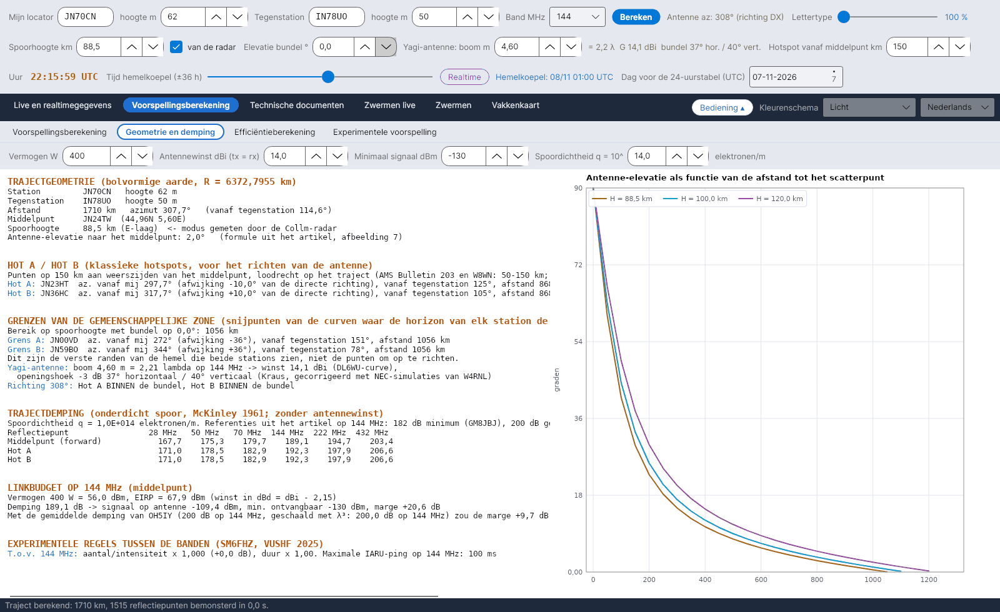

[English](Geometry-and-Path-Loss) · [Italiano](Geometry-and-Path-Loss-it) · [Deutsch](Geometry-and-Path-Loss-de) · **Nederlands** · [Français](Geometry-and-Path-Loss-fr) · [Español](Geometry-and-Path-Loss-es) · [Português](Geometry-and-Path-Loss-pt) · [Dansk](Geometry-and-Path-Loss-da) · [Norsk](Geometry-and-Path-Loss-nb) · [Svenska](Geometry-and-Path-Loss-sv) · [Íslenska](Geometry-and-Path-Loss-is) · [Eesti](Geometry-and-Path-Loss-et) · [Lietuvių](Geometry-and-Path-Loss-lt) · [Latviešu](Geometry-and-Path-Loss-lv) · [Русский](Geometry-and-Path-Loss-ru) · [Українська](Geometry-and-Path-Loss-uk) · [Türkçe](Geometry-and-Path-Loss-tr) · [Afrikaans](Geometry-and-Path-Loss-af) · [العربية](Geometry-and-Path-Loss-ar) · [עברית](Geometry-and-Path-Loss-he) · [اردو](Geometry-and-Path-Loss-ur) · [हिन्दी](Geometry-and-Path-Loss-hi) · [বাংলা](Geometry-and-Path-Loss-bn) · [Bahasa Indonesia](Geometry-and-Path-Loss-id) · [Tagalog](Geometry-and-Path-Loss-tl) · [日本語](Geometry-and-Path-Loss-ja) · [한국어](Geometry-and-Path-Loss-ko) · [中文](Geometry-and-Path-Loss-zh)

# Geometrie en demping

*Tabblad: Voorspellingsberekening › Geometrie en demping.*

[](https://raw.githubusercontent.com/ic8tem/YA-MS/main/docs/screenshots/nl-2_2.png)

Een tekstverslag van het traject (selecteerbaar, zodat je het kunt kopiëren) en rechts de grafiek **Antenne-elevatie als functie van de afstand tot het scatterpunt**. Getallen tussen haken verwijzen naar de vergelijkingen in de rekenhandleiding (`doc/YA-MS_manuale_calcoli.docx`).

## Invoer van dit tabblad

| Veld | Standaard | Gebruik |
|---|---|---|
| **Vermogen W** | 400 | Zendvermogen voor het linkbudget |
| **Antennewinst dBi (tx = rx)** | 14 | Dezelfde antenne aan beide kanten |
| **Minimaal signaal dBm** | −130 | Minimaal detecteerbaar signaal (artikel: 8-elements Yagi + voorversterker) |
| **Spoordichtheid q = 10^ … elektronen/m** | 14 | Lineaire elektronendichtheid van het onderdichte spoor |

De stations, band, spoorhoogte, bundelelevatie, boom en hotspot-afstand komen uit de [rijen bedieningselementen](Getting-Started-nl#1-de-drie-rijen-bedieningselementen).

## Onderdelen van het verslag

| Onderdeel | Inhoud |
|---|---|
| **TRAJECTGEOMETRIE (bolvormige aarde, R = 6372,7955 km)** | Station en tegenstation met hoogtes; afstand, azimut en tegenazimut; middelpunt (locator en coördinaten); spoorhoogte (*<- modus gemeten door de Collm-radar* als die van de radar komt); antenne-elevatie naar het middelpunt |
| **HOT A / HOT B (klassieke hotspots, voor het richten van de antenne)** | Voor elk: locator, azimut vanaf jou en afwijking van het directe traject, azimut vanaf het tegenstation, afstand, elevatie |
| **GRENZEN VAN DE GEMEENSCHAPPELIJKE ZONE** | Bereik op spoorhoogte met de bundelelevatie; Grens A / Grens B met azimuts |
| Antenne | Boom in λ, winst, horizontale / verticale bundel; of Hot A en Hot B binnen of buiten de bundel liggen |
| **TRAJECTDEMPING (onderdicht spoor, McKinley 1961; zonder antennewinst)** | Tabel voor het middelpunt (forward), Hot A en Hot B op 28, 50, 70, 144, 222 en 432 MHz |
| **LINKBUDGET OP … MHz (middelpunt)** | Vermogen en EIRP, trajectdemping, signaal op de antenne, minimaal detecteerbaar, **marge**; dezelfde marge met de gemiddelde demping van OH5IY |
| **EXPERIMENTELE REGELS TUSSEN DE BANDEN (SM6FHZ, VUSHF 2025)** | Aantal/intensiteit en duur vergeleken met 144 MHz; maximale IARU-ping |

## Locator en traject

Locator (4, 6 of 8 tekens; midden van het vak, IARU-Maidenheadsysteem) [14]. Afstand, azimut en middelpunt met grootcirkelformules op een bol met straal **r = 6372,7955 km** (artikel van Cerrotta–Sartori) [15–16]. Tijdsafhankelijke berekeningen verwijzen naar het **middelpunt**, omdat het beste tijdstip tussen de twee uiteinden tot 1,5 uur kan verschillen (SM6FHZ).

## Antenne-elevatie

**Bron:** formule uit het artikel van Cerrotta–Sartori (figuur 7), met x = d/r, d de grondafstand tot het reflectiepunt, H de spoorhoogte en h de stationshoogte [17]:

```math
e = 90^\circ - 57{.}3\,\arctan\left[\frac{r\tan x + \left(H - \frac{r(1-\cos x)}{\cos x}\right)\sin x}{H - \frac{r(1-\cos x)}{\cos x} - h\sin x}\right]
```

**Controle:** komt binnen 0,03° overeen met de exacte bolgeometrie. Het programma gebruikt de arctangens met twee argumenten, die voorbij de horizon negatieve waarden geeft en het periodiciteitsprobleem uit het artikel vermijdt. Een negatieve elevatie naar het middelpunt betekent *traject voorbij het geometrisch bereik van één sprong*.

## Bereik tot de horizon

Grondafstand waarop een straal met elevatie e de hoogte H bereikt (geometrische inverse van de formule hierboven) [18]:

```math
d_H = r\left[\frac{\pi}{2} - e - \arcsin\left(\frac{(r+h)\cos e}{r+H}\right)\right]
```

**Controle:** H = 89,5 km, e = 0° → **1062 km**. In het voorbeeld uit het artikel (JN44BB–IO53RT) legt de tekening de horizonsnijpunten op ongeveer 870 km van de stations, wat overeenkomt met een bundel die ongeveer 2° is opgeheven (865 km).

## Grenzen van de gemeenschappelijke zone

**Bron:** het artikel bepaalt de snijpunten van de curven waar de horizon van elk station de E-laag raakt: de snijpunten van twee cirkels met hoekstraal ρ = d_H/r rond A en B [19–20]:

```math
p_0 = \frac{\cos\rho}{1+\hat{u}_A\cdot\hat{u}_B}\,(\hat{u}_A+\hat{u}_B),\qquad p_{A,B} = p_0 \pm \sqrt{\frac{1-|p_0|^2}{|\hat{u}_A\times\hat{u}_B|^2}}\,(\hat{u}_A\times\hat{u}_B)
```

Als 1 − |p0|² < 0 is het traject langer dan 2·d_H en zien de stations **geen gemeenschappelijke zone in de E-laag**.

**Controle:** dit zijn de **verste randen** van de hemel die beide stations zien, **geen punten om op te richten**. Op JN70CN–IN78UO (1710 km, azimut 308°) liggen ze op 1062 km van het station, 37° links en rechts van het directe traject, terwijl MSHV 10° voorstelt. Daarom heten ze *Grens A* / *Grens B* en worden ze vaag op de kaart getekend.

## Hot A en Hot B

**Bron:** reflecties van sporadische meteoren concentreren zich in twee zones ("hotspots") aan weerszijden van het middelpunt. J. Richardson (AMS) geeft in de door DJ5HG aangehaalde tabel (*Die Geometrie von Meteorscatterverbindungen*, 2004) de antenne-afwijking ten opzichte van de directe richting: **13° bij 1000 km, 11° bij 1250 km, 10° bij 1500 en 2000 km**. AMS Bulletin nr. 203, overgenomen door W8WN, geeft 10° bij 1500 en 1800 km.

**Keuze:** Hot A en Hot B zijn de punten op afstand s van het middelpunt M, loodrecht op het traject. Met *auto (AMS)* aangevinkt (standaard) volgt s uit de afwijking van de tabel van Richardson, lineair geïnterpoleerd (13° onder 1000 km, 10° boven 2000 km): s = (D/2)·tan(afwijking). Niet aangevinkt wordt s met de hand ingevoerd, 30–400 km (MSHV gebruikt 150 km); A links, kijkend van jouw station naar de DX, B rechts [21]. De afwijking gezien vanaf het station is ongeveer [22]:

```math
\Delta Az_{hot} \approx \arctan\frac{s}{D/2}
```

**Controle:** met de AMS-tabel 1000 km → 13°, s ≈ 115 km; 1250 km → 11°, s ≈ 121 km; 1500 km → 10°, s ≈ 132 km; 2000 km → 10°, s ≈ 176 km. JN70CN–IN78UO (1710 km) → 10°, s ≈ 151 km, gelijk aan de eerder en door MSHV gebruikte 150 km; op korte trajecten brengt de tabel de hotspots dichter bij het middelpunt.

## Demping bij onderdichte sporen

**Bron:** de vergelijking van McKinley voor onderdichte sporen (β = 0, sin α = 1), zonder antennewinst; q = lineaire elektronendichtheid, r_e = klassieke elektronstraal = 2,818·10⁻¹⁵ m, R1, R2 afstanden tot het spoor, φ de halve verstrooiingshoek [36]:

```math
L = 10\log_{10}\left[\frac{16\pi^2 R_1 R_2 (R_1+R_2)\cos^2\varphi}{\lambda^3 q^2 r_e^2}\right]\ \mathrm{dB}
```

**Controle:** met q = 10¹⁴ elektronen/m op 144 MHz: **181–192 dB** tussen 600 en 2200 km, in lijn met de referenties uit het artikel op 144 MHz: **minimaal 182 dB** (GM8JBJ, naar Kaiser & Closs 1952) en **gemiddeld 200 dB** (OH5IY).

## Linkbudget

```math
P_{rx} = P_{tx}(\mathrm{dBm}) + G_{tx} - L + G_{rx},\qquad M = P_{rx} - P_{min},\quad P_{min} = -130\ \mathrm{dBm}
```

[37–38]. Winsten worden in dBi ingevoerd en gebruikt: de demping volgens McKinley geldt voor isotrope antennes, dus wordt er geen dipoolcorrectie van 2,15 dB afgetrokken (EIRP = vermogen + winst). Het verslag geeft ook de marge met de **gemiddelde trajectdemping van OH5IY** (200 dB op 144 MHz, met λ³ omgerekend naar de gekozen band). Referentie uit het artikel: er is ongeveer **70 dBm EIRP** nodig (−130 dBm + 200 dB, bijv. ongeveer 400 W in 14 dBi).

## Antennewinst en bundel

**Winst – bron:** de curve van Günter Hoch **DL6WU** voor lange Yagi's als functie van de boomlengte L, aangehaald door W8IO (geldig vanaf ongeveer 2 λ) [39]:

```math
G = 7{.}773\,\log_{10}(L/\lambda) + 11{.}43\ \mathrm{dBi}
```

**Controle tegen de NEC-modellen van L.B. Cebik W4RNL op 432 MHz** (*Appreciating DL6WU Wide-Band Long-Boom Yagi Design*; *70-CM Yagi Stacks Part 2*):

| Yagi | Elementen | Boom (λ) | W4RNL NEC (dBi) | Formule (dBi) |
|---|---|---|---|---|
| DL6WU | 13 / 22 / 31 | 3,23 / 6,82 / 10,42 | 15,28 / 17,82 / 19,35 | 15,38 / 17,91 / 19,34 |
| VK3AUU (David Tanner) | 16 / 28 / 40 | 3,12 / 6,88 / 10,79 | 15,17 / 17,91 / 19,46 | 15,27 / 17,94 / 19,45 |

Het verschil is nooit groter dan **0,1 dB**: de winst hangt meer af van de boomlengte dan van het ontwerp (VK3AUU-Yagi's hebben bij hetzelfde aantal elementen een kortere boom). De Yagi Calculator van VK5DJ geeft ook schattingen voor de varianten VK3AUU, WA2PHW en DJ9BV, waarvan de formules niet zijn gepubliceerd.

**Bundel – bron:** regel van Kraus, met een cirkelvormige bundel θE = θH = θK [40]:

```math
G_{lin} = \frac{41253}{\theta_E\,\theta_H}\quad\Rightarrow\quad \theta_K = \sqrt{\frac{41253}{10^{G/10}}}
```

**Controle:** de NEC-modellen van W4RNL voor DL6WU-Yagi's geven een **horizontale bundel die 5–10 % smaller is** dan volgens Kraus: 33,8° / 26,4° / 22,6° voor 12, 19 en 26 elementen, tegenover 37,3° / 28,0° / 23,9°. Eenvoudige formules negeren de voorwaartse zijlobben (W4RNL, *Long-Boom Yagi Rules of Thumb*). Bij lange booms is de verticale bundel iets breder dan de horizontale (14 λ: 18,4° / 18,8°).

**Keuze** [41]:

```math
\theta_{horizontal} = 0{.}93\,\theta_K,\qquad \theta_{vertical} = \theta_K
```

Voorbeeld: Yagi van 14 λ op 432 MHz → 20,3 dBi, bundel 18,1° horizontaal en 19,5° verticaal; de modellen van W4RNL geven 20,4 dBi en 18,4° / 18,8°. Het zijn benaderende regels, afgeleid van een paar DL6WU-antennes.

De antenne wordt altijd geacht op de DX gericht te zijn. Een hotspot ligt **binnen de bundel** als |Az(Hot) − Az(antenne)| ≤ θ_horizontal/2: hij wordt dan grijs getekend in de [Hemelkoepel](Sky-View-nl) en er verschijnt een waarschuwing. In de efficiëntieberekening zijn de antennes isotroop; de werkelijke bundel wordt alleen voor deze controle gebruikt.

## Experimentele regels tussen de banden

Vergeleken met 144 MHz: aantal/intensiteit × (144/f)³ (in dB), duur × (144/f)² (SM6FHZ, VUSHF 2025). Maximale pingduur volgens IARU Regio 1: 1000 ms op 50 MHz, 500 ms op 70 MHz, 100 ms op 144 MHz, 13 ms op 432 MHz (VHF Handbook, geciteerd in het artikel). Zie ook [Experimentele voorspelling](Experimental-Forecasts-nl).
