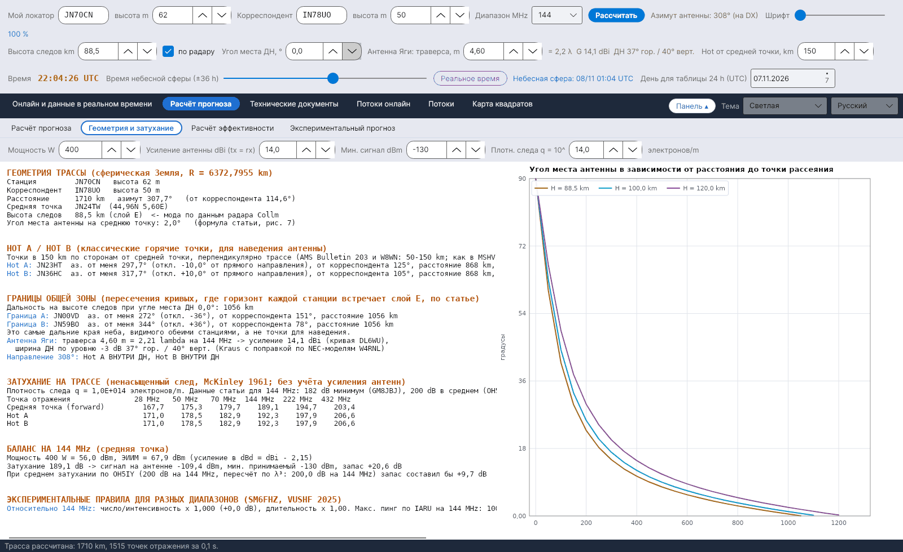

[English](Geometry-and-Path-Loss) · [Italiano](Geometry-and-Path-Loss-it) · [Deutsch](Geometry-and-Path-Loss-de) · [Nederlands](Geometry-and-Path-Loss-nl) · [Français](Geometry-and-Path-Loss-fr) · [Español](Geometry-and-Path-Loss-es) · [Português](Geometry-and-Path-Loss-pt) · [Português (Brasil)](Geometry-and-Path-Loss-pt-br) · [Dansk](Geometry-and-Path-Loss-da) · [Norsk](Geometry-and-Path-Loss-nb) · [Svenska](Geometry-and-Path-Loss-sv) · [Íslenska](Geometry-and-Path-Loss-is) · [Eesti](Geometry-and-Path-Loss-et) · [Lietuvių](Geometry-and-Path-Loss-lt) · [Latviešu](Geometry-and-Path-Loss-lv) · [Polski](Geometry-and-Path-Loss-pl) · [Čeština](Geometry-and-Path-Loss-cs) · [Magyar](Geometry-and-Path-Loss-hu) · [Română](Geometry-and-Path-Loss-ro) · [Ελληνικά](Geometry-and-Path-Loss-el) · **Русский** · [Українська](Geometry-and-Path-Loss-uk) · [Türkçe](Geometry-and-Path-Loss-tr) · [Afrikaans](Geometry-and-Path-Loss-af) · [العربية](Geometry-and-Path-Loss-ar) · [עברית](Geometry-and-Path-Loss-he) · [اردو](Geometry-and-Path-Loss-ur) · [हिन्दी](Geometry-and-Path-Loss-hi) · [বাংলা](Geometry-and-Path-Loss-bn) · [ไทย](Geometry-and-Path-Loss-th) · [Bahasa Indonesia](Geometry-and-Path-Loss-id) · [Tagalog](Geometry-and-Path-Loss-tl) · [日本語](Geometry-and-Path-Loss-ja) · [한국어](Geometry-and-Path-Loss-ko) · [中文](Geometry-and-Path-Loss-zh) · [中文 (繁體)](Geometry-and-Path-Loss-zh-tw)

# Геометрия и затухание

*Вкладка: Расчёт прогноза › Геометрия и затухание.*

[](https://raw.githubusercontent.com/ic8tem/YA-MS/main/docs/screenshots/ru-2_2.png)

Текстовый отчёт о трассе (текст можно выделить и скопировать), а справа – график **Угол места антенны в зависимости от расстояния до точки рассеяния**. Числа в квадратных скобках ссылаются на уравнения руководства по расчётам (`doc/YA-MS_manuale_calcoli.docx`).

## Входные данные этой вкладки

| Поле | По умолчанию | Назначение |
|---|---|---|
| **Мощность W** | 400 | Мощность передатчика для энергетического баланса |
| **Усиление антенны dBi (tx = rx)** | 14 | Одинаковая антенна на обоих концах |
| **Мин. сигнал dBm** | −130 | Минимальный принимаемый сигнал (статья: 8-элементная Яги + предусилитель) |
| **Плотн. следа q = 10^ … электронов/m** | 14 | Линейная электронная плотность ненасыщенного следа |

Станции, диапазон, высота следов, угол места ДН, траверса и расстояние горячих точек берутся из [рядов элементов управления](Getting-Started-ru#1-три-ряда-элементов-управления).

## Разделы отчёта

| Раздел | Содержание |
|---|---|
| **ГЕОМЕТРИЯ ТРАССЫ (сферическая Земля, R = 6372,7955 km)** | Станция и корреспондент с высотами; расстояние, азимут и обратный азимут; средняя точка (локатор и координаты); высота следов (*<- мода по данным радара Collm*, если взята с радара); угол места антенны на среднюю точку |
| **HOT A / HOT B (классические горячие точки, для наведения антенны)** | Для каждой: локатор, азимут от вас и отклонение от прямого направления, азимут от корреспондента, расстояние, угол места |
| **ГРАНИЦЫ ОБЩЕЙ ЗОНЫ** | Дальность на высоте следов при данном угле места ДН; Граница A / Граница B с азимутами |
| Антенна | Траверса в λ, усиление, горизонтальная / вертикальная ДН; находятся ли Hot A и Hot B внутри или вне ДН |
| **ЗАТУХАНИЕ НА ТРАССЕ (ненасыщенный след, McKinley 1961; без учёта усиления антенн)** | Таблица для средней точки (forward), Hot A и Hot B на 28, 50, 70, 144, 222 и 432 MHz |
| **БАЛАНС НА … MHz (средняя точка)** | Мощность и ЭИИМ, затухание на трассе, сигнал на антенне, минимальный принимаемый сигнал, **запас**; тот же запас при среднем затухании по OH5IY |
| **ЭКСПЕРИМЕНТАЛЬНЫЕ ПРАВИЛА ДЛЯ РАЗНЫХ ДИАПАЗОНОВ (SM6FHZ, VUSHF 2025)** | Число/интенсивность и длительность относительно 144 MHz; максимальный пинг по IARU |

## Локатор и трасса

Локатор (4, 6 или 8 символов; центр квадрата, система IARU Maidenhead) [14]. Расстояние, азимут и средняя точка – по формулам дуги большого круга на сфере радиусом **r = 6372,7955 km** (статья Cerrotta–Sartori) [15–16]. Расчёты, зависящие от времени, относятся к **средней точке**, потому что лучшее время на двух концах трассы может различаться до 1,5 часа (SM6FHZ).

## Угол места антенны

**Источник:** формула статьи Cerrotta–Sartori (рис. 7), где x = d/r, d – расстояние по земле до точки отражения, H – высота следов, h – высота станции [17]:

```math
e = 90^\circ - 57{.}3\,\arctan\left[\frac{r\tan x + \left(H - \frac{r(1-\cos x)}{\cos x}\right)\sin x}{H - \frac{r(1-\cos x)}{\cos x} - h\sin x}\right]
```

**Проверка:** совпадает с точной сферической геометрией в пределах 0,03°. Программа использует арктангенс двух аргументов, который даёт отрицательные значения за горизонтом и устраняет проблему периодичности, упомянутую в статье. Отрицательный угол места на среднюю точку означает, что *трасса длиннее геометрической дальности одного скачка*.

## Дальность до горизонта

Расстояние по земле, на котором луч с углом места e достигает высоты H (геометрическая обратная формула к приведённой выше) [18]:

```math
d_H = r\left[\frac{\pi}{2} - e - \arcsin\left(\frac{(r+h)\cos e}{r+H}\right)\right]
```

**Проверка:** H = 89,5 km, e = 0° → **1062 km**. В примере статьи (JN44BB–IO53RT) на рисунке точки пересечения горизонта находятся примерно в 870 km от станций, что соответствует ДН, поднятой примерно на 2° (865 km).

## Границы общей зоны

**Источник:** в статье определяются пересечения кривых, где горизонт каждой станции встречает слой E: точки пересечения двух окружностей углового радиуса ρ = d_H/r с центрами в A и B [19–20]:

```math
p_0 = \frac{\cos\rho}{1+\hat{u}_A\cdot\hat{u}_B}\,(\hat{u}_A+\hat{u}_B),\qquad p_{A,B} = p_0 \pm \sqrt{\frac{1-|p_0|^2}{|\hat{u}_A\times\hat{u}_B|^2}}\,(\hat{u}_A\times\hat{u}_B)
```

Если 1 − |p0|² < 0, трасса длиннее 2·d_H, и у станций **нет общей зоны слоя E**.

**Проверка:** это **самые дальние края** неба, видимого обеими станциями, **а не точки для наведения**. На трассе JN70CN–IN78UO (1710 km, азимут 308°) они находятся в 1062 km от станции, на 37° слева и справа от прямого направления, тогда как MSHV предлагает 10°. Поэтому они называются *Граница A* / *Граница B* и рисуются на карте бледно.

## Hot A и Hot B

**Источник:** отражения от спорадических метеоров концентрируются в двух зонах («горячих точках») по обе стороны от средней точки. J. Richardson (AMS) в таблице, которую цитирует DJ5HG (*Die Geometrie von Meteorscatterverbindungen*, 2004), даёт смещение антенны от прямого направления: **13° при 1000 km, 11° при 1250 km, 10° при 1500 и 2000 km**. AMS Bulletin No. 203, использованный W8WN, даёт 10° при 1500 и 1800 km.

**Выбор:** Hot A и Hot B – точки на расстоянии s от средней точки M, перпендикулярно трассе. При отмеченном *auto (AMS)* (по умолчанию) s получается из смещения по таблице Richardson с линейной интерполяцией (13° ниже 1000 km, 10° выше 2000 km): s = (D/2)·tan(смещение). Без отметки s вводится вручную, от 30 до 400 km (MSHV использует 150 km); A – слева, если смотреть от вашей станции на корреспондента, B – справа [21]. Смещение, видимое со станции, примерно равно [22]:

```math
\Delta Az_{hot} \approx \arctan\frac{s}{D/2}
```

**Проверка:** по таблице AMS 1000 km → 13°, s ≈ 115 km; 1250 km → 11°, s ≈ 121 km; 1500 km → 10°, s ≈ 132 km; 2000 km → 10°, s ≈ 176 km. JN70CN–IN78UO (1710 km) → 10°, s ≈ 151 km, то же, что 150 km, использовавшиеся раньше и в MSHV; на коротких трассах таблица приближает горячие точки к средней точке.

## Затухание на ненасыщенных следах

**Источник:** уравнение McKinley и Рекомендация ITU-R P.843 для ненасыщенных следов (sin α = 1), без учёта усиления антенн; q – линейная электронная плотность, r_e – классический радиус электрона = 2,818·10⁻¹⁵ m, R1, R2 – расстояния до следа, φ – половина угла рассеяния, β – угол между следом и плоскостью трассы, a₁ – множитель начального радиуса, r₀ в m и h в km (P.843, ур. 4 и 7) [36]:

```math
L = 10\log_{10}\left[\frac{16\pi^2 R_1 R_2 (R_1+R_2)\,(1-\cos^2\beta\,\sin^2\varphi)}{\lambda^3 q^2 r_e^2}\right] - 10\log_{10} a_1\ \mathrm{dB},\qquad a_1 = \exp\left(-\frac{8\pi^2 r_0^2}{\lambda^2\sec^2\varphi}\right),\qquad \log_{10} r_0 = 0{.}035\,h - 3{.}45
```

**Выбор:** в энергетическом балансе и таблице затуханий используется β = 90° (след пересекает плоскость трассы, наименее благоприятный случай: осторожное значение), а баланс показывает также лучший случай, β = 0. r₀ берётся на средней высоте эха для данной частоты, h = 124 − 17 log f (P.843, ур. 15): 0,76 m на 95 km для 50 MHz, 0,40 m на 87 km для 144 MHz, 0,21 m на 79 km для 432 MHz. На 1000 km a₁ составляет 0,2 dB на 50 MHz, 0,6 dB на 144 MHz и 1,4 dB на 432 MHz (2,9 dB на 600 km); при фиксированной высоте 102 km у DJ5HG было бы около 70 dB на 432 MHz, то есть никакого эха.

**Проверка:** при q = 10¹⁴ электронов/m, следах на 89,5 km и β = 0, на 144 MHz: **182–192 dB** на расстояниях от 600 до 2100 km (185 dB на 1000 km), в пределах диапазона **172–190 dB**, рассчитанного John Worsnop **G4BAO** в его диссертации PhD, как сообщает GM8JBJ. При β = 90° затухание растёт на 10 dB на 600 km, на 13 dB на 1000 km и на 16 dB на 2100 km; **200 dB в среднем** у OH5IY лежат между двумя случаями. 182 dB в таблице GM8JBJ не являются подтверждением: в таблице не указана частота, её 86,4 dB на участок – это затухание в свободном пространстве на 500 km при 1 MHz (нет члена 20 log f: 129,6 dB на 144 MHz), а её статьи в сумме дают 163,8 dB, а не 182; на странице нет ни «минимум», ни «144 MHz».

## Энергетический баланс

```math
P_{rx} = P_{tx}(\mathrm{dBm}) + G_{tx} - L + G_{rx},\qquad M = P_{rx} - P_{min},\quad P_{min} = -130\ \mathrm{dBm}
```

[37–38]. Усиления вводятся и используются в dBi: затухание по McKinley относится к изотропным антеннам, поэтому дипольная поправка 2,15 dB не вычитается (ЭИИМ = мощность + усиление). Отчёт также даёт запас при **среднем затухании по OH5IY** (200 dB на 144 MHz, пересчитанные по λ³ на выбранный диапазон). Ориентир из статьи: нужно около **70 dBm ЭИИМ** (−130 dBm + 200 dB, например, около 400 W на антенну 14 dBi).

## Усиление и ДН антенны

**Усиление – источник:** кривая Günter Hoch **DL6WU** для длинных Яги в зависимости от длины траверсы L, по W8IO (справедлива примерно от 2 λ) [39]:

```math
G = 7{.}773\,\log_{10}(L/\lambda) + 11{.}43\ \mathrm{dBi}
```

**Проверка по NEC-моделям L.B. Cebik W4RNL на 432 MHz** (*Appreciating DL6WU Wide-Band Long-Boom Yagi Design*; *70-CM Yagi Stacks Part 2*):

| Яги | Элементов | Траверса (λ) | W4RNL NEC (dBi) | Формула (dBi) |
|---|---|---|---|---|
| DL6WU | 13 / 22 / 31 | 3,23 / 6,82 / 10,42 | 15,28 / 17,82 / 19,35 | 15,38 / 17,91 / 19,34 |
| VK3AUU (David Tanner) | 16 / 28 / 40 | 3,12 / 6,88 / 10,79 | 15,17 / 17,91 / 19,46 | 15,27 / 17,94 / 19,45 |

Расхождение нигде не превышает **0,1 dB**: усиление зависит от длины траверсы больше, чем от конструкции (у Яги VK3AUU траверса короче при том же числе элементов). Yagi Calculator от VK5DJ также даёт оценки для вариантов VK3AUU, WA2PHW и DJ9BV, формулы которых не опубликованы.

**ДН – источник:** правило Kraus для круговой ДН θE = θH = θK [40]:

```math
G_{lin} = \frac{41253}{\theta_E\,\theta_H}\quad\Rightarrow\quad \theta_K = \sqrt{\frac{41253}{10^{G/10}}}
```

**Проверка:** NEC-модели W4RNL для Яги DL6WU дают **горизонтальную ДН на 5–10 % уже**, чем по Kraus: 33,8° / 26,4° / 22,6° для 12, 19 и 26 элементов против 37,3° / 28,0° / 23,9°. Простые формулы не учитывают боковые лепестки в передней полусфере (W4RNL, *Long-Boom Yagi Rules of Thumb*). На длинных траверсах вертикальная ДН немного шире горизонтальной (14 λ: 18,4° / 18,8°).

**Выбор** [41]:

```math
\theta_{horizontal} = 0{.}93\,\theta_K,\qquad \theta_{vertical} = \theta_K
```

Пример: Яги 14 λ на 432 MHz → 20,3 dBi, ДН 18,1° по горизонтали и 19,5° по вертикали; модели W4RNL дают 20,4 dBi и 18,4° / 18,8°. Это приближённые правила, выведенные по нескольким антеннам DL6WU.

Антенна всегда считается направленной на DX. Hot spot находится **внутри лепестка**, если |Az(Hot) − Az(антенна)| ≤ θ_horizontal/2: тогда он рисуется серым в [Небесная сфера](Sky-View-ru) и появляется предупреждение. Вертикальный лепесток входит и в расчёт эффективности: при включённом флажке *диаграмма антенны* точки отражения взвешиваются вертикальным усилением обеих антенн (ширина θ_vertical, максимум на угле места лепестка, множитель земли до нуля у горизонта).

## Экспериментальные правила для разных диапазонов

Относительно 144 MHz: число/интенсивность × (144/f)³ (в dB), длительность × (144/f)² (SM6FHZ, VUSHF 2025). Максимальная длительность пинга по IARU Region 1: 1000 ms на 50 MHz, 500 ms на 70 MHz, 100 ms на 144 MHz, 13 ms на 432 MHz (VHF Handbook, по статье). См. также [Экспериментальный прогноз](Experimental-Forecasts-ru).
