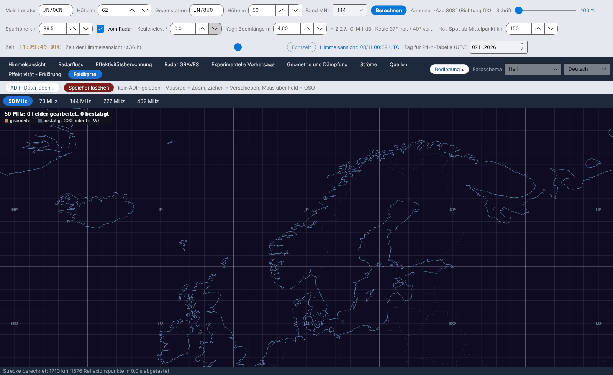

[English](Grid-Square-Map) · [Русский](Grid-Square-Map-ru) · **Deutsch** · [日本語](Grid-Square-Map-ja)

# Feldkarte

*Reiter 10.*

Die Maidenhead-Felder (4 Zeichen), die du **gearbeitet** und **bestätigt** hast, gelesen aus der ADIF-Datei deines Logs, auf einer Europakarte – **ein Unterreiter pro Band: 50, 70, 144, 222 und 432 MHz**.

## Bedienelemente

| Bedienelement | Was es tut |
|---|---|
| **ADIF-Datei laden...** | Liest eine Datei `.adi` / `.adif`. Eine neue ADIF-Datei **ersetzt** die bisherigen Daten. |
| **Speicher löschen** | Löscht alle aus der ADIF-Datei geladenen Felder (fragt nach Bestätigung). |
| Maus | **Mausrad = Zoom, Ziehen = Verschieben, Maus über Feld = QSO** (bis zu sechs Rufzeichen mit Datum, *(bestätigt)*, wenn bestätigt) |

Nach dem Laden zeigt der Status *… QSOs gelesen, … QSO-Felder in den Bändern 50-432 MHz, … QSOs verworfen (andere Bänder oder ohne Feld)*. Jede Bandkarte trägt die Beschriftung *… Felder gearbeitet, … bestätigt*.

| Farbe | Bedeutung |
|---|---|
| Orange | gearbeitet |
| Grün | bestätigt (QSL oder LoTW) |

## Wie die ADIF-Datei gelesen wird

- Verwendete Felder: `CALL`, `GRIDSQUARE`, `VUCC_GRIDS`, `BAND`, `FREQ`, `QSO_DATE`, `QSL_RCVD`, `LOTW_QSL_RCVD` (ADIF-Spezifikation).
- Band aus `BAND` oder aus der Frequenz: 50–54 MHz = 6 m, 69,9–71,5 MHz = 4 m, 144–148 MHz = 2 m, 219–225 MHz = 1,25 m, 420–450 MHz = 70 cm.
- Ein Feld gilt als **bestätigt**, wenn mindestens ein QSO darin `QSL_RCVD = Y` oder `LOTW_QSL_RCVD = Y` hat.
- Die Felder bleiben in `data/adif_quadrati.csv` gespeichert, bis du eine andere Datei lädst oder **Speicher löschen** drückst.

YA-MS verbindet sich **nicht** mit LoTW: Exportiere die ADIF-Datei aus deinem Logprogramm (oder aus LoTW) und lade sie hier.
