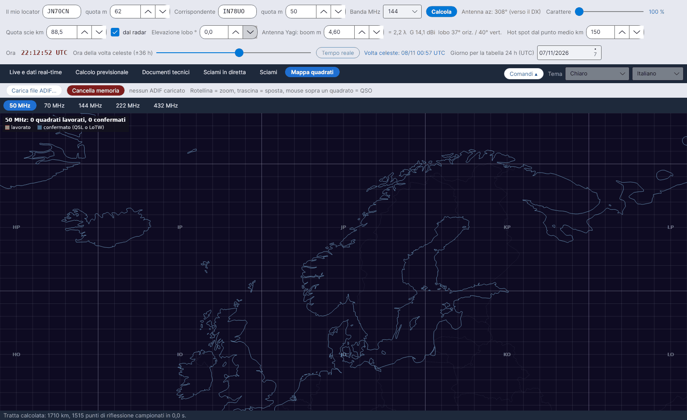

[English](Grid-Square-Map) · **Italiano** · [Deutsch](Grid-Square-Map-de) · [Nederlands](Grid-Square-Map-nl) · [Français](Grid-Square-Map-fr) · [Español](Grid-Square-Map-es) · [Português](Grid-Square-Map-pt) · [Português (Brasil)](Grid-Square-Map-pt-BR) · [Dansk](Grid-Square-Map-da) · [Norsk](Grid-Square-Map-nb) · [Svenska](Grid-Square-Map-sv) · [Íslenska](Grid-Square-Map-is) · [Eesti](Grid-Square-Map-et) · [Lietuvių](Grid-Square-Map-lt) · [Latviešu](Grid-Square-Map-lv) · [Polski](Grid-Square-Map-pl) · [Čeština](Grid-Square-Map-cs) · [Magyar](Grid-Square-Map-hu) · [Română](Grid-Square-Map-ro) · [Ελληνικά](Grid-Square-Map-el) · [Русский](Grid-Square-Map-ru) · [Українська](Grid-Square-Map-uk) · [Türkçe](Grid-Square-Map-tr) · [Afrikaans](Grid-Square-Map-af) · [العربية](Grid-Square-Map-ar) · [עברית](Grid-Square-Map-he) · [اردو](Grid-Square-Map-ur) · [हिन्दी](Grid-Square-Map-hi) · [বাংলা](Grid-Square-Map-bn) · [ไทย](Grid-Square-Map-th) · [Bahasa Indonesia](Grid-Square-Map-id) · [Tagalog](Grid-Square-Map-tl) · [日本語](Grid-Square-Map-ja) · [한국어](Grid-Square-Map-ko) · [中文](Grid-Square-Map-zh) · [中文 (繁體)](Grid-Square-Map-zh-TW)

# Mappa quadrati

*Linguetta: Mappa quadrati.*

I quadrati Maidenhead (4 caratteri) che hai **lavorato** e **confermato**, letti dal file ADIF del tuo log, su una mappa d'Europa – **una sotto-linguetta per banda: 50, 70, 144, 222 e 432 MHz**.

## Comandi

| Comando | Che cosa fa |
|---|---|
| **Carica file ADIF...** | Legge un file `.adi` / `.adif`. Un nuovo ADIF **sostituisce** i dati precedenti. |
| **Cancella memoria** | Cancella tutti i quadrati caricati dall'ADIF (chiede conferma). |
| Mouse | **Rotellina = zoom, trascina = sposta, mouse sopra un quadrato = QSO** (fino a sei nominativi con la data, *(confermato)* se confermato) |

Dopo il caricamento lo stato mostra *… QSO letti, … quadrati-QSO nelle bande 50-432 MHz, … QSO scartati (altre bande o senza quadrato)*. Ogni mappa di banda ha la didascalia *… quadrati lavorati, … confermati*.

| Colore | Significato |
|---|---|
| Arancione | lavorato |
| Verde | confermato (QSL o LoTW) |

## Come si legge l'ADIF

- Campi usati: `CALL`, `GRIDSQUARE`, `VUCC_GRIDS`, `BAND`, `FREQ`, `QSO_DATE`, `QSL_RCVD`, `LOTW_QSL_RCVD` (specifica ADIF).
- Banda da `BAND`, oppure dalla frequenza: 50–54 MHz = 6 m, 69,9–71,5 MHz = 4 m, 144–148 MHz = 2 m, 219–225 MHz = 1,25 m, 420–450 MHz = 70 cm.
- Un quadrato è **confermato** se almeno un QSO al suo interno ha `QSL_RCVD = Y` oppure `LOTW_QSL_RCVD = Y`.
- I quadrati restano in `data/adif_quadrati.csv` finché non carichi un altro file o premi **Cancella memoria**.

YA-MS **non** si collega a LoTW: esporta l'ADIF dal tuo programma di log (o da LoTW) e caricalo qui.
